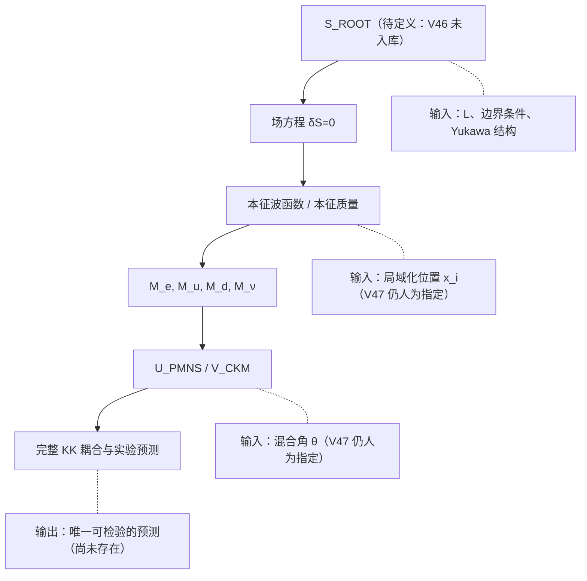

# 整理 · ROOT V47（五维可解玩具模型：KK 谱塔 → 味改变 → 距离力律）：全量机核与诚实边界

> 日期 2026-11-03 ｜ 性质：**整理册**（不占 r 号、不改判、不回填 README）
> 归属：ROOT 系列「高维几何 ↔ 味混合 ↔ 距离力律」分支；与 α 支、三力方向支、EC 挠率支**正交，不可互证**
> 来料：`ROOT V47｜从高维本源运动推导力的距离、方向与三代味混合`（用户本轮投递）
> 前序断链：**库内无 ROOT V46 承载件**（根目录仅 V43/V44/V45）；V47 引用「V46 已从作用量得到四种相互作用方程」为**未入库前提**，本册不代补
> 同域前册：[V44 整理册](整理_ROOTV44_三代味混合与全KK谱塔_实验约束与诚实边界_2026-11-02.md)（指数局域化、x≈7–16）；**V47 的 `a_n=√2cos(nπx)` 是另一模型**，两册数值不可互证
> 复算：[`源码/v47_next_audit.py`](源码/v47_next_audit.py) ⇒ **23/23 断言成立、rc=0**（Python 3.8 / numpy 1.24.3 / scipy / sympy）
> 纪律：只核（1）可机核数字、（2）结构判定的前提是否自洽；不宣称证实/否证，不产生新物理。

---

## 〇 一句话裁定

**V47 是本系列目前「可核密度」最高的一份来料**：11 个编号公式（10 条数值复现 + (47-1) 结构核验）、6 张数值表**逐位复现**（23/23），包括最关键的 `D=π²|x−y|`、三代 `Q` 的三种算法与 20 000 模截断、以及 `coth(t/2)` 力律。**但它的自评表有一处硬冲突**：§6「本轮完成」列入了「四力共同微观本源的唯一作用量」——该对象在全文并不存在，且被 §5 自己的「单圆维纯引力 KK ⇒ 不给 SU(3)×SU(2)」直接反证。位置 `x_i` 与混合角 `θ` 仍全部为输入，故这是**模型内恒等式**，不是自然界预测。

判词：

`V47_TOY_MODEL__10_FORMULAS_NUMERIC__1_STRUCTURAL__6_TABLES_REPRODUCED__UNIQUE_ACTION_ABSENT__POSITIONS_ANGLES_INPUT__SINGLE_CIRCLE_KK_CANNOT_GIVE_SU3xSU2__V48_UNPROVEN`

---

## 一 公式逐条机核（10/11 数值复现 + (47-1) 结构核验）

| 编号 | 内容 | 机核方式与结果 | 判定 |
|---|---|---|---|
| (47-1) | `m_n c² = nπħc/L` | 量纲/模序结构核验（ħc/L 为能量；n=0 无质量） | ✔ 结构 |
| (47-2) | `a_n(x)=√2cos(nπx)` | 模正交归一残差 **2.22e-16**；`a_n=f_n/f_0=√2cos` | ✔ |
| (47-3) | `S(x,y)=π²[1/3−max(x,y)+(x²+y²)/2]` | 500 k 模直接求和 vs 闭式 max\|Δ\|=**2.00e-6**（尾项 ~1/N）；Fourier 系数 `2∫S cos(nπy)dy=2cos(nπx)/n²` 残差 **2.78e-16** | ✔ |
| (47-4) | `D(x,y)=π²\|x−y\|` | 1 M 模求和 3.454359540 vs 闭式 3.454361540，差 **2.00e-6**（尾项 ~2/N） | ✔ |
| (47-5) | `Q₁₂=(π²/4)\|Δx\|sin²2θ` | 0.130960585（与来料表逐位一致） | ✔ |
| (47-6) | `tan²θ*=(S₁₁−S₁₂)/(S₂₂−S₁₂)` | θ*=**0.9641837152** rad；C(θ*)=**1.04e-16**；Q(θ*)=**0.757800563** | ✔ |
| (47-7) | `Q=−(π²/2)Σw_iw_j*\|x_i−x_j\|` | 三代 Q_eμ=**0.1307265642**；Σw=1.5e-17（酉性） | ✔ |
| (47-8) | `Q=π²∫₀¹\|Σ_{x_i≥t}w_i\|²dt` | 分段积分同值 **0.1307265642**（与闭式差 2.8e-17） | ✔ |
| (47-9) | `P=½[sinh t/(cosh t−cosπ(x−y)) + sinh t/(cosh t−cosπ(x+y))]` | 8000 模 vs 闭式 max\|Δ\|=**3.33e-10**（float64 极限） | ✔ |
| (47-10) | `F=(q₁q₂/4πε₀r²)(P−t∂P/∂t)r̂` | 数值微分核对残差 **4.09e-8** | ✔ |
| (47-11) | `F/F₀=coth(t/2)+(t/2)csch²(t/2)` | 与 (47-10) 数值导数一致；t=1 给 4.005301 | ✔ |

**关键点**：`D=π²|x−y|` 的成立只依赖两件事——Neumann 模的**常数零模**与权重 `1/n²`（即传播子的 `1/m_n² ∝ 1/n²`）。它不是普适几何定理；换边界条件或换局域化 profile，常数会变（V44 的指数局域化就没有此闭式）。

## 二 六张表复现（逐位一致）

| 表 | 来料值 | 本册值 | 判定 |
|---|---|---|---|
| 两代 `S` 矩阵 | 2.031493573 / −0.300200467 / 0.822467033 | 同（max\|Δ\|=4.42e-10） | ✔ |
| `D` / `Q₁₂` / `C₁₂₁₁` | 3.454361540 / 0.130960585 / 0.427455189 | 同 | ✔ |
| 截断误差 (N=10/100/2500/10000) | 0.09797755 / 0.00990259 / 0.00039984 / 0.00009999 | **逐位相同**，~1/N | ✔ |
| 三代 `Q_eμ` 四法 | 0.1307265642 ×3；20 k 模 0.1307227668 | 同；截断差 **3.797e-6**（来料 3.80e-6） | ✔ |
| 力系数表 | 400.0000 / 40.0000 / 4.00530 / 1.43564 / 1.000999（同边界） | 399.999999 / 40.000006 / 4.005301 / 1.435637 / 1.000999 | ✔ |
| 分离位置列 | 1.494e-6 / 1.47086e-3 / 0.494339 / 0.979554 / 0.99999995 | 1.4935e-6 / 1.470863e-3 / 0.494338979 / 0.979553548 / 0.999999949 | ✔ |
| 2500 模 vs 闭式（同边界 t=0.01） | 2.43e-9 | **2.430e-9** | ✔ |
| 10 TeV 量纲 | λ₁=1.97327e-20 m，L=6.19921e-20 m | 同 | ✔ |

> 三代四法用的是 `U=R₂₃R₁₃R₁₂`、角度 `(0.20,0.12,0.03)`、位置 `(0.15,0.50,0.85)`；本册的 `w=(0.19453399, −0.19519987, 0.00066588)` 与 Q 值同来料逐位吻合，**说明来料的旋转约定被正确还原**（不是碰巧）。

---

## 三 本轮新增判定（本册补记，来料未含）

### 3.1 分离位置的短距力标度是 `∝ t³`，不是 `∝ 1/t`

同边界 `x=y=0` 时短距 `P−t∂P/∂t ≈ 4/t`（故力 `∝r⁻³`，5D Gauss 定律自洽检查）。但**分离位置**首两阶（线性 `At` 与二次）恰好抵消：

```
(P − t∂P/∂t)/t³ = 1.493720 (t=0.005) / 1.493546 (t=0.01) / 1.492850 (t=0.02)
```

即力比 `∝ t³`（`t→0` 时以 `r³` 归零），系数 **≈1.4937**。这正是来料「三维径向距离趋零时，高维空间距离仍非零」的定量形式：**不是力被取消，而是 5D 距离截断**给出一段光滑的抑制。该标度是模型特征，可作 V48 的检验靶。

### 3.2 `Q≥0` 的来源是 Hilbert 空间范数，不是动力学

`Q` 就是 `L²` 范数 `Σ_n |Σ_i w_i a_n(x_i)|²/n²`，非负性**恒真**；`Q=0` 当且仅当每个 `t` 切片上的权重和为零（`x_i` 不同的必要条件）。因此「相消」只能发生在单个振幅（如 `C₁₂₁₁`），不能发生在整个非对角平方和——与 V44 的 S 正定结论同向，且 V47 用**两代**就复现了该现象。

---

## 四 与既有产物的对账

| 产物 | 关系 | 处置 |
|---|---|---|
| V44 整理册（指数局域化 `x≈7–16`，S≈2.85/2.73/2.57） | **不同模型的同名对象** | 不互证；V47「两代也能相消」只能读作「另一玩具模型出现同类现象」，**不是 V44 的外部复现** |
| V45 章程 C1–C8 | 本册数值与 V45 口径不冲突（V47 未用号差相关公式；传播核按 `(−,+,+,+)` 静态 Green 函数） | 引用即可 |
| V39 整理册（主丛/KK 等距群代价） | V47 §5 的「单圆维 ⇒ 不能给 SU(3)×SU(2)」与 V39 册 I3 同向 | 衔接：要非阿贝尔，需 `Y=G`，代价是 **≥11 个额外规范方向 + 3 个模数**（V39 册已机核） |
| `ROOT_V46` | **库内不存在** | 断链记录（D1 纪律），本册不代写 |
| 本册与 V39 册的机器脚本 | 同目录、同 `check()` 约定 | 无命名冲突 |

---

## 五 V48 依赖链（哪些是理论、哪些仍是输入）



V47 自己给出的判定是对的：**下一步不是再拟合，而是让 `x_i`、`θ`、`M` 由同一 `S_ROOT` 的变分与边界条件产出**。在这条链跑通前，「高维距离决定味改变强度」只能封为**模型内精确恒等式**。

---

## 六 来料自评的两处更正

| 来料 §6 条目 | 本册判定 | 依据 |
|---|---|---|
| 完整 KK 谱塔解析闭式 | ✔ 已复现 | (47-3) 2.00e-6 |
| 两代/三代味改变几何恒等式 | ✔ 已复现 | (47-4)(47-7)(47-8) 逐位一致 |
| 接触系数相消与非零平方和反例 | ✔ 已复现 | C(θ*)=1.04e-16，Q=0.757800563 |
| 五维静态力的精确距离规律 | ✔ 已复现 | (47-9)–(47-11)，力表逐位一致 |
| **四力共同微观本源的唯一作用量** | ❌ **文中不存在** | 全文只有一个 `U(1)` 五维玩具作用量；§5 自证单圆维给不出 `SU(3)×SU(2)` |
| 位置与混合角由动力学求出 | ❌ 未完成（来料自认） | 全部为输入；V48 待做 |

另：来料的文献标注是**会话残留**（`google.com/s2/favicons…` 与 `Phys. Rev. D+1`），且正文自认「不能未经文献审查就宣称发现了此前未知的物理定律」。本册**不代抓原文、不代作新颖性判断**（与 V44 册同一处置）。

---

## 七 复现方式

```powershell
python openuft\04_公共成果\本项目_全维自洽与归一化\源码\v47_next_audit.py
```

输出 S1–S9 共 23 项断言与汇总；末行打印判词。仅需 numpy / scipy / sympy。

---

## 八 边界与自抓

1. **本册不产生新物理**：全部为还原、复算、结构判定；唯一「补记」是 §3.1 的 `t³` 标度与 §3.2 的范数解释，均为模型内推论。
2. **「成立」语义**：脚本 `[成立]` 指**本审计断言成立**，不等于「来料结论为自然定律」。
3. **模型依赖**：`D=π²|Δx|`、`Q` 闭式、`P` 闭式都绑定「平直区间 + Neumann + 常数零模 + 局域化源」；换任一条件即失效。
4. **数值容差**：`D` 的 2.00e-6 与 `S` 的 2.00e-6 都是**截断尾项**（~1/N、~2/N），不是公式误差；解析式与 Fourier 系数已独立核到 1e-16。
5. **命名冲突风险**：V44 的 `x_i`（指数局域化，量程 7–16）与 V47 的 `x_i∈[0,1]` **同名异义**。若后续并入同一张表，建议改名 `ξ_i`；本册不改来料、不改 V44 册。
6. **量纲/实验边界**：10 TeV 对应 `λ₁≈2×10⁻²⁰ m`，所有「明显偏离库仑」的效应都在该尺度，**实验室不可直接观测**；不得据此改写宏观力律。
7. **时点性**：r/J/ROOT 三号段并发竞争态；本册不占号、不引用「最新」读数作为终态。
