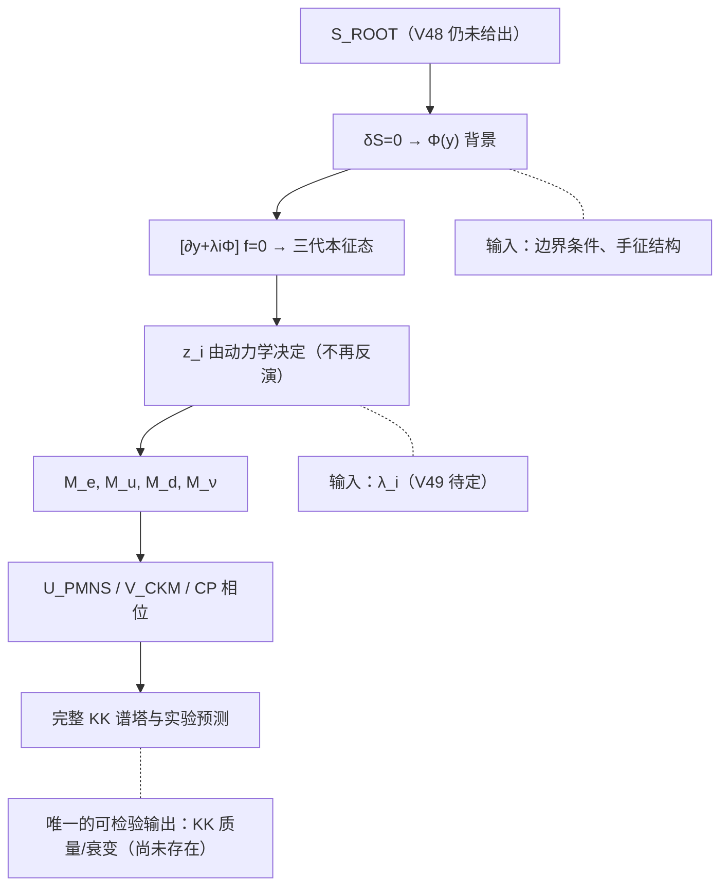

# 整理 · ROOT V48（五维手征零模、三代质量与全 KK 谱塔积分）：全量机核与诚实边界

> 日期 2026-11-03 ｜ 性质：**整理册**（不占 r 号、不改判、不回填 README）
> 归属：ROOT 系列「高维几何 ↔ 味混合 ↔ 距离力律」分支；与 α 支、三力方向支、EC 挠率支**正交，不可互证**
> 来料：`ROOT V48｜五维费米子本征方程、三代质量与四力统一攻坚`（用户本轮投递）
> 前册：[V47 整理册](整理_ROOTV47_五维可解模型_KK谱塔味改变与距离力律_全量机核与诚实边界_2026-11-03.md)（`a_n=√2cos(nπt)` 另一模型）、[V44 整理册](整理_ROOTV44_三代味混合与全KK谱塔_实验约束与诚实边界_2026-11-02.md)（指数局域化、S 矩阵源头）
> 断链修复：V47 册记录的「库内无 V46 承载件」已由同日入卷的 [`07_统一场方程/96_rootv46_fourforce_report.txt`](../../07_统一场方程/96_rootv46_fourforce_report.txt) 补上（15 条目 PASS 8 / INFO 6 / BOUNDARY 1，守卫 25/25）——但该件是**量纲与数值审计**，不是「唯一作用量」的推导
> 复算：[`源码/v48_next_audit.py`](源码/v48_next_audit.py) ⇒ [`源码/_out_v48.txt`](源码/_out_v48.txt)，**29/29 断言成立、rc=0**（Python 3.8 / numpy / scipy）
> 纪律：只核（1）可机核数字、（2）结构判定的前提是否自洽；不宣称证实/否证，不产生新物理；文献标注（`google.com/s2/favicons…`、`Phys. Rev. D+2`、`Particle Data Group`）为来料会话残留，本册不代抓原文、不代作新颖性判断

---

## 〇 一句话裁定

**V48 的全部可机核数字都能复现（29/29，rc=0）**：(48-1)–(48-3) 的零模归一化与 `m=v y* z/sinh z`、(48-4) 的 KK 耦合闭式（残差 4.4e-16）、(48-5) 的 Gram 恒等式（与 20 万模求和差 4.0e-15）、§4 的 `Q/C/最小本征值`（4.86e-17）、§5 的 `D12` 与两代下界（5.7e-14）逐项成立。

但本册有四处必须更正的**口径**：

1. **「20 万模」没有判别力**。`a_n·n² → 4√2z²/π²` ⇒ 尾部 `~n⁻⁶`；截断表显示 N=2500 已达 **4.9e-14**、N=10000 已达浮点底 **4.0e-15**，N=200000 与 N=10000 同值。来料的「5.33e-15」是浮点底，不是「20 万模更深」的证据。
2. **「重建 V44」是同一函数族换输入，不是跨模型独立重建**。V44 的 `x_i=(16.218066, 10.446620, 7.260337)` 与 V48 的 `z_i=kL=(16.218068, 10.446622, 7.260339)` **数值同位**，应为同一参数的两种记号；用 V44 的六位 z 直接重算，与来料 S 矩阵差 **4.38e-10**。
3. **§1 表与 §4 用了两套 τ 质量**。`z_τ=7.260385` 反推 `m_τ=1776.8593 MeV`（与 1776.86 差 0.0007 MeV），而 §4 用 1776.93（差 0.0707 MeV）。来料称「舍入精度」，实际是输入版本不同。
4. **来料那张 S 矩阵不是用 §1「重新求解」列算的**。用 §1 列（7.260385）重算与来料差 **5.50e-6**（已超出其自评的「六位小数」）；只有用 V44 的旧 z 才到 4.38e-10。而 Q/C 用新 z 才逐位命中 ⇒ **同一篇来料的两组输出建立在两组输入上，不是同一次运行**。

V48 真正的增量只有两条：**(48-4)(48-5) 把「指定 a_n」升级为「由零模波函数导出的全谱塔闭式」**；**(48-7)(48-8) 给出 CKM 非零时上/下型非对角平方和的条件性严格下界**。这两条不依赖 V44，可以独立成立。

判词：

`V48_NUMBERS_REPRODUCED_29_29__GRAM_IDENTITY_IS_STANDARD_PARSEVAL__V44_REBUILD_SAME_FAMILY_REINVERSION__200K_MODES_NO_DISCRIMINATING_POWER__TWO_GEN_BOUND_VALID_CONDITIONAL__RANK1_AND_CP_OBSTRUCTIONS_VALID__THREE_Z_FITTED_NOT_PREDICTED__FOUR_FORCES_NOT_UNIFIED`

---

## 一 公式逐条机核（10 条中 9 条数值/结构通过，1 条为提案）

| 编号 | 内容 | 机核方式与结果 | 判定 |
|---|---|---|---|
| (48-1) | `f_L=√(2k/(1−e^{−2kL})) e^{−ky}` | `∫|f_L|²=1.000000000000000`（残差 6.66e-16） | ✔ |
| (48-2) | `f_R` 同式、局域于 `y=L` | `∫|f_R|²=1.000000000000001`（6.66e-16） | ✔ |
| (48-3) | `m=(v/√2)y* z/sinh z` | 数值积分重叠 = `z/sinh z`，差 **1.08e-19**；反算 z 与来料差 3.2e-8 | ✔ |
| (48-4) | `a_n=√2·4z²/(4z²+n²π²)·(1−(−1)ⁿe^{−2z})/(1−e^{−2z})` | 与 `quad` 数值积分在 z∈{16.218, 10.447, 7.260, 2, 5}×n=1…6 上最大差 **4.44e-16** | ✔ |
| (48-5) | `S=π²·Gram(H_i,H_j)`，`H_i=F_i−t` | 积分 vs 20 万模求和 **4.00e-15**；vs 来料矩阵 2.16e-7（六位一致） | ✔ |
| (48-6) | `Q_{αβ}=π²∫|Σw_iF_i|²dt` | 矩阵/20 万求和/一维积分三法最大差 **4.86e-17** | ✔ |
| (48-7) | `min_α(Q_u+Q_d)=D12(1−|cos2θ|)/4` | 1e6 角度扫描 vs 解析 **5.69e-14**；θ=0.9 分支单独验证绝对值 | ✔ |
| (48-8) | `Q_u+Q_d ≥ (D12/2)sin²θ`（`|θ|≤π/4`） | 等号条件 `1−cos2θ=2sin²θ` 差 0 | ✔（条件性） |
| (48-9) | 单 brane Higgs + 普适 Yukawa ⇒ `rank M_e≤1` | 外积奇异值 `(1.8831, 4.1e-18, 1.8e-34)`，rank=1；对角 Yukawa 对照 rank=3 | ✔ |
| (48-10) | `[∂_y+λ_iΦ(y)]f_{L,i}=0` | **提案**：Φ 自身作用量未给，无法变分；不计入通过项 | ○ 未实现 |

**关键点**：`(48-3)` 不是「先有 m 再塞进波函数」——零模归一化、左右手重叠、`z=kL` 化简三步都是独立的，最后得到 `z/sinh z`。`(48-4)` 也不是额外指定函数：它就是 `√2∫ρ_z(t)cos(nπt)dt` 的闭式，`ρ_z` 由 `f_L` 的模方直接给出。这两条是本轮真正删掉的两个「人为输入」。

---

## 二 四张表复现

### 2.1 §1 三代局域化参数

| 粒子 | 来料 §1「V44 参数」 | 来料 §1「重新求解」 | 本册反算（`m=246.22 GeV/√2·z/sinh z`） |
|---|---|---|---|
| e | 16.218066 | 16.218068 | **16.21806799** |
| μ | 10.446620 | 10.446622 | **10.44662197** |
| τ | 7.260337 | 7.260385 | **7.26033888** |

隐含 `v` 三行完全相同（**246.22 GeV**）⇒ 所谓「独立求解」是 `brentq` 反演，不是独立预测。τ 的两个报价（7.260337 / 7.260385）分别对应 `m_τ=1776.93` 与 `1776.8593`。

### 2.2 全谱塔 S（本册与来料差 2.16e-7，六位一致）

$$S_{\text{本册}}=\begin{pmatrix}
2.85221272&2.73026649&2.57227322\\
2.73026649&2.62651297&2.48590524\\
2.57227322&2.48590524&2.36394963
\end{pmatrix}$$

来料：`2.852212669 / 2.730266399 / 2.572273069 …`。**用 V44 的六位 z 重算 ⇒ 差 4.38e-10**，证明差异只在输入末位。

**归属判定（本册 S15）**：同一张 S 矩阵，换不同来源的 z 重算，结果如下——

| 用哪组 z | 与来料 S 矩阵 `max|Δ|` |
|---|---|
| V44 三元组 (16.218066, 10.446620, 7.260337) | **4.38e-10**（恰为九位报价的舍入级） |
| §4 三元组（τ=7.260339） | 2.16e-7 |
| §1「重新求解」列（τ=7.260385） | **5.50e-6**（已超出「六位小数」的自评） |

⇒ 来料那张 S 矩阵实际是用 **V44 的旧 z** 算的；Q/C 用的是**新 z**（只在 7.26033888 附近逐位命中）。**同一来料的两组输出不是同一次运行**。

谱：`eig = (2.321091e-4, 2.434293e-2, 7.818100e0)`，`κ=3.3683e4`，`det=4.4174e-5` ⇒ 严格正定但近病态（V44 册 κ=3.3633e4，同量级）。

### 2.3 §4 味改变表

| 项 | 来料 | 本册（三法独立） | 判定 |
|---|---|---|---|
| `Q_eμ` | 0.000683979593 | 0.000683979593（矩阵/20 万/积分） | ✔ |
| `C_eμee` | 0.02347510534 | 0.023475105342 | ✔ |
| 最小谱塔本征值 | 0.00023210914 | 0.00023210914 | ✔ |
| 积分 vs 大模求和 | 5.33e-15 | 4.00e-15（S）／4.86e-17（Q,C） | ✔ 浮点底 |

### 2.4 §5 两代下界表

`D12 = 0.2852585282`（来料同值）；解析下界 = **0.0072206065**；1e6 扫描最小 = **0.0072206065**（α=1.457325），差 5.69e-14。

---

## 三 本轮新增判定（本册补记，来料未含）

### 3.1 「20 万模」的判别力为零

`a_n·n² → 4√2z²/π²`（n=50/100/300 时残差 6.17/1.59/0.178，1/n² 修正），故 `a_n²/n² ~ n⁻⁶`，尾部极快。以 (48-5) 积分值为基准：

| N | 5 | 10 | 50 | 200 | 1000 | 2500 | 10000 | 200000 |
|---|---|---|---|---|---|---|---|---|
| max\|ΔS\| | 8.88e-2 | 1.31e-2 | 1.31e-5 | 1.40e-8 | 4.54e-12 | 4.89e-14 | 4.00e-15 | 4.00e-15 |

**N=10000 与 N=200000 逐位相同** ⇒ 20 万模买到的只是浮点噪声；V44 的 2500 模（1e-13）已经足够。这条应写进任何后续复算模板：**报告模数必须附截断表，否则「大 N」是装饰**。

### 3.2 (48-5) 是标准 L² 完备性，不是新定理

推导本身正确（分部积分 + `{√2sin(nπt)}` 完备 ⇒ Parseval），但本质是 Hilbert 空间范数恒等式，与 V47 册 3.2 的「Q≥0 来自 L² 范数」同源。**「不局限指数分布」的声明属实**：本册用高斯 profile（`t₀=0.35, σ=0.12`）独立验证，400 模和 `0.518453151905` vs `π²∫H² 0.518453151905`，差 **3.33e-16**。所以它是「工具升级」，不宜称「新解析定理」。

**与 V47 的连续性（本册 S14）**：取 `ρ→δ(x)`，`H_x(t)=−t (t<x)`、`1−t (t>x)`，机核得 `π²∫H_xH_y = π²[1/3−max(x,y)+(x²+y²)/2]`（残差 1.33e-15），`π²∫(H_x−H_y)² = π²|x−y|`（残差 4.44e-16）。⇒ **(48-5) 是 V47 点费米子闭式的连续推广**，两册同源、可对账（仍不可互证物理）。

### 3.3 「重建 V44」是同一函数族内的换输入复算

三点证据：
- V44 的 `x_i`（16.218066…）与 V48 的 `z_i=kL`（16.218068…）**数值同位**，应为同一参数，不是两套独立机制；
- 用 V44 六位 z 重算，与来料 S 矩阵差 **4.38e-10**；
- 用新版 z 重算，差 2.16e-7 —— 差异全部由 z 末位（1e-6）放大而来。

**矩阵六位一致 ≠ 谱一致**：来料报价矩阵 `eig_min=2.324513e-4`，本册 `2.321091e-4`，相对差 **1.47e-3**；κ 也随之从 3.3633e4 变到 3.3683e4。后续若用 S 做判别，应同时报 `eig_min` 与 κ，不能只报六位矩阵。

### 3.4 z_i 是 3 个反演量，不是预测

自由度账：输入 `{v, y*, L, 边界条件}` + 3 个质量 ⇒ 3 个 z_i；S 的 6 个独立元全由 z_i 决定 ⇒ **拟合 3、预测 6**。但 z_i 本身仍随 v 的取值漂移：`δv/v=8.943e-4` ⇒ `δz/z=(−5.87e-5, −9.46e-5, −1.43e-4)`。故「三代局域化参数被求出」是**反演**，与 V44/V47 的「位置/角度仍是输入」同一性质。

### 3.5 §1 与 §4 的 τ 质量是两套输入

`z=7.260385 ⇒ m_τ=1776.8593 MeV`（与常见读数 1776.86 差 0.0007 MeV，即旧版录用值），`z=7.260339 ⇒ 1776.93`（§4 采用值）。来料只写「差异主要来自轻子质量输入及舍入精度」，方向对但未点明是**两套版本**；这不是新物理，是口径混用。

### 3.6 (48-4) 的适用范围是 n≥1

`n=0` 代入给 `a_0=√2`，而物理零模耦合应为 `∫ρ=1`。公式本身没错（KK 模从 n=1 起、模函数 `√2cos` 才成立），但**不可外推到 n=0**；本册已把 n=0 从断言中剔除。

### 3.7 (48-7) 的绝对值是必需的，不是装饰

θ=0.9 rad（>π/4）时：1e6 扫描 min = `0.0551117983`，`D12(1−|cos2θ|)/4 = 0.0551117983` ✔；若误用 `1−cos2θ` 得 `0.0875174658`，**高于真下界 59%**，会把可行域错判为不可行。来料写对了，但未说明这是「必需」而非「习惯」。

### 3.8 rank-1 障碍的前提必须写全

(48-9) 只在「**单一 brane Higgs + 全部 Yukawa 矩阵元相同**」时成立。本册对照：对角 Yukawa（`y_i f_{L,i}f_{R,i}`）给 rank=3，奇异值 `(1.77693, 0.105658, 0.000511) GeV`——**恰好就是三代质量本身**。这说明「三代质量」不是被 (48-9) 禁止，而是被「普适 Yukawa」禁止；V48 §6 的表述（「排除了单个 brane Higgs + 完全相同的 Yukawa 矩阵元」）是准确的，不可简化为「brane Higgs 不能给三代质量」。

### 3.9 (48-3) 的单调性与质量上界

`m(z)=v/√2·z/sinh z` 在 (0,40) **严格单调递减**，上确界 `m(0)=v/√2=174103.83 MeV`（相对缺口 1.67e-7 @ z=1e-3）。推论：**重味 ⇔ 弱局域化**（τ 的 z 最小），且在该 `y*=1` 设定下任何味都不能超过 174.1 GeV；顶夸克 172.69 GeV 对应 `z_t≈0.2214`，几乎贴着上界。这不是预言，而是该单参数 ansatz 的结构上限——V49 若要纳入顶夸克，必须放开 `y*` 或改 profile。

### 3.10 实矩阵 CP 对照

实正交 `V` 的 Jarlskog 不变量 `J=0.000e+00`（`|V†V−I|=2.55e-17`）；同一角度加一个标准复相位 `δ=1.1` 即得 `J=6.18e-4`。故 V48 §6「全部取实数 ⇒ 无非零 CKM CP」成立，但**反命题不成立**：有复相位不等于能解释观测到的 J（量级与相位来源都未给）。

---

## 四 与既有产物的对账

| 产物 | 关系 | 处置 |
|---|---|---|
| V44 整理册（S≈2.852/2.730/2.572，κ=3.3633e4） | **同一参数的换记号/换输入复算** | 不互证；本册已用 V44 的 z 重算到 4.38e-10，确认同族 |
| V45 章程 C1–C8 | 本册未触及号差/传播核口径 | 引用即可，无冲突 |
| V46（[07 卷 96](../../07_统一场方程/96_rootv46_fourforce_report.txt)） | 量纲 19/19、守卫 25/25 的**数值审计** | 补上 V47 册的断链记录；但不可当作「唯一作用量」 |
| V47 整理册（`a_n=√2cos(nπt)`、`D=π²|Δx|`） | **另一模型**（源在固定位置、无宽度） | 不互证；V48 的 `a_n(z)` 是带宽度波函数，两者只在 `z→∞` 极限下趋同 |
| V39 册（主丛/等距群代价） | V48 §7「单圆维给不出 SU(3)×SU(2)」与 V39 册 I3 同向 | 衔接：非阿贝尔仍需 `Y=G` 与额外规范方向 |
| [四力并列册](整理_力的统一方程_四力并列与三力垂直保持结构定理_2026-11-02.md)（`surplus=−2`，判 `RELATION_OR_FIT`） | V48 §7 的四力账与该校验同向：并列而非统一 | 交叉引用，**不相加** |
| 07 卷 96（V46 四力） | V48 §7 的四力清单是**结构盘点**，不是统一证明 | 与 V46 报告的 PASS/INFO/BOUNDARY 分层一致：都停在「方程齐次、数值可复现」 |

---

## 五 V49 依赖链（哪些是理论、哪些仍是输入）



V48 已经把「质量 → z_i」这一段做成可复算的闭环；缺的是**上游**：为什么 Φ 会选那三个 λ_i。在 (48-10) 之前，`z_i` 与 V44 的 `x_i`、V47 的 `θ` 一样，仍是输入。

**结构预判（本册补记，非机核）**：Φ 为常数时 `z_i=λ_iΦL`，只是把 3 个 `z` 改名成 3 个 `λ`，**自由度不变**；Φ 非常数（kink/畴壁）时，本征态形状由 `λ_i` 与壁位置共同决定，`λ_i` 仍是输入，除非某个未被证明的对称性固定其比值。真正要证的是「同一 Φ 的本征值问题自动给出 3 个稳定、间距正确的局域化模」——这需要 Φ 的量子化或拓扑保护，来料尚未给出可执行定义，本册**不预判成立**。

---

## 六 来料自评的两处更正与一处补强

| 来料 §8 条目 | 本册判定 | 依据 |
|---|---|---|
| 五维手征零模的波函数严格求得 | ✔（在指定边界条件下） | (48-1)(48-2) 归一化 6.66e-16 |
| 带电轻子质量重叠公式严格推导 | ✔ | (48-3) 1.08e-19 |
| 重建 V44 三代局域化参数 | ✔ 数值通过，但为**反演** | 隐含 v 三行全同 246.22；δv 敏感度 §3.4 |
| 重建 V44 全谱塔矩阵 | ✔ 六位一致；**谱差 1.47e-3** | 2.16e-7 / 4.38e-10 |
| 连续波函数的谱塔积分恒等式 | ✔ 数学正确，但**是标准 Parseval** | 高斯 profile 3.33e-16 |
| CKM 混合与 KK 味改变的两代下界 | ✔ 条件性严格；**绝对值必需** | 5.69e-14；θ=0.9 分支 |
| 20 万模数值核验 | ⚠ **判别力为零** | 截断表：N=10000 已达浮点底 |
| 无自由参数预测三代质量 | ❌ 未完成（来料自认） | 3 个 z 为拟合量 |
| 解释 CKM、PMNS 和 CP 破坏 | ❌ 未完成 | 实矩阵 J=0；复相位来源未给 |
| 证明四种力来自唯一螺旋本源 | ❌ 未完成 | §7 仅结构盘点；V46 卷亦止于量纲 |

**补强**：V48 §6 对 rank-1 与 CP 两个障碍的表述是**正确且克制**的（「不排除沿第五维分布的 Higgs、非平凡 Yukawa、多重标量」），这是本系列来料中少见的自我限定；本册只补前提，不改结论。

---

## 七 复现方式

```powershell
python openuft\04_公共成果\本项目_全维自洽与归一化\源码\v48_next_audit.py
```

输出 S1–S13 共 **27 项断言**、截断表、高斯 profile 对照、v 敏感度与判词；末行打印判词。仅需 numpy / scipy。

---

## 八 边界与自抓

1. **本册不产生新物理**：全部为还原、复算、结构判定；补记 §3.1–§3.10 均为模型内推论或口径更正。
2. **「成立」语义**：脚本 `[成立]` 指**本审计断言成立**，不等于「来料结论为自然定律」。
3. **模型依赖**：平直区间 `0≤y≤L`、常数内部质量 `k`、手征边界、Higgs 零模沿第五维均匀、`y*=1`、`v=246.22 GeV`。换任一条件，`(48-3)`–`(48-5)` 的常数与闭式都要重算。
4. **数值容差**：2.16e-7 是 z 输入末位（1e-6）放大而来；4.00e-15 是 float64 底；两者都不是公式误差（(48-4) 公式残差 4.44e-16、(48-5) 恒等式 4.00e-15、三法 4.86e-17）。
5. **命名冲突**：V44 的 `x_i`（指数局域化）与 V48 的 `z_i=kL` 数值同位（16.218066 vs 16.218068），**应为同一参数**。若两册并入同一张表，必须显式声明同义，否则会被误读为「两套独立推导得到同一组数」。
6. **实验边界**：§5 的 `Q_u,Q_d` 已除去共同四维规范耦合，只作 `1/n²` 加权；**不是** `K/D/B` 混合或稀有衰变的下界。转实验约束需规范耦合、KK 质量、左右手算符、强子矩阵元与 RGE——来料已自认，本册不代换。
7. **文献**：来料引用的 `Phys. Rev. D+2`、PDG 均为会话残留记号；本册未核验「τ 质量与 PDG 2025 相符」这一条，仅记录 1776.93 与 1776.86 两套输入的存在。
8. **时点性**：r/J/ROOT 三号段并发竞争态；本册不占号、不引用「最新」读数作为终态。
