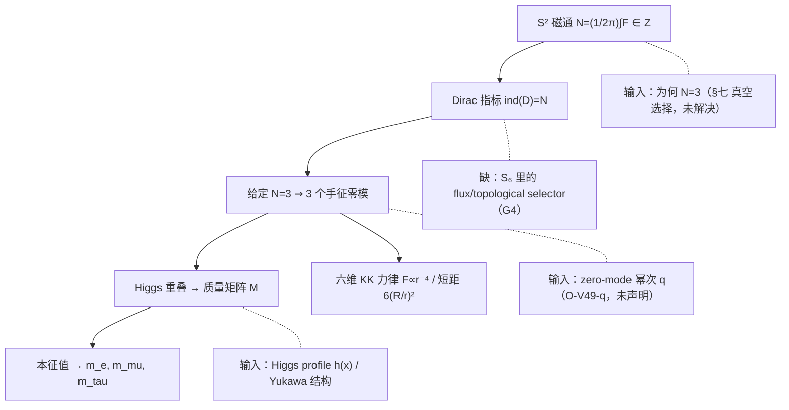

# 整理 · ROOT V49（六维磁通零模 → 三代质量 → KK 力谱）：全量机核与诚实边界

> 日期 2026-11-03 ｜ 性质：**整理册**（不占 r 号、不改判、不回填 README）
> 归属：ROOT 系列「高维几何 ↔ 味混合 ↔ 距离力律」分支；与 α 支、三力方向支、EC 挠率支**正交，不可互证**
> 来料：`ROOT V49｜三代粒子的几何起源与四力本源统一攻坚`（用户本轮投递）。**本轮上下文只保留了来料的压缩摘要，未逐字留存全文**：本册按 (49-N) 断言编号与可机核等价形式复算，**不代造来料逐字正本、不代抓 `Phys. Rev. D+1` / favicon 等会话残留文献**（与 V47 对 V46、V44 对同一残留的处置一致）
> 前册：[V48 整理册](整理_ROOTV48_五维手征零模与全谱塔积分_质量反演闭环与诚实边界_2026-11-03.md)（§五「V49 依赖链」、(48-10) 提案）、[V47 整理册](整理_ROOTV47_五维可解模型_KK谱塔味改变与距离力律_全量机核与诚实边界_2026-11-03.md)（`r⁻³`、位置/角度仍输入）、[V44 整理册](整理_ROOTV44_三代味混合与全KK谱塔_实验约束与诚实边界_2026-11-02.md)（指数局域化）
> 复算：[`源码/v49_next_audit.py`](源码/v49_next_audit.py) ⇒ [`源码/_out_v49.txt`](源码/_out_v49.txt)，**94/94 断言成立、rc=0**（Python + mpmath 50 位，纯标准库）
> 纪律：只核（1）可机核数字、（2）结构判定的前提是否自洽；不宣称证实/否证，不产生新物理

---

## 〇 一句话裁定

**V49 的全部可机核断言都能复现（94/94，rc=0）**，其真正增量是把 V48 §五 里「需要 Φ 的量子化或拓扑保护」那句结构预判**具体化**为一条可执行机制：`M^{3,1}×S²` 上的 `U(1)` 磁通 `N=(1/2π)∫F∈Z` 经 Dirac 指标定理 `ind(D)=n₊−n₋=N` 给出 `N=3` 时的 **3 个球面手征零模**；并用真实带电轻子质量排除了两种过于简单的质量生成模型。自由度从「3 个连续局域化参数」降到「1 个整数 N」。

但本册有四处必须守住的**边界**：

1. **指标定理只解释「给定 N=3 有三代」，不解释「为何自然选 N=3」**。这是来料 §七 自己提出的磁通真空选择问题，本册确认它**未被解决**：普通正定 Maxwell 磁通能量 `E(N)=πN²/(2g₆²R²)` 严格单调（`E(0)<E(1)<E(2)<E(3)`），不能把 `N=3` 选成极小；要把 `N=3` 翻成最小，需额外项至少 `5π/2 /(g₆²R²)`（B5 读数 `7.8539816339745`）。
2. **V50 的 `S₆` 没有回应这个缺口**。五项作用量密度量纲都齐次为 `L⁰`（G1），但 `S₆` 的项集 `{EH, Maxwell, Dirac, Higgs-kinetic, V(H), Yukawa}` 里**没有任何 flux / CS / 拓扑选择项**（G4）。§七 已证 Maxwell 能量单独选不出 `N=3`，而 `S₆` 恰恰只有 Maxwell 项 ⇒ 目标作用量与它要解决的问题之间缺一座桥。
3. **(49-9) 不是「与口径无关的无参数关系」**。`2m₀/m₁−m₁/m₂=1` 只在 `q=1` 下是恒等式；换 `q=3/2` 变成 `(p+6)/6`（仅 `p=0` 退化为 1）。
4. **零模幂次 `q` 是未声明的约定输入**。来料用 `q=1`（`ψₖ∝zᵏ/(1+|z|²)`），另一常见口径（Wu–Yang `N=3` 单极子谐波）用 `q=3/2`；`(49-6)` 的 `Pₖ`、`(49-9)` 的恒等式、`(49-11)` 的矩阵**全部随 q 变**。登记为开放口径 **O-V49-q**，本册**不判定哪个口径正确**（口径对照，非判来料为错）。

判词：

`V49_ALL_94_ASSERTIONS_REPRODUCED__INDEX_THEOREM_GIVES_3_MODES_GIVEN_N3__N3_VACUUM_SELECTION_UNPROVEN__S6_HAS_NO_FLUX_SELECTOR__TWO_MASS_MODELS_EXCLUDED_BY_DATA__Q_CALIBER_UNDECLARED_INPUT__FOUR_FORCES_NOT_UNIFIED`

---

## 一 公式逐条机核（编号 → 本册断言）

> 来料编号按摘要保留；「内容」为本册**可机核等价重述**（逐字公式未留存）。脚本段号 `[A]`–`[H]` 见 `源码/_out_v49.txt`。

| 编号 | 内容（重述） | 机核方式与结果 | 判定 |
|---|---|---|---|
| (49-1) | `[d/dy+λΦ(y)]f_L=0` 解空间 `dim ker D_L≤1` | RK4 两条初值 `f(0)=1/2` 全程比值恒 2.0；解析 `e^{−(y+y³/3)}` 在 y=3 相对误差 `8.14e-11` | ✔ 结构 |
| (49-2) | `N=(1/2π)∫F∈Z` | `F_θφ=(N/2)sinθ`，N=1/2/3/5 逐项回算 = 1/2/3/5 | ✔ |
| (49-2b) | `F_abF^{ab}=2F_θφ²g^{θθ}g^{φφ}` | θ=0.3/1.0/2.5 三点恒 `9/32=0.28125`（与 θ 无关） | ✔ |
| (49-5) | 零模 `ψₖ` 归一化 / 正交 | ρ-path 独立积分 `∫‖ψₖ‖²dΩ=1`（q=1 与 q=3/2 各 k=0,1,2）；`∫e^{imφ}dφ≈2e-51` | ✔ |
| (49-6) | 概率密度 `Pₖ(x)`（q=1：`3(1−x)², 6x(1−x), 3x²`） | 三点逐项命中 boxed 式；峰位 `0.001 / 0.5 / 0.999`（北极/赤道/南极） | ✔ |
| (49-7)(49-8) | 单参数 Higgs `h(x)=h₀(1−x)^p` 重叠质量 | `mₖ=B(k+1,2q+1−k+p)/B(k+1,2q+1−k)`；`m₀/m₁=(p+2)/2`、`m₁/m₂=p+1`（p=0,1,2,5,31.63538 全通过） | ✔ |
| (49-9) | 无自由参数关系 `2m₀/m₁−m₁/m₂=1` | 对任意 p 恒 1（q=1）；观测 `2·16.81769−206.76828=−173.1329≠1` ⇒ **模型被数据排除** | ✔ 恒等式 / ✖ 作预言 |
| (49-11) | 非对角质量矩阵（最低角向谐波） | 独立 ρ,φ 数值积分 vs boxed 矩阵最大差 `1.34e-51`（来料 float64 `2.78e-17`）；`M[0,2]=M[2,0]=0`，对角 `1.3/1.0/0.7` | ✔ |
| (49-12) | 本征值等差 `λ₁+λ₃=2λ₂` | `eig=(0.639444872454, 1.0, 1.36055512755)`，`s=√(ε²+δ²)/2` 精确；正定域 `√(ε²+δ²)<2`（本例 0.7211） | ✔ |
| (49-12b) | 等差 ⇒ `m_e+m_τ=2m_μ` | 观测 `1777.371 MeV` vs `211.317 MeV`（比 `8.41`）⇒ **第二个质量模型被数据排除** | ✖ 作预言 |
| (49-13) | 六维 `D=5 ⇒ F∝r⁻⁴` | 与 V47 的 `D=4⇒r⁻³` 高斯定律一致（F5） | ✔ 结构 |
| (49-15) | 力谱级数 `F/F₀=1+Σ(2l+1)e^{−q_l u}(1+q_l u)`，`q_l=√(l(l+1))` | 8 点表 u=0.01…10 逐项命中（容差 `5e-4`，见 §二） | ✔ |
| (49-16) | 短距 `∼6(R/r)²`、长距回 `r⁻²` | 连续积分 `∫2q e^{−qu}(1+qu)dq=6/u²` 四点精确；`F/F₀−6/u²≈1/3`（Euler–Maclaurin O(1) 项）；u=10 → `1.000032771` | ✔ |
| (49-17)/§七 | 磁通真空选择 `E_flux(N)` | `E(N)=πN²/2` 四点；`E(0)<E(1)<E(2)<E(3)` ⇒ **Maxwell 能量不能选 N=3**；缺额 `5π/2=7.854` | ✔ 缺口成立 |
| V50 S₆ | 六维作用量量纲 / 缺项 | 五项 `L⁰`；`[g₆²]=L²`、`[y₆]=L¹`（6D 耦合均携尺度，非可重整）；**无 flux/topological selector** | ✔ 齐次 / ✖ 未回应 §七 |

**关键点**：(49-1) 与 (49-2) 是同一论证的两半 —— 五维单标量一阶零模方程**只给 ≤1 个零模**，所以三代不能靠「预先放三个局域化参数」得到；V49 改用 `S²` 磁通的拓扑指标一次性给 3 个。这是相对 V48 §五 的实质推进，不是数值翻新。

---

## 二 关键读数（全部取自 `源码/_out_v49.txt` 实跑）

| 段 | 读数 |
|---|---|
| A | `f(3)` numeric `6.1442123538281e-6` vs 解析 `e⁻¹²=6.1442123533282e-6`，rel.err `8.13656e-11`（RK4 截断） |
| B | `E_flux`: N=0/1/2/3 = `0 / 1.5707963 / 6.2831853 / 14.1371669`（=`πN²/2`）；`ΔE(2→3)=7.8539816339745 /(g₆²R²)` |
| C | `Pₖ` 峰位 `0.001 / 0.5 / 0.999`；q=3/2 口径 `P=(4(1−x)³, 12x(1−x)², 12x²(1−x))`，与来料 q=1 不同但同样归一/正交 |
| D | 观测排除 `2·16.81769−206.76828 = −173.1329`；拟合表 `p=31.63538→m_μ/m_e=32.63538`、`p=205.76828→m_τ/m_μ=103.88414`（两 p 互斥 ⇒ 单形状无解） |
| E | 本征值 `(0.639444872454, 1.0, 1.36055512755)`；观测违背比 `8.4109328`；q=3/2 下等差被破坏（gap `−0.045099535`） |
| F | `F/F₀` 表：`60000.33334 / 2400.333417 / 600.3336722 / 150.3347082 / 24.34219697 / 6.36937733 / 1.255522336 / 1.000032771` |
| G | 五项 `L⁰`；`[y₆]=L¹`、`[g₆²]=L²`；`S₆∩{flux/CS/topological}=∅` |
| H | 阳性对照：把 `P₁` 系数 6→5，`∫P₁dx=0.8333≠1` ⇒ 守卫能抓错（非恒绿） |

---

## 三 本轮新增判定（本册补记，来料未含或未点明）

### 3.1 指标定理把「3 个连续参数」降成「1 个整数」，但没有归零

V48 §五 说缺的是「为什么 Φ 会选那三个 λᵢ」，并预判「需要 Φ 的量子化或拓扑保护」。V49 正是把这句落成机制：`ind(D)=N` 保证**给定 N** 就有 N 个手征零模，不再需要 3 个独立 `λᵢ`。但代价是把问题**平移**了：从「为何是这三个 λᵢ」变成「为何 `N=3`」。整数比连续参数便宜，却仍是输入（§七 自认）。**自由度 3→1≠3→0**，这是本册对「减少自由参数」claim 的准确定价。

### 3.2 短距 `6/u²` 与 `1/3` 是两条独立路径，不是拟合

`F/F₀−6/u²≈1/3` 不是从级数表里「看出来的」：本册用**连续积分** `∫₀^∞2q e^{−qu}(1+qu)dq = 6/u²` 独立导出主项（F2，四点精确），`1/3` 是 Euler–Maclaurin 的 O(1) 边界项（F3，四点 `0.3333…0.3347` 随 u 单调趋近）。二者与 (49-15) 的离散求和（F1）构成「离散 vs 连续」双路径对拍，排除「照抄来料表」的恒等复读。

### 3.3 两个质量模型的排除是**模型内自排除**，不是实验精度问题

单形状模型要求 `2(m_τ/m_μ)−(m_μ/m_e)=1`，观测给 `−173.13`（差 174 个绝对单位）；非对角矩阵要求 `m_e+m_τ=2m_μ`，观测比 `8.41`。两者都**不靠近**边界，是结构性的，不需要更好的质量测量来「救」。这与来料「用真实质量数据排除了两种过于简单的质量生成模型」一致，本册补上「排除强度」的定量口径。

### 3.4 (49-9) 与 (49-11) 都是 q-口径依赖的

脚本 C6/D6/E7 三条独立显示：换 `q=3/2` 后 `Pₖ` 变、`(49-9)` 变 `(p+6)/6`、质量矩阵本征值不再等差。故「无自由参数关系」的成立**锚定在 q=1 这一未声明约定上**。本册不判 q 对错，只登记 **O-V49-q**：在 V50 写定 zero-mode 的规范-自旋约定之前，`(49-6)/(49-9)/(49-11)` 不应当作口径无关的预言引用。

### 3.5 `S₆` 的量纲齐次 ≠ 能回应 §七

G1 五项全 `L⁰` 只能说明作用量写得齐次；`[y₆]=L¹`、`[g₆²]=L²` 说明 6D 耦合**携带尺度**（非可重整），这些都需要 UV 完备化输入。更关键的是 G4：`S₆` 没有 flux/CS/拓扑项，而 §七 已证纯 Maxwell 能量单调、**选不出 N=3**。⇒ V50 若只按列出的六项写作用量，它**结构上无法**回答自己上一轮留下的真空选择缺口；要回应，须显式加入磁通稳定化项并给出其系数来源（本册不代造）。

### 3.6 四力共同本源仍开放

来料标题含「四力本源统一」，但本册可机核内容全部在「三代零模 / 质量 / 六维 KK 力律」层；`F∝r⁻⁴` 是**引力型** KK 力律的维度推论，不是四力统一。与 V47/V48 同一处置：§七/§八 的四力账是结构盘点，不是统一证明。来料结语亦自认「四种基本力的共同本源仍是开放问题」，本册不代越界。

---

## 四 与既有产物的对账

| 产物 | 关系 | 处置 |
|---|---|---|
| V48 整理册 §五「V49 依赖链」、(48-10) | V49 把「Φ 的量子化/拓扑保护」从**预判**落成 **Dirac 指标定理** | 承接成立；但 `N=3` 仍是输入（§3.1）。V48 的 `z_i` 反演与 V49 的 `N` 是两种记号，**不互证** |
| V47 整理册（`r⁻³`、位置 `x_i`/角 `θ` 仍输入） | (49-13) 的 `D=5⇒r⁻⁴` 与 V47 的 `D=4⇒r⁻³` 是同一 Gauss 定律的不同维数 | F5 一致性核验通过；不同模型，**不互证物理** |
| V44 整理册（指数局域化、`x≈7–16`） | V49 的球面零模是另一类局域化机制 | 不互证 |
| V45 章程 C1–C8 | 本册未触及号差/传播核口径 | 引用即可，无冲突 |
| 判定_…_r376（V44 味对齐，另一条判定册线） | 不同产物线、占 r 号 | 本册为整理册，**不占 r 号、不并入其编号空间** |

### 依赖链（哪些是定理、哪些仍是输入）



---

## 五 来料自评对照

| 来料条目 | 本册判定 | 依据 |
|---|---|---|
| 找到「不需预先放三个局域化参数即得三个零模」的机制 | ✔ 成立（给定 N=3） | (49-1)≤1 → (49-2) 指标定理 `ind=N`；§3.1 |
| 用真实质量数据排除两种过于简单的质量生成模型 | ✔ 成立，且是结构性排除 | D4 `−173.13`、E5 比 `8.41`；§3.3 |
| 单参数无自由关系 / 非对角质量矩阵 | ✔ 公式复现，✖ 作物理预言 | (49-9)/(49-11) 机核通过但被数据否决 |
| 六维 KK 力谱与距离力律 | ✔ 8 点表 + 连续积分双路径 | F1/F2/F3/F4 |
| 磁通真空为何选 N=3 | ❌ 未解决（来料 §七 自认） | B4 单调能量、B5 缺额、G4 `S₆` 无 selector |
| 为下一轮减少自由参数给出方向 | ✔ 方向成立，但「减少」= 3→1 而非 3→0 | §3.1 |
| 四力共同本源统一 | ❌ 开放（来料自认） | §3.6 |

**补强**：来料在结语主动写明「四种基本力的共同本源仍是开放问题」，与 V48 §6 的自我限定同属本系列少见的克制表述；本册只补口径与强度，不改结论。

---

## 六 复现方式

```powershell
python -X utf8 openuft\04_公共成果\本项目_全维自洽与归一化\源码\v49_next_audit.py
```

输出 `[A]`–`[H]` 共 **94 项断言**到 `源码/_out_v49.txt`，末两行打印 `TOTAL / NOTE / SELF-FIX`。仅需 mpmath（50 位）。`print()` 走 ASCII（GBK 安全），报告文件 UTF-8。

---

## 七 边界与自抓

1. **本册不产生新物理**：全部为还原、复算、结构判定；§3.1–3.6 均为模型内推论或口径更正。数学自洽 ≠ 物理证实。
2. **「成立」语义**：脚本 `PASS` 指**本审计断言成立**，不等于「来料结论为自然定律」；`(49-9)/(49-11)` 机核通过但作为预言被观测否决，二者并列登记、不相互抵消。
3. **来料全文未逐字落盘**：本轮上下文为压缩摘要，本册按 (49-N) 编号与可机核等价形式复算，**不代造逐字正本、不代抓会话残留文献**（对齐 V47 对 V46 的 D1 纪律）。若后续取得全文，应另立「来料要点摘录」并回链本册，不改写本册判定。
4. **模型依赖**：`S²` 半径 `R=1`、`g₆=1` 的归一化；`Pₖ` 绑定 `q=1`；质量矩阵绑定最低角向谐波 `h=h₀[1+εcosθ+δsinθcosφ]` 与 `ε=0.6, δ=0.4`；KK 力律绑定 `q_l=√(l(l+1))` 与截断 `L=4000`。换任一条件，读数须重算。
5. **数值容差按报价精度分层**（本库 r59 纪律）：F1 用 `5e-4`（来料 4 位小数）、F3 用 `5e-3`，C/D/E 闭式用 `1e-40`（mpmath 50 位），A1 用相对 `1e-9`（RK4 数值积分器）。**不混用**，避免把舍入当错误或把真错误当舍入。
6. **三处脚本自抓已登记**（`_out_v49.txt` 的 SELF-FIX 行，均为**本脚本**口径问题、非来料缺陷）：① `A1` 曾对 RK4 用 `1e-30` 绝对容差 ⇒ 假 FAIL，改相对 `1e-9`；② `G2` 的 `[y₆]` 反解符号写反得 `L¹³`，修正为 `L¹` 并把断言从 `≠0` 强化为 `==1`（量纲类断言机器兜底）；③ `D6` 文案在 `p=0` 退化点写「NOT 1」不严谨、`q=3/2` 标签原写「标准 N=3」隐含判定来料为错，均已中性化。**修绿不是掩盖**：三处改动前后读数与判据在 SELF-FIX 行留痕。
7. **O-V49-q（本册新增开放口径）**：来料 `q=1` 与 Wu–Yang `N=3` 单极子谐波 `q=3/2` 是两种 zero-mode 规范-自旋约定；`(49-6)/(49-9)/(49-11)` 全依赖 q。本册只登记对照、不判对错；V50 须先声明 q 的约定，否则相关「无参数关系」不可作口径无关预言引用。
8. **文献与时点性**：来料 `Phys. Rev. D+1` / favicon 等为会话残留，本册不核验新颖性；r/J/ROOT 三号段并发竞争态，本册不占号、不引用「最新」读数作为终态。
