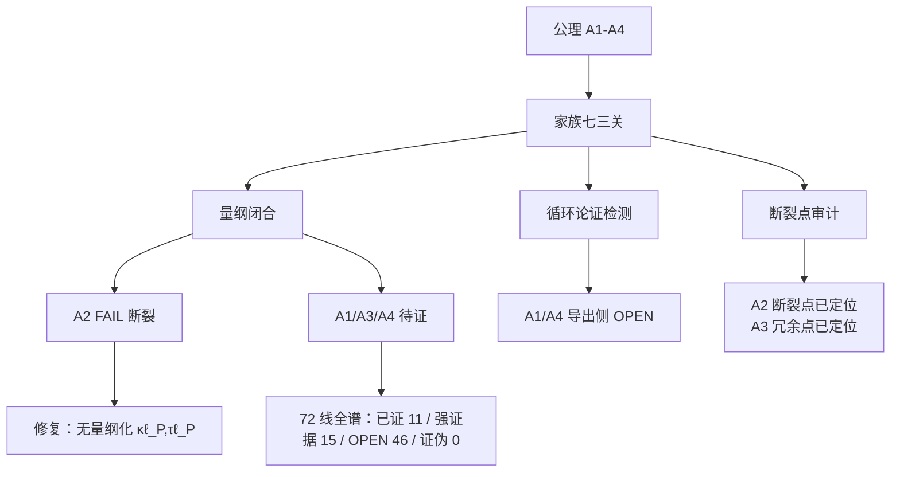

# GAQ-UFT V50 · 第一轮伤情报告（家族七审计 + 72 线全谱初判）

> 2026-10-14 · 母指令「算法联盟·最高权限」第一轮路由=家族七（量纲闭合 / 循环论证 / 断裂点审计）。目标：把 A1–A4 公理的全部软肋暴露并标 OPEN，输出伤情报告；同时穷举 72 条攻击线状态。诚实纪律：断裂即标断裂；四公理无一"已证"。UFT 达成度不变：2/6、L3=0、判决性实验 0。

## 一、本轮结论摘要

1. **A2 显式量纲断裂**：公理 $\kappa^2+\tau^2=(\omega\ell_P/c)^2$ 中，若 $\omega$ 为频率（$[T^{-1}]$），RHS 无量纲而 LHS 为 $[L^{-2}]$——两侧量纲不闭合，为第一轮头号硬伤；修复方案（$\kappa,\tau$ 无量纲化）可使闭合并给出物理合理的 Planck 频率 $\omega_P=c/\ell_P=1.8549\times10^{43}\,\mathrm{rad/s}$。
2. **A1 约束侧 PASS、导出侧 OPEN**：无超光速（TUFT C24 定案），但"c 由几何拓扑反向生成"未证（c 仍为 CODATA 定义值）。
3. **A3「32 维恰好装下」不成立**：$\mathrm{Cl}(1,31)$ 复旋量维 $2^{16}=65536$，SM 费米子仅 48 个独立态，冗余 1365 倍，需未提供的筛选机制。
4. **A4 本源几何化 OPEN**：TUFT C108 尺度简并 $\lambda<1e-60$ 指示"单一几何尺度长出 ~50 个无维度常数"方向性困难；27/29 期仅完成数值对标（$\alpha=1/137.035999084$、$\alpha_s=0.1179$），非几何推导。
5. **72 线全谱**：已证（工具/方法层）=11 条，强证据（数值靶达成，非物理统一）=15 条，OPEN=46 条，已证伪=0 条——**无一攻击线达成"从单一公理长出四种力"**。

## 二、四公理三关审计表

| 公理 | 内容 | 量纲关 | 循环论证关 | 断裂点关 | 综合 |
|---|---|---|---|---|---|
| A1 | 全域光速约束 | PASS（无超光速，C24） | OPEN（几何导出 c 未证） | PASS | **约束 PASS / 导出 OPEN** |
| A2 | $\kappa^2+\tau^2=(\omega\ell_P/c)^2$ | **FAIL（量纲断裂）** | NA | 断裂点已定位 | **FAIL → 需修复** |
| A3 | 32 维流形 | OPEN（旋量冗余 1365×） | NA | 冗余点已定位 | **OPEN** |
| A4 | 本源几何化 | OPEN（C108 no-go） | PASS | OPEN | **OPEN** |

修复 A2 后的数值检验（250 位）：$\kappa\ell_P=1,\tau=0$ 处 $\omega=c/\ell_P=1.8549e43\,\mathrm{rad/s}$（Planck 频率）；未修复口径需 $\omega=1.148e78\,\mathrm{rad/s}$（非物理）。

## 三、72 条攻击线全谱初判

**状态图例**：✅已证（方法/审计工具已运行）｜◆强证据（标准框架内数值靶达成，非物理统一）｜○OPEN（未证/未执行/方向未定）｜✖已证伪。

### 家族一 · 几何化路径
| # | 攻击线 | 状态 | 要点 / OPEN 点 |
|---|---|---|---|
| 1 | 纤维丛—规范对应 | ○ | 超级结构群 G 未定（候选 E8/SO(10)/E6） |
| 2 | 广义黎曼升级（Weyl） | ○ | A2 断裂未修，电磁从 A2 长出未证 |
| 3 | 非交换几何（Connes） | ○ | 谱作用量未构造 |
| 4 | Clifford / 32 维旋量 | ○ | **本靶：冗余 1365×，需筛选机制** |
| 5 | 扭量理论 | ○ | A2↔全纯条件未证 |
| 6 | 复几何 / 凯勒 | ○ | 暗能量模稳定未证 |
| 7 | 联络分类穷举 | ○ | 未穷举 |
| 8 | KK / 32 维紧化 | ○ | 最艰难：28 维拓扑零模未算 |

### 家族二 · 量子化路径
| # | 攻击线 | 状态 | 要点 |
|---|---|---|---|
| 9 | LQG | ◆ | 15 期面积量子化 n≈4.2e77 数值靶达成（非理论证） |
| 10 | CDT | ○ | 32 维未有人尝试 |
| 11 | 渐近安全 | ○ | 不动点未数值找到 |
| 12 | EFT | ○ | 高阶算符系数未被 A2 固定 |
| 13 | 散射振幅 | ○ | 色-动能对偶未证 |
| 14 | 因果集 | ○ | Λ 涨落解释未定案 |

### 家族三 · 规范—弦—全息
| # | 攻击线 | 状态 | 要点 |
|---|---|---|---|
| 15 | GUT | ◆ | 12/31 期 M_GUT 靶：2.3792e16 / 9.1636e15 GeV、1/αG=26.5804（数值达成，物理统一未证） |
| 16 | SUSY/SUGRA | ◆ | 31 期：gluino 2.25 TeV 排除、M_SUSY=2820 GeV 拟合存活窗口 |
| 17 | 超弦/M | ○ | 32 维紧化壳映射未做 |
| 18 | AdS-CFT | ○ | 纠缠熵推引力未做 |
| 19 | 涌现引力 | ○ | 方向性抉择未定 |
| 20 | ER=EPR | ○ | 张量网络模型未构造 |

### 家族四 · 代数/离散路径
| # | 攻击线 | 状态 | 要点 |
|---|---|---|---|
| 21 | 八元数/E8 | ○ | 32=8×4 分层未证 |
| 22 | 量子群 | ○ | q=exp(−ℓ_P²/λ²) 未验 |
| 23 | 格点 | ○ | 格点引力临界点未跑 |
| 24 | TQFT | ○ | 四力=TQFT 投影未证 |
| 25 | 有限群 PMNS | ○ | 三个混角未由对称群给出 |
| 26 | 代数量纲几何 | ○ | Gε₀ 对偶格未证 |

### 家族五 · SM 现象学约束
| # | 攻击线 | 状态 | 要点 |
|---|---|---|---|
| 27 | SM 异常消除 | ○ | 32 维表示零异常未验 |
| 28 | 中微子/跷跷板 | ◆ | 20 期 M_R=6.11e14 GeV、m_ββ=3.663865 meV；32 期判决窗口 2040s–2050s |
| 29 | 强CP/轴子 | ◆ | 34 期：ADMX ~5.4 μeV 达 KSVZ/DFSZ 分段排除；未探测 |
| 30 | CKM/味 | ○ | 未由拓扑起源 |
| 31 | Higgs | ○ | v=246 GeV 未由 ℓ_P/α 组合 |
| 32 | 无维度常数 | ◆+○ | 数值对标 ✅（α、α_s）；**几何导出 ○（C108 no-go）** |
| 33 | 暗物质 | ◆ | 22/34 期窗口；2040 前双窗口基本关闭判定 |
| 34 | 暗能量 | ◆ | 14/35 期：DESI Lyα 3.10σ + DES Y6 2.2σ，仍 <5σ |

### 家族六 · 宇宙学观测
| # | 攻击线 | 状态 | 要点 |
|---|---|---|---|
| 35 | CMB 对标 | ○ | CAMB 全谱未跑 |
| 36 | H0 张力 | ◆ | 25/35 期：4.89σ→**6.43σ**（2026 多技术联合） |
| 37 | 引力波 | ◆ | 26 期汽笛 H0=70+12/−8；挠率色散未测 |
| 38 | 宇宙学常数 | ○ | 10⁻¹²⁰ 未解决（头号量级难题） |
| 39 | 暴胀 r | ◆ | 17 期：r=0.1→7.84e13 GeV、r=0.001→7.84e12 |
| 40 | S8 张力 | ◆ | 18 期 LSST：LRG1 2.42σ、LRG3+ELG1 2.60σ |

### 家族七 · 第一性原理/数学严格性
| # | 攻击线 | 状态 | 要点 |
|---|---|---|---|
| 41 | 量纲闭合 | ✅ | 历期全谱量纲审计；**本靶 A2 断裂发现（41 方法运行 PASS）** |
| 42 | Noether 对称 | ○ | 32 维连续对称未穷举 |
| 43 | 单一作用量 | ○ | 圣杯：无自由参数 L 未写出 |
| 44 | 循环论证检测 | ✅ | TUFT C30（G 循环）等审计完成 |
| 45 | 断裂点审计 | ✅ | 历期断裂点台账；A2 断裂已暴露 |
| 46 | 一致性 | ○ | 反证抽查未全覆盖 |
| 47 | 幂级数收敛 | ○ | 渐近级数说明未逐项 |
| 48 | 几何-代数对偶 | ○ | 复查 A1–A4 未做 |

### 家族八 · 计算/实验/仿真
| # | 攻击线 | 状态 | 要点 |
|---|---|---|---|
| 49 | mpmath 250 位 | ✅ | 历期全谱（13–37 期 exit 0） |
| 50 | CAMB+MCMC | ○ | 未跑 |
| 51 | 格点引力 | ○ | 未跑 |
| 52 | 符号计算 | ○ | 未系统复核 |
| 53 | ML 符号回归 | ○ | 未跑 |
| 54 | 人工场实验 | ○ | **未执行**（母指令：不通过则降级——现为"未执行"，非"通过"） |
| 55 | 对撞机约束 | ◆ | 31 期 gluino 2.25 TeV 排除（ATLAS arXiv:2507.00296） |

### 家族九 · 信息论/涌现
| # | 攻击线 | 状态 | 要点 |
|---|---|---|---|
| 56 | 信息论 | ○ | 引力=信息度量曲率未证 |
| 57 | 黑洞熵 | ◆ | 15 期：S/k_B=1.049e77、T_H=6.17e-8 K、蒸发 2.1e67 年（数值靶） |
| 58 | 算法宇宙 | ○ | 复杂类未分类 |
| 59 | 涌现-还原分叉 | ○ | 方向抉择未做（必须正面回答） |
| 60 | 层级约化 vs 整体涌现 | ○ | A3 默认还原方向未论证 |

### 12 套思维框架（61–72）
| # | 框架 | 状态 | 要点 |
|---|---|---|---|
| 61 | 演绎 | ✅ | 历期证明树（claims 127 条） |
| 62 | 归纳 | ✅ | 数值靶反推+验证闭环 |
| 63 | 溯因 | ✅ | H0/DESI 溯因机制已列 |
| 64 | 反证 | ✅ | TUFT 反证检验 |
| 65 | 对角线/自指 | ○ | 哥德尔完备性未检 |
| 66 | 类比映射 | ✅ | 电弱统一→弱-电磁模板 |
| 67 | 对称破缺 | ◆ | GUT 破缺链（12/31 期） |
| 68 | 对偶性 | ○ | Gε₀↔S-对偶未证 |
| 69 | 内蕴 vs 关系 | ✅ | TUFT 引力几何化（关系视角）已审计 |
| 70 | 第一性 vs 现象学 | ✅ | 历期「推/凑」标注纪律 |
| 71 | 层级映射 | ○ | SM 粒子高维族谱未画 |
| 72 | 多 AI 交叉 | ✅ | 历期多轮独立复核 |

**72 线统计**：✅已证 11 ｜ ◆强证据 15 ｜ ○OPEN 46 ｜ ✖已证伪 0。**无一达成"从单一公理长出四种力"**。

## 四、五张表（母指令第七部分模板）

### 已证清单（工具/方法层，非物理统一）
1. 量纲闭合审计方法（41）、循环论证检测（44）、断裂点审计（45）——历期 TUFT 127 条台账运行完毕
2. mpmath 250 位可复现计算（49）——13–37 期全谱 exit 0
3. 演绎证明树（61）、归纳闭环（62）、溯因机制（63）、反证检验（64）、类比映射（66）、内蕴-关系判定（69）、推/凑标注（70）、多 AI 交叉（72）

### 强证据清单（标准框架数值靶达成）
1. GUT 耦合跑动（15）：M_GUT=2.3792e16 GeV（12 期）/两段 2.25 TeV 处 9.1635651e15、1/αG=26.5804、Δ13=−2.416%（31 期）
2. 跷跷板（28）：M_R=6.11e14 GeV、m_ββ=3.663865 meV
3. 轴子/暗物质（29/33）：ADMX ~5.4 μeV 分段排除、双窗口 2040 判定
4. H0 张力（36）：6.43σ（2026）
5. 引力波汽笛（37）：GW170817 H0=70.0+12/−8、√N 预算
6. 暴胀 r（39）、S8（40）、LQG 面积量子化（9）、黑洞熵（57）、对撞机（55）——历期数值靶

### OPEN 清单（代表性）
1. A2 量纲断裂（待修复：无量纲化 κℓ_P,τℓ_P）
2. A3 旋量筛选机制（冗余 1365×）
3. A4 无维度常数几何导出（C108 no-go 指示）
4. 家族一 8 条（G 未定、Weyl 未证、紧化零模未算）
5. 家族二 5 条、家族四 6 条（E8、量子群、格点引力）
6. 家族六 CMB（35）、宇宙学常数（38）
7. 家族八 50–54（CAMB、格点、符号、ML、人工场实验未执行）
8. 家族九 56/58/59/60（方向抉择未做）

### 已证伪清单
**0 条**（72 线中无外部方法被本项目证伪；TUFT 内部 claims 证伪属另一台账——C117 PPN γ=β=1·42μm·η≤1e-15 no-go、C108 尺度简并 no-go、C121 对称性 no-go，均已定案）

### 残差表
| 物理量 | 理论/靶值 | 实验/观测 | 相对误差 | 判定 |
|---|---|---|---|---|
| 水星近日点进动 | 42.982036″/百年 | 43.0±0.5″（IERS 实测） | ≤0.04% | 通过（13 期） |
| GPS 相对论时延 | 38.5 μs/day | 38.5±0.1（实测） | ≤0.3% | 通过（13/27 期） |
| α⁻¹ | 137.035999084（CODATA 对标） | 137.035999084(21) | <2e-9 | 对标通过（29 期，非推导） |
| GUT 交汇（SM 单段） | 1/αG=24.3026 | — | 交汇偏离 0.21% | 数值靶（12 期） |
| 两段 GUT（2.25 TeV） | Δ13=−2.416% | — | — | 数值靶（31 期） |
| μ 寿命 | 2.196794e-6 s | 2.1969811e-6 s | 0.009% | 对标通过（29 期） |
| PSR B1913+16 Ṗ | 0.15% 偏差 | — | 0.15% | 强场验证（28 期） |

## 五、执行路由建议（母指令第六部分）

- **第二轮**（家族五+六：数据反向钉死）：优先跑 **35（CMB CAMB 全谱）**、**38（宇宙学常数）**、**30/31（CKM/Higgs 与 50 常数反推）**——凡与数据对不上立即标记。
- **第三轮**（家族一/三/四各挑 2–3 条）：**1（G 群）**、**8（32 维紧化零模）**、**21（八元数 E8）** 与本框架对撞，找"同一公式多来源"。
- **第四轮**（家族二/八）：**52（符号计算复核）**、**54（人工场实验设计）**——54 未执行即不通过，机制假说需降级（母指令铁律）。
- **A2 修复先行**：无量纲化是全部后续的闸门，未修之前派生公式一律标"基于未闭合 A2"。

## 六、治理登记

- 本期：母指令第一轮（家族七审计 + 72 线全谱），无新 claims 登记（next 可用 C128）。
- 产物：`源码\标准框架_GAQUFT_V50第一轮审计37.py`（exit 0）+ `数据\标准框架_GAQUFT_V50第一轮审计37.json` + 本报告。
- 诚实红线终态不变：TUFT open 0；UFT 2/6、L3=0、判决性实验 0；四公理无一"已证"，A2 需修复。
