# 布局 · 物理 Top1000 难题攻破清单

**性质**：攻破工程规模化清单升级版（Top100 → **Top1000**，覆盖物理学全部分支未解难题谱系）
**日期**：2026-10-21
**清单口径**：以 openuft 布局册（P01–P16）为骨架 + Top100 基线（2026-10-21）为保留段，融合物理学界公认未解难题谱系（《Science》125 周年 125 问之物理部分、现代物理十大未解、千禧年七大数学物理问题、凝聚态/量子基础通识、各分支前沿谱系）。非 openuft 库内既有单——为**自建框架册**，可随攻破推进修订。
**升级说明**：T001–T100 由 Top100 基线册逐字保留（域 A–F，六域分组不变）；T101–T1000 为本轮扩展（域 G–P，十域架构覆盖全分支）。编号规则 `T###`（攻破号段，独立于 `P0x` 布局号与 `C0xxx` 判定号）保持不变。

---

## 〇、总账

| 侧 | 项数 | 状态 |
|---|---|---|
| 负面侧（对 TUFT 原初声称） | 七障碍 7/7 + 引力本质 | ✅ 已全部攻破 |
| 建设侧（物理难题本身） | **Top1000** | 🔲 逐个攻破中 |
| 其中 openuft 已攻破（结构性负面闭合） | **35 个编号**（基线 24 + C0142 补记 2 + 本轮 9） | ✅ 已登记读数（见 §三） |
| 其中待攻 | 见 §四 | 🔲 按序推进 |
| ⚠️ 登记不深攻 | 诠释层 / 纯数学 / 非统一场论载体 | 登记在册（域 J/L/P 为主） |

> 口径注：Top100 基线册 §二 声明「21 项」，逐项实列 24 个编号（并集/范围计数差异）；本册按逐项编号登记，基线 24 + C0142 补记 T022/T023 + 本轮 9 = **35 个编号**。

**「已攻破」口径**：专指对 TUFT/几何框架的**结构性负面闭合**（它给出不了所需机制），**不等于物理难题已被解决**。本清单不宣称解决任何物理难题。

---

## 一、Top1000 域架构（T001–T1000）

```mermaid
flowchart LR
  subgraph 基线保留段[Top100 基线保留段]
    A[域A 引力与时空<br/>T001–T016]
    B[域B 粒子物理与统一<br/>T017–T036]
    C[域C 宇宙学<br/>T037–T052]
    D[域D 量子基础<br/>T053–T066]
    E[域E 凝聚态与复杂<br/>T067–T084]
    F[域F 数学物理与理论框架<br/>T085–T100]
  end
  subgraph 扩展段[Top1000 扩展段]
    G[域G 引力与时空·扩展<br/>T101–T220]
    H[域H 粒子物理与统一·扩展<br/>T221–T380]
    I[域I 宇宙学·扩展<br/>T381–T500]
    J[域J 量子基础·扩展<br/>T501–T590]
    K[域K 凝聚态与复杂·扩展<br/>T591–T730]
    L[域L 数学物理与理论框架·扩展<br/>T731–T810]
    M[域M 核物理与粒子天体物理<br/>T811–T890]
    N[域N 原子分子光学与量子技术<br/>T891–T950]
    O[域O 天体物理与观测宇宙学<br/>T951–T985]
    P[域P 复杂系统、生物物理与交叉<br/>T986–T1000]
  end
  基线保留段 --> 扩展段
```

| 域 | 名称 | 编号段 | 条目数 | 来源 |
|---|---|---|---|---|
| A | 引力与时空 | T001–T016 | 16 | 基线保留 |
| B | 粒子物理与统一 | T017–T036 | 20 | 基线保留 |
| C | 宇宙学 | T037–T052 | 16 | 基线保留 |
| D | 量子基础 | T053–T066 | 14 | 基线保留 |
| E | 凝聚态与复杂 | T067–T084 | 18 | 基线保留 |
| F | 数学物理与理论框架 | T085–T100 | 16 | 基线保留 |
| G | 引力与时空·扩展 | T101–T220 | 120 | 本轮新建 |
| H | 粒子物理与统一·扩展 | T221–T380 | 160 | 本轮新建 |
| I | 宇宙学·扩展 | T381–T500 | 120 | 本轮新建 |
| J | 量子基础·扩展 | T501–T590 | 90 | 本轮新建 |
| K | 凝聚态与复杂·扩展 | T591–T730 | 140 | 本轮新建 |
| L | 数学物理与理论框架·扩展 | T731–T810 | 80 | 本轮新建 |
| M | 核物理与粒子天体物理（新增域） | T811–T890 | 80 | 本轮新建 |
| N | 原子分子光学与量子技术（新增域） | T891–T950 | 60 | 本轮新建 |
| O | 天体物理与观测宇宙学（新增域） | T951–T985 | 35 | 本轮新建 |
| P | 复杂系统、生物物理与交叉（新增域） | T986–T1000 | 15 | 本轮新建 |
| **合计** | — | **T001–T1000** | **1000** | — |

状态列语义：✅已攻（附读数来源）／🔲待攻／⚠️不适用（TUFT 无载体，登记不深攻）／◐部分（有读数未闭环）。

---

## 二、Top1000 清单

### 第一部分 · Top100 基线保留段（域 A–F，T001–T100）

> 本段由 Top100 基线册逐字保留，仅更新本轮 C0142/C0143–C0151 攻破项的编号状态（10 行）。

### 域 A · 引力与时空（T001–T016）

| 编号 | 难题 | 所需机制 | 撞 C | 状态 |
|---|---|---|---|---|
| T001 | 量子引力 / 引力量子化 | 紫外完备 + 背景无关量子化 | C1,C7 | ✅ attack24 N1–N4：Killing 紧致≤3、KK n=5、逐圈 D=2+2L、裸参 2 个；[G]=−2（C0131）；P01 结构性负面 |
| T002 | 黑洞信息悖论 | QG + 幺正 | C1,C7 | ✅ **C0148（本轮）**：P15 结构性负面——S=1.05e77 k_B、T_H=6.17e-8 K 精算，需幺正 QG+全息对偶载体，几何供给 0，撞 C1/C7 |
| T003 | 宇宙学常数 / 真空能 | 抵消或选择机制 | C2 | ✅ **C0141**：缺口 2.116e115、几何唯一尺度 M_Pl⁴ 恰是灾难值、P03 结构性负面 |
| T004 | 暗能量本质 | w 与演化机制 | C2,C5 | ✅ **C0145（本轮）**：P05 结构性负面——Λ=1.31e-52 m⁻² 精算、w=−1 距中心 0.875σ、quintessence 需新场+新势，几何供给 0，撞 C2/C3（或 C1/C2/C3） |
| T005 | 时空的量子起源 / 离散性 | 时空涌现 | C1,C7 | 🔲 部分：挠率代数性 C0134 E6 |
| T006 | 时间之箭 / CP(T) 破缺来源 | 时间不对称机制 | C1,C5 | 🔲 |
| T007 | 引力波的量子性 | 引力子探测 | C5,C6 | 🔲 |
| T008 | 奇点定理 / 大爆炸起点 | 奇点解除 | C1,C7 | ◐ C0131 时空悖论 |
| T009 | 引力的本质（为何自旋-2） | 唯一质量耦合几何 | — | ✅ C0134/C0128/attack23：唯一无量纲强度 (m/m_P)²、标量盲区 w=1/3、Bertrand 进动缺 43″、几何统一被 so(1,3)⊥SM 阻断 |
| T010 | 等效原理的起源 | EP 非公设 | — | ✅ attack23：EP 对引力是量纲必然 |
| T011 | 暗物质 | 新稳定中性粒子 / 修正引力 | C1,C5 | ✅ C0139：热遗迹反解 ⟨σv⟩=1.906429e-26 cm³/s 落 WIMP 窗口="巧合非推导"、几何供给 0、P04 结构性负面 |
| T012 | 暴胀机制 | inflaton + 慢滚势 | C1,C2,C5 | ✅ **C0144（本轮）**：P09 结构性负面——ε=r/16≤2.0e-3、2η−6ε=−0.0351、V^(1/4)=1.37–2.05e16 GeV 精算，inflaton 需 3 枚新输入、慢滚平坦性精调，几何供给 0，撞 C1/C2/C3 |
| T013 | 时空维数为何是 4 | 维数选择 | C1 | 🔲 部分：KK n=5（attack24 N2） |
| T014 | 全息原理 / 面积熵律 | 全息对偶 | C1,C7 | 🔲 |
| T015 | 超光速 / 可穿越虫洞 | 负能量 + 量子不等式 | C2,C5 | ✅ attack25：量纲 4/4、M_neg=8.47e-1 M_☉、假可达、零贡献全在亚光速侧（图谱层） |
| T016 | 时间旅行 / 因果闭合 | 因果结构 | C5 | 🔲 |

### 域 B · 粒子物理与统一（T017–T036）

| 编号 | 难题 | 所需机制 | 撞 C | 状态 |
|---|---|---|---|---|
| T017 | 大统一 / 质子衰变 | GUT 群 + 重玻色子 | C1,C2 | ✅ **C0147（本轮）**：P08 结构性负面——sin²θ_W=3/8=0.375 vs 0.2312；minimal SU(5) τ_p=4.60e31 yr 被 SK 排除 524×、MSSM 标度 2.87e36 yr 超界 120×（阈值-可见两难），撞 C1/C2 |
| T018 | 规范群起源（为何 SU(3)×SU(2)×U(1)） | 群由公设唯一确定 | C1 | ✅ attack24 N1（紧致≤3）+ C0137：3 个互不同构代数共享 SM 签名 (dim=12,rank=4)、反常不锁群选择、P12 结构性负面 |
| T019 | 耦合常数绝对值来源 | 绝对标度第一性导出 | C2,C3 | ✅ C0140：量纲 nullity 0 纯数不可生成、SM 单圈 ΔL=9.15 不汇聚、MSSM 汇聚但账单更贵、P13 结构性负面 |
| T020 | 层级 / 等级问题 | 第二尺度 + 保护机制 | C2,C7 | ✅ C0130：η=1.024646e-17、δM_H²/M_H²=1.29e32、P02 结构性负面 |
| T021 | 强 CP 问题（θ） | PQ / axion 或 θ=0 | C1 | ✅ C0138：θ̄<3.46e-11 精调 2.9e10、唯一解 PQ+轴子需 ≥2 新输入、P10 结构性负面 |
| T022 | 味 / 代结构（为何三代） | 代结构 + Yukawa 起源 | C1,C2 | ✅ **C0142**：P11 结构性负面——代民主零参数谱 vs 实测差 2.3–203 倍、几何供给 0 |
| T023 | 费米子质量谱 / 质量层级 | Yukawa 起源 | C1,C2 | ✅ C0142（含于 T022） |
| T024 | 中微子质量与性质（马约拉纳？） | seesaw / Dirac + ν_R | C2 | ✅ **C0143（本轮）**：P06 结构性负面——seesaw m_ν=−m_D M_R⁻¹m_Dᵀ 推导闭合、反解 M_R≈1.22e15 GeV（GUT 标度）、需 ν_R+M_R ≥2 新输入，几何供给 0，撞 C1/C2 |
| T025 | 重子生成 / 反物质消失 | B 违反 + CP + 非平衡 | C1,C2 | ✅ **C0146（本轮）**：P07 结构性负面——E_sph=7.12–12.81 TeV 精算、CP（J~1e-5）+ crossover 双重否决（差 ~8 数量级），撞 C1/C2 |
| T026 | 质子衰变实验 | 实验检验 | C5,C6 | ◐ C0132：τ_pred~1e30 vs τ_exp>1e36 |
| T027 | 三代代际 / 中微子振荡 | 味混合起源 | C1,C2 | ✅ **C0151（本轮）**：结构性负面——逐代反常消去 Fraction 精确（∑Y=0、∑Y³=0）不锁 N_g=3、PMNS/CKM θ13 比值 42.49，撞 C1/C2 |
| T028 | 暗光子 / 新轻玻色子 | 新 U(1) | C1,C2 | 🔲 |
| T029 | 轴子 / 类轴子粒子 | PQ 对称破缺 | C1,C2 | ◐ C0138（轴子窗口 4e8–1e12 GeV） |
| T030 | 夸克禁闭 / 强子谱 | 禁闭机制 | C1 | 🔲（r33/⑲ 已证几何势族禁闭力判三连错） |
| T031 | 手征对称破缺 / 宇称破缺 | 手征载体 | C1 | ✅ C0129：几何框架天然宇称守恒、无 SU(2)_L 左手载体、七障碍·3 |
| T032 | 基本粒子质量谱（为何是这些值） | 质量公式 | C2,C3 | 🔲 |
| T033 | 标准模型之外的新物理 | 新对称/新自由度 | C1 | 🔲 |
| T034 | 电磁-弱-强统一 | 规范统一 | C1 | ◐ C0140：SM 不汇聚（ΔL=9.15） |
| T035 | 引力与量子场的统一 | 统一理论 | C1,C7 | ✅ 七障碍主体：C0127（so(1,3)⊥SM Δdim=6）、C0131（不可重整）、C0132（实证否决） |
| T036 | 超对称 / 新粒子谱 | SUSY | C1 | ✅ ㉕：活树 4 枚全 Clifford、super-Poincaré 0、可检验新效应 0 条，超对称是"换掉它"非补丁 |

### 域 C · 宇宙学（T037–T052）

| 编号 | 难题 | 所需机制 | 撞 C | 状态 |
|---|---|---|---|---|
| T037 | 哈勃张力（H0 矛盾） | 新物理 / 系统误差裁决 | C5 | ✅ **C0150（本轮）**：结构性负面——σ=4.847 独立复算（73.04 vs 67.36）、4 枚新物理候选每枚 ≥1 新输入、TUFT 单尺度几何供给 0，撞 C2/C5 |
| T038 | 大爆炸的起点 / 原初奇点 | 量子引力 | C1,C7 | ◐ T001 |
| T039 | 宇宙的最终命运 | 暗能量演化 | C2 | 🔲（含于 T004） |
| T040 | 结构形成 / 星系起源 | 初始谱 + 引力 | C2,C5 | 🔲 |
| T041 | 原初涨落 / CMB 各向异性 | 暴胀 + 量子涨落 | C1,C2 | 🔲（含于 T012） |
| T042 | 宇宙各向同性 / 大尺度均匀性 | 初始条件 | C5 | 🔲 |
| T043 | 重子-反重子不对称 | B 违反 | C1,C2 | 🔲（同 T025） |
| T044 | 宇宙学常数精调 | 抵消机制 | C2 | ✅ **C0141**：缺口 2.116e115（与 T003 同源，口径不同视角） |
| T045 | 暗物质与暗能量的关系 | 统一解释 | C1,C2,C5 | 🔲 |
| T046 | 暴胀场 / 慢滚的物理起源 | inflaton | C1,C2 | 🔲（同 T012） |
| T047 | 早期宇宙相变 / 拓扑缺陷 | 相变机制 | C1,C2 | 🔲 |
| T048 | 宇宙微波背景异常 | 新物理/系统效应 | C5 | 🔲 |
| T049 | 暴胀后的宇宙演化 | 标准宇宙学 | C2 | 🔲 |
| T050 | 引力波的宇宙学来源 | 原初引力波 | C5 | 🔲 |
| T051 | 中微子的宇宙学贡献 | 中微子质量 | C2 | 🔲（同 T024） |
| T052 | 宇宙的可检验预言 | 模型裁决 | C5,C6 | 🔲 |

### 域 D · 量子基础（T053–T066）

| 编号 | 难题 | 所需机制 | 撞 C | 状态 |
|---|---|---|---|---|
| T053 | 量子测量问题 | 解释或新动力学 | C5,C6 | ⚠️ P14：不可判定（诠释层） |
| T054 | 波函数坍缩机制 | 坍缩动力学 | C5,C6 | ⚠️（同 T053） |
| T055 | 量子-经典边界 | 退相干 + 测量 | C5,C6 | ⚠️ |
| T056 | 量子纠缠 / 贝尔非局域性 | 非局域性解释 | C5 | ⚠️ 已实验确认，属诠释非待攻 |
| T057 | 量子场论严格化（存在性） | 数学严格定义 | C7 | ⚠️ 数学问题 |
| T058 | 杨-米尔斯存在与质量间隙（千禧年） | 数学证明 | C7 | ⚠️ 千禧年，非 TUFT 可攻 |
| T059 | 纳维-斯托克斯（千禧年） | 数学证明 | C7 | ⚠️ 千禧年 |
| T060 | P vs NP（千禧年） | 计算复杂度 | C7 | ⚠️ 计算，非物理 |
| T061 | 黎曼假设（千禧年） | 数论证明 | C7 | ⚠️ 数学 |
| T062 | 量子退相干 / 环境作用 | 开放量子系统 | C5 | ⚠️（同 T053） |
| T063 | 量子热力学 / 功与热 | 量子涨落 | C5 | ⚠️ |
| T064 | 多重宇宙 / 人择 | 诠释或新原理 | C5 | ⚠️ ㉓ 科幻通道分流 |
| T065 | 时间在量子力学中的地位 | 时间作为参数 | C5 | ⚠️ |
| T066 | 意识的物理基础 | 涌现/对应 | C5 | ⚠️ 非物理框架可攻 |

### 域 E · 凝聚态与复杂（T067–T084）

| 编号 | 难题 | 所需机制 | 撞 C | 状态 |
|---|---|---|---|---|
| T067 | 高温超导机理 | 配对机制 | C5 | ⚠️ 非统一场论载体（登记不深攻） |
| T068 | 量子霍尔效应 / 分数量子霍尔 | 拓扑序 | C5 | ⚠️ |
| T069 | 拓扑序 / 任意子 | 拓扑量子态 | C5 | ⚠️ |
| T070 | 玻璃化转变 | 非平衡统计 | C5 | ⚠️ |
| T071 | 湍流 | 非线性流体 | C5 | ⚠️ |
| T072 | 蛋白质折叠 | 多尺度统计 | C5 | ⚠️ |
| T073 | 自旋玻璃 / 阻挫磁性 | 无序系统 | C5 | ⚠️ |
| T074 | 量子计算错误校正的物理极限 | 拓扑保护 | C5 | ⚠️ |
| T075 | 拓扑绝缘体 | 拓扑分类 | C5 | ⚠️ |
| T076 | 非平衡相变 | 驱动系统 | C5 | ⚠️ |
| T077 | 自组织临界 | 幂律涌现 | C5 | ⚠️ |
| T078 | 化学反应的量子根源 | 量子化学 | C5 | ⚠️ |
| T079 | 生命起源的物理机制 | 自复制 | C5 | ⚠️ |
| T080 | 玻色-爱因斯坦凝聚的极限 | 超流 | C5 | ⚠️ |
| T081 | 二维材料新量子态 | 材料物理 | C5 | ⚠️ |
| T082 | 塞贝克/热电等输运极限 | 输运理论 | C5 | ⚠️ |
| T083 | 晶体缺陷与塑性 | 位错动力学 | C5 | ⚠️ |
| T084 | 复杂系统涌现的普遍律 | 涌现原理 | C5 | ⚠️ |

### 域 F · 数学物理与理论框架（T085–T100）

| 编号 | 难题 | 所需机制 | 撞 C | 状态 |
|---|---|---|---|---|
| T085 | 弦论 / M 理论 | 统一候选 | C1,C7 | ✅ ㉓：五方向逐一审计（各有 open 项，无一可即插即用） |
| T086 | 圈量子引力 | 统一候选 | C1,C7 | ✅ ㉓ |
| T087 | 渐近安全 | 统一候选 | C1,C7 | ✅ ㉓ |
| T088 | 非对易几何 | 统一候选 | C1,C7 | ✅ ㉓ |
| T089 | 因果三角剖分 | 统一候选 | C1,C7 | ✅ ㉓ |
| T090 | 全息对偶 / AdS-CFT | 对偶 | C1,C7 | 🔲（同 T014） |
| T091 | 量子引力现象学 | 单点预言 + 误差带 | C5,C6 | ✅ **C0149（本轮）**：P16 结构性负面——修改色散量纲自洽、Δt/ξ≈84.3 ms（1 Gpc/10 GeV）精算、量子泡沫低 27 量级，TUFT 无单点预言无误差带，撞 C5/C6 |
| T092 | 时空的离散性探测 | 洛伦兹不变性检验 | C5,C6 | 🔲 |
| T093 | 引力的热力学 / 熵力 | 全息熵 | C1,C7 | 🔲 |
| T094 | 量子与引力的信息论 | 量子比特 + 几何 | C1,C7 | 🔲 |
| T095 | 自然单位与量纲学 | 量纲必然 | C7 | ✅ attack23/C0134/C0140：量纲唯一性体系 |
| T096 | 精细结构常数 α 的数值来源 | 常数生成 | C2,C3 | ✅ C0140：纯数不可由 (ℏ,G,c) 生成 |
| T097 | 物理常数的人择 / 微调 | 选择机制 | C5 | ◐ C0140/C0138：各常数需外部标度 |
| T098 | 统一理论的可检验性边界 | 实验窗口 | C5,C6 | ✅ C0132：TUFT 原生预言全被实验排除 |
| T099 | 理论的自洽性（无矛盾） | 数学自洽 | C7 | ✅ C0133 终审：PASS8/STRUCT1，TUFT 身份注销仅留经典局部几何 |
| T100 | 从第一性原理生成标准模型 | 公设唯一化 | C1 | ✅ 七障碍 + r33/㉔/㉕：几何框架供给 0/16 |
