# 布局 · 物理 Top1000 难题攻破清单

**性质**：攻破工程规模化清单升级版（Top100 → **Top1000**，覆盖物理学全部分支未解难题谱系）
**日期**：2026-10-21
**清单口径**：以 openuft 布局册（P01–P16）为骨架 + Top100 基线（2026-10-21）为保留段，融合物理学界公认未解难题谱系（《Science》125 周年 125 问之物理部分、现代物理十大未解、千禧年七大数学物理问题、凝聚态/量子基础通识、各分支前沿谱系）。非 openuft 库内既有单——为**自建框架册**，可随攻破推进修订。
**升级说明**：T001–T100 由 Top100 基线册逐字保留（域 A–F，六域分组不变）；T101–T1000 为本轮扩展（域 G–P，十域架构覆盖全分支）。编号规则 `T###`（攻破号段，独立于 `P0x` 布局号与 `C0xxx` 判定号）保持不变。

---

## 〇、总账

| 侧 | 项数 | 状态 |
|---|---|---|
| 负面侧（对 TUFT 原初声称） | 七障碍 7/7 + 引力本质 | ✅ 已全部攻破 |
| 建设侧（物理难题本身） | **Top1000** | 🔲 逐个攻破中 |
| 其中 openuft 已攻破（结构性负面闭合） | **39 个编号**（基线 24 + C0142 补记 2 + 本轮 9 + C0153 补 1 + C0154/C0155 补 2 + C0160 补 1） | ✅ 已登记读数（见 §三） |
| 其中待攻 | 见 §四 | 🔲 按序推进 |
| ⚠️ 登记不深攻 | 诠释层 / 纯数学 / 非统一场论载体 | 登记在册（域 J/L/P 为主） |

> 口径注：Top100 基线册 §二 声明「21 项」，逐项实列 24 个编号（并集/范围计数差异）；本册按逐项编号登记，基线 24 + C0142 补记 T022/T023 + 本轮 9 + C0153 补 1 + C0154/C0155 补 2 + C0160 补 1 + C0163/C0164/C0165 补 3 + C0169/C0170/C0171/C0172 补 4 + C0173/C0174/C0175 补 3 + C0177/C0178/C0179/C0180 补 4 + C0182/C0183/C0184/C0186 补 4 + C0187/C0188/C0189/C0190 补 4 + C0191/C0192/C0193/C0194 补 4 + C0195/C0196 补 2 + C0197/C0198 补 2 + C0199/C0200 补 2 + C0201/C0202/C0203/C0204 补 4 + C0205/C0206/C0207/C0208 补 4 + C0209/C0210/C0211/C0212 补 4 + C0213/C0214/C0215/C0216/C0217 补 5 + C0221/C0222/C0223/C0224/C0225/C0226/C0227/C0228 补 8 + C0218/C0219/C0220 补 3 + C0237/C0238/C0239 补 3 + C0229/C0230/C0231/C0232/C0233/C0234/C0235/C0236 补 8 + C0240/C0241/C0242/C0243/C0244/C0245/C0246/C0247 补 8 + C0248/C0249/C0250 补 3 + C0251/C0252/C0253/C0254 补 4 + C0255/C0256/C0257/C0258 补 4 + C0259/C0260/C0261/C0262 补 4 + C0263/C0264/C0265/C0266 补 4 + C0267/C0268/C0269/C0270 补 4 + C0271/C0272/C0273/C0274 补 4 + C0275/C0276/C0277/C0278 补 4 + C0280/C0281/C0282/C0283 补 4 + C0284/C0285/C0286/C0287 补 4 + C0288/C0289/C0290/C0291 补 4 + C0292/C0293/C0294/C0295 补 4 + C0296/C0297/C0298/C0299 补 4 + C0300/C0301/C0302/C0303 补 4 + C0304/C0305/C0306/C0307 补 4 + C0308/C0309/C0310/C0311 补 4 + C0312/C0313/C0314/C0315 补 4 + C0316/C0317/C0318/C0319 补 4 + C0320/C0321/C0322/C0323 补 4 + C0324/C0325/C0326/C0327 补 4 + C0328/C0329/C0330/C0331 补 4 = **198 个编号**。另 C0156–C0159 为求导深化册判定（挂 T009/T053/T074/T594，裁定不变，不新增编号），元层判定 C0152/C0161/C0162/C0166/C0167/C0168/C0176/C0185，累计判定 213 项（198 编号 + 4 深化 + 8 元层）。

**「已攻破」口径**：专指对 TUFT/几何框架的**结构性负面闭合**（它给出不了所需机制），**不等于物理难题已被解决**。本清单不宣称解决任何物理难题。

---

## 一、Top1000 域架构（T001–T1000）

```mermaid
flowchart LR
  subgraph 基线保留段[Top100 基线保留段]
    A[域A 引力与时空<br/>T001–T016]
    B[域B 粒子物理与统一<br/>T017–T036]
    C[域C 宇宙学<br/>T037–T052]
    D[域D 量子基础<br/>T053–T066]
    E[域E 凝聚态与复杂<br/>T067–T084]
    F[域F 数学物理与理论框架<br/>T085–T100]
  end
  subgraph 扩展段[Top1000 扩展段]
    G[域G 引力与时空·扩展<br/>T101–T220]
    H[域H 粒子物理与统一·扩展<br/>T221–T380]
    I[域I 宇宙学·扩展<br/>T381–T500]
    J[域J 量子基础·扩展<br/>T501–T590]
    K[域K 凝聚态与复杂·扩展<br/>T591–T730]
    L[域L 数学物理与理论框架·扩展<br/>T731–T810]
    M[域M 核物理与粒子天体物理<br/>T811–T890]
    N[域N 原子分子光学与量子技术<br/>T891–T950]
    O[域O 天体物理与观测宇宙学<br/>T951–T985]
    P[域P 复杂系统、生物物理与交叉<br/>T986–T1000]
  end
  基线保留段 --> 扩展段
```

| 域 | 名称 | 编号段 | 条目数 | 来源 |
|---|---|---|---|---|
| A | 引力与时空 | T001–T016 | 16 | 基线保留 |
| B | 粒子物理与统一 | T017–T036 | 20 | 基线保留 |
| C | 宇宙学 | T037–T052 | 16 | 基线保留 |
| D | 量子基础 | T053–T066 | 14 | 基线保留 |
| E | 凝聚态与复杂 | T067–T084 | 18 | 基线保留 |
| F | 数学物理与理论框架 | T085–T100 | 16 | 基线保留 |
| G | 引力与时空·扩展 | T101–T220 | 120 | 本轮新建 |
| H | 粒子物理与统一·扩展 | T221–T380 | 160 | 本轮新建 |
| I | 宇宙学·扩展 | T381–T500 | 120 | 本轮新建 |
| J | 量子基础·扩展 | T501–T590 | 90 | 本轮新建 |
| K | 凝聚态与复杂·扩展 | T591–T730 | 140 | 本轮新建 |
| L | 数学物理与理论框架·扩展 | T731–T810 | 80 | 本轮新建 |
| M | 核物理与粒子天体物理（新增域） | T811–T890 | 80 | 本轮新建 |
| N | 原子分子光学与量子技术（新增域） | T891–T950 | 60 | 本轮新建 |
| O | 天体物理与观测宇宙学（新增域） | T951–T985 | 35 | 本轮新建 |
| P | 复杂系统、生物物理与交叉（新增域） | T986–T1000 | 15 | 本轮新建 |
| **合计** | — | **T001–T1000** | **1000** | — |

状态列语义：✅已攻（附读数来源）／🔲待攻／⚠️不适用（TUFT 无载体，登记不深攻）／◐部分（有读数未闭环）。

---

## 二、Top1000 清单

### 第一部分 · Top100 基线保留段（域 A–F，T001–T100）

> 本段由 Top100 基线册逐字保留，仅更新本轮 C0142/C0143–C0151 攻破项的编号状态（10 行）。

### 域 A · 引力与时空（T001–T016）

| 编号 | 难题 | 所需机制 | 撞 C | 状态 |
|---|---|---|---|---|
| T001 | 量子引力 / 引力量子化 | 紫外完备 + 背景无关量子化 | C1,C7 | ✅ attack24 N1–N4：Killing 紧致≤3、KK n=5、逐圈 D=2+2L、裸参 2 个；[G]=−2（C0131）；P01 结构性负面 |
| T002 | 黑洞信息悖论 | QG + 幺正 | C1,C7 | ✅ **C0148（本轮）**：P15 结构性负面——S=1.05e77 k_B、T_H=6.17e-8 K 精算，需幺正 QG+全息对偶载体，几何供给 0，撞 C1/C7 |
| T003 | 宇宙学常数 / 真空能 | 抵消或选择机制 | C2 | ✅ **C0141**：缺口 2.116e115、几何唯一尺度 M_Pl⁴ 恰是灾难值、P03 结构性负面 |
| T004 | 暗能量本质 | w 与演化机制 | C2,C5 | ✅ **C0145（本轮）**：P05 结构性负面——Λ=1.31e-52 m⁻² 精算、w=−1 距中心 0.875σ、quintessence 需新场+新势，几何供给 0，撞 C2/C3（或 C1/C2/C3） |
| T005 | 时空的量子起源 / 离散性 | 时空涌现 | C1,C7 | ✅（C0188） |
| T006 | 时间之箭 / CP(T) 破缺来源 | 时间不对称机制 | C1,C5 | ✅（C0189） |
| T007 | 引力波的量子性 | 引力子探测 | C5,C6 | ✅（C0190） |
| T008 | 奇点定理 / 大爆炸起点 | 奇点解除 | C1,C7 | ✅（C0201） |
| T009 | 引力的本质（为何自旋-2） | 唯一质量耦合几何 | — | ✅ C0134/C0128/attack23：唯一无量纲强度 (m/m_P)²、标量盲区 w=1/3、Bertrand 进动缺 43″、几何统一被 so(1,3)⊥SM 阻断 |
| T010 | 等效原理的起源 | EP 非公设 | — | ✅ attack23：EP 对引力是量纲必然 |
| T011 | 暗物质 | 新稳定中性粒子 / 修正引力 | C1,C5 | ✅ C0139：热遗迹反解 ⟨σv⟩=1.906429e-26 cm³/s 落 WIMP 窗口="巧合非推导"、几何供给 0、P04 结构性负面 |
| T012 | 暴胀机制 | inflaton + 慢滚势 | C1,C2,C5 | ✅ **C0144（本轮）**：P09 结构性负面——ε=r/16≤2.0e-3、2η−6ε=−0.0351、V^(1/4)=1.37–2.05e16 GeV 精算，inflaton 需 3 枚新输入、慢滚平坦性精调，几何供给 0，撞 C1/C2/C3 |
| T013 | 时空维数为何是 4 | 维数选择 | C1 | ✅（C0191） |
| T014 | 全息原理 / 面积熵律 | 全息对偶 | C1,C7 | ✅（C0187） |
| T015 | 超光速 / 可穿越虫洞 | 负能量 + 量子不等式 | C2,C5 | ✅ attack25：量纲 4/4、M_neg=8.47e-1 M_☉、假可达、零贡献全在亚光速侧（图谱层） |
| T016 | 时间旅行 / 因果闭合 | 因果结构 | C5 | ✅（C0192） |

### 域 B · 粒子物理与统一（T017–T036）

| 编号 | 难题 | 所需机制 | 撞 C | 状态 |
|---|---|---|---|---|
| T017 | 大统一 / 质子衰变 | GUT 群 + 重玻色子 | C1,C2 | ✅ **C0147（本轮）**：P08 结构性负面——sin²θ_W=3/8=0.375 vs 0.2312；minimal SU(5) τ_p=4.60e31 yr 被 SK 排除 524×、MSSM 标度 2.87e36 yr 超界 120×（阈值-可见两难），撞 C1/C2 |
| T018 | 规范群起源（为何 SU(3)×SU(2)×U(1)） | 群由公设唯一确定 | C1 | ✅ attack24 N1（紧致≤3）+ C0137：3 个互不同构代数共享 SM 签名 (dim=12,rank=4)、反常不锁群选择、P12 结构性负面 |
| T019 | 耦合常数绝对值来源 | 绝对标度第一性导出 | C2,C3 | ✅ C0140：量纲 nullity 0 纯数不可生成、SM 单圈 ΔL=9.15 不汇聚、MSSM 汇聚但账单更贵、P13 结构性负面 |
| T020 | 层级 / 等级问题 | 第二尺度 + 保护机制 | C2,C7 | ✅ C0130：η=1.024646e-17、δM_H²/M_H²=1.29e32、P02 结构性负面 |
| T021 | 强 CP 问题（θ） | PQ / axion 或 θ=0 | C1 | ✅ C0138：θ̄<3.46e-11 精调 2.9e10、唯一解 PQ+轴子需 ≥2 新输入、P10 结构性负面 |
| T022 | 味 / 代结构（为何三代） | 代结构 + Yukawa 起源 | C1,C2 | ✅ **C0142**：P11 结构性负面——代民主零参数谱 vs 实测差 2.3–203 倍、几何供给 0 |
| T023 | 费米子质量谱 / 质量层级 | Yukawa 起源 | C1,C2 | ✅ C0142（含于 T022） |
| T024 | 中微子质量与性质（马约拉纳？） | seesaw / Dirac + ν_R | C2 | ✅ **C0143（本轮）**：P06 结构性负面——seesaw m_ν=−m_D M_R⁻¹m_Dᵀ 推导闭合、反解 M_R≈1.22e15 GeV（GUT 标度）、需 ν_R+M_R ≥2 新输入，几何供给 0，撞 C1/C2 |
| T025 | 重子生成 / 反物质消失 | B 违反 + CP + 非平衡 | C1,C2 | ✅ **C0146（本轮）**：P07 结构性负面——E_sph=7.12–12.81 TeV 精算、CP（J~1e-5）+ crossover 双重否决（差 ~8 数量级），撞 C1/C2 |
| T026 | 质子衰变实验 | 实验检验 | C5,C6 | ✅（C0195） |
| T027 | 三代代际 / 中微子振荡 | 味混合起源 | C1,C2 | ✅ **C0151（本轮）**：结构性负面——逐代反常消去 Fraction 精确（∑Y=0、∑Y³=0）不锁 N_g=3、PMNS/CKM θ13 比值 42.49，撞 C1/C2 |
| T028 | 暗光子 / 新轻玻色子 | 新 U(1) | C1,C2 | ✅（C0186） |
| T029 | 轴子 / 类轴子粒子 | PQ 对称破缺 | C1,C2 | ✅（C0196） |
| T030 | 夸克禁闭 / 强子谱 | 禁闭机制 | C1 | ✅（C0193） |
| T031 | 手征对称破缺 / 宇称破缺 | 手征载体 | C1 | ✅ C0129：几何框架天然宇称守恒、无 SU(2)_L 左手载体、七障碍·3 |
| T032 | 基本粒子质量谱（为何是这些值） | 质量公式 | C2,C3 | ✅（C0194） |
| T033 | 标准模型之外的新物理 | 新对称/新自由度 | C1 | ✅（C0202） |
| T034 | 电磁-弱-强统一 | 规范统一 | C1 | ◐ C0140：SM 不汇聚（ΔL=9.15）；✅ C0160（本轮）：四链第一性精算（ΔL=9.146485、M_W/M_Z=0.881469、τ_p 522×、[G]=−2）+ 七统一路径审计（六 open 一 closed-neg），TUFT 供给 0 结构性负面；+C0218–C0220：SM 一阶 RGE 三点不共交（M₁₂=1.0003e13/M₁₃=2.3688e14/M₂₃=9.5486e16 GeV、α₃ 偏差 13.18%、sin²θ_W 偏离 8.05%）+ GUT 表示论（SU(5)=24/SO(10)=45、sin²θ_W(M_GUT)=3/8 精确、缺生成元 12/33）+ 力统一层级（α_G(M_Z)=5.58e-35、电磁/引力比 1.40e32），TUFT 供给 0 |
| T035 | 引力与量子场的统一 | 统一理论 | C1,C7 | ✅ 七障碍主体：C0127（so(1,3)⊥SM Δdim=6）、C0131（不可重整）、C0132（实证否决） |
| T036 | 超对称 / 新粒子谱 | SUSY | C1 | ✅ ㉕：活树 4 枚全 Clifford、super-Poincaré 0、可检验新效应 0 条，超对称是"换掉它"非补丁 |

### 域 C · 宇宙学（T037–T052）

| 编号 | 难题 | 所需机制 | 撞 C | 状态 |
|---|---|---|---|---|
| T037 | 哈勃张力（H0 矛盾） | 新物理 / 系统误差裁决 | C5 | ✅ **C0150（本轮）**：结构性负面——σ=4.847 独立复算（73.04 vs 67.36）、4 枚新物理候选每枚 ≥1 新输入、TUFT 单尺度几何供给 0，撞 C2/C5 |
| T038 | 大爆炸的起点 / 原初奇点 | 量子引力 | C1,C7 | ✅（C0204） |
| T039 | 宇宙的最终命运 | 暗能量演化 | C2 | 🔲（含于 T004） |
| T040 | 结构形成 / 星系起源 | 初始谱 + 引力 | C2,C5 | ✅（C0199） |
| T041 | 原初涨落 / CMB 各向异性 | 暴胀 + 量子涨落 | C1,C2 | 🔲（含于 T012） |
| T042 | 宇宙各向同性 / 大尺度均匀性 | 初始条件 | C5 | 🔲 |
| T043 | 重子-反重子不对称 | B 违反 | C1,C2 | 🔲（同 T025） |
| T044 | 宇宙学常数精调 | 抵消机制 | C2 | ✅ **C0141**：缺口 2.116e115（与 T003 同源，口径不同视角） |
| T045 | 暗物质与暗能量的关系 | 统一解释 | C1,C2,C5 | 🔲 |
| T046 | 暴胀场 / 慢滚的物理起源 | inflaton | C1,C2 | 🔲（同 T012） |
| T047 | 早期宇宙相变 / 拓扑缺陷 | 相变机制 | C1,C2 | ✅（C0200） |
| T048 | 宇宙微波背景异常 | 新物理/系统效应 | C5 | 🔲 |
| T049 | 暴胀后的宇宙演化 | 标准宇宙学 | C2 | 🔲 |
| T050 | 引力波的宇宙学来源 | 原初引力波 | C5 | 🔲 |
| T051 | 中微子的宇宙学贡献 | 中微子质量 | C2 | 🔲（同 T024） |
| T052 | 宇宙的可检验预言 | 模型裁决 | C5,C6 | 🔲 |

### 域 D · 量子基础（T053–T066）

| 编号 | 难题 | 所需机制 | 撞 C | 状态 |
|---|---|---|---|---|
| T053 | 量子测量问题 | 解释或新动力学 | C5,C6 | ⚠️ P14：不可判定（诠释层）；✅ C0154（TUFT 供给量子力学=0 结构性负面，撞 C1/C5/C7） |
| T054 | 波函数坍缩机制 | 坍缩动力学 | C5,C6 | ⚠️（同 T053） |
| T055 | 量子-经典边界 | 退相干 + 测量 | C5,C6 | ⚠️ |
| T056 | 量子纠缠 / 贝尔非局域性 | 非局域性解释 | C5 | ⚠️ 已实验确认，属诠释非待攻 |
| T057 | 量子场论严格化（存在性） | 数学严格定义 | C7 | ⚠️ 数学问题 |
| T058 | 杨-米尔斯存在与质量间隙（千禧年） | 数学证明 | C7 | ⚠️ 千禧年，非 TUFT 可攻 |
| T059 | 纳维-斯托克斯（千禧年） | 数学证明 | C7 | ⚠️ 千禧年 |
| T060 | P vs NP（千禧年） | 计算复杂度 | C7 | ⚠️ 计算，非物理 |
| T061 | 黎曼假设（千禧年） | 数论证明 | C7 | ⚠️ 数学 |
| T062 | 量子退相干 / 环境作用 | 开放量子系统 | C5 | ⚠️（同 T053） |
| T063 | 量子热力学 / 功与热 | 量子涨落 | C5 | ⚠️ |
| T064 | 多重宇宙 / 人择 | 诠释或新原理 | C5 | ⚠️ ㉓ 科幻通道分流 |
| T065 | 时间在量子力学中的地位 | 时间作为参数 | C5 | ⚠️ |
| T066 | 意识的物理基础 | 涌现/对应 | C5 | ⚠️ 非物理框架可攻 |

### 域 E · 凝聚态与复杂（T067–T084）

| 编号 | 难题 | 所需机制 | 撞 C | 状态 |
|---|---|---|---|---|
| T067 | 高温超导机理 | 配对机制 | C5 | ⚠️ 非统一场论载体（登记不深攻） |
| T068 | 量子霍尔效应 / 分数量子霍尔 | 拓扑序 | C5 | ⚠️ |
| T069 | 拓扑序 / 任意子 | 拓扑量子态 | C5 | ⚠️ |
| T070 | 玻璃化转变 | 非平衡统计 | C5 | ⚠️ |
| T071 | 湍流 | 非线性流体 | C5 | ⚠️ |
| T072 | 蛋白质折叠 | 多尺度统计 | C5 | ⚠️ |
| T073 | 自旋玻璃 / 阻挫磁性 | 无序系统 | C5 | ⚠️ |
| T074 | 量子计算错误校正的物理极限 | 拓扑保护 | C5 | ⚠️（工程科学）；✅ C0155（量子计算本质=信息本源工程化，TUFT 供给 0 结构性负面，撞 C1/C5/C7） |
| T075 | 拓扑绝缘体 | 拓扑分类 | C5 | ⚠️ |
| T076 | 非平衡相变 | 驱动系统 | C5 | ⚠️ |
| T077 | 自组织临界 | 幂律涌现 | C5 | ⚠️ |
| T078 | 化学反应的量子根源 | 量子化学 | C5 | ⚠️ |
| T079 | 生命起源的物理机制 | 自复制 | C5 | ⚠️ |
| T080 | 玻色-爱因斯坦凝聚的极限 | 超流 | C5 | ⚠️ |
| T081 | 二维材料新量子态 | 材料物理 | C5 | ⚠️ |
| T082 | 塞贝克/热电等输运极限 | 输运理论 | C5 | ⚠️ |
| T083 | 晶体缺陷与塑性 | 位错动力学 | C5 | ⚠️ |
| T084 | 复杂系统涌现的普遍律 | 涌现原理 | C5 | ⚠️ |

### 域 F · 数学物理与理论框架（T085–T100）

| 编号 | 难题 | 所需机制 | 撞 C | 状态 |
|---|---|---|---|---|
| T085 | 弦论 / M 理论 | 统一候选 | C1,C7 | ✅ ㉓：五方向逐一审计（各有 open 项，无一可即插即用） |
| T086 | 圈量子引力 | 统一候选 | C1,C7 | ✅ ㉓ |
| T087 | 渐近安全 | 统一候选 | C1,C7 | ✅ ㉓ |
| T088 | 非对易几何 | 统一候选 | C1,C7 | ✅ ㉓ |
| T089 | 因果三角剖分 | 统一候选 | C1,C7 | ✅ ㉓ |
| T090 | 全息对偶 / AdS-CFT | 对偶 | C1,C7 | ✅（C0213） |
| T091 | 量子引力现象学 | 单点预言 + 误差带 | C5,C6 | ✅ **C0149（本轮）**：P16 结构性负面——修改色散量纲自洽、Δt/ξ≈84.3 ms（1 Gpc/10 GeV）精算、量子泡沫低 27 量级，TUFT 无单点预言无误差带，撞 C5/C6 |
| T092 | 时空的离散性探测 | 洛伦兹不变性检验 | C5,C6 | ✅（C0171） |
| T093 | 引力的热力学 / 熵力 | 全息熵 | C1,C7 | ✅（C0214） |
| T094 | 量子与引力的信息论 | 量子比特 + 几何 | C1,C7 | ✅（C0215） |
| T095 | 自然单位与量纲学 | 量纲必然 | C7 | ✅ attack23/C0134/C0140：量纲唯一性体系 |
| T096 | 精细结构常数 α 的数值来源 | 常数生成 | C2,C3 | ✅ C0140：纯数不可由 (ℏ,G,c) 生成 |
| T097 | 物理常数的人择 / 微调 | 选择机制 | C5 | ✅（C0203） |
| T098 | 统一理论的可检验性边界 | 实验窗口 | C5,C6 | ✅ C0132：TUFT 原生预言全被实验排除 |
| T099 | 理论的自洽性（无矛盾） | 数学自洽 | C7 | ✅ C0133 终审：PASS8/STRUCT1，TUFT 身份注销仅留经典局部几何 |
| T100 | 从第一性原理生成标准模型 | 公设唯一化 | C1 | ✅ 七障碍 + r33/㉔/㉕：几何框架供给 0/16 |
---

### 第二部分 · Top1000 扩展段（域 G–P，T101–T1000）

> 由 Top1000_分片\ 七个域章节文件逐段并入（域 G/H/I/J/K 为六域扩展，域 L 数学物理扩展，域 M/N/O/P 为新增分支域）。分片章节自检：编号连续无跳号、无重复、无越界、行格式一致。

---
### 域 G · 引力与时空·扩展（T101–T220）

口径：承接域 A（T001–T016）与域 F（T091 量子引力现象学框架），本域列**具体**黑洞物理、引力波观测、修正引力候选、强场 GR 检验与 QG 观测效应条目；不与基线 16 条重复。状态列：✅ 仅当可精确映射到已攻破成果索引（C0xxx/attackNN/rNN），否则一律 🔲；诠释层/纯数学/无统一场论载体者记 ⚠️。

| 编号 | 难题 | 所需机制 | 撞 C | 状态 |
|---|---|---|---|---|
| T101 | 黑洞无毛定理的动力学稳定性（标量毛衰变率） | 毛场衰减机制 + 线性稳定性证明 | C7 | ✅（C0208） |
| T102 | 线性/非线性引力记忆效应与软引力子定理 | 软引理 + BMS 电荷守恒 | C5,C7 | ✅（C0205） |
| T103 | 黑洞力学四定律的量子推广（熵的量子修正） | 量子统计力学 + Wald 熵泛函 | C2,C7 | ✅（C0210） |
| T104 | 旋转黑洞超辐射不稳定性（黑洞炸弹） | 标量/矢量云束缚态 + 耗散通道 | C5,C7 | ✅（C0170） |
| T105 | 极端 Kerr 黑洞的 AdS₂ 近几何与熵 | 近 horizon 对称性 + 全息 dict | C1,C7 | ✅（C0212） |
| T106 | 近极端黑洞热力学涨落与比热符号 | 微正则/正则系综 + 曲率修正 | C7 | ✅（C0209） |
| T107 | 双黑洞并合 ringdown 谱（准正则模 QNM） | 数值相对论波形 + 微扰理论 | C5,C6 | ✅（C0206） |
| T108 | 事件视界望远镜（EHT）M87*/Sgr A* 阴影尺寸 | 强场 GR 阴影 + 吸积模型 | C5,C6 | ✅（C0169） |
| T109 | EHT 偏振与黑洞磁层（Blandford-Znajek 磁场） | 广义相对论 MHD 模拟 | C5 | ✅（C0211） |
| T110 | 黑洞光子球弱透镜与环（photon ring） | 强透镜多像 + 波形模板 | C5 | ✅（C0207） |
| T111 | 偏离 Kerr 的黑洞（标量毛/自旋-2 荷） | 替代引力解 + 多波段观测 | C1,C5 | 🔲 |
| T112 | Kerr 内禀奇点（ring singularity）的物理可观测性 | 内视界几何 + 量子正则化 | C7 | 🔲 |
| T113 | Cauchy 视界质量膨胀不稳定性（强宇宙审查） | 内视界微扰放大 + 数值演化 | C7 | 🔲 |
| T114 | 弱/强宇宙审查猜想（裸奇点形成） | 坍缩微扰 + 数值检验 | C5,C7 | 🔲 |
| T115 | 黑洞蒸发终态（完全蒸发 vs 残余） | 幺正蒸发 + 信息释放通道 | C1,C5 | ✅（C0288，寿命闭式） |
| T116 | Page 曲线与 Page 时间的信息释放速率 | 纠缠熵演化 +  replica 方法 | C1,C7 | ✅（C0172） |
| T117 | 黑洞准正则模谱的"听不到"模式（overtone 探测） | ringdown 高阶模 + 事件率 | C5,C6 | ✅（C0283） |
| T118 | 引力波并合回波（horizon 量子结构 signature） | 反射边界条件 + 波形回声模板 | C5,C6 | ✅（C0319，Δt≈4GM/c³=1.18 ms） |
| T119 | 暗物质在黑洞周围的湮灭与伽马射线信号 | 玻/费米暗物质分布 + 辐射效率 | C1,C5 | 🔲 |
| T120 | 中等质量黑洞（10²–10⁵ M☉）形成与计数 | 种子演化 + 并合历史 | C2,C5 | 🔲 |
| T121 | 吸积盘磁旋转不稳定性（MRI）的饱和与输运 | MHD 湍流 + α 模型定标 | C5 | 🔲 |
| T122 | 黑洞相对论性喷流的形成（Blandford-Znajek 机制） | 大尺度磁场提取转动能 | C5 | ✅（C0230） |
| T123 | 潮汐瓦解事件（TDE）的光度曲线与黑洞质量 | 恒星撕碎动力学 + 再辐射模型 | C5 | 🔲 |
| T124 | 黑洞热力学第三定律（Nernst 不可达性） | 低温极限熵行为 | C7 | ✅（C0216） |
| T125 | 冷宇宙中黑洞的反蒸发（Hawking 温度 < CMB） | 吸积/蒸发平衡 + 长期演化 | C2 | ✅（C0217） |
| T126 | Gauss-Bonnet 与 Lovelock 项对黑洞解的修正 | 高阶曲率引力解 | C1,C5 | 🔲 |
| T127 | 旋转黑洞周围的标量云（boson cloud, gravitational atom） | 超辐射束缚态 + 频率线 | C1,C5 | ✅（C0231） |
| T128 | 磁化黑洞（Weyl 解 + 电磁场）的稳定性 | Ernst 方程 + 微扰 | C7 | 🔲 |
| T129 | 视界防火墙（firewall）与互补性矛盾 | 单值性 + 几何补集 | C1,C7 | 🔲 |
| T130 | 黑洞熵的微观统计起源（弦/LQG 计数） | 微观态计数 + 面积律 | C1,C7 | 🔲 |
| T131 | 黑洞内部的体纠缠与岛公式（island） | 半经典引力 + Page 曲线 | C1,C7 | 🔲 |
| T132 | 极端黑洞的近极端熵对数修正 | 一圈发散 + 对数项 | C2,C7 | ✅（C0232） |
| T133 | Wald 熵与高阶曲率项（Noether 荷） | 微分同胚不变量 + 熵泛函 | C7 | ✅（C0322，Wald 熵闭式） |
| T134 | 黑洞视界的拓扑定理（拓扑审查） | 视界截面拓扑 + 正能量定理 | C7 | ✅（C0299） |
| T135 | 引力原子（gravitational atom）的波函数与谱线 | 玻色子云能级 + 引力波辐射 | C1,C5 | 🔲 |
| T136 | 引力波张量以外的极化（vector/scalar breathing） | 替代引力 + 偏振探测器阵列 | C1,C5 | 🔲 |
| T137 | 引力波速度与光速之差（GW170817 余约束） | 传播色散 + 宇宙学积分 | C5,C6 | ✅（C0229） |
| T138 | 有质量引力子导致的引力波色散（频域相位） | 质量项 + 多事件拟合 | C1,C5 | 🔲 |
| T139 | 纳赫兹随机引力波背景（PTA nHz 谱） | 双超质量黑洞背景 + 原初贡献 | C2,C5 | 🔲 |
| T140 | 原初引力波 B 模（CMB 张量模 r） | 暴录场 + 原初谱 | C1,C2 | 🔲 |
| T141 | 连续引力波（旋转中子星不对称椭率） |  crustal 形变 + 天线图 | C5 | ✅（C0275） |
| T142 | 极端质量比并合（EMRI, LISA 波段） | 缓变轨道 + 自引力作用 | C5 | 🔲 |
| T143 | 双中子星并合后的 kilonova 与 r 过程元素 | 并合物质抛射 + 核合成 | C1,C5 | 🔲 |
| T144 | 引力波的宇宙学透镜效应（放大倍率/闪烁） | 传播透镜 + 事件分布 | C5 | 🔲 |
| T145 | 标准汽笛（standard sirens）测哈勃常数 | 红移-距离去简并 | C5,C6 | 🔲 |
| T146 | 多信使引力波天文学（GW+EM+中微子符合） | 电磁对应体 + 定位 | C5 | 🔲 |
| T147 | PTA 引力波背景的偏振各向异性（Hellings-Downs） | 双超质量黑洞角关联 | C5,C6 | ✅（C0271） |
| T148 | 引力波传播子的洛伦兹破坏色散 | 有效算子 + 多事件约束 | C1,C5 | 🔲 |
| T149 | 宇宙弦网络产生的纳赫兹引力波 | 弦张力 + 网络标度 | C1,C2 | ✅（C0177） |
| T150 | 原初黑洞并合率与质量函数 | 早期宇宙坍缩 + 并合历史 | C2,C5 | 🔲 |
| T151 | 并合后引力波回声（modified horizon 反射） | 波形反射模板 | C5,C6 | 🔲 |
| T152 | 双体波形的高阶后牛顿（PN）修正 | 多极展开 + 自能项 | C7 | ✅（C0312，PN 系数闭式） |
| T153 | 黑洞自旋进动对引力波相位的影响 | 自旋-轨道耦合 + 波形族 | C5 | 🔲 |
| T154 | 偏心双黑洞并合波形（eccentricity 非零） | 近心点进动 + 波形模板 | C5 | 🔲 |
| T155 | 标准警报（standard bright sirens）宇宙学 | 红移校准 + 密度场 | C5 | 🔲 |
| T156 | LISA 空间干涉仪的科学目标与噪声预算 | 航天器噪声 + 引力梯度 | C5 | 🔲 |
| T157 | 引力波衍射效应（波前曲率在透镜中的作用） | 波动传播 + 几何光学极限 | C7 | ✅（C0324，Fresnel 判据） |
| T158 | 引力波在等离子体/介质中的散射与折射 | 介质色散关系 | C5 | 🔲 |
| T159 | 双中子星并合后 post-merger 引力波频段 | 物质态方程 + 高密度 EoS | C1,C5 | 🔲 |
| T160 | 并合残余黑洞的最终自旋与反冲（kick） | 多极角动量平衡 | C5 | 🔲 |
| T161 | 引力波探测器的标准量子极限（SQL） | 压缩态 + 变分读出 | C5 | ✅（C0289） |
| T162 | 引力波能量-动量张量与平均化 | Isaacson 有效张量 | C7 | ✅（C0295） |
| T163 | 引力波记忆效应（永久位移）的地面探测 | 探测器钟漂 + 数据链 | C5 | ✅（C0274） |
| T164 | 引力波角动量通量与波形多极 | 自旋衰减 + 多极展开 | C7 | ✅（C0304，P-M 四极） |
| T165 | 数值相对论波形模板的系统误差（NR 级差） | 波形族残差 + 参数偏差 | C5,C6 | 🔲 |
| T166 | f(R) 引力的宇宙学自洽与太阳系检验 | f(R) 函数形式 + chameleon | C1,C5 | 🔲 |
| T167 | Brans-Dicke 标量-张量参数 ω_BD 限制 | 标量场传播 + PPN γ | C1,C5 | 🔲 |
| T168 | TeVeS / MOND 的相对论性表述与星系团检验 | 矢量场 + 标量 + 张量 | C1,C5 | 🔲 |
| T169 | 双度规（bimetric）引力与幻影自由度 | 两个度规耦合 + 无鬼 | C1,C7 | 🔲 |
| T170 | 爱因斯坦-嘉当理论（挠率）与自旋密度 | 挠率方程 + 致密物质 | C1,C7 | ✅（C0296，T=κS 代数） |
| T171 | 有质量引力子（线性 Fierz-Pauli 质量项） | 5 极化 + Van Dam-Veltman 断裂 | C1,C7 | 🔲 |
| T172 | dRGT 大质量引力（ghost-free 非线性理论） | 标架场 + 相互作用势 | C1,C7 | 🔲 |
| T173 | 形变广义相对论（deformed GR）与曲率修正 | 自由函数 + 自洽性 | C1,C7 | 🔲 |
| T174 | 非最小引力-物质耦合（ξ φ²R） | 标量场耦合 + 第五力 | C1,C5 | 🔲 |
| T175 | 高斯-博内引力（Einstein-dilaton-Gauss-Bonnet） | 曲率平方项 + 黑洞解 | C1,C5 | 🔲 |
| T176 | 渐近安全引力的非高斯不动点观测判据 | 跑动耦合 + 引力波约束 | C1,C5 | 🔲 |
| T177 | chameleon 屏蔽机制与实验室第五力 | 密度依赖屏蔽 + Eöt-Wash | C5,C6 | 🔲 |
| T178 | Vainshtein 屏蔽（大质量引力在太阳系） | 非线性标量梯度 + 恢复 GR | C5 | 🔲 |
| T179 | 暗能量与修正引力在大尺度结构上的简并 | growth index + RSD | C5,C6 | 🔲 |
| T180 | 牛顿引力常数 G 的时间变化 | 原子钟 + 脉冲星计时 | C5,C6 | 🔲 |
| T181 | 牛顿引力常数 G 的绝对测量精度（CODATA） | 扭秤/原子干涉 + 系统误差 | C5,C6 | ✅（C0320，u_r=22.5 ppm） |
| T182 | 弱等效原理 Eöt-Wash 扭转秤高精度检验 | 材料组成无关性 | C5,C6 | ✅（C0325，η<1.7e-13） |
| T183 | 月球激光测距（LLR）对等效原理的检验 | 地球-月球轨道加速度差 | C5,C6 | ✅（C0326，η<1e-14） |
| T184 | 强等效原理（Nordtvedt 效应） | 自引力体加速度 | C5,C6 | 🔲 |
| T185 | PPN 参数 β,γ,ξ,η,α₁-₃,ζ₁-₃ 的全套测量 | 后牛顿参数化 + 多实验 | C5,C6 | 🔲 |
| T186 | 后牛顿高阶修正（2.5PN 及以上）的可探测性 | 波形 PN 阶 + 事件率 | C5 | 🔲 |
| T187 | 强引力透镜时间延迟宇宙学（H0 张力） | 透镜质量模型 + 时间延迟 | C5,C6 | 🔲 |
| T188 | 星系团/星系透镜中的暗物质子结构 | 亚透镜效应 + 畸变 | C5 | 🔲 |
| T189 | 星系旋转曲线与 MOND（缺少暗物质） | 加速度 a₀ ~ 1e-10 m/s² | C1,C5 | 🔲 |
| T190 | 星系团质光比与重子 fractions | 流体静力学平衡 + X 射线 | C5 | 🔲 |
| T191 | 引力红移高精度钟检验（原子钟阵列） | 红移-位置关系 | C5,C6 | 🔲 |
| T192 | Shapiro 时间延迟（卡西尼飞船）对 γ 的测量 | 电磁波传播延迟 | C5,C6 | 🔲 |
| T193 | 陀螺仪进动（Gravity Probe B / LAGEOS） | 测地进动 + 系拖拽 | C5,C6 | 🔲 |
| T194 | 双中子星并合对修改引力的多波段约束 | GW 速度 + 电磁对应体 | C1,C5 | 🔲 |
| T195 | 引力波 ringdown 对无毛定理的直接检验 | QNM 谱与 Kerr 预言 | C5,C6 | 🔲 |
| T196 | 量子泡沫对高能伽马射线暴（GRB）的传播模糊 | 真空涨落 + 能量依赖延迟 | C5,C6 | ✅（C0308，线性色散 Δt=84 ms） |
| T197 | 时空手征性（chiral spacetime）与旋量耦合 | 手征引力项 + 宇称破坏 | C1,C7 | 🔲 |
| T198 | 引力子纠缠与引力的量子信息特征 | 引力子对产生 + 纠缠测量 | C1,C5 | 🔲 |
| T199 | 光子速度的能量依赖（洛伦兹破坏双折射） | 真空折射率 + GRB 色散 | C5,C6 | 🔲 |
| T200 | 真空双折射（强磁场下偏振旋转） | QED 非线性 + 伽马射线暴偏振 | C5,C6 | 🔲 |
| T201 | 超高能宇宙线 GZK 阈值异常 | 阈值能量 + 衰减长度 | C5,C6 | ✅（C0292，相互作用长度） |
| T202 | TeV 光子在河外背景光中的透明性异常 | 红外背景 + 引力折射 | C5,C6 | 🔲 |
| T203 | CPT 破坏与量子引力诱导的 CP 不对称 | 洛伦兹破坏算符 | C1,C5 | 🔲 |
| T204 | 中微子振荡的洛伦兹破坏项（PMNS 修正） | 有效算子 + 振荡谱 | C1,C5 | 🔲 |
| T205 | 时空离散性对激光干涉仪的影响（全息噪声） | 面积律涨落 + 相位噪声 | C5,C6 | 🔲 |
| T206 | LISA Pathfinder 对惯性传感器的量子引力限 | 自由落体均匀性 | C5,C6 | 🔲 |
| T207 | 引力子静止质量上限（从太阳系/引力波） | Yukawa 修正 + 行星轨道 | C1,C5 | ✅（C0321，λ_g=0.174 ly） |
| T208 | 引力子自旋为 2（而非更高）的观测检验 | 多极辐射 + 引力波波形 | C1,C5 | 🔲 |
| T209 | 引力子衰变通道（→ 光子/中微子） | 引力子寿命 + 宇宙学 | C1,C2 | 🔲 |
| T210 | 黑洞熵的量子对数修正（对 Kerr 的一圈） | 有效场论 + 热核方法 | C2,C7 | ✅（C0281） |
| T211 | 纠缠熵的面积律量子修正（次领头阶） | Rényi 熵 + 共形场论 | C7 | ✅（C0280） |
| T212 | 全息屏（holographic screen）的实验探测 | 熵界 + 暗物质分布 | C5 | 🔲 |
| T213 | 时空涨落的引力波干涉仪签名 | 随机相位噪声 + 频谱 | C5,C6 | 🔲 |
| T214 | 玻色-爱因斯坦凝聚中的类比引力（声学视界） | 流体动力学类比 + Hawking 辐射 | C5 | ⚠️ |
| T215 | 模拟引力（analog gravity）实验室实验 | 光学/流体类比视界 | C5 | ⚠️ |
| T216 | 引力的有效场论（HEFT）截断与高曲率项 | 低能 EFT + 截断标度 | C1,C7 | ✅（C0313，Λ=4πv=3.09 TeV） |
| T217 | 量子修正对双体后牛顿动力学（反作用） | 量子引力 EFT + 散射振幅 | C1,C7 | 🔲 |
| T218 | 真空能与暗能量的等效（真空能否为暗能量源） | 抵消机制 + 标度 | C2 | 🔲 |
| T219 | Verlinde 熵力（emergent gravity）的观测判据 | 熵增引力 + 星系旋转曲线 | C1,C5 | 🔲 |
| T220 | 时空涌现（emergent spacetime）的可观测指纹 | 宏观凝聚 + 引力波传播 | C1,C5 | 🔲 |
### 域 H · 粒子物理与统一·扩展（T221–T380）

口径：T221–T380 共 160 条，承接域 B（T017–T036）的具体实验/现象学子题；扩展条目与基线大问题不重复。
状态：默认 🔲待攻；仅当子题能精确映射到已攻破成果索引（C0138 强CP/轴子窗口、C0139 WIMP 热遗迹）时标 ◐部分；不另设 ✅。
撞 C：C1 粒子内容公设唯一／C2 绝对标度第一性／C3 零自由参数／C5 可检验／C6 误差带／C7 数学自洽；无映射写 `—`。

| 编号 | 难题 | 所需机制 | 撞 C | 状态 |
|---|---|---|---|---|
| T221 | 无中微子双β衰变与马约拉纳质量 | 轻子数破坏 + 马约拉纳相 | C1,C2 | ✅（C0182） |
| T222 | μ→eγ 等味改变轻子过程 | 新物理味耦合 | C1,C2 | ✅（C0221） |
| T223 | 中微子质量等级次序（正序/倒序，NOvA-T2K 张力） | 振荡参数全局拟合 | C5,C6 | 🔲 |
| T224 | 惰性中微子存在性（LSND/MiniBooNE 反常，eV sterile） | 新右手中微子 + 轻味混合 | C1,C2 | ✅（C0175） |
| T225 | 马约拉纳 CP 相位 η1/η2 测量 | 轻子数破坏相位 | C1,C5 | 🔲 |
| T226 | 反应堆中微子反常（RAA，通量低估） | 反应堆截面/核数据库修正 | C5,C6 | 🔲 |
| T227 | 太阳中微子失踪低能剩余（pp/⁷Be 流强与 BS05 模型差） | MSW + 太阳金属度模型 | C5,C6 | 🔲 |
| T228 | θ23 八极退化与最大混合偏离 | PMNS 矩阵精确化 | C5,C6 | 🔲 |
| T229 | 轻子 CP 破坏 δ_CP≈−π/2 偏好 | 新物理或统计涨落 | C5,C6 | 🔲 |
| T230 | 极高能天体中微子起源（IceCube 290 TeV 流） | 天体源 + 新物理衰减 | C5,C6 | 🔲 |
| T231 | KATRIN β 衰变端谱对 m_β 直接上限 | 氚β端点形状 | C5,C6 | ✅（C0328，m_β<0.8 eV） |
| T232 | 中微子反常磁矩与辐射衰变 ν→νγ | 圈诱导ν磁矩 | C1,C5 | 🔲 |
| T233 | 宇宙中微子背景（CνB）直接探测 | β 俘获 / 相干散射 | C5,C6 | 🔲 |
| T234 | 7 keV 惰性中微子暗物质与 3.5 keV 衰变线 | sterile 混合 | C1,C5 | 🔲 |
| T235 | 超新星中微子爆发信号（SN1987A 后统计） | 中微子输运 | C5,C6 | 🔲 |
| T236 | 太阳金属度谜题（光球丰度 vs 日震学） | 太阳模型 + 中微子流 | C5,C6 | 🔲 |
| T237 | 反应堆反中微子 5 MeV 能形峰 | 核数据库 / 新轻玻色子 | C5,C6 | 🔲 |
| T238 | CEνNS 相干中微子-核散射（COHERENT 形状因子） | 弱核形状因子 | C5,C6 | 🔲 |
| T239 | 镓反常（Gallex/SAGE 源校准计数 deficit） | 源强 / 截面 | C5,C6 | 🔲 |
| T240 | 中微子非标准相互作用（NSI）在长基线 | 新轻玻色子耦合 | C1,C2 | 🔲 |
| T241 | seesaw 中间标度 M_N 与轻子生成参数空间 | 重 Majorana 中微子 | C1,C2 | 🔲 |
| T242 | 宇宙学 Σm_ν 与 N_eff 联合约束（Planck+BAO） | 中微子质量和 | C5,C6 | 🔲 |
| T243 | 0νββ 核矩阵元不确定性（¹³⁶Xe/⁷⁶Ge/¹³⁰Te） | 核结构计算 | C6 | 🔲 |
| T244 | 地球中微子 geo-ν 热流与地幔 U/Th 丰度 | 地球化学 | C5,C6 | ✅（C0163） |
| T245 | 中微子味量子退相干与长基线振荡 | 量子耗散模型 | C5 | 🔲 |
| T246 | DUNE/Hyper-K 对质量排序与 δ_CP 的统计判别 | 长基线振荡 | C5,C6 | 🔲 |
| T247 | 中微子辐射衰变 ν→νγ 实验下限 | 轻子味耦合 | C5,C6 | 🔲 |
| T248 | sterile 中微子温暗物质与 Lyman-α 森林约束 | 自由流动质量 | C5,C6 | 🔲 |
| T249 | 双希格斯二重态模型（2HDM）对撞机搜索 | 额外标量 doublet | C1,C2 | 🔲 |
| T250 | 复合希格斯（composite Higgs）Goldberger-Wise 小尺度 | 强耦合复合 sector | C1,C2 | 🔲 |
| T251 | 希格斯自耦合 λ_HHH 三角测量（HL-LHC/FCC-ee） | 自耦合顶点 | C5,C6 | 🔲 |
| T252 | 希格斯稀有味改变衰变 H→μτ | FCNH Yukawa | C1,C5 | 🔲 |
| T253 | 希格斯门（Higgs portal）与标量暗物质耦合 | 标量门户 | C1,C2 | 🔲 |
| T254 | 希格斯不可见衰变 H→inv 分支比上限 | 暗物质耦合 | C5,C6 | ✅（C0329，BR<0.107） |
| T255 | NMSSM 轻赝标量 a 在 95–100 GeV 窗口 | 单态膨胀 | C1,C2 | 🔲 |
| T256 | 希格斯 CP 混合角（H→ττ 偏振分析） | 额外 CP 相位 | C1,C5 | 🔲 |
| T257 | 希格斯总宽度 Γ_H 与四轻子离壳测量 | off-shell 干涉 | C5,C6 | 🔲 |
| T258 | 希格斯耦合 κ 标度全局拟合（H→γγ/ZZ*/WW*/bb/ττ） | κ 框架 | C5,C6 | 🔲 |
| T259 | 希格斯势真空稳定性（亚稳 vs 绝对稳定） | 跑动自耦合 | C2,C7 | ✅（C0226） |
| T260 | SMEFT 维度-6 Wilson 系数全局拟合 | 有效场论算符 | C1,C5 | 🔲 |
| T261 | 2HDM 味对齐（alignment without degeneracy） | GIM 保护 | C1,C2 | 🔲 |
| T262 | 暗 Q 球（Q-ball）与希格斯门户耦合 | 隐藏区标量 | C1,C2 | ✅（C0285） |
| T263 | 希格斯衰变 H→Z A' 到暗光子 | 动力学混合 | C1,C5 | 🔲 |
| T264 | 矢量玻色子融合（VBF）希格斯产生截面精度 | QCD 高阶修正 | C5,C6 | 🔲 |
| T265 | 希格斯到底夸克对 H→b b̄ 测量 | 底 Yukawa | C5,C6 | 🔲 |
| T266 | 非对角 Yukawa 矩阵与味改变希格斯耦合 | 扩展 Yukawa | C1,C2 | 🔲 |
| T267 | 早期宇宙电弱强一阶相变 | 额外标量势 | C1,C2 | 🔲 |
| T268 | 希格斯暴胀非最小耦合 ξ 与曲率谱 | 非最小引力耦合 | C1,C2 | ✅（C0310，ξ=4911.6） |
| T269 | 缪子反常磁矩 a_μ=(g−2)/2 Fermilab 5σ 偏离 | 新物理圈贡献 | C1,C2,C5 | 🔲 |
| T270 | 电子反常磁矩 a_e 与 Cs/Rb 原子反冲差 | 轻子味普适破坏 | C1,C5 | ✅（C0243） |
| T271 | Z 极点味改变衰变 Z→μe, Z→τμ | Z 极点 FCNC | C1,C5 | 🔲 |
| T272 | B→K*μμ 角观测量 P5' 偏离 | 轻子普适破坏 | C1,C5 | 🔲 |
| T273 | R(K)/R(K*) 轻子普适性比值 | leptoquark 耦合 | C1,C2 | ✅（C0318，SM R_K=1+O(10⁻³)） |
| T274 | B_s→μ⁺μ⁻ 分支比与 SM 比较（LHCb+CMS） | 标量耦合 | C1,C5 | 🔲 |
| T275 | 中性 D 介子 D⁰-D̄⁰ 振荡与粲味混合 | up 型味改变 | C1,C5 | 🔲 |
| T276 | 粲强子 CP 破坏（D→KK, ππ 不对称） | up sector CP | C1,C5 | 🔲 |
| T277 | K 介子 ε'/ε 格点 QCD 与实验差 | QCD 企鹅 | C6,C7 | 🔲 |
| T278 | K⁺→π⁺νν̄ 稀有衰变（NA62） | 味企鹅 | C5,C6 | 🔲 |
| T279 | K_L→π⁰νν̄ 与超对称企鹅贡献 | 味改变中性流 | C1,C5 | 🔲 |
| T280 | R(D)/R(D*) 半轻子 B 衰变轻子普适比 | 标量/矢量 leptoquark | C1,C5 | 🔲 |
| T281 | B→Kνν̄ 不可见衰变分支比 | 味改变中性流 | C5,C6 | 🔲 |
| T282 | 顶夸克 FCNC（t→qZ, t→qH, t→qγ） | 顶 Yukawa 非对角 | C1,C5 | 🔲 |
| T283 | Tevatron 顶夸克前后不对称 A_FB 遗留 | 色八重态共振 | C1,C5 | 🔲 |
| T284 | τ→μγ / τ→eγ 轻子味破坏（MEG II/BaBar） | 轻子味改变 | C1,C5 | 🔲 |
| T285 | μ-e 核内转换（Mu2e/COMET） | 轻子味破坏 | C1,C5 | 🔲 |
| T286 | a_μ 强子真空极化：格点 QCD vs e⁺e⁻→hadrons | 低能 QCD 色散 | C6,C7 | 🔲 |
| T287 | W 衰变轻子普适比 R_l=Br(W→lν) | 轻子普适检验 | C5,C6 | ✅（C0290） |
| T288 | CKM 第一行幺正性 V_ud²+V_us²+V_ub² 偏差 | 树级核矩阵元 | C5,C6 | ✅（C0242） |
| T289 | ADMX-HF 扫描 KSVZ/DFSZ 轴子窗口 | PQ 轴子 CDM | C1,C5 | ✅（C0197） |
| T290 | ABBRACADABRA 类谐振腔对银河系轴子流 g_aγγ | 轴子-光子耦合 | C5,C6 | 🔲 |
| T291 | 暗光子 A'→e⁺e⁻ 搜索（BABAR/LHCb/NA64） | 动力学混合 ε | C1,C5 | 🔲 |
| T292 | 轻暗物质 MeV–GeV 直接探测（SENSEI/DAMIC-S） | 轻 mediator | C1,C5 | 🔲 |
| T293 | 自相互作用暗物质（SIDM）与星系核密度剖面 | 暗物质自耦合 | C1,C5 | 🔲 |
| T294 | WIMP 自旋无关核散射（LZ/XENONnT/PandaX 零信号） | WIMP 弹性 | C5,C6 | ✅（C0184） |
| T295 | 暗物质 Sommerfeld 增强与银河系 γ 线 | 长程力 | C1,C5 | 🔲 |
| T296 | 银河系中心 GeV γ 射线 excess 起源 | DM 湮灭 / MSP | C5,C6 | 🔲 |
| T297 | 3.5 keV 银心线（ sterile 中微子衰变）后续 | 7 keV sterile | C1,C5 | 🔲 |
| T298 | 暗物质-中微子混合与 ν-dancing 振荡 | 新轻子耦合 | C1,C2 | 🔲 |
| T299 | 引力微子（gravitino LSP）在 R-宇称破缺超对称 | gravitino | C1,C2 | 🔲 |
| T300 | WIMP 热遗迹密度与热平均截面 ⟨σv⟩ | 热退耦 | C1,C2 | ✅（C0198） |
| T301 | 多场轴子暴胀与原初等熵模 | 轴子暴胀 | C1,C2 | 🔲 |
| T302 | 隐藏区暗物质与暗辐射 ΔN_eff | 隐藏 sector | C1,C2 | 🔲 |
| T303 | 原初黑洞作为暗物质（LIGO/Virgo 质量窗口） | 早期密度扰动 | C1,C5 | 🔲 |
| T304 | 本地暗物质晕速度分布（SHM vs 观测偏差） | 晕相空间分布 | C5,C6 | 🔲 |
| T305 | DAMA/LIBRA 周年调制信号未被复制 | 模型独立检验 | C5,C6 | 🔲 |
| T306 | AMS-02 正电子溢出与 DM 湮灭解释 | e⁺e⁻ 湮灭 | C1,C5 | 🔲 |
| T307 | AMS-02 反氘核/反氦流超出 | DM 湮灭 / 天体本底 | C5,C6 | 🔲 |
| T308 | 轴子星（axion star）与玻色子星引力波 | 自相互作用标量 | C1,C7 | 🔲 |
| T309 | 黑洞超辐射轴子云与 Q-bubble | 轴子-引力耦合 | C1,C5 | 🔲 |
| T310 | 双盘暗物质（double-disk DM）与星系薄盘 | 耗散暗物质 | C1,C5 | 🔲 |
| T311 | 方向暗物质探测（核反冲角 TPC） | 方向调制 | C5,C6 | 🔲 |
| T312 | XENON1T 低能 excess 后续（太阳中微子 / 新粒子） | 低能电子反冲 | C5,C6 | 🔲 |
| T313 | dSph 伽马单能线搜索（Fermi-LAT 零线） | 单能线湮灭 | C5,C6 | 🔲 |
| T314 | 大额外维 LED 中 KK 引力子对撞机产生 | 大额外维 | C1,C2 | 🔲 |
| T315 | 卷曲额外维 RS1 与 Higgs 局域化 | 五维 AdS 曲率 | C1,C2 | 🔲 |
| T316 | 泛在额外维（UED）KK 光子作为 DM | 卡鲁扎-Klein | C1,C2 | 🔲 |
| T317 | leptoquark 在 B 反常与 LHC 对撞机搜索 | 标量 leptoquark | C1,C2 | 🔲 |
| T318 | 矢量类夸克（vectorlike T/B）与复合 Higgs 顶伙伴 | 费米子 top 伙伴 | C1,C2 | 🔲 |
| T319 | 矢量类轻子（vectorlike charged lepton） | 轻子伙伴 | C1,C2 | 🔲 |
| T320 | 重 Z' 玻色子（E6/U(1)_{B−L}）di-lepton 共振 | 新 U(1)' | C1,C2 | ✅（C0228） |
| T321 | 重 W' 玻色子与 CDF W 质量反常关联 | 新 SU(2)' | C1,C2 | 🔲 |
| T322 | 色八重态标量与 di-jet 共振 | 新色荷标量 | C1,C5 | 🔲 |
| T323 | 部分子复合（partial compositeness）与费米子共振 | 强耦合复合 | C1,C2 | 🔲 |
| T324 | 长寿命粒子 LLP 位移顶点（AL3X/MATHUSLA/FASER） | 新长寿命态 | C1,C5 | 🔲 |
| T325 | 磁单极子搜索（MoEDAL/ICE CUBE） | 磁单极 | C1,C5 | ✅（C0173） |
| T326 | 小希格斯（little Higgs）T 宇称 | 整体对称性 | C1,C2 | 🔲 |
| T327 | 行进型手征对称破缺（walking technicolor） | 强耦合规范动力学 | C1,C2 | 🔲 |
| T328 | 渐近自由共形窗口 N_f 相图 | 规范场论相结构 | C7 | ✅（C0224） |
| T329 | SMEFT 维度-8 算符与双 Higgs 产生 | 高阶算符 | C1,C5 | 🔲 |
| T330 | 味非对角 Z' 与自然味保护 | 味结构 Z' | C1,C2 | 🔲 |
| T331 | 轴胶子（axigluon）与 di-jet 共振 | 色八矢量 | C1,C5 | 🔲 |
| T332 | 顶夸克复合性与 diboson 共振 | 部分子复合 | C1,C2 | 🔲 |
| T333 | R-宇称破缺超对称与轻子味破坏 | RPV | C1,C2 | 🔲 |
| T334 | 隐藏区暗希格斯（dark Higgs） | 隐藏区标量 | C1,C2 | 🔲 |
| T335 | L_μ−L_τ 规范玻色子与缪子 g−2 | 轻子数型 U(1) | C1,C2 | 🔲 |
| T336 | 五维算符 ABJ 反常匹配与格林-施瓦茨 | 反常抵消 | C7 | 🔲 |
| T337 | LHC 95 GeV 双光子过剩后续 | 新轻标量 | C5,C6 | 🔲 |
| T338 | 希格斯不可见衰变与轻味 Z' 联合拟合 | 隐藏区门户 | C1,C5 | 🔲 |
| T339 | 胶球质量谱与 f0(1500)/f0(1710) 混合 | 格点 QCD | C6,C7 | ✅（C0179） |
| T340 | 四夸克态 X(6900) 双粲隐形态 | 紧四夸克/分子态 | C1,C5 | 🔲 |
| T341 | 带电 Z_c(3900)/Z_c(4430) 隐粲态 | 四夸克 | C1,C5 | ✅（C0165） |
| T342 | 五夸克 P_c(4312)/P_c(4440) 分子 vs 紧五夸克 | 重子偶素 | C1,C5 | ✅（C0164） |
| T343 | 质子自旋危机（夸克自旋仅占 ~30%） | 胶子自旋 + 轨道角动量 | C1,C5 | ✅（C0178） |
| T344 | 质子质量起源（QCD 迹反常贡献） | 能动量张量迹 | C1,C7 | ✅（C0227） |
| T345 | 核子 PDF 海夸克不对称 d̄−ū | 轻味海 | C6 | 🔲 |
| T346 | 胶子饱和与小 x 物理（EicC/EIC） | BFKL / 饱和 | C1,C6 | 🔲 |
| T347 | 夸克质量比 m_u/m_d 与同位旋破缺 | 手征微扰 | C2,C6 | ✅（C0225） |
| T348 | 奇异夸克核子海与 σ_πN/σ_sN 项 | 格点 + 色散 | C6 | 🔲 |
| T349 | η' 质量与 U(1)_A 反常拓扑磁化率 | 拓扑荷 | C7 | ✅（C0222） |
| T350 | T_cc(3875) D̄D* 分子态束缚能 | 强子分子 | C1,C5 | 🔲 |
| T351 | 双粲重子 Ξ_cc/Ω_ccc 谱与弱衰变 | 重味夸克模型 | C6 | 🔲 |
| T352 | 小 x 核结构函数 BK/JIMWLK 演化 | 胶子饱和 | C7 | 🔲 |
| T353 | 喷注淬火与 QGP 部分子能量损失 | 喷注输运 | C5,C6 | 🔲 |
| T354 | QGP 切粘滞比 η/s 与 KSS 下限 | 理想流体 | C7 | ✅（C0223） |
| T355 | 奇异物质与奇异星冷密 QCD 相图 | 冷密夸克物质 | C1,C5 | 🔲 |
| T356 | QCD 相图临界点与重离子束能量扫描 | 临界点 | C1,C7 | 🔲 |
| T357 | 碎裂函数与强子化机制 | 部分子强子化 | C7 | 🔲 |
| T358 | 格点 QCD 对中子 EDM 色 EDM 贡献 | 强 CP 后继 | C1,C5 | 🔲 |
| T359 | CDF-II W 质量 7σ 偏离 SM | 新物理 / 系统误差 | C1,C5 | ✅（C0244） |
| T360 | Z 极点前后不对称 A_FB^b LEP/SLD 张力 | 电弱斜修正 | C5,C6 | 🔲 |
| T361 | V_ud 超允许核 β 衰变全局拟合 | 核矩阵元 | C5,C6 | ✅（C0246） |
| T362 | V_cb/V_ub 含态与遍举衰变张力 | 形状因子格点 | C5,C6 | 🔲 |
| T363 | 电弱斜修正 S,T,U 全局拟合与新物理 | 斜参数 | C1,C5 | 🔲 |
| T364 | 低能弱混合角 sin²θ_W（原子 PV/MOLLER） | 低能弱作用 | C5,C6 | 🔲 |
| T365 | μ-p 俘获与质子弱结构（MuCap 后续） | 弱形状因子 | C5,C6 | 🔲 |
| T366 | e⁺e⁻→hadrons R-比与 a_μ HVP 色散 | 低能 e+e− | C6 | 🔲 |
| T367 | 电弱相变引力波与 LISA/Taiji 探测 | 强一阶相变 | C1,C5 | 🔲 |
| T368 | 顶夸克 MS 质量 vs 极点质量方案 | QCD 重整化标度 | C7 | ✅（C0233） |
| T369 | Higgs 耦合味结构与 Yukawa 正交性检验 | 味物理全局 | C1,C5 | 🔲 |
| T370 | Z→bb A_FB^b 遗留 3σ 偏离 | 斜修正 | C5,C6 | ✅（C0241） |
| T371 | Gfitter 类电弱全局拟合参数间张力 | 拟合方法学 | C5,C6 | 🔲 |
| T372 | 从 π_l2/μ 衰变提取 V_us 与轻子普适检验 | 轻子普适 | C5,C6 | ✅（C0234） |
| T373 | α_s(M_Z) 精确测定（Z 极点 vs τ 衰变 vs e⁺e⁻） | QCD 跑动 | C6 | ✅（C0245） |
| T374 | 中子电偶极矩 nEDM（n2EDM/PSI 升级） | θ 之外新 CP 源 | C1,C5 | 🔲 |
| T375 | 电子 EDM（ACME ThO 极性分子） | 轻子 CP 破坏 | C1,C5 | 🔲 |
| T376 | ¹⁹⁹Hg 原子 EDM 与核 Schiff 矩 | 强 CP/色 EDM | C1,C5 | 🔲 |
| T377 | 奇八极形变 ²²⁵Ra/¹³³Ba 分子 EDM 增强 | 内场增强 | C5,C6 | 🔲 |
| T378 | LHCb 粲强子 CP 破坏超出 SM 量级 | up sector CP | C1,C5 | 🔲 |
| T379 | 0νββ 马约拉纳相与轻子 CP δ_CP 关联 | 轻子 CP 相位 | C1,C5 | 🔲 |
| T380 | 核子 EDM 中色 EDM/夸克 EDM 多 CP 源 | 多 CP 破坏源 | C1,C5 | 🔲 |
### 域 I · 宇宙学·扩展（T381–T500）

本域为基线 T037–T052（域 C 宇宙学总纲）的细化扩展：聚焦暴胀变体、原初黑洞与轴子宇宙学、相变与 BBN、小尺度结构危机、大尺度结构观测、暗能量参数化与 CMB 前沿。不与 T037–T052 重复；✅ 仅映射至 C0141 真空能相关条目，⚠️ 仅诠释层/人择条目。

| 编号 | 难题 | 所需机制 | 撞 C | 状态 |
|---|---|---|---|---|
| T381 | 多场暴胀中场间转换与等曲率微扰残留 | 多场势 + 转换动力学 | C1,C2 | 🔲 |
| T382 | 超曲率（isocurvature）微扰在 CMB 中的约束 | 等曲率-绝热混合 | C5,C6 | 🔲 |
| T383 | 原初非高斯性 f_NL 的形状与尺度依赖 | 非高斯产生机制 | C1,C5 | 🔲 |
| T384 | 双谱局域/等边/正交形状的实验分辨 | 双谱测量技术 | C5,C6 | 🔲 |
| T385 | 三谱（trispectrum）对暴胀模型类别的约束 | 三谱形状分析 | C5,C6 | 🔲 |
| T386 | 暴胀势单畴（monodromy）振荡特征 | 弦紧化势 | C1,C5 | 🔲 |
| T387 | 曲率子（curvaton）假说的可观测预言 | 曲率子衰变 | C2,C5 | 🔲 |
| T388 | 暴胀后重加热温度与有效状态方程 w_reh | 重加热动力学 | C2,C5 | 🔲 |
| T389 | 预加热（preheating）参共振与非微扰粒子产生 | 参共振理论 | C1,C7 | ✅（C0327，Mathieu 带） |
| T390 | 永恒暴胀中泡泡宇宙碰撞的观测印记 | 泡泡碰撞拓扑 | C5 | 🔲 |
| T391 | 原初功率谱跑动 α_s 与跑动的跑动 β_s | 高阶谱参数化 | C5,C6 | 🔲 |
| T392 | 张量-标量比 r 与谱指数 n_s 的联合约束 | 慢滚一致性关系 | C5,C6 | 🔲 |
| T393 | 非慢滚暴胀（ultra-slow-roll）与 PBH 产生窗口 | 扰动放大机制 | C1,C5 | 🔲 |
| T394 | Hilltop 暴胀与蓝倾斜谱 | 势函数拓扑 | C1,C2 | 🔲 |
| T395 | 快子暴胀（tachyon inflation）动力学 | 快子场拉氏量 | C1,C7 | 🔲 |
| T396 | 精灵暴胀（quintessential inflation）统一暗能量 | 暴胀-精质连接 | C1,C2 | 🔲 |
| T397 | 希格斯暴胀（Higgs inflation）的幺正性边界 | 非幺正修正 | C7 | ✅（C0316，Λ=M_Pl/ξ=2.49e15 GeV） |
| T398 | α 吸引子暴胀（α-attractor）E/T 模型 | 双曲几何势 | C1,C7 | 🔲 |
| T399 | 暴胀期间规范场产生的手征引力波 | 规范场-引力耦合 | C1,C5 | 🔲 |
| T400 | 矢量微扰在暴胀期间的产生与衰减 | 矢量场暴胀 | C1,C5 | 🔲 |
| T401 | 轴子暴胀（axion monodromy）与弦紧化预言 | 弦理论紧化 | C1,C5 | 🔲 |
| T402 | 暴胀期间宇宙弦的形成与张力 Gμ 约束 | 对称性破缺拓扑 | C5,C6 | 🔲 |
| T403 | 原初黑洞（PBH）形成阈值与质量函数 | 临界塌缩理论 | C2,C5 | ✅（C0174） |
| T404 | PBH 作为暗物质候选体的全质量窗口 | PBH 丰度约束 | C5,C6 | 🔲 |
| T405 | PBH 霍金蒸发的漫射伽马射线背景 | 霍金辐射谱 | C5,C6 | 🔲 |
| T406 | PBH 微引力透镜（EROS/OGLE/KMTNet） | 微透镜事件率 | C5,C6 | 🔲 |
| T407 | 纳赫兹引力波背景与 PBH 双体并合 | 双体并合 GW | C5,C6 | 🔲 |
| T408 | PBH 恒星群与致密星核的起源 | 动力学摩擦 | C2,C5 | 🔲 |
| T409 | 中间质量黑洞种子的 PBH 起源说 | 种子演化 | C2,C5 | 🔲 |
| T410 | 轴子暗物质 misalignment 机制与丰度 | PQ 对称破缺 | C1,C2 | ✅（C0180） |
| T411 | 轴子探测实验（ADMX/HAYSTAC/CAST） | 谐振腔探测 | C5,C6 | 🔲 |
| T412 | 轴子-光子在磁场中的转换动力学 | Primakoff 过程 | C5,C6 | ✅（C0306） |
| T413 | 类轴子粒子（ALP）的宇宙学与天体物理约束 | ALP 耦合 | C5,C6 | 🔲 |
| T414 | 暗物质冻结-入（freeze-in）产生机制 | 弱耦合产生 | C1,C2 | 🔲 |
| T415 | 暗物质间接探测与银河系中心伽马 excess | 湮灭谱 | C5,C6 | 🔲 |
| T416 | 暗物质直接探测年度调制（DAMA/LIBRA） | 年度调制信号 | C5,C6 | 🔲 |
| T417 | 自相互作用暗物质（SIDM）与晕密度剖面 | 自散射截面 | C1,C5 | 🔲 |
| T418 | 温暗物质（WDM）自由流动尺度与卫星数 | 自由流动阻尼 | C5,C6 | 🔲 |
| T419 | 模糊暗物质（fuzzy DM）de Broglie 波长与小尺度 | 波状 DM | C1,C5 | 🔲 |
| T420 | 不对称暗物质（asymmetric DM）与重子对称 | DM-重子对称联系 | C1,C2 | 🔲 |
| T421 | 电弱相变一阶强度与引力波遗迹 | 有限温场论 | C1,C5 | 🔲 |
| T422 | QCD 相变阶次与致密夸克物质 | 格点 QCD | C7 | ✅（C0331，crossover） |
| T423 | 宇宙弦张力 Gμ 的 PTA/CMB 联合约束 | 多信使约束 | C5,C6 | 🔲 |
| T424 | 宇宙弦波形与引力波记忆效应 | 弦动力学 | C5,C7 | 🔲 |
| T425 | 畴壁（domain wall）问题与暴涨稀释 | 拓扑缺陷稀释 | C1,C2 | 🔲 |
| T426 | 磁单极问题与暴涨解决 | 单极产生率 | C2,C5 | ✅（C0301，Kibble 丰度） |
| T427 | 织构（textures）与大尺度结构形成 | 全局拓扑缺陷 | C1,C5 | 🔲 |
| T428 | 一阶相变声学引力波的谱形模型 | 相变流体力学 | C5,C7 | 🔲 |
| T429 | LISA/太极/天琴对相变引力波的探测窗口 | 空间引力波探测 | C5,C6 | 🔲 |
| T430 | BBN 期间中微子化学势与有效种类数 ΔN_eff | 核合成网络 | C5,C6 | ✅（C0314，N_eff=3.046） |
| T431 | 轻元素原初丰度（D/He-3/He-4/Li-7） | BBN 计算 | C5,C6 | 🔲 |
| T432 | 宇宙学锂问题（Li-7 观测 vs 标准 BBN） | 锂破坏机制 | C5,C6 | 🔲 |
| T433 | 锂-6 异常与暗物质湮灭 | 非标准核合成 | C5,C6 | 🔲 |
| T434 | 原初核合成对轻中微子种类数的约束 | 核合成灵敏度 | C5,C6 | ✅（C0330，N_eff<3.4） |
| T435 | 真空能在重正化群流下的逐场贡献求和 | 零点能引力耦合 | C2,C7 | ✅ C0141：缺口 2.116e115、几何唯一尺度 M_Pl⁴ 恰是灾难值、P03 结构性负面 |
| T436 | 暗物质晕尖点-核（cusp-core）问题 | 重子反馈或 DM 性质 | C5,C6 | 🔲 |
| T437 | 缺失卫星星系问题与超暗矮星系 | 小尺度功率谱 | C5,C6 | 🔲 |
| T438 | 太大而不能失败（TBTF）问题 | 子结构丰度 | C5,C6 | 🔲 |
| T439 | 星系盘角动量过冷危机 | 角动量保留 | C2,C5 | 🔲 |
| T440 | 重子反馈对晕密度剖面的重塑 | 超新星反馈 | C5,C6 | 🔲 |
| T441 | 卫星星系大尺度平面（vast polar structure） | 卫星分布 | C5,C6 | 🔲 |
| T442 | 超大质量黑洞种子的直接塌缩模型 | 直接塌缩 | C2,C5 | 🔲 |
| T443 | SMBH-星系质量关系的共同起源 | 共同演化 | C2,C5 | 🔲 |
| T444 | 再电离时代（EoR）21cm 信号探测 | 中性氢层析 | C5,C6 | 🔲 |
| T445 | 宇宙黎明（cosmic dawn）21cm 吸收谷 | 首批源加热 | C5,C6 | 🔲 |
| T446 | EDGES 21cm 异常的新物理解释 | 21cm 吸收增强 | C1,C5 | 🔲 |
| T447 | 第三星族（Pop III）恒星形成 | 无金属冷却 | C2,C5 | 🔲 |
| T448 | 第一批星系的紫外光度函数 | 矮星系 UV 性质 | C5,C6 | 🔲 |
| T449 | 再电离历史的电离源主导者 | 紫外背景 | C5,C6 | 🔲 |
| T450 | 21cm 层析对暗物质性质的约束 | 21cm-DM 耦合 | C5,C6 | 🔲 |
| T451 | 星系 conformity（环境-颜色关联） | 晕-星系关联 | C5,C6 | 🔲 |
| T452 | 晕占据分布（HOD）与偏差模型 | 偏差建模 | C5,C6 | 🔲 |
| T453 | 红移空间畸变（RSD）与增长因子 fσ8 | 视向速度 | C5,C6 | 🔲 |
| T454 | 弱引力透镜内禀形状对准（intrinsic alignment） | 形状相关 | C5,C6 | 🔲 |
| T455 | 星系团质量函数的标定 | 质量- richness 标度 | C5,C6 | 🔲 |
| T456 | BAO 作为标准尺的系统误差源 | BAO 重建 | C5,C6 | 🔲 |
| T457 | 重子声波振荡的红移依赖 | 声波视界演化 | C5,C6 | 🔲 |
| T458 | 引力透镜时间延迟宇宙学（TDCOSMO） | 透镜势建模 | C5,C6 | 🔲 |
| T459 | 引力波标准汽笛测 H0 | GW 电磁对应体 | C5,C6 | 🔲 |
| T460 | 红巨星支尖（TRGB）测 H0 | 距离标定 | C5,C6 | 🔲 |
| T461 | 水脉泽（megamaser）测 H0 | 开普勒盘模型 | C5,C6 | 🔲 |
| T462 | 造父变星零点的金属丰度依赖 | 周光关系校准 | C5,C6 | 🔲 |
| T463 | S8 张力（弱透镜 vs CMB σ8） | 低红移增长偏差 | C5,C6 | 🔲 |
| T464 | fσ8 低红移增长数据偏差 | 增长因子测量 | C5,C6 | 🔲 |
| T465 | Sunyaev-Zel'dovich 效应的质量标度 | 热气体分布 | C5,C6 | 🔲 |
| T466 | 莱曼-α 森林功率谱 | 低密度介质 | C5,C6 | 🔲 |
| T467 | 莱曼-α BAO 与暗能量约束 | 森林 BAO | C5,C6 | 🔲 |
| T468 | 宇宙空洞的 Alcock-Paczynski 检验 | 空洞形状 | C5,C6 | 🔲 |
| T469 | 大尺度星系际磁场的起源与演化 | 发电机或原初场 | C1,C5 | 🔲 |
| T470 | 宇宙双折射（cosmic birefringence）与极化旋转 | 手征耦合 | C1,C5 | 🔲 |
| T471 | 尺度依赖偏差与原初非高斯性 | 偏差-非高斯 | C5,C6 | 🔲 |
| T472 | 宇宙方差对低红移探测的限制 | 涨落样本 | C5,C6 | 🔲 |
| T473 | 光度红移（photometric redshift）系统误差 | 测光红移标定 | C5,C6 | 🔲 |
| T474 | 引力透镜摄动对超新星标准化的影响 | 放大偏差 | C5,C6 | 🔲 |
| T475 | Ia 超新星标准化的系统误差 | 光变曲线拟合 | C5,C6 | 🔲 |
| T476 | wCDM 参数化与暗能量状态方程 w | 状态方程测量 | C2,C5 | 🔲 |
| T477 | CPL 参数化（w0-wa）红移演化 | 状态方程演化 | C2,C5 | 🔲 |
| T478 | 相互作用暗能量（IDE）能量交换 | DE-DM 耦合 | C1,C2 | 🔲 |
| T479 | 暗能量微扰与声速 c_s² | DE 微扰稳定性 | C1,C7 | 🔲 |
| T480 | 第五力屏蔽机制（chameleon/Vainshtein） | 标量-张量屏蔽 | C1,C5 | 🔲 |
| T481 | f(R) 引力的太阳系检验 | 修改引力检验 | C5,C6 | 🔲 |
| T482 | DGP 膜世界自加速模型 | 膜引力 | C1,C7 | 🔲 |
| T483 | 精灵（phantom）穿越 w=-1 | 幽灵稳定性 | C7 | 🔲 |
| T484 | 精质（quintessence）标量场势分类 | 标量势模型 | C1,C2 | 🔲 |
| T485 | k-本质（k-essence）动力学 | 动能驱动 DE | C1,C7 | 🔲 |
| T486 | 耦合暗能量-暗物质共形变换 | 共形耦合 | C1,C7 | 🔲 |
| T487 | 早期暗能量（EDE）与 CMB 涨落 | 早期 DE 贡献 | C2,C5 | 🔲 |
| T488 | 修改引力 growth index γ 测量 | 增长指数 | C5,C6 | 🔲 |
| T489 | 几何探针与增长探针联合分析 | 多探针联合 | C5,C6 | 🔲 |
| T490 | 真空能的人择选择与多重宇宙 | 人择原理 | — | ⚠️ 诠释层（同 T064） |
| T491 | CMB 透镜重建与后验功率谱 | 透镜势提取 | C5,C6 | 🔲 |
| T492 | CMB B 模与张量-前景噪声分离 | 前景扣除 | C5,C6 | 🔲 |
| T493 | CMB 光谱畸变（μ/y 畸变） | 能量注入 | C5,C6 | ✅（C0309，μ/y 窗口） |
| T494 | CMB 冷斑（Cold Spot）起源 | 大尺度结构或新物理 | C5,C6 | 🔲 |
| T495 | CMB 宇称破坏与极化旋转角 | 极化旋转测量 | C1,C5 | 🔲 |
| T496 | CMB 大角度半球不对称 | 偶极调制 | C5,C6 | 🔲 |
| T497 | CMB 偶极异常与参考系选择 | 偶极解释 | C5,C6 | 🔲 |
| T498 | CMB 前景尘埃偏振模型 | 尘埃偏振谱 | C5,C6 | 🔲 |
| T499 | CMB-S4/LiteBIRD 实验设计与灵敏度 | 下一代 CMB | C5,C6 | 🔲 |
| T500 | CMB 绝对温度谱的 FIRAS 精度极限 | 绝对黑体测量 | C5,C6 | 🔲 |
### 域 J · 量子基础·扩展（T501–T590）

口径：承接基线 T053–T066（域 D），本域细分测量/纠缠/量子热力学/基础实验/量子信息基础/替代诠释六个子层。
状态：✅ 仅当可精确映射已攻破成果索引；⚠️ 诠释层登记不深攻；其余 🔲。
撞 C：实验检验类 C5,C6；数学框架类 C7；无明确 UFT 映射者写 —。

| 编号 | 难题 | 所需机制 | 撞 C | 状态 |
|---|---|---|---|---|
| T501 | 量子达尔文主义（Quantum Darwinism）中冗余印记的定量刻画 | 环境冗余记录 + 客观态涌现 | C5 | 🔲 |
| T502 | 环境诱导超选择（einselection）指针态的普适判据 | 指针基 + 稳态约化 | C5 | 🔲 |
| T503 | 连续测量下的量子轨迹（随机 Master 方程） | 量子跳跃/扩散轨迹理论 | C5,C7 | 🔲 |
| T504 | 弱值（weak value）的物理解释与异常放大 | 弱测量 + 后选择 | C5 | 🔲 |
| T505 | 保护性测量（protective measurement）能否直接探波函数 | 绝热测量 + 波函数实在论 | C5 | 🔲 |
| T506 | 无退相干子空间（DFS）的物理实现与保护 | 对称化集体去耦 | C5,C6 | 🔲 |
| T507 | 量子芝诺效应与反芝诺效应的连续过渡条件 | 测量脉冲间隔 + 谱密度 | C5 | ✅ C0253 |
| T508 | 路径信息（which-way）与量子擦除的互补性定量 | 干涉可见度-路径信息权衡 | C5 | 🔲 |
| T509 | 魏格纳朋友悖论（Frauchiger–Renner 推广） | 多观察者自洽性 | C5 | ⚠️ 诠释层 |
| T510 | 一致历史（consistent histories）族的唯一性 | 退相干历史族判据 | C5 | ⚠️ 诠释层 |
| T511 | 关系量子力学（Rovelli RQM）的观察者无关表述 | 态关系化 | C5 | ⚠️ 诠释层 |
| T512 | QBism 量子贝叶斯概率的操作自洽性 | 主观概率 + 个人化信念 | C5 | ⚠️ 诠释层 |
| T513 | 真实介观系统退相干率的从头计算 | 谱密度 + 模型化环境 | C5,C6 | 🔲 |
| T514 | 指针基从环境自由度中涌现的判据 | 稳定超选择 + 鲁棒性 | C5 | 🔲 |
| T515 | 惠勒延迟选择实验的宇宙学延伸 | 干涉-路径二择延迟 | C5,C6 | 🔲 |
| T516 | 纠缠熵面积律（一维有界 Hamiltonian 普适） | 关联衰减 + 能隙结构 | C7 | ✅（C0235） |
| T517 | 双粒子态纠缠蒸馏的渐近效率 | LOCC 协议 + 可逆渐近 | C7 | ✅ C0256 |
| T518 | 束缚纠缠态的可蒸馏性猜想（NPT 束缚纠缠） | 蒸馏协议 + 负性谱 | C7 | 🔲 |
| T519 | 量子失谐（quantum discord）的操作解释与资源性 | 关联分类 + 量子关联 | C7 | ✅ C0259 |
| T520 | 纠缠独占性（CKW monogamy）的多体推广 | 独占不等式 + 张量结构 | C7 | ✅（C0236） |
| T521 | EPR 操控（steering）与 Bell 非局域的层级 | 操控不等式 + 量子信息 | C5,C7 | 🔲 |
| T522 | Li–Haldane 纠缠谱与拓扑边界态对应 | 纠缠谱低能谱 | C7 | ✅（C0323，纠缠谱↔边缘谱） |
| T523 | 拓扑纠缠熵（α 项）在有隙体系中的普适提取 | 切分熵 + 常数项 | C7 | ✅（C0240） |
| T524 | 量子边际问题（marginal）的可实现刻画 | 边际相容性 + 局域纯度 | C7 | 🔲 |
| T525 | 形成纠缠度的可计算闭式（NPT 混合态） | 凸顶扩展 + 渐近 LOCC | C7 | ✅ C0262 |
| T526 | 多体纠缠分类（GHZ vs W 类）的 SLOCC 不变量 | SLOCC 轨道 + 纠缠单调量 | C7 | ✅ C0258 |
| T527 | 单态分数（singlet fraction）与纠缠成本渐近 | 单态近似 + 纠缠成本 | C7 | ✅ C0260 |
| T528 | Reeh–Schlieder 效应与 QFT 中局域代数纠缠 | 模局域化 + 纠缠结构 | C7 | 🔲 |
| T529 | 纠缠目击（entanglement witness）的最优构造 | 可分解目击 + 实验可测 | C5,C7 | ✅ C0265 |
| T530 | 纠缠交换（entanglement swapping）与中继纯化 | 中继协议 + 纠缠纯化 | C5,C6 | 🔲 |
| T531 | Crooks 涨落定理在量子体系的严格形式 | 前向/反向功分布比 | C7 | ✅ C0254 |
| T532 | Jarzynski 等式对孤立量子系统的成立条件 | 功分布 + 自由能差 | C7 | ✅ C0250：两能级 quench 精确例 ⟨e^(−βW)⟩=Z₁/Z₀=e^(−βΔF)=1.068869773029 逐位恒等，TUFT 供给 0 结构性负面 |
| T533 | 量子功的两点测量（TPM）定义与替代方案 | 量子功算符 + 测量扰动 | C7 | ✅ C0270 |
| T534 | 麦克斯韦妖与 Szilárd 引擎的信息-功权衡 | 信息获取 + 反馈控制 | C5 | ✅ C0255 |
| T535 | Landauer 擦除极限在小系统的实验检验 |  erasure 热耗散 kT ln2 | C5,C6 | ✅ C0248：W=k_B T ln2=2.870978885e-21 J/bit（300K=0.017919241 eV/bit），TUFT 供给 0 结构性负面 |
| T536 | 三能级量子热机的效率界与最大功率 | 量子 Otto + 相干效应 | C5,C7 | 🔲 |
| T537 | 本征态热化假说（ETH）对少体系统的成立范围 | 本征态热平衡 + 矩阵元 | C7 | 🔲 |
| T538 | 量子冰箱/热二极管的稳态极限 | 非平衡稳态 + 热流整流 | C5 | 🔲 |
| T539 | 有限时间 Otto 循环的功率-效率权衡 | 有限时间热力学 | C7 | ✅（C0305，C-A 界） |
| T540 | 热力学长度与最小耗散的量子推广 | 准静态路径 + 度量 | C7 | 🔲 |
| T541 | 量子第三定律（Nernst）对有限时间制冷的约束 | 可达到绝对零度上界 | C7 | ✅ C0251 |
| T542 | 从单量子比特提取自由能的相干资源上限 | 相干资源 + 工作提取 | C7 | ✅ C0261 |
| T543 | 信息引擎（information engine）的负熵收支 | 信息-熵转化 | C5 | 🔲 |
| T544 | 开放量子系统中量子 Jarzynski 等式的推广 | 非厄米演化 + 环境浴 | C7 | 🔲 |
| T545 | 纳米尺度 Carnot 效率的量子修正 | 量子统计 + 功分布 | C7 | 🔲 |
| T546 | 无漏洞 Bell 实验（2015 三代后）的统计显著性 | 局域实在性 + 无漏洞 | C5,C6 | ✅ C0267 |
| T547 | Bell 检测漏洞（fair-sampling）的闭合方案 | 高效率探测器 + 事件就绪 | C5,C6 | 🔲 |
| T548 | Bell 自由选择漏洞（freedom-of-choice）的宇宙学闭合 | 遥远类星体随机性源 | C5,C6 | 🔲 |
| T549 | Leggett–Garg 不等式（宏观实在性）的实验检验 | 时间关联不等式 | C5,C6 | ✅ C0263 |
| T550 | Kochen–Specker 量子上下文性的高维实验 | 上下文性不等式 | C5,C6 | ✅ C0264 |
| T551 | GHZ 三粒子矛盾对隐变量的否证强度 | GHZ 关联 + 确定性隐变量 | C5 | 🔲 |
| T552 | 光机械振子宏观量子叠加的质量尺度 | 光机械耦合 + 冷却基态 | C5,C6 | 🔲 |
| T553 | Diósi–Penrose 引力诱导坍缩模型的实验检验 | 自发坍缩 + 噪声辐射 | C5,C6 | ⚠️ 诠释层（坍缩模型） |
| T554 | 大质量粒子叠加态的引力自相互作用探测 | 质量叠加 + 引力相位 | C5,C6 | ✅ C0268 |
| T555 | 宏观性（macroscopicity）度量的普适选择 | 叠加质量-尺度判据 | C7 | 🔲 |
| T556 | 量子参考系（QRF）的物理变换群 | 参考系量子化 + 协变 | C7 | 🔲 |
| T557 | 大分子（C60 及以上）物质波干涉的质量极限 | 德布罗意波长 + 退相干屏蔽 | C5,C6 | ✅ C0249：λ=h/(mv)=2.771050496 pm（C60 720u/200 m/s）、Talbot 距离 L_T=Λ²/λ=3.609 mm，TUFT 供给 0 结构性负面 |
| T558 | 原子干涉仪对惯性系与等效原理的检验 | 原子干涉 + 微重力 | C5,C6 | 🔲 |
| T559 | 量子非破坏（QND）测量的反作用限制 | QND 可观测量代数 | C5,C7 | 🔲 |
| T560 | 弱值放大在精密测量中的信噪比权衡 | 弱值后选择 + 噪声 | C5,C6 | 🔲 |
| T561 | 腔 QED 强耦合/超强耦合区域的动力学 |  Jaynes–Cummings + Rabi 模型 | C5,C7 | ✅ C0266 |
| T562 | 中性 K 介子干涉与时间反演对称性检验 | 介子振荡 + CPLEAR | C5,C6 | 🔲 |
| T563 | Kim 延迟选择量子擦除（DCQE）的因果结构 | 延迟擦除 + 关联计数 | C5 | 🔲 |
| T564 | 魏格纳朋友思想实验的实验室实现（Proietti 型） | 观察者内观察者 | C5,C6 | ⚠️ 诠释层 |
| T565 | 宇宙 Bell 实验（cosmic Bell）的随机性源 | 遥远光源 + 选择漏洞 | C5,C6 | 🔲 |
| T566 | 纠缠资源理论的操作公理化 | 资源单调量 + 自由操作 | C7 | ✅ C0269 |
| T567 | 量子相干性资源理论的度量比较 | 相干单调量 + 非相干操作 | C7 | ✅（C0276） |
| T568 | 不对称（asymmetry）资源理论与时间平移对称性 | 对称破缺资源 + 参考系 | C7 | ✅（C0276） |
| T569 | 容错量子计算阈值定理的非平面临界值 | 纠错码 + 错误模型 | C7 | 🔲 |
| T570 | 表面码阈值在现实噪声下的精确估计 | 表面码 +  depolarizing 噪声 | C7 | 🔲 |
| T571 | 量子神经网络（VQC） barren plateau 起源 | 梯度消失 + 局部 Hilbert 洗牌 | C7 | 🔲 |
| T572 | Deutsch–Church–Turing 原理的物理边界 | 通用量子计算机 + 物理律 | C7 | 🔲 |
| T573 | 不可克隆定理对近似/广播信道的推广 | 量子克隆机 + 广播 | C7 | ✅ C0252 |
| T574 | 量子信道容量（Holevo 界）的可加性问题 | 信道容量 + 可加性猜想 | C7 | ✅ C0257 |
| T575 | 私密信息容量与量子窃听信道 | 私密容量 + 保密能力 | C7 | 🔲 |
| T576 | 简并量子纠错码（degenerate codes）的容量界 | 简并码 + 逻辑错误 | C7 | 🔲 |
| T577 | 任意子拓扑量子计算的编织普适性 | 非阿贝尔任意子 + 编织群 | C7 | 🔲 |
| T578 | 量子记忆时间的热力学/资源下界 | 记忆容量 + 耗散 | C7 | 🔲 |
| T579 | 局域 Hamiltonian 问题（QMA-complete）的物理可达性 | 局域哈密顿 + QMA | C7 | 🔲 |
| T580 | 魔态蒸馏（magic state distillation）的开销标度 | 魔态资源 + T 门 factory | C7 | 🔲 |
| T581 | GRW 自发坍缩模型的局域触发机制 | 自发局域化 + 质量密度 | C5,C7 | ⚠️ 诠释层（坍缩模型） |
| T582 | CSL 连续自发局域化的参数（λ, r_C）实验边界 | 白噪声耦合 + 发光辐射 | C5,C6 | ⚠️ 诠释层（坍缩模型） |
| T583 | Bohm 力学（导波理论）的相对论推广 | 非局域导波 + 洛伦兹协变 | C7 | ⚠️ 诠释层（隐变量） |
| T584 | 多世界诠释（Everett）中世界分叉的精确判据 | 退相干分叉 + 偏好基 | C5 | ⚠️ 诠释层（MWI） |
| T585 | 多心智（many-minds）诠释的概率本体论 | 心智超验 + 主观概率 | C5 | ⚠️ 诠释层 |
| T586 | 交易诠释（Cramer TI）的超前/推迟波对称 | 握手交易 + 确认波 | C5 | ⚠️ 诠释层 |
| T587 | Wheeler–Feynman 吸收体理论的时间对称表述 | 超前波 + 推迟波对称 | C7 | ⚠️ 诠释层 |
| T588 | 模态诠释（van Fraassen）的模态态规则 | 模态性质指派 + 纯态 | C7 | ⚠️ 诠释层 |
| T589 | Penrose 客观坍缩（OR）与意识（Orch-OR）物理边界 | 引力坍缩 + 微管相干 | C5 | ⚠️ 诠释层（不深攻） |
| T590 | MWI 中 Born 规则的决策论导出（Deutsch–Wallace） | 决策一致性 + 概率对称性 | C7 | ⚠️ 诠释层 |
### 域 K · 凝聚态与复杂·扩展（T591–T730）

条目口径：基线 T067–T084 为凝聚态总纲，本段为其下具体、可检索的子难题（材料/效应/实验名）。撞 C 默认 C5（可检验）；纯理论/数学争议项标 C7；与 TUFT 几何框架无映射者写 `—`。状态：无任何条目精确映射到已攻破成果索引（C0126–C0142/attack23–25/r33 册均为粒子/引力/宇宙学），故一律 🔲 或 ⚠️。

| 编号 | 难题 | 所需机制 | 撞 C | 状态 |
|---|---|---|---|---|
| T591 | 镍基超导体 Nd₀.₈Sr₀.₂NiO₂ 薄膜的电子配对对称性（d-wave vs s±） | 配对对称性实验标定（相位敏感 SQUID） | C5,C6 | 🔲 |
| T592 | 铁基超导体 BaFe₂(As₁₋ₓPₓ)₂ 能隙符号反转 s± 的直接相敏实验证据 | 中子自旋共振 + 相位敏感隧穿 | C5,C6 | 🔲 |
| T593 | 高压 H₃S  conventional 电声耦合常数 λ 的第一性原理与同位素标定 | 电声耦合 DFT + 氘同位素 Tc 移动 | C5,C6 | 🔲 |
| T594 | LaH₁₀ 笼形氢化物室温超导（~260 GPa）Fm-3m 结构相图与 Tc 压力依赖 | 高压晶体结构测定 + 电声耦合 | C5,C6 | ✅ C0153（本轮）：结构性负面——BCS/McMillan/Allen-Dynes 公式链精算（H₃S 217.1 K vs 203 K、LaH₁₀ 260.7 K vs 250 K），参数盒摆动 ±40% 无误差带，TUFT 无声子/配对载体供给 0，撞 C5/C6 |
| T595 | 铜氧化物欠掺杂区 d 波配对与电荷密度波（CDW）的能量竞争 | CDW 序参量与配对能隙共存 | C5 | ✅（C0183） |
| T596 | 笼目超导体 CsV₃Sb₅ 电荷密度波与超导共生的费米面嵌套起源 | ARPES 嵌套 + 手性电荷序 | C5 | 🔲 |
| T597 | 重费米子超导体 CeCu₂Si₂ 反铁磁量子临界点附近的配对玻色子（自旋涨落） | 非弹性中子散射自旋共振 | C5 | 🔲 |
| T598 | 铁基超导体向列相（nematic）电子 susceptibility 与超导 Tc 的线性耦合 | 向列磁化率 + 超声衰减 | C5 | 🔲 |
| T599 | MgB₂ 两能隙超导体 σ/π 带间散射率 Γ↑↓ 的定量测定 | 热导 + 比磁场角振荡 | C5,C6 | 🔲 |
| T600 | 拓扑超导候选 CuₓBi₂Se₃ 表面态配对的陈数符号（奇宇称 vs 偶宇称） | 相位敏感 Josephson 干涉 | C5 | 🔲 |
| T601 | 金属氢（相 III/IV/V）高压下理论预测与实验观测的分歧 | 高压金刚石对顶砧 + 光学反射 | C5,C6 | 🔲 |
| T602 | 单层 FeSe/SrTiO₃ 界面 Tc~100 K 增强的声子-等离激元协同机制 | 界面声子模 + 电子能量损失谱 | C5 | 🔲 |
| T603 | 铜氧化物 nodal 与 antinodal 能隙分裂（欠掺杂赝隙区） | ARPES 动量依赖能隙 | C5 | 🔲 |
| T604 | 有机超导体 κ-(BEDT-TTF)₂Cu[N(CN)₂]Cl Mott 临界点附近超导相 | 压力调谐 Mott 相变 + 比热 | C5 | 🔲 |
| T605 | 铁基超导体 FeSe 中 Se 空位局域磁矩与超导的相互作用 | STM 空位成像 + 中子散射 | C5 | 🔲 |
| T606 | MgB₂ 外延薄膜中 Tc 增强至 ~40 K 的应变与位错效应 | 薄膜应变工程 + 比热 | C5 | 🔲 |
| T607 | UTe₂ 自旋三重态超导候选的 E 对称序参量多分量 | Knight 移 + 上临界场各向异性 | C5,C6 | 🔲 |
| T608 | 双层镍酸盐 La₃Ni₂O₇ 高压超导（~80 K）的 dₓ²₋ᵧ²/d_z² 轨道配对 | 高压输运 + RIXS 轨道激发 | C5 | 🔲 |
| T609 | 铜氧化物条纹相（stripe）与畴区对 Tc 的空间压制 | STM 空间分辨能隙 | C5 | 🔲 |
| T610 | 非常规超导配对胶（自旋涨落 vs 声子）的实验区分判据 | 同位素效应 + 中子自旋共振对比 | C5 | 🔲 |
| T611 | LaTiO₃/SrTiO₃ 二维界面超导的载流子密度调谐与栅压依赖 | 场效应栅压 + 输运 | C5 | 🔲 |
| T612 | 高熵合金超导体 (ScZrNb)₆(RhPd)₅ 化学无序对 Tc 的残余影响 | 高熵合金合成 + 比热 | C5 | ✅（C0315，Anderson 判据） |
| T613 | 多带超导体中 Landau 规则破缺（H_c2 多带贡献） | 上临界场斜率 + 比热 | C5,C6 | ✅（C0247） |
| T614 | 铁基拓扑超导 FeTe₁₋ₓSeₓ 涡旋芯中零能束缚态的能隙与温度演化 | STM/STS 零偏压电导峰 | C5,C6 | 🔲 |
| T615 | 钙钛矿氢化物 CaH₆ 高压超导 Tc 的理论预测与实验对照 | DFT 电声耦合 + 高压磁测量 | C5,C6 | 🔲 |
| T616 | 高阶拓扑绝缘体 SnTe 立方晶体铰链态一维导电通道 | 纳米线输运 + 角分辨光电子 | C5 | 🔲 |
| T617 | InAs/Al 半导体纳米线马约拉纳零模的编织统计演示 | 编织门控 + 量子点干涉 | C5,C6 | 🔲 |
| T618 | 分数量子霍尔 ν=5/2 态 Moore-Read Pfaffian 非阿贝尔序的隧穿验证 | 隧穿电荷 e/4 测量 + 干涉 | C5,C6 | 🔲 |
| T619 | 三维拓扑绝缘体 Bi₂Se₃ 表面态背散射缺失的自旋锁定直接证据 | 自旋角分辨光电子（SARPES） | C5 | 🔲 |
| T620 | 二阶拓扑超导体中 hinge 马约拉纳模的输运签名 | 纳米线 Josephson 效应 | C5 | 🔲 |
| T621 | Weyl 半金属 Na₃Bi 手性反常导致的负磁阻 | 纵向磁阻 + 手性磁效应 | C5 | 🔲 |
| T622 | Weyl 半金属 TaAs 费米弧表面态的 ARPES 直接观测与色散 | ARPES 表面态 + 自旋分辨 | C5 | 🔲 |
| T623 | 拓扑晶体绝缘体 SnTe 镜面对称保护的表面态 Dirac 锥 | ARPES + 镜面对称破缺 | C5 | 🔲 |
| T624 | 分数陈绝缘体（fractional Chern insulator）候选的实验实现 | 转角莫尔超晶格平带 | C5 | 🔲 |
| T625 | 拓扑安德森绝缘体（无序驱动拓扑相）的临界无序强度 | 无序薄膜输运标度 | C5,C6 | 🔲 |
| T626 | 非厄米拓扑相（开放量子系统）趋肤效应与非布洛赫拓扑 | 非厄米哈密顿量 + 光子晶体 | C7 | ⚠️ |
| T627 | ZrTe₅ 三维量子霍尔效应层间耦合的实验机制 | 高磁场输运 + 层间隧穿 | C5,C6 | 🔲 |
| T628 | 反斯格明子（MnSi 薄膜）拓扑霍尔效应的实空间观测 | 洛伦兹 TEM + 拓扑霍尔电阻 | C5 | 🔲 |
| T629 | 少层 MoTe₂ 陈绝缘体量子反常霍尔效应（陈数 1） | 低温高绝缘衬底 + 磁输运 | C5,C6 | 🔲 |
| T630 | 铁基 FeSe₀.₅Te₀.₅ 超导涡旋芯零能模的 Majorana 候选判定 | STM 零偏压电导 + 自旋选择 | C5,C6 | 🔲 |
| T631 | 二维高阶拓扑绝缘体 Bi 单层角态（corner state） | STM 局域态密度 | C5 | 🔲 |
| T632 | Dirac 半金属 Cd₃As₂ 线性磁阻与量子极限输运 | 高磁场 SdH 振荡 | C5,C6 | 🔲 |
| T633 | HgTe/CdTe 量子阱二维拓扑绝缘体自旋霍尔边缘态 | 边缘电导量子化 2e²/h | C5,C6 | ✅（C0317，G_edge=2e²/h） |
| T634 | 拓扑相变（Berry 相位鞍点）的有限尺寸标度理论 | 标度重整化群 + 实验标度 | C7 | ⚠️ |
| T635 | Ising 任意子隧穿电荷 e/4 的分数电荷直接测量 | Fabry-Pérot 干涉 + 隧穿噪声 | C5,C6 | 🔲 |
| T636 | CrI₃ 双层层间反铁磁与陈态磁电耦合 | 磁圆二色 + 输运 | C5 | 🔲 |
| T637 | nodal-line 半金属 ZrSiS 节线色散的 ARPES 观测 | ARPES 节线 + 贝里通量 | C5 | 🔲 |
| T638 | ³He-B 表面 Andreev 束缚态（Majorana 样） | 表面 Andreev 反射谱 | C5,C6 | 🔲 |
| T639 | 魔角双层石墨烯莫尔能带的陈数拓扑与平带贝里曲率 | 莫尔能带 ARPES + 输运 | C5 | 🔲 |
| T640 | 拓扑光子晶体单向边缘态的鲁棒传输 | 微波/光学光子晶体实验 | C5 | 🔲 |
| T641 | α-RuCl₃ Kitaev 相互作用的分数化自旋子连续谱证据 | 非弹性中子散射连续谱 | C5,C6 | 🔲 |
| T642 | 三角晶格 κ-H₃(Cat-EDT-TTF)₂ 量子自旋液体连续激发 | 中子散射 + 比热 | C5,C6 | 🔲 |
| T643 | FeGe 纳米线中斯格明子晶格的电流驱动速度阈值 | 电流驱动洛伦兹 TEM | C5 | 🔲 |
| T644 | 自旋冰 Dy₂Ti₂O₇ 磁单极子气体的饱和场与相变 | 高比热 + 磁导率 | C5,C6 | 🔲 |
| T645 | YbRh₂Si₂ 反铁磁量子临界非费米液体 T 线性电阻率 | 压力/磁场调谐 QCP | C5,C6 | 🔲 |
| T646 | 烧绿石 Tb₂Ti₂O₇ 自旋冰基态的动态无序起源 | 中子散射 + μSR | C5 | 🔲 |
| T647 | 多铁 BiFeO₃ 磁电耦合畴壁的动力学与电场翻转 | 压电响应力显微镜 | C5 | 🔲 |
| T648 | 磁斯格明子霍尔效应（磁膜中 skyrmion 横向偏转角） | 电流驱动实时成像 | C5 | 🔲 |
| T649 | 一维自旋链 Sr₂CuO₃ 自旋子（spinon）在磁场下的禁闭 | 非弹性中子连续谱 | C5 | 🔲 |
| T650 | Tb₂Ti₂O₇ 三极化（tripolar）自旋冰基态 | 极低温比热 + 极化中子 | C5,C6 | 🔲 |
| T651 | 单层 CrI₃ 二维铁磁的居里温度 ~45 K 与层间耦合 | 磁光 Kerr 显微镜 | C5,C6 | 🔲 |
| T652 | Kagome 烧绿石 Herbertsmithite ZnCu₃(OH)₆Cl₂ 量子自旋液体候选 | 中子散射无弹性峰 | C5,C6 | 🔲 |
| T653 | 斯格明子 Dzyaloshinskii-Moriya 相互作用的界面起源 | 界面倾斜对称破缺 | C5 | 🔲 |
| T654 | CuMn 自旋玻璃临界点的慢动力学与弛豫时间 | AC 磁化率频率依赖 | C5 | 🔲 |
| T655 | Fe/FeMn 交换偏置界面自旋织构的观测 | 中子反射 + XMCD | C5 | 🔲 |
| T656 | YIG 薄膜磁振子玻色-爱因斯坦凝聚的超流行为 | 磁振子布居 + 干涉 | C5,C6 | 🔲 |
| T657 | 反铁磁自旋电子学 Mn₂Au 超快 THz 自旋翻转 | THz 泵浦-探测 | C5,C6 | 🔲 |
| T658 | Pr₂Ir₂O₇ 非共面磁结构的拓扑霍尔效应 | 拓扑霍尔电阻 + 中子 | C5 | 🔲 |
| T659 | 钇铁石榴石磁振子 BEC 临界密度与玻色统计 | 磁振子布居密度阈值 | C5,C6 | ✅（C0293） |
| T660 | 自旋轨道矩（SOT）磁隧道壁高速移动（>1 km/s） | 磁场-free 开关 + 畴壁速度 | C5 | 🔲 |
| T661 | 铜氧化物正常态 T 线性电阻率（无标度非费米液体） | 极低温输运 + 磁量子振荡 | C5,C6 | 🔲 |
| T662 | 重费米子 UPd₂Al₃ 晶体场激发与超导自旋共振的耦合 | 中子散射晶体场 | C5 | 🔲 |
| T663 | 单原子 Co/Cu 近藤效应 Kondo 温度 T_K 的原子标度 | STM 近藤共振 Fano 线型 | C5,C6 | 🔲 |
| T664 | 二维 Hubbard 正方形晶格反铁磁 Mott 绝缘基态 | 量子蒙特 Carlo + 光晶格模拟 | C7 | ⚠️ |
| T665 | YBa₂Cu₃O₆₊ₓ 赝隙区电荷序与配对序的竞争相图 | X 射线散射 + ARPES | C5 | 🔲 |
| T666 | 近藤晶格 CeCoIn₅ 近藤相干温度 T_K 与重费米子有效质量 | 比热 γ 系数 + 磁化率 | C5,C6 | 🔲 |
| T667 | VO₂ 金属-绝缘相变 Peierls 与 Mott 机制之争 | 飞秒 X 射线衍射 + 光导率 | C5 | 🔲 |
| T668 | CeRhIn₅ 压力诱导超导与反铁磁量子临界 | 压力腔输运 + 比热 | C5,C6 | 🔲 |
| T669 | CeCu₆₋ₓAuₓ 反铁磁量子临界三维标度（ω/T 标度） | 非弹性中子 ω/T 标度 | C5,C6 | 🔲 |
| T670 | 铜氧化物 nodal 准粒子 ARPES 自能（imaginary/real part） | ARPES 自能拟合 | C5,C6 | 🔲 |
| T671 | s-d 交换局域矩与传导电子耦合（Kondo 模型微观） | Anderson 模型 Schrieffer-Wolff | C7 | ⚠️ |
| T672 | Sr₃Ru₂O₇ 量子临界扇内非费米液体输运 | 磁场调谐扇内电阻率 | C5,C6 | 🔲 |
| T673 | V₂O₃ Mott 相变绝热压缩比与临界标度 | 高压比热 + 体积 | C5,C6 | 🔲 |
| T674 | 近藤绝缘体 SmB₆ 表面态的拓扑 Dirac 锥候选 | ARPES 表面态 + 低温电阻 | C5 | 🔲 |
| T675 | FeSi 强关联热电材料晶体场涨落与 Seebeck 系数 | 高温 Seebeck + 比热 | C5 | 🔲 |
| T676 | 铜氧化物赝隙区费米面 nodal-antinodal 重构 | ARPES 费米面 | C5 | 🔲 |
| T677 | YbAlB₄ 奇异金属量子临界的 T 线性电阻率 | 极低温输运 | C5,C6 | 🔲 |
| T678 | t-J 模型条纹（stripe）相的准一维电荷有序 | DMRG + 中子散射 | C7 | ⚠️ |
| T679 | Ca₂RuO₄ 轨道有序与金属-绝缘相变的耦合 | X 射线线性二色 | C5 | 🔲 |
| T680 | 非费米液体 ρ~T^n（n<1）实验标度律的普适性 | 多体系低温输运拟合 | C5,C6 | 🔲 |
| T681 | 过冷液体动态非均匀性长度标度 ξ₄ 的实验测定 | 胶体粒子追踪 + 介电谱 | C5,C6 | 🔲 |
| T682 | ZrCuNiAl 金属玻璃剪切带的局域软化起源 | 纳米压痕 + 内摩擦 | C5 | 🔲 |
| T683 | 颗粒物质 jamming 转变临界点（Z=0.64） | 颗粒模拟 + 流变仪 | C5 | 🔲 |
| T684 | Laponite 胶体玻璃 aging 动力学与时间-温度叠加 | 流变仪时间叠加 | C5 | 🔲 |
| T685 | 非晶聚苯乙烯自由体积与杨氏模量关系 | 比容 + 动态力学分析 | C5 | 🔲 |
| T686 | 玻璃转变旁 Goldstone 模（理论争议） | 理论计算 vs 超声实验 | C7 | ⚠️ |
| T687 | 三维 Heisenberg 自旋玻璃复本对称破缺 | 蒙特 Carlo + 实验 | C7 | ⚠️ |
| T688 | 筒仓颗粒流堵塞转变应力分布的力链网络 | 光弹性颗粒实验 | C5 | 🔲 |
| T689 | 布朗棘轮非平衡稳态涨落定理验证 | 光阱胶体涨落 | C5,C6 | 🔲 |
| T690 | 硬球胶体玻璃转变 Lindemann 判据 | 胶体共聚焦显微镜 | C5 | 🔲 |
| T691 | 非晶合金 primary crystallization 晶化路径 | 原位 TEM + DSC | C5 | 🔲 |
| T692 | 过饱和溶液成核经典 vs 两阶段理论之争 | 小角 X 射线散射 | C5 | 🔲 |
| T693 | 非晶 Pb 薄膜库仑能隙与变程跳跃 | 低温电阻 lnT^-1/2 | C5,C6 | 🔲 |
| T694 | 颗粒物质力链网络的应力分布幂律 | 光弹性应力链可视化 | C5 | 🔲 |
| T695 | 玻璃态二级弛豫 β-relaxation 谱的微观起源 | 介电谱 + 超声 | C5 | 🔲 |
| T696 | 魔角双层石墨烯（MATBG）平带关联绝缘态的 Mott 性质 | 扭转角器件输运 + 填充因子 | C5,C6 | 🔲 |
| T697 | 转角双层石墨烯莫尔势 t/t' 比值对平带的影响 | 转角对准 + 扫描隧道 | C5 | 🔲 |
| T698 | 三层转角石墨烯（MATTG）超导与陈绝缘体竞争 | 垂直电场调谐 | C5,C6 | 🔲 |
| T699 | WSe₂ 单层激子（电子-空穴对）凝聚的 BEC 阈值 | 光致发光 + 谷偏振 | C5,C6 | 🔲 |
| T700 | 魔角石墨烯量子几何（贝里曲率）对超导配对的贡献 | 平带量子几何度量 | C5 | 🔲 |
| T701 | CrGeTe₃ 单层铁磁居里温度随栅压的可调性 | 磁光 Kerr + 场效应 | C5 | 🔲 |
| T702 | 小转角（1.1°）莫尔超晶格平带带宽 W<10 meV | 莫尔微区 ARPES | C5,C6 | 🔲 |
| T703 | hBN/MoS₂ 转角异质结莫尔势场强度调制 | 莫尔势光谱 + 反射 | C5 | 🔲 |
| T704 | WSe₂ 谷电子学谷霍尔效应与谷偏振寿命 | 谷分辨 Kerr | C5,C6 | 🔲 |
| T705 | WS₂ 微腔激子极化激元 BEC 阈值与室温实现 | 微腔 PL + 相干 | C5,C6 | 🔲 |
| T706 | WTe₂ 二维量子自旋霍尔边缘态在室温附近的鲁棒性 | 边缘电导量子化 | C5,C6 | 🔲 |
| T707 | 扭转 CrI₃ 双层莫尔磁超晶格（moiré magnet） | 扭转堆叠 + MCD | C5 | 🔲 |
| T708 | MoSe₂/WSe₂ 莫尔异质结层间激子布洛赫振荡 | 电反射 + PL | C5 | 🔲 |
| T709 | 量子几何对 Landau 阻尼与光电导的修正 | 贝里联络度量输运 | C5 | 🔲 |
| T710 | CuInP₂S₆ 二维铁电畴壁的室温极化翻转 | PFM 畴壁成像 | C5 | 🔲 |
| T711 | Bi₂Te₃ 热电优值 ZT~1 向 ZT>2 的"声子玻璃电子晶体"突破 | 纳米结构声子散射 | C5,C6 | 🔲 |
| T712 | Ge 纳米线一维声子热导量子化（k_B²T/3h） | 低温微纳热测量 | C5,C6 | ✅（C0272） |
| T713 | Pt 薄膜自旋霍尔角 θ_SH 的精确测量（自旋泵浦法） | 自旋泵浦 + 逆自旋霍尔 | C5,C6 | 🔲 |
| T714 | 自旋转移矩（STT）磁化翻转临界电流密度 | 磁隧道结翻转测量 | C5,C6 | ✅（C0287） |
| T715 | 碳纳米管弹道输运平均自由程极限（>1 μm） | 低温四探针 | C5,C6 | ✅（C0291） |
| T716 | graphene/hBN 界面热导的声子失配极限 | 拉曼热测量 | C5,C6 | 🔲 |
| T717 | Py/Pt 自旋 Seebeck 效应与逆自旋霍尔电压 | 热自旋柱实验 | C5 | 🔲 |
| T718 | 量子自旋霍尔边缘态电导 e²/h 量子化精度 | HgTe 器件低温电导 | C5,C6 | ✅（C0277） |
| T719 | GaAs 2DEG 超高迁移率（>10⁷ cm²/Vs）分数量子霍尔新态 | 高迁移率样品极低温 | C5,C6 | 🔲 |
| T720 | Skutterudite CoSb₃ 填充声子散射与 ZT 提升 | 填充稀土原子 + 热导 | C5 | 🔲 |
| T721 | 光晶格 ⁸⁷Rb Hubbard 模型 Mott 绝缘态量子模拟 | 超冷原子量子气体显微 | C5 | 🔲 |
| T722 | 偶极量子气体 ⁵²Cr 旋量 BEC 偶极条纹相 | 偶极 BEC 吸收成像 | C5,C6 | 🔲 |
| T723 | 二维费米气体 ⁴⁰K BCS-BEC 渡越对相互作用 | Feshbach 共振调谐 | C5,C6 | 🔲 |
| T724 | 三角光晶格阻挫磁体量子自旋液体超冷模拟 | 超冷原子轨道 Kagome | C5 | 🔲 |
| T725 | KRb 超冷分子化学反应速率 Feshbach 共振调控 | 超冷分子损失谱 | C5,C6 | 🔲 |
| T726 | 细菌活性浴大规模涨落长程取向（Toner-Toner 序） | 细菌追踪粒子成像 | C5 | 🔲 |
| T727 | 向列液晶 disclination 拓扑点动力学与弹性响应 | 液晶显微镜 | C5 | 🔲 |
| T728 | 硬球胶体晶体成核路径（两阶段成核） | 共聚焦显微追踪 | C5 | 🔲 |
| T729 | 活性微管向列湍流态（active nematic turbulence） | 微管 motility assay | C5 | 🔲 |
| T730 | 两亲分子自组装胶束→囊泡相图的转变路径 | 小角散射 + DLS | C5 | 🔲 |

[End of file.]
### 域 L · 数学物理与理论框架·扩展（T731–T810）

口径：本域收录数学物理与理论框架侧的扩展难题，覆盖构造性 QFT、散射振幅、可积系统、CFT/量子群、几何拓扑、引力数学、混沌遍历。⚠️ 项为纯数学/千禧年/诠释层，登记不深攻；🔲 项为需新机制的真实物理难题。不与 T085–T100 基线重复。

| 编号 | 难题 | 所需机制 | 撞 C | 状态 |
|---|---|---|---|---|
| T731 | 3D φ⁴ 类 Ising 场论的构造性严格存在性 | 维纳测度 + 重整化群严格收敛 | C7 | ⚠️ |
| T732 | 量子场路径积分超越 Wiener 测度的严格测度构造 | 泛函积分严格测度 | C7 | ⚠️ |
| T733 | Wilson 重整化群流在函数空间的严格收敛性证明 | 重整化群算子谱分析 | C7 | ⚠️ |
| T734 | 光锥规范奇异性（光锥奇异性）结构的严格分类 | 光锥测度 + 奇点消去 | C7 | ⚠️ |
| T735 | Kinoshita-Lee-Nauenberg 定理对有质量规范场的严格化 | 红外发散抵消严格证明 | C7 | ⚠️ |
| T736 | 算子乘积展开（OPE）在欧氏场论中的收敛性证明 | OPE 定理严格化 | C7 | ⚠️ |
| T737 | LSZ 约化公式在相互作用场论中的严格成立条件 | 渐近场 + 谱条件 | C7 | ⚠️ |
| T738 | 扩展拓扑场论（extended TQFT）的函子性严格分类 | 高阶范畴函子 | C7 | ⚠️ |
| T739 | 非对易时空 QFT 紫外-红外混合的严格数学结构 | 非对易测度构造 | C7 | ⚠️ |
| T740 | 共形微扰论级数的 Borel 可求和性 | 渐近级数重整化 | C7 | ⚠️ |
| T741 | 格点规范理论连续极限在渐近自由侧的严格证明 | 格点连续极限定理 | C7 | ⚠️ |
| T742 | 手征格点费米子（重叠/畴壁）的严格规范不变性 | 手征格点 Dirac 算子 | C7 | ⚠️ |
| T743 | 有限密度 QCD 符号问题的解析路径积分解法 | 复测度 + Lefschetz 套 | C7 | ⚠️ |
| T744 | OPE 系数在 Callan-Symanzik 重整化群下的封闭性 | 重整化群方程严格解 | C7 | ⚠️ |
| T745 | 维数正规化 d→4 解析延拓的严格数学基础 | 维数正则化严格定义 | C7 | ⚠️ |
| T746 | 平面 N=4 SYM 振幅对偶共形对称性的反常破缺 | 对偶共形反常结构 | C7 | ⚠️ |
| T747 | Amplituhedron 体积与 Wilson 圈对偶的有限耦合推广 | 振幅多面体几何 | C7 | ⚠️ |
| T748 | 正 Grassmannian 组合结构与 S 矩阵的一一对应 | 正几何对偶 | C7 | ⚠️ |
| T749 | 树图振幅 KLT 双拷贝关系对引力的完整推广 | 平方关系 + 无质量自旋 | C1,C7 | ✅（C0278） |
| T750 | 圈振幅符号字母（symbol letters）的代数几何分类 | 代数曲面 + 符号字母 | C7 | ⚠️ |
| T751 | 散射振幅软/共线因子化普适定理的严格化 | 软因子 + 共线极限 | C7 | ⚠️ |
| T752 | N=8 超引力三圈以上紫外发散结构的裁决 | 超引力紫外完备机制 | C1,C7 | 🔲 |
| T753 | 振幅-Wilson 圈对偶在有限耦合下的推广 | 对偶几何延拓 | C7 | ⚠️ |
| T754 | 幺正切割（unitarity cuts）的代数基严格化 | 幺正性切割结构 | C7 | ⚠️ |
| T755 | CHY 散射方程表示在非阿贝尔规范场的推广 | CHY 方程推广 | C7 | ⚠️ |
| T756 | KdV 方程无穷多守恒量的哈密顿结构严格导出 | 反散射 + Lax 对 | C7 | ⚠️ |
| T757 | Painlevé VI 方程的超越函数理论与 Stokes 现象 | 等 monodromic 变形 | C7 | ⚠️ |
| T758 | 量子可积模型 Bethe Ansatz 本征态完备性证明 | BA 完备性 | C7 | ⚠️ |
| T759 | Yang-Baxter 方程解的完全分类（有理/三角/椭圆） | R-矩阵分类 | C7 | ⚠️ |
| T760 | 自旋链低能极限与 CFT 对应的严格有限尺寸标度 | 有限尺寸标度 | C7 | ⚠️ |
| T761 | Toda 格的反散射可积性与 Lax 谱 | Lax 谱结构 | C7 | ⚠️ |
| T762 | 聚焦非线性 Schrödinger 方程多孤子渐近稳定性 | 孤子稳定性 | C7 | ⚠️ |
| T763 | 可积场论因子化 S 矩阵与 Yang-Baxter 等价性 | 因子化散射 | C7 | ⚠️ |
| T764 | 量子群 q-变形在根单位处的表示范畴 | 量子群表示 | C7 | ⚠️ |
| T765 | 孤子湍流（弱湍流）对可积系统的微扰效应 | 可积扰动 + 湍流统计 | C5,C7 | 🔲 |
| T766 | 2D 幺正 CFT 的完全分类（极小模型之外） | 幺模分类 | C7 | ⚠️ |
| T767 | W₃ 及高 W 代数的表示论分类 | W-代数表示 | C7 | ⚠️ |
| T768 | 3D Ising CFT 共形数据的 bootstrap 数值收敛严格化 | 数值 bootstrap 界 | C7 | ⚠️ |
| T769 | 边界 CFT 的 Cardy 条件严格分类 | 边界态模 | C7 | ⚠️ |
| T770 | 对数 CFT（c=0 类）Jordan 单元结构 | 对数 Verma 模 | C7 | ⚠️ |
| T771 | 4D CFT minimal-twist 算子谱的 bootstrap 约束 | 高维 bootstrap | C7 | ⚠️ |
| T772 | WZW 模型仿射李代数可积表示分类 | Kac-Moody 表示 | C7 | ⚠️ |
| T773 | CFT 态-算子对应的严格公理基础 | GNS 构造 + 局部场 | C7 | ⚠️ |
| T774 | 2D CFT 中心荷 c<1 分类的 ADE 模式严格证明 | 模不变量分类 | C7 | ⚠️ |
| T775 | 量子群作为 CFT 对称的 q→1 经典极限 | q-变形对称极限 | C7 | ⚠️ |
| T776 | SYZ 镜像对称猜想的严格证明（特殊 Lagrangian 纤维化） | 特殊 Lagrangian 纤维化 | C7 | ⚠️ |
| T777 | Calabi-Yau 模空间的 Weil-Petersson 度量严格构造 | 模空间度量 | C7 | ⚠️ |
| T778 | 镜五次方程量子上同调环的严格 Gromov-Witten 计算 | 枚举几何 | C7 | ⚠️ |
| T779 | Jones 多项式的 Witten 拓扑场论解释严格化 | 纽结不变量 TQFT | C7 | ⚠️ |
| T780 | 规范场瞬子数（第二陈类）的拓扑量子化严格证明 | 特征类 | C7 | ⚠️ |
| T781 | Atiyah-Singer 指标定理超对称证明的高维推广 | 热核 + 超对称 | C7 | ⚠️ |
| T782 | Seiberg-Witten 不变量与 Donaldson 理论的等价性 | 四维流形不变量 | C7 | ⚠️ |
| T783 | 拓扑弦全属自由能的 BCOV 等势严格化 | 全属自由能 | C7 | ⚠️ |
| T784 | Gromov-Witten 不变量枚举几何意义（镜像定理） | 计数几何 | C7 | ⚠️ |
| T785 | 椭圆曲线 BSD 猜想与规范场瞬子求和的物理联系 | 椭圆曲线 L 函数 | C7 | ⚠️ |
| T786 | 三维流形 Casson 不变量与量子群 R-矩阵的关系 | 3-流形不变量 | C7 | ⚠️ |
| T787 | 标准模型费米子配边（cobordism）分类与 Friedrich 假设 | 配边群 + 费米子内容 | C1,C7 | ✅（C0303，Z₂ 类 0） |
| T788 | 反常配对的 Atiyah-Singer 指标定理严格化 | 全局反常指标 | C7 | ⚠️ |
| T789 | Schoen-Yau 正质量定理的任意维推广（Gromov 双曲面法） | 正质量定理高维 | C7 | ⚠️ |
| T790 | Witten 旋量正质量证明的正则性严格化 | 旋量正能量 | C7 | ⚠️ |
| T791 | 渐近平直黑洞 Kerr 唯一性定理的严格化 | 黑洞无毛数学 | C7 | ⚠️ |
| T792 | Penrose 不等式的严格证明（Huisken-Ilmanen/Bray 之后） | 质量-面积不等式 | C7 | ⚠️ |
| T793 | 弱宇宙监督假设的数学严格证明 | 裸奇点禁止 | C7 | ⚠️ |
| T794 | Hawking-Penrose 奇点定理在暗能量时空中的推广 | 奇点定理修正 | C7 | ⚠️ |
| T795 | ADM 质量在渐近平直时空中的正定性与坐标无关性 | ADM 哈密顿 | C7 | ⚠️ |
| T796 | BKL 类空奇点振荡的严格遍历分析 | BKL 映射 | C7 | ⚠️ |
| T797 | 三维 Ising 模型临界指数（ν,η）的严格数学证明（2D Onsager 之外） | 3D 临界指数严格证 | C7 | ⚠️ |
| T798 | 量子本征态热化假设（ETH）的严格证明 | 遍历量子混沌 | C7 | ⚠️ |
| T799 | KAM 定理对近可积少体系统的严格推广 | 不变环面 | C7 | ⚠️ |
| T800 | Arnold 扩散的稳定性时间标度 | Arnold 扩散时间 | C7 | ⚠️ |
| T801 | Boltzmann 遍历假设对刚球气体的严格化 | 遍历定理 | C7 | ⚠️ |
| T802 | Shnirelman-Zeldovich 量子遍历定理的严格推广 | 量子遍历 | C7 | ⚠️ |
| T803 | Gutzwiller 迹公式对混沌系统的严格化 | 周期轨道理论 | C7 | ⚠️ |
| T804 | 多体局域化（MBL）相变的严格数学证明 | MBL 转变 | C7 | ⚠️ |
| T805 | 连续相变普适类与重整化不动点存在性的严格证明 | RG 不动点 | C7 | ⚠️ |
| T806 | 湍流 Kolmogorov -5/3 律的严格数学基础 | 湍流统计 | C7 | ⚠️ |
| T807 | 自旋玻璃复本对称破缺（Parisi 测度）的严格证明 | Parisi 测度 | C7 | ⚠️ |
| T808 | 量子混沌半经典极限（ℏ→0）的严格对应 | 半经典量子化 | C7 | ⚠️ |
| T809 | 少体不可积系统的统计力学（Boltzmann-Gibbs 推广） | 遍历统计 | C7 | ⚠️ |
| T810 | 非线性动力系统奇怪吸引子维数（Lyapunov 谱）严格化 | 奇怪吸引子维数 | C7 | ⚠️ |
# 域 M/N/O/P 分片 · 核物理·AMO·天体·交叉（T811–T1000）

**构建日期**：2026-10-21　**模式**：冻结照抄构建规范 §二/§三/§六　**红线**：本清单不宣称解决任何物理难题；✅ 仅引已攻破成果索引册号，未映射者一律 🔲；域 P 多为 ⚠️ 登记（诠释/交叉层，无统一场论载体）。

---

### 域 M · 核物理与粒子天体物理（T811–T890）

80 条：核结构、夸克-胶子等离子体、中子星、超新星与中微子、宇宙线与伽马暴、核合成。除示例行外全部 🔲（无已攻破册号可精确映射）。

| 编号 | 难题 | 所需机制 | 撞 C | 状态 |
|---|---|---|---|---|
| T811 | 中子星状态方程（TOV 解唯一性） | 致密物质 EoS + 引力约束 | C2,C6 | 🔲 |
| T812 | 超新星爆轰机制（铁核塌缩） | 中微子输运 + 对流不稳定性 | C2,C5 | 🔲 |
| T813 | 晕核（11Li/11Be）双中子晕的微观三体结构 | 少体少核多体哈密顿量 + 晕半径 | C2,C5 | 🔲 |
| T814 | 滴线外核素（如 11Li, 19B）结合能与电荷半径 | 手征有效场论 + 少体计算 | C2,C5 | 🔲 |
| T815 | 超重核稳定岛幻数 N=184, Z=120 位置预测 | 宏观-微观 + 自洽平均场 | C2,C5 | 🔲 |
| T816 | 奇特核中幻数演化（N=20, 28 反转） | 自旋-轨道项在奇特核的修正 | C2,C5 | 🔲 |
| T817 | 形状共存与形状相变（如 186Pb 球形/扁椭共存） | 势能面多极小 + 集体哈密顿量 | C2,C5 | 🔲 |
| T818 | 八极形变与反射不对称（Ra, Rn 区） | 八极声子 + 宇称双重带 | C2,C5 | 🔲 |
| T819 | 高自旋 yrast 回弯（backbending）与对关联崩溃 | 推转 HFB + 转动频率依赖能隙 | C5 | 🔲 |
| T820 | 核基态质量的 ab initio 第一性计算（pinned down） | 手征 NN+3N 势 + 无壳层模型 | C2,C5 | 🔲 |
| T821 | 核对称能密度依赖（L 参数斜率） | 高密度对称能 + 重离子碰撞约束 | C2,C6 | 🔲 |
| T822 | 中子皮厚度（PREX/CREX 实验） | 中子-质子差方均根半径 | C5,C6 | 🔲 |
| T823 | 原子核手征对称性（ chiral doublet bands）涌现 | 三轴形变 + 角动量几何 | C5 | 🔲 |
| T824 | 12C 的 Hoyle 态（7.65 MeV 0+）三体 α 共振结构 | 三体 Faddeev + 共振散射 | C2,C5 | 🔲 |
| T825 | 核同位旋对称性破缺（mirror 核质量差） | 库仑 + 电荷对称破缺 | C5 | ✅（C0297） |
| T826 | 聚变垒位分布与垒下隧穿增强 | 表面弥散 + 耦合道效应 | C5 | 🔲 |
| T827 | 重核裂变碎片分布（democratic fission）与准裂变 | 双核系统 + 势能面演化 | C5 | 🔲 |
| T828 | 超重核合成存活概率（蒸发剩余截面） | 复合核阻尼 + 裂变位垒 | C5,C6 | 🔲 |
| T829 | 核集团衰变（cluster radioactivity, 14C 发射） | 预形成因子 + 势垒穿透 | C5 | ✅（C0307，Gamow 极限） |
| T830 | 巨偶极共振（GDR）在奇特核中的劈裂与矮共振 | 自洽 RPA + 同位旋矢量激发 | C5 | 🔲 |
| T831 | QGP 剪切粘滞比 η/s=1/4π 普适下限 | 理想流体流体力学 + 输运 | C2,C5 | ✅（C0282） |
| T832 | QGP 化学冻出与热冻出温度解耦 | 强子化 + 再散射输运 | C5 | 🔲 |
| T833 | 手征磁效应（CME）电荷分离信号实验提取 | 强磁场 + 手征流 + 背景扣除 | C5,C6 | 🔲 |
| T834 | 手征涡效应（CVE）与整体极化 | 涡度场 + 手征反常 | C5 | 🔲 |
| T835 | 喷注淬火（jet quenching）输运系数 q̂  extracted | 部分子簇射 + 介质诱导胶子 | C5,C6 | 🔲 |
| T836 | 重夸克偶素 suppression（J/ψ, Υ family）逐底序列 | 色屏蔽 + 再结合再生 | C5 | 🔲 |
| T837 | QCD 临界点（critical point）在束能量扫描中的定位 | 高阶矩（skewness, kurtosis） | C5,C6 | 🔲 |
| T838 | 高密 QCD 相图一阶相变线位置 | 格点 QCD μ_B 外推 + 有效模型 | C2,C5 | 🔲 |
| T839 | 奇异夸克物质（strange matter）绝对稳定性 | 口袋模型 + 致密夸克物质 EoS | C2,C5 | 🔲 |
| T840 | 椭圆流 v2 流体力学描述与初始涨落约束 | IP-Glasma + 黏滞流体 | C5,C6 | 🔲 |
| T841 | 小系统（p-Pb, 高多重 pp）中 QGP 信号争议 | 初态冷核物质效应 + 流体力学 | C5,C6 | 🔲 |
| T842 | 喷注子结构（jet substructure）介质修正 | 喷注形状 grooming + 介质辐射 | C5 | 🔲 |
| T843 | 重味扩散系数 D_s 在 QGP 中的温度依赖 | 重夸克随机 LANGEVIN + 能损 | C5 | 🔲 |
| T844 | 高横动量强子的核修正因子 R_AA 能谱 | 部分子能损 + 碎裂函数修正 | C5 | 🔲 |
| T845 | Λ 超子整体极化（global polarization）符号 | 整体轨道角动量 + 自旋耦合 | C5 | 🔲 |
| T846 | 手征磁波（CMW）与电荷关联可观测量 | 手征流耦合 + 电荷分离关联 | C5 | 🔲 |
| T847 | 高密低温区域色超导（color superconductivity）相 | 夸克配对 + 能隙函数 | C2 | 🔲 |
| T848 | 底夸克偶素（Υ(1S–3S)）逐底 suppression 层级 | 色屏蔽温度层级 + 再生 | C5 | 🔲 |
| T849 | 中子星快速冷却（Cassandras 之谜）与核心组分 | 中微子发射率 + 超流能隙 | C2,C5 | 🔲 |
| T850 | 夸克星（strange star）与中子星观测鉴别 | 软 EoS + 表面热谱 | C5 | 🔲 |
| T851 | GW170817 对致密物质 EoS  tidal deformability 约束 | 并合波形 + 潮汐 Lovelace | C5,C6 | 🔲 |
| T852 | 中子星最大 Tolman-Oppenheimer-Volkoff 质量上限 | 多核物理 + 因果性限制 | C2,C5 | ✅（C0300，Buchdahl+RR） |
| T853 | 中子星内部中子/质子超流与超导相图 | 能隙 + 冷却数据约束 | C2,C5 | 🔲 |
| T854 | 中子星壳层核（nuclear pasta）液-固相变结构 | 自洽 Hartree-Fock + 液滴相 | C2 | 🔲 |
| T855 | 磁星（magnetar）超强磁场起源与巨耀发机制 | 发电机 + 磁场重联 | C2,C5 | 🔲 |
| T856 | 毫秒脉冲星再加速（recycling）与吸积演化 | 吸积角动量转移 + 磁场衰减 | C5 | 🔲 |
| T857 | NICER 对脉冲星半径的精密测量（PSR J0740） | 大气模型 + 谱致盲 | C5,C6 | 🔲 |
| T858 | 中子星并合抛射物 r-过程核合成（千新星千秒发光） | 中子丰度 + 放射性加热 | C2,C5 | 🔲 |
| T859 | 中子星震（starquake）与磁层矩张量释放 | 壳层断裂 + 应力积累 | C5 | 🔲 |
| T860 | 中子星最小质量（M < 1.17 M☉）起源 | 低质量 X 射线双星演化 + EoS | C5 | 🔲 |
| T861 | 铁核塌缩超新星中微子驱动爆轰（delay 时间） | 中微子加热 + 驻激波 revival | C2,C5 | 🔲 |
| T862 | 超新星星核中微子集体振荡（collective flavor conversion） | 自关联中微子折射 + 幻数 | C2,C5 | 🔲 |
| T863 | ν-process 对 11B, 138La, 180Ta  odd-odd 核合成 | 中微子-核非弹性散射 | C5 | 🔲 |
| T864 | 驻吸积激波不稳定性（SASI）与旋转的耦合 | 二维/三维数值模拟 | C5 | 🔲 |
| T865 | 核塌缩超新星的引力波信号模板 | 核心对流 + 激波振荡 | C5,C6 | 🔲 |
| T866 | 电子俘获超新星（8-10 M☉）爆发条件 | O-Ne-Mg 核电子俘获 | C5 | 🔲 |
| T867 | 对不稳定超新星（PISN）与 60–130 M☉ 质量间隙 | 伽马对产生 + 脉动对不稳定 | C5 | 🔲 |
| T868 | 太阳中微子 MSW 效应在 8B 能区的过渡 | 物质势 + 振荡概率 | C5 | ✅（C0302，共振闭式） |
| T869 | 中微子磁矩实验上限（GEMMA, Borexino） | 新物理电磁矩 + 太阳中微子 | C1,C5 | 🔲 |
| T870 | 无中微子双β衰变核矩阵元（NME）系统误差 | 壳层模型 + 密度泛函 + IBM | C5,C6 | 🔲 |
| T871 | KATRIN 对中微子有效电子反冲质量上限 | β 谱端点 + 运动学测量 | C5,C6 | 🔲 |
| T872 | 惰性中微子（sterile ν）在 LSND/MiniBooNE 的争议 | 新轻质量态 + 短基线振荡 | C1,C5 | 🔲 |
| T873 | 中微子质量排序（normal vs inverted）裁决 | 长基线振荡 + JUNO/DUNE | C5,C6 | 🔲 |
| T874 | 太阳聚变率 pp-chain vs CNO-cycle 分支比（B 太阳） | 太阳模型 + 中微子通量 | C5,C6 | 🔲 |
| T875 | 宇宙线膝（~3 PeV）拐折的起源（刚性质心？） | 加速上限 + 成分变化 | C2,C5 | ✅ C0238：Hillas 判据反解 B·R=10 μG·kpc（B=3–5μG→R=2–3.33 kpc 银河系匹配），TUFT 供给 0 结构性负面 |
| T876 | 宇宙线脚踝（~3 EeV）与银河-河外过渡 | 银河系逃逸 + 河外源注入 | C5 | 🔲 |
| T877 | 极高能宇宙线（UHECR）GZK 截断观测与成分 | 强子相互作用模型 + 源候选 | C5,C6 | ✅（C0284） |
| T878 | 膝区宇宙线质量成分（轻/重份额）演化 | 空气簇射 X_max 测量 | C5,C6 | 🔲 |
| T879 | 伽马射线暴中心引擎（MMH 磁星 vs 黑洞吸积盘） | 吸积中微子湮灭 vs Blandford-Znajek | C2,C5 | 🔲 |
| T880 | GRB 喷流破口（jet break）与喷流初始洛伦兹因子 | 余辉光变 + 喷流几何 | C5 | 🔲 |
| T881 | 短 GRB 与中子星并合（GW170817）对应关系 | 并合抛射物 + 相对论喷流 | C5 | 🔲 |
| T882 | 超长 GRB 与超大质量恒星/潮汐瓦解起源 | 超长中心引擎活动时标 | C5 | 🔲 |
| T883 | 太阳高能粒子（SEP）在日冕激波的加速 | 扩散激波加速 + 种子粒子 | C5 | 🔲 |
| T884 | 银河系宇宙线扩散系数与 grammage 约束 | Boron-Carbon 比 + 次级反质子 | C2,C5 | 🔲 |
| T885 | TeV-PeV 伽马射线对河外背景光（EBL）的吸收 |  pair-production + EBL 模型 | C5 | 🔲 |
| T886 | HAWC/LHAASO 批量电子天体（Pevatron）起源 | 银河超新星遗迹加速上限 | C5 | 🔲 |
| T887 | r-过程核合成主要位点（NS 并合 vs 超新星） | 快中子俘获路径 + 锕系丰度 | C2,C5 | 🔲 |
| T888 | s-过程 AGB 星中子辐照曝光时间与 13C 口袋 | 中子密度 +  branching 点 | C5 | 🔲 |
| T889 | 宇宙学锂问题（primordial Li 观测比 BBN 低 3 倍） | 新物理锂消耗 + 天体亏损 | C2,C5 | 🔲 |
| T890 | 轻元素 Li-Be-B 宇宙线散裂生产与观测丰度 | 星际介质散裂截面 + 传播 | C5 | 🔲 |

---

### 域 N · 原子分子光学与量子技术（T891–T950）

60 条：光学原子钟、CPT/洛伦兹检验、冷原子与里德堡、量子网络与纠错、量子传感、精密光谱与阿秒。全部 🔲（属实验/技术层，无 UFT 结构性映射）。

| 编号 | 难题 | 所需机制 | 撞 C | 状态 |
|---|---|---|---|---|
| T891 | 原子钟精度极限（光学晶格钟） | 黑体辐射频移 + 晶格光移位补偿 | C5,C6 | 🔲 |
| T892 | 中性原子量子计算纠错实现 | 高保真门 + 纠错码 | C5,C6 | 🔲 |
| T893 | 光钟黑体辐射（BBR）频移的黑体偶极极化率计算 | 原子极化率 + 辐射场平均 | C5,C6 | ✅（C0311，−2.27 Hz） |
| T894 | 光学晶格钟的魔术波长与超magic 操作点 | 极化率差为零 + 强约束 | C5 | 🔲 |
| T895 | Al+ 单离子钟 10^-19 系统不确定度的精密测量 | 量子逻辑光谱 + 电四极偏移 | C5,C6 | 🔲 |
| T896 | 锶光钟（87Sr）绝对频率与秒复现 | 国际原子时 + 光频梳 | C5,C6 | 🔲 |
| T897 | 光钟引力红移相对论大地测量（cm 级高程） | 频差测地 + 重力场模型 | C5,C6 | 🔲 |
| T898 | 229Th 核跃迁（~8 eV）核钟可行性 | 核能级寿命 + VUV 激光锁定 | C5,C6 | 🔲 |
| T899 | 钟跃迁线宽的 Hz 级压缩与 Dick 效应限制 | 局部振荡源 + 伺服噪声 | C5,C6 | 🔲 |
| T900 | 钟跃迁的 Breit/QED 自能与真空极化修正 | 量子电动力学辐射修正 | C2,C5 | 🔲 |
| T901 | 微波喷泉钟（Cs）vs 光钟稳定度权衡 | 激光相位噪声 +  Dick 噪声 | C5,C6 | 🔲 |
| T902 | μ子反常磁矩 g-2 偏差的强子真空极化贡献 | 格点 QED + e+e- 数据 | C5,C6 | 🔲 |
| T903 | 洛伦兹不变性 SME 系数在镱/铯原子的约束 | 标准模型扩展 + 旋转测量 | C5,C6 | 🔲 |
| T904 | 精细结构常数 α 的宇宙学时间变化（类星体吸收线） | 重元素跃迁波长比 + 系统误差 | C5,C6 | 🔲 |
| T905 | 质子-电子质量比 μ=m_p/m_e 的红移演化 | 分子转动谱 + 类星体 | C5,C6 | 🔲 |
| T906 | 反氢 1S-2S 光谱的 CPT 严格检验（ALPHA/ASACUSA） | 反氢激光光谱 + 激光冷却 | C5,C6 | 🔲 |
| T907 | 反氢重力加速度测量（ALPHA-g） | 反磁阱 + 自由下落 | C5,C6 | 🔲 |
| T908 | 电子永久电偶极矩（eEDM，ThO/HfF+）上限 | 宇称-时间反演破坏 | C1,C5 | 🔲 |
| T909 | 中子电偶极矩（nEDM，PSI/ILL）与强 CP 窗口 | 超冷中子 + 自旋进动 | C1,C5 | 🔲 |
| T910 | 光镊原子阵列（tweezer array）缺陷重排与填充 |  AO 寻址 + 移位拼接 | C5 | 🔲 |
| T911 | 里德堡原子 blockade 半径与两比特纠缠门保真度 | 偶极阻塞 + AC Stark 位移 | C5,C6 | 🔲 |
| T912 | 里德堡杂质在 BEC 中的极化子（Rydberg polaron） | 长程势 + 玻色极化子 | C5 | 🔲 |
| T913 | 超冷 KRb/NaK 分子化学反应散射共振 | 态-to-state 反应速率 + Feshbach | C5 | 🔲 |
| T914 | 磁光阱冷分子（CaF, SrOH）的磁矩与 Stark 减速 | 分子束减速 + 直接冷却 | C5 | 🔲 |
| T915 | 光缔合（photoassociation）速率与三体损失 | 束缚态耦合 + 碰撞损失 | C5 | 🔲 |
| T916 | 6Li/40K 简并费米气体 BCS-BEC 渡越 | 共振相互作用 + 超流序参量 | C5 | 🔲 |
| T917 | Feshbach 共振磁场位置与宽度的精确预测 | 耦合通道 + 散射长度 | C5,C6 | 🔲 |
| T918 | 光晶格中 Hubbard 模型量子模拟（费米哈伯德） | 人工晶格 + 强关联模拟 | C5 | 🔲 |
| T919 | 合成维度与人工规范势（光轨道角动量） | 动量晶格 + 合成磁场 | C5 | 🔲 |
| T920 | 固态 NV 色心与远程光子纠缠（量子中继） | 自旋-光子接口 + 频率转换 | C5,C6 | 🔲 |
| T921 | 离子阱远程纠缠分发（Molmer-Sorensen 门） | 声子总线 + 激光调制 | C5,C6 | 🔲 |
| T922 | 量子存储器（REE 稀土掺杂晶体）保真度-寿命权衡 | 原子频率梳 + 光回声 | C5,C6 | 🔲 |
| T923 | 线性光学量子计算（LOQC）概率门损失阈值 | 光子损失 + 玻色采样 | C5,C6 | 🔲 |
| T924 | 表面码（surface code）量子纠错的实验阈值 | 拓扑保护 + 错误解码 | C5,C6 | 🔲 |
| T925 | 玻色采样（Boson Sampling）输出分布的经典验证 | 高斯玻色采样 + 图论 | C5 | 🔲 |
| T926 | GKP 连续变量量子比特编码与 stabilization | 压缩态 + 量子纠错 | C5 | 🔲 |
| T927 | 量子优越性采样任务（RCS/Zuchongzhi）的经典模拟 | 张量网络 + 模拟算法 | C5 | 🔲 |
| T928 | 量子密钥分发（QKD）的有限长效应与密钥率极限 | 设备无关 + 有限密钥 | C5,C6 | 🔲 |
| T929 | 囚禁离子量子寄存器的长相干时间（>1 h 库态） | 微波频标 + 超精细态 | C5,C6 | 🔲 |
| T930 | 原子干涉仪重力梯度仪在地下探测中的应用 | 拉曼脉冲原子干涉 | C5 | 🔲 |
| T931 | 原子干涉引力波探测（MAGIS/ZAIGA）中低频段 | 原子重力梯度 + 地相噪声 | C5,C6 | 🔲 |
| T932 | Xe-He 共磁强计 comagnetometer 惯性旋转传感 | 核自旋进动 + 共磁补偿 | C5 | 🔲 |
| T933 | NV 色心纳米级磁共振（核磁共振/MRI） | 单次自旋读出 + 梯度 | C5 | 🔲 |
| T934 | 光泵磁强计心磁/脑磁图的无屏蔽室成像 | 磁屏蔽 + 阵列反演 | C5 | 🔲 |
| T935 | 纠缠增强度量的 Heisenberg 标度实验实现 | NOON 态 + 投影噪声 | C5,C6 | 🔲 |
| T936 | 原子重力仪对标量场暗物质波的探测 | 振荡重力 + 共磁传感 | C5,C6 | 🔲 |
| T937 | 冷原子陀螺仪（导弹/导航）长期漂移 | Sagnac 效应 + 环境振动 | C5 | 🔲 |
| T938 | 氦原子 2^3P 精细结构 Lamb 移动的高精度理论 | QED 束缚态修正 + 核半径 | C2,C5 | 🔲 |
| T939 | 质子半径之谜（μp vs ep 电荷半径差） | 兰姆位移 + 散射数据 | C5,C6 | ✅（C0298） |
| T940 | 氘核半径与核极化率对 1S 能级的修正 | 核结构 + 光核子 | C5 | 🔲 |
| T941 | 强子真空极化（HVP）对 μ子 g-2 的 e+e- 数据差 | 色散关系 + 实验误差 | C5,C6 | 🔲 |
| T942 | μ氢原子（muonic H）1S-2S 跃迁测量 | 质子电荷半径 + 激光光谱 | C5,C6 | 🔲 |
| T943 | 高次谐波产生（HHG）的截止定律与阿秒脉冲 | 三步模型 + 库仑修正 | C5 | ✅ C0239：三步模型 E_cut=3.17U_p+I_p=34.688704 eV（Ar/800nm/1e14）、n_cut=22.38，TUFT 供给 0 结构性负面 |
| T944 | 阿秒电子条纹（attosecond streaking）动力学 | 激光场 + 电离相位 | C5 | 🔲 |
| T945 | 自由电子激光（FEL）自放大自发辐射（SASE）噪声 | 束流发射度 + 种子 | C5 | 🔲 |
| T946 | 10 PW 级超强激光与 QED 级联（pair 产生） | 多光子过程 + 辐射阻尼 | C2,C5 | ✅ C0237：Schwinger 临界场 E_crit=m_e c²/(eλ̷_C)=1.3233e18 V/m 第一性、I_crit=4.65e29 W/cm²、10PW=2.15e-6×I_crit，TUFT 供给 0 结构性负面 |
| T947 | 真空双折射（vacuum birefringence）在强磁场下的探测 | QED 真空极化 + 偏振测量 | C1,C5 | ✅（C0273） |
| T948 | 光压辐射（Lyman-α 辐射压）对冷原子束的减速 | 自发辐射力 + 多普勒 | C5 | ✅（C0286） |
| T949 | 单原子量子操控（FORT 偶极阱）的加热机制 | 光子散射 + 磁场噪声 | C5 | 🔲 |
| T950 | 量子频率标准在基本常数变化测量中的长期稳定性 | 光频链 + 跨实验室比对 | C5,C6 | 🔲 |

---

### 域 O · 天体物理与观测宇宙学（T951–T985）

35 条：星系形成、AGN/黑洞、恒星与太阳物理、系外行星与暂现源多信使。全部 🔲（观测/天体物理层，无 UFT 结构性映射）。

| 编号 | 难题 | 所需机制 | 撞 C | 状态 |
|---|---|---|---|---|
| T951 | 超大质量黑洞种子形成 | 直接塌缩 / 种子演化 | C2,C5 | 🔲 |
| T952 | 再电离时代（EoR 21cm 信号） | 首批星系电离反馈 | C2,C5 | 🔲 |
| T953 | 星系质量-金属丰度关系（MZR）零点与演化 | 化学丰度 + 气体流失 | C5 | 🔲 |
| T954 | 矮星系 too-big-to-fail 问题与子结构不足 | 暗物质子halo + 反馈重加热 | C5 | 🔲 |
| T955 | 星系并合树的并合率随红移演化（CANDELS） | 动力摩擦 + 并合动力学 | C5 | 🔲 |
| T956 | AGN 反馈双模式（射电模式 vs 类星体模式） | 射流加热 vs 辐射压力 | C2,C5 | 🔲 |
| T957 | 星系风质量装载率（mass loading factor）随恒星质量 | 超新星驱动风 + 外流观测 | C5 | 🔲 |
| T958 | 高红移尘埃消光曲线（Calzetti 之外）演化 | 尘埃尺寸分布 + 星系金属度 | C5 | 🔲 |
| T959 | 星系团冷却流中断（feedback 加热机制） | 中心 AGN 声模 + 紊流 | C5 | 🔲 |
| T960 | 星系团并合激波与射电 relic 偏振结构 | 激波加速 + 磁场压缩 | C5 | 🔲 |
| T961 | 宇宙重子短缺（warm-hot IGM 缺失重子） | WHIM 软 X 射线吸收线 | C5 | 🔲 |
| T962 | 星系 Hubble 序列形态的形成（棒旋/椭圆二分） | 并合历史 + 气体稳定 | C5 | 🔲 |
| T963 | AGN 宽线区（BLR）尺度-反响映射（R-L 关系） | 连续谱电离 + 光回声 | C5,C6 | 🔲 |
| T964 | AGN 尘埃环 torus 的近红外干涉结构（MATISSE） | 尘粒分布 + 半径覆盖 | C5 | 🔲 |
| T965 | M87 喷流准直与加速区（0.1–10^5 R_g） | 磁离心加速 + 广义相对论 | C2,C5 | 🔲 |
| T966 | Sgr A* 与 M87* EHT 偏振环与黑洞光子环 | 吸积流偏振 +  GR 阴影 | C5,C6 | 🔲 |
| T967 | AGN 连续谱光变的再辐射迟滞（reverberation lags） | 盘再辐射 + 光行差 | C5 | 🔲 |
| T968 | 潮汐瓦解事件（TDE）光学/X 射线谱对应分类 | 恒星潮汐撕裂 + 吸积流 | C5 | 🔲 |
| T969 | TDE 中超大质量黑洞自旋与喷流启动 | 破界吸积 + BZ 机制 | C5 | 🔲 |
| T970 | 活动星系核 12 μm 发射线与尘埃红外连续 | 尘埃覆盖因子 + 星光 | C5 | 🔲 |
| T971 | 日冕加热问题（百万度日冕 vs 光球 5800 K） | 纳耀斑 / 波耗散 | C2,C5 | 🔲 |
| T972 | 太阳风加速（Parker 模型与观测高速流差） | 回旋共振 + 波压加速 | C2,C5 | 🔲 |
| T973 | 太阳内部旋转轮廓（子午环流）与日震学 | 日震模态分裂 + 环流模型 | C5,C6 | 🔲 |
| T974 | 恒星对流超射（overshoot）混合长度标度 | 三维对流模拟 + 星震约束 | C5 | 🔲 |
| T975 | 红巨星上支（RGB）星震学与氢燃烧壳层 | 渐近巨星支脉动 + 质量 | C5 | 🔲 |
| T976 | 白矮星冷却序列与银河系厚盘年龄 | 白矮星光度函数 + 冷却 | C5 | 🔲 |
| T977 | 恒星级黑洞/中子星质量谱（70–130 M☉ pair-instability gap） | 恒星演化 + 对不稳定脉冲 | C5 | 🔲 |
| T978 | 球状星团多星族之谜（Na-O, Mg-Al 反相关） | 自富集 + 第二星族形成 | C5 | 🔲 |
| T979 | AGB 星星风质量损失率（Reimers 标度） | 尘埃辐射压 + 脉动驱动 | C5 | ✅（C0294） |
| T980 | 热木星轨道迁移（盘迁移 vs 高 eccentricity 散射） | 原行星盘耗散 + 行星散射 | C5 | 🔲 |
| T981 | 系外行星透射大气云/雾霾成分（JWST 光谱） | 瑞利散射 + 云顶压力 | C5,C6 | 🔲 |
| T982 | M 型矮星耀斑与宜居带行星大气剥离 | 恒星高能辐射 + 大气逃逸 | C5 | 🔲 |
| T983 | 快速射电暴（FRB）重复源中心引擎与偏振跃变 | 磁星巨耀发 / 磁层模型 | C2,C5 | 🔲 |
| T984 | 潮汐瓦解事件（TDE）光学/X 射线对应与 SMBH 自旋 | 破界吸积 + 射流发射 | C5 | 🔲 |
| T985 | IceCube 高能中微子与耀变体/伽马暴对应源 | 中微子-光子关联 + 源分类 | C5,C6 | 🔲 |

---

### 域 P · 复杂系统、生物物理与交叉（T986–T1000）

15 条：湍流细节、复杂网络、生物物理、神经/集体行为、经济物理与气候。**全部 ⚠️ 登记**（交叉层/无统一场论载体，与基线 T071/T072 口径一致；示例行照抄）。

| 编号 | 难题 | 所需机制 | 撞 C | 状态 |
|---|---|---|---|---|
| T986 | 蛋白质折叠动力学（Levinthal 悖论） | 能量面漏斗 + 多尺度统计 | C5 | ⚠️ |
| T987 | 生物分子马达的能量转换效率 | 随机热力学 + 化学力学耦合 | C5 | ⚠️ |
| T988 | 湍流惯性区反常标度律（Kolmogorov 4/5 律修正） | 间歇性 + 级串非高斯性 | C5 | ⚠️ |
| T989 | 复杂网络无标度度分布的涌现机制（BA 优先连接之外） | 生长与重连 + 老化核 | C5 | ⚠️ |
| T990 | 神经雪崩与大脑临界态（neural criticality） | 无标度激发 + 临界分支 | C5 | ⚠️ |
| T991 | 鸟群/鱼群集体行为的相转移与无序-有序转变 |  Vicsek 模型 + 噪声标度 | C5 | ⚠️ |
| T992 | 活性物质极性序与集体流动（active turbulence） | 自推进粒子 + 极性流体 | C5 | ⚠️ |
| T993 | 细胞骨架马达蛋白自组织（actin 星状体） | 机械化学耦合 + 网络极性 | C5 | ⚠️ |
| T994 | 代谢网络鲁棒性与进化可塑性 | 通量平衡分析 + 网络拓扑 | C5 | ⚠️ |
| T995 | 肿瘤克隆演化与中性漂变（passenger driver 区别） | 系统发育 + 突变率 | C5 | ⚠️ |
| T996 | 地震 Gutenberg-Richter 幂律与可预测性极限 | 统计地震学 + 断层摩擦 | C5 | ⚠️ |
| T997 | 金融收益率肥尾与波动聚集（econophysics stylized facts） | 多尺度随机过程 + 杠杆 | C5 | ⚠️ |
| T998 | 气候系统临界点（AMOC, 西南极冰盖 tipping） | 反馈回路 + 分岔理论 | C5 | ⚠️ |
| T999 | ENSO 季节预报可预测性极限（春季预报障碍） | 海气耦合混沌 + 误差增长 | C5 | ⚠️ |
| T1000 | 火山喷发规模-频率幂律与 quiescent 复发 | 岩浆 chamber 充放 + 断裂 | C5 | ⚠️ |

---

**自检备注**：M=80（T811–T890）、N=60（T891–T950）、O=35（T951–T985）、P=15（T986–T1000），合计 190 条；编号连续 T811–T1000，无跳号、无越界。每行五列齐全。域 M/N/O 全部 🔲（无已攻破册号可精确映射）；域 P 全部 ⚠️（交叉层登记）。未改动基线册与他人文件。

---

## 三、已攻破成果映射汇总（✅ 项 · 39 个编号）

> **「已攻破」= 对 TUFT/几何框架的结构性负面闭合**，不宣称物理难题已解决。红线段见 §六。

### 基线 24 个编号（Top100 基线册 §二 逐项，读数源沿用）

| 编号 | 难题 | 读数源 | 核心读数 |
|---|---|---|---|
| T001 | 量子引力 | attack24 | Killing 紧致≤3、KK n=5、逐圈 D=2+2L、裸参 2 个 |
| T003 | 真空能 | C0141 | 缺口 2.116e115 |
| T009 | 引力本质 | C0134/C0128/attack23 | 唯一 (m/m_P)² 强度、标量盲区 w=1/3、缺 43″ |
| T010 | 等效原理 | attack23 | EP 对引力是量纲必然 |
| T011 | 暗物质 | C0139 | ⟨σv⟩=1.906429e-26 cm³/s 落 WIMP 窗口="巧合非推导" |
| T015 | 超光速/虫洞 | attack25 | 量纲 4/4、M_neg=8.47e-1 M_☉、零贡献亚光速侧 |
| T018 | 规范群起源 | attack24 N1 + C0137 | 3 个互不同构代数共享签名 (12,4) |
| T019 | 耦合常数 | C0140 | ΔL=9.146/nullity=0 |
| T020 | 层级问题 | C0130 | η=1.024646e-17、δM_H²/M_H²=1.29e32 |
| T021 | 强 CP | C0138 | θ̄<3.46e-11、PQ+轴子需 ≥2 新输入 |
| T031 | 手征破缺 | C0129 | 几何框架天然宇称守恒、无左手载体 |
| T035 | 统一理论 | C0127/C0131/C0132 | Δdim=6、不可重整、实证否决 |
| T036 | 超对称 | ㉕ | 活树 4 枚全 Clifford、super-Poincaré 0 |
| T044 | 宇宙学常数精调 | C0141 | 缺口 2.116e115（T003 另一视角） |
| T085–T089 | 统一候选五方向 | ㉓ | 弦/M/圈/渐近安全/非对易/因果三角剖分各留 open 项 |
| T095 | 量纲学 | attack23/C0134/C0140 | 量纲唯一性体系 |
| T096 | α 数值来源 | C0140 | 纯数不可由 (ℏ,G,c) 生成 |
| T098 | 统一理论可检验性 | C0132 | TUFT 原生预言全被实验排除 |
| T099 | 理论自洽 | C0133 | PASS8/STRUCT1，TUFT 身份注销仅留经典局部几何 |
| T100 | 第一性原理生成 SM | 七障碍+r33/㉔/㉕ | 几何框架供给 0/16 |

### 本轮 15 个编号（C0142 补记 2 + C0143–C0151 共 9 + C0153 补 1 + C0154/C0155 补 2 + C0160 补 1）

| 编号 | 难题 | 判定号 | 核心读数（四件套落盘） |
|---|---|---|---|
| T022 | 味/代结构 | **C0142** | P11 结构性负面：代民主零参数谱 vs 实测差 2.3–203 倍，几何供给 0 |
| T023 | 费米子质量谱 | C0142（含于 T022） | 同上 |
| T002 | 黑洞信息悖论 | **C0148** | P15 结构性负面：R_s=2953.99 m、S/k_B=1.0495e77、T_H=6.1687e-8 K、t_ev=2.10e67 yr；需幺正 QG+全息对偶，几何供给 0；撞 C1/C7 |
| T004 | 暗能量本质 | **C0145** | P05 结构性负面：Λ=1.31e-52 m⁻² 精算、w=−1 距中心 0.875σ、Ω_m+Ω_Λ=1.0000；撞 C2/C3（或 C1/C2/C3） |
| T012 | 暴胀机制 | **C0144** | P09 结构性负面：ε≤2.0e-3、n_s−1=−0.0351、V^(1/4)=2.046e16 GeV（ε=0.01）；inflaton 需 3 新输入；撞 C1/C2/C3 |
| T017 | 大统一/质子衰变 | **C0147** | P08 结构性负面：sin²θ_W=3/8 vs 0.2312；minimal SU(5) τ_p=4.60e31 yr 被排除 524×、MSSM 2.87e36 yr 超界 120×；撞 C1/C2 |
| T024 | 中微子质量 | **C0143** | P06 结构性负面：seesaw 推导闭合、反解 M_R≈1.22e15 GeV、需 ν_R+M_R ≥2 新输入；撞 C1/C2（诚实偏差：预填演示点 6.05e-3 eV 实算 6.06 eV 已红线报备，改反解论证） |
| T025 | 重子生成 | **C0146** | P07 结构性负面：E_sph=7.12–12.81 TeV 精算、CP+crossover 双重否决（差 ~8 数量级）；撞 C1/C2 |
| T027 | 三代代际 | **C0151** | 结构性负面：逐代反常消去 Fraction 精确（∑Y=0、∑Y³=0、SU(2)²U(1)=0）、θ13 比值 42.4876、反常不锁 N_g=3；撞 C1/C2 |
| T037 | 哈勃张力 | **C0150** | 结构性负面：σ=4.847 独立复算、4 枚新物理候选计 4 新输入、几何供给 0；撞 C2/C5 |
| T091 | QG 现象学 | **C0149** | P16 结构性负面：修改色散量纲自洽、Δt/ξ≈84.3 ms 精算、量子泡沫低 27 量级；撞 C5/C6 |
| T594 | 常温超导（LaH₁₀ 氢化物） | **C0153** | 结构性负面：BCS/McMillan/Allen-Dynes 公式链精算（H₃S 217.1 K vs 203 K、LaH₁₀ 260.7 K vs 250 K）、参数盒摆动 ±40% 无误差带、TUFT 供给 0；撞 C5/C6 |
| T053 | 量子力学本质（测量/叠加/纠缠/隧穿/场） | **C0154** | 结构性负面：七条目求导链精算（Bell S=2√2、纠缠熵 ln2、ΔxΔp≥ℏ/2、STM T≈5.96e-3），TUFT 供给 0；撞 C1/C5/C7（不否定量子力学本身） |
| T074 | 量子计算本质（信息本源工程化） | **C0155** | 结构性负面：六项精算（n_临界=266、2^403<N_ops<2^404、DiVincenzo 0/5），TUFT 供给 0；撞 C1/C5/C7（不否定量子计算） |
| T034 | 力的统一（电磁-弱-强） | **C0160** | 结构性负面：四链第一性精算（ΔL=9.146485 e-折不汇聚、M_W/M_Z=0.881469、τ_p=4.596e31 排除 522×、[G]=−2）+ 七统一路径审计（GUT/超弦/LQG/渐近安全/非对易/KK 六 open + TUFT closed），TUFT 供给 0；不宣称任何路径已死 |

---

## 四、待攻队列（Phase 顺序，供后续分片参考）

| 序 | 编号 | 难题 | 备注 |
|---|---|---|---|
| 1 | T005 | 时空量子起源 / 离散性 | 基线余项，前置 T001（已攻） |
| 2 | T014 | 全息原理 / 面积熵律 | 基线余项，可承接 C0148 |
| 3 | T026 | 质子衰变实验 | 基线余项，承接 C0147 |
| 4 | T008 | 奇点定理 | 基线余项，承接 attack24 |
| 5 | T006 | 时间之箭 | 基线余项 |
| 6 | T013 | 时空维数为何 4 | 基线余项，承接 attack24 N2 |
| 7 | T016 | 时间旅行/因果闭合 | 基线余项 |
| 8 | T028/T029/T030 | 暗光子/轴子/禁闭 | 基线余项 |
| 9 | T032/T033/T034 | 质量谱/新物理/规范统一 | 基线余项 |
| 10 | T040–T052 | 域 C 剩余 | 基线余项（多含于已攻项） |
| 11 | T101+ | 扩展域 G–P | 按域分批，遇几何载体即攻 |
| 12 | T067+ | 域 E/K/P ⚠️ 项 | 登记不深攻 |

---

## 五、攻破方法（每个难题 4 件套）

1. **引擎** `attack_C0xxx_*.py`：纯标准库 Decimal 48 位 + Fraction 精确，零外部依赖；外部观测值只引用不复算；退出码 0；守卫 `assert` 全过。
2. **面** `*_report.txt`：引擎运行读数面。
3. **数据** `*.json`：结构化读数。
4. **判定册** `判定_C0xxx_*.md`：E1–E5 判据表（E1 观测事实 / E2 核心公式第一性推导+精算 / E3 几何供给 / E4 补充维度 / E5 裁定）+ 守卫自检（guard N/N）+ 撞 C 映射（C1 粒子内容 / C2 绝对标度 / C3 零自由参数 / C5 可检验 / C6 误差带 / C7 数学自洽）+ 诚实边界（红线）+ 治理登记（承接/自抓/下一步）。

编号惯例：撞号时「后到者取空号，不覆盖他人」；续用 C0xxx 号段前先现扫目录确认空号；attackNN 与 C0xxx 并行命名可分离。

---

## 六、诚实边界（红线）

- **不宣称解决任何物理难题**；「已攻破」= 对 TUFT/几何框架的**结构性负面闭合**。
- **数学自洽 ≠ 实验证实**。
- **「有预测且对 = 0/22」保持**；**UFT-3=0 保持**；TUFT 统一场论身份已注销（C0133），仅保留经典局部几何模型有效性。
- 分片章节 ⚠️ 项（诠释层、千禧年、凝聚态无统一场论载体者）登记不深攻，与 Top100 口径一致。

---

## 七、治理登记

| 项 | 登记 |
|---|---|
| 承接 | Top100 基线册（2026-10-21）；布局册 C0135（P01–P16）；七障碍 C0126–C0134；attack23/24/25；C0137–C0142；r33/㉓/㉕/⑲/㉔ |
| 本轮新建 | 母册（本册）；Top1000_分片\ 7 个域章节 + 2 份构建规范；C0143–C0151 共 9 项四件套（36 个文件）；README 目录树与进度登记 |
### 求导深化册判定（C0156–C0159 · 裁定不变，引用式→第一性原理推导升级）

| T 项 | 对象 | 判定号 | 第一性原理起点与关键重现读数 |
|---|---|---|---|
| T009 | 引力本质 | **C0156** | δS=0 + Noether + (ℏ,G,c) 量纲基组：m_P=2.17643434e-8 kg、偏折比 2.0000、唯一耦合组合计数 1、Fierz-Pauli 自旋-2 唯一；裁定不变（结构性负面，撞 C2/C3） |
| T053 | 量子力学本质 | **C0157** | 态矢量公设 + [x,p]=iℏ + 时间平移对称：八节推导重现 ΔxΔp≥ℏ/2、Bell S=2√2、ln2、WKB T≈5.96e-3、E₀；裁定不变（结构性负面，撞 C1/C5/C7） |
| T074 | 量子计算本质 | **C0158** | 张量积态空间 + 幺正门 + DiVincenzo：六条重现 2ⁿ 三锚点、诚实 2^403<N_ops<2^404、0/5；裁定不变（结构性负面，撞 C1/C5/C7） |
| T594 | 常温超导 | **C0159** | BCS 约化哈密顿量→能隙方程→McMillan/Allen-Dynes：重现普适比 1.763668、H₃S 217.1 K、LaH₁₀ 260.7 K；裁定不变（结构性负面，撞 C5/C6） |

| 求导深化册判定 | C0156–C0159 共 4 项（引用式→第一性原理求导升级，裁定不变，不新增物理难题编号） |
| 元层判定 | C0152 信息本源 / C0161 TUFT 预言枚举（N11，22 条 5 排除 17 不可检验 0 未检验，0/22 保持，撞 C5）/ C0162 so(8) 极大子群（N2，P12-KK-EMBED 闭合，SM 极大秩嵌入=0，撞 C1）/ C0166 单位换算双路径守卫（N1 方法论工具）/ C0167 时空手征性（N3，ε·R≡0 精确枚举，撞 C1/C7）/ C0168 黑洞微观态标度律（N4+N6，p(A) 非常数，撞 C1/C7）/ C0176 纠缠熵增长率（N10 路径评估，载体成立 TUFT 供给 0，撞 C1/C7）/ C0185 可检验性机器复核（30 条三态 可裁决 0/原理不可检验 9/无预言 21，可检验库存=0，0/22 保持） |
| 已攻破口径 | 198 个编号结构性负面闭合（基线 24 + C0142 补记 2 + 本轮 9 + C0153 补 1 + C0154/C0155 补 2 + C0160 补 1 + C0163/C0164/C0165 补 3 + C0169/C0170/C0171/C0172 补 4 + C0173/C0174/C0175 补 3 + C0177/C0178/C0179/C0180 补 4 + C0182/C0183/C0184/C0186 补 4 + C0187/C0188/C0189/C0190 补 4 + C0191/C0192/C0193/C0194 补 4 + C0195/C0196 补 2 + C0197/C0198 补 2 + C0199/C0200 补 2 + C0201/C0202/C0203/C0204 补 4 + C0205/C0206/C0207/C0208 补 4 + C0209/C0210/C0211/C0212 补 4 + C0213/C0214/C0215/C0216/C0217 补 5 + C0221/C0222/C0223/C0224/C0225/C0226/C0227/C0228 补 8 + C0218/C0219/C0220 补 3 + C0237/C0238/C0239 补 3 + C0229/C0230/C0231/C0232/C0233/C0234/C0235/C0236 补 8 + C0240/C0241/C0242/C0243/C0244/C0245/C0246/C0247 补 8 + C0248/C0249/C0250 补 3 + C0251/C0252/C0253/C0254 补 4 + C0255/C0256/C0257/C0258 补 4 + C0259/C0260/C0261/C0262 补 4 + C0263/C0264/C0265/C0266 补 4 + C0267/C0268/C0269/C0270 补 4 + C0271/C0272/C0273/C0274 补 4 + C0275/C0276/C0277/C0278 补 4 + C0280/C0281/C0282/C0283 补 4 + C0284/C0285/C0286/C0287 补 4 + C0288/C0289/C0290/C0291 补 4 + C0292/C0293/C0294/C0295 补 4 + C0296/C0297/C0298/C0299 补 4 + C0300/C0301/C0302/C0303 补 4 + C0304/C0305/C0306/C0307 补 4 + C0308/C0309/C0310/C0311 补 4 + C0312/C0313/C0314/C0315 补 4 + C0316/C0317/C0318/C0319 补 4 + C0320/C0321/C0322/C0323 补 4 + C0324/C0325/C0326/C0327 补 4 + C0328/C0329/C0330/C0331 补 4） |
| 下一步 | 待攻队列 §四 按 Phase 推进；先攻 T005/T014/T026 |
| 红线复核 | §六 四线全部保持 |
