# 穷尽攻破 · 第二件：宇宙本质本源候选层攻破册

**性质**：对「物理宇宙的本质本源是什么」构建**本源候选层**（16 项候选解释），逐项做穷尽攻破判定。
**日期**：2026-10-21
**位置**：攻破工程根目录（母册 `布局_物理Top1000难题攻破清单_2026-10-21.md` 同级；**不写入 `Top1000_分片\`**）
**判定口径**：与母册完全一致——「已攻破」= **对 TUFT/几何框架的结构性负面闭合**（它给不出所需机制），**不等于物理宇宙本质已被回答**。
**证据纪律**：所有观测与理论读数**逐字映射母册既有编号**（C0xxx / attackNN / T###），**禁止新发明数值**；本册不跑引擎、不写新精算，只做候选层的立场归档与撞 C 映射。

---

## 〇、本批次破位置与净增量

母册（2026-10-21）已对 Top1000 清单中的 **35 个具体物理难题**逐项登记结构性负面读数（基线 24 + C0142 补记 2 + C0143–C0151 共 9）。本册是**第二件穷尽式元攻破**：不再逐题攻，而是把「宇宙本质本源」这一**哲学-物理学总问题**拆成 **16 个可枚举的候选解释立场**，逐项回答一个固定问题：

> **TUFT / 几何框架（四维挠率引力，已被 C0133 注销统一场论身份、仅留经典局部几何）能否作为该候选所主张的「本源」供给机制？**

六字段固定：

| 字段 | 含义 |
|---|---|
| ① 本源 | 候选立场命名 |
| ② 候选解释 | 代表立场 / 思想实验 / 主张内容 |
| ③ 几何框架能否供给（TUFT 读数引用） | 供给 ✅ / 部分 / 0，引既有 C/attack 读数 |
| ④ 撞哪条 C | C1 粒子内容公设唯一 / C2 绝对标度第一性 / C3 零自由参数 / C5 可检验 / C6 误差带 / C7 数学自洽 |
| ⑤ 现有观测与理论证据立场 | 映射母册既有编号读数（逐字引用） |
| ⑥ 裁定 | ✅ 结构性负面 / ⚠️ 登记不深攻（哲学·诠释·不可判定）/ ◐ 部分 |

**⚠️ C0152 状态登记**：`判定_C0152_宇宙本源信息学攻破_2026-10-21.md` **本册落笔时未落盘**（根目录扫描确认无 `判定_C0152_*` 文件）。凡涉及信息本源 / 计算本源两项，E2 读数（de Sitter 视界熵 bits 数、Lloyd 计算上限 ops 数）与 E5 裁定位置一律标注「**（C0152 判定册并行产出中，读数由总成补填）**」，本册不预填、不编造。

---

## 一、候选层总览（16 项 × 六字段）

| # | 本源 | 候选解释（代表立场） | 几何框架能否供给 | 撞 C | 证据立场（既有读数） | 裁定 |
|---|---|---|---|---|---|---|
| 1 | 时空本源（几何实在论） | 时空/度规/挠率是最基本实在，物质与场是时空的激发 | 0（双分水岭失守） | C1, C7 | attack24 N1–N4；C0131 [G]=−2；C0133 TUFT 身份注销 | ✅ |
| 2 | 物质本源（粒子本体） | 基本粒子（SM 谱）是最基本本体，场/时空是其派生物 | 0 | C1 | C0127 `so(1,3)⊥SM` Δdim=6；C0129 手征无左手载体 | ✅ |
| 3 | 能量本源（真空/零点能） | 真空零点能 / 量子场涨落是宇宙本源，物质从真空破缺而来 | 0（唯一尺度恰是灾难值） | C2, C3 | C0141 缺口 2.116e115；C0145 Λ=1.31e-52 m⁻² | ✅ |
| 4 | 信息本源（It from Bit） | Wheeler：物理量源自比特，观测参与生成实在 | 部分（C0148 已闭；C0152 待补） | C1, C7 | C0148 P15 全息载体缺失；**（C0152 并行产出中，E2/E5 由总成补填）** | ◐ |
| 5 | 计算本源（数字物理/元胞自动机） | 宇宙是一台量子计算机/元胞自动机，物理过程=计算 | 部分（同上） | C1, C7 | C0148 P15；**（C0152 并行产出中，bits/ops 读数由总成补填）** | ◐ |
| 6 | 数学本源（数学宇宙 MUH · Tegmark） | 宇宙是一个数学结构，物理实在=数学结构的自感知部分 | 0（纯数不可生成） | C2, C3 | C0140 nullity=0；C0133 PASS8/STRUCT1 | ✅ |
| 7 | 意识本源（参与性宇宙 / Orch-OR） | 意识/观测是宇宙坍缩的根基，参与者生成实在 | 无 TUFT 载体（不可测） | C5 | T066、T589 诠释层登记 | ⚠️ |
| 8 | 涌现本源（无基础层级 · 无穷下降） | 没有最基础层，每层由下一层涌现，无穷退行 | 无 TUFT 载体（无判定入口） | C5, C7 | 与 T084 涌现原理同层口径；母册 ⚠️ 诠释层 | ⚠️ |
| 9 | 多宇宙本源（人择原理） | 宇宙是巨大多重宇宙中的一个，参数由人择选择 | 不可检验 | C5 | T064、T490 ㉓ 科幻通道分流；C0141 E3 人择行 | ⚠️ |
| 10 | 关系本源（本体论关系主义 · Rovelli RQM） | 物体/粒子不存在，只有关系；态只相对于观察者定义 | 无 TUFT 载体（诠释） | C5 | T511 关系量子力学 ⚠️ 诠释层 | ⚠️ |
| 11 | 过程本源（怀特海过程哲学） | 现实事态（actual occasions）之流是终极，物质实体是过程的沉淀 | 无 TUFT 载体（纯哲学） | C7 | 与域 J 诠释层同口径登记 | ⚠️ |
| 12 | 场本源（量子场本体） | 量子场是第一性，粒子是场的激发，时空是背景 | 0（几何自己不可量子化） | C1, C7 | C0131 [G]=−2 不可重整；C0127 Δdim=6；C0133 身份注销 | ✅ |
| 13 | 结构本源（结构实在论 ESR） | 我们只知道数学结构/关系，结构是本体；实体不可知 | 无 TUFT 载体（科学哲学） | C7 | 与 T511/T588 模态诠释同口径 ⚠️ | ⚠️ |
| 14 | 对称/规范本源（对称决定论） | 对称原理与规范群是物理的第一性，SM 群应从对称唯一推出 | 0（签名不唯一化） | C1 | C0137 签名 (12,4) 三候选；attack24 N1 紧致≤3 | ✅ |
| 15 | 随机本源（量子随机性根基） | 量子内禀随机性 / 自发坍缩是时间之流与实在的根基 | 不可检验（坍缩模型族） | C5, C6 | T553/T581/T582/T589 诠释层 ⚠️ | ⚠️ |
| 16 | 空无本源（无中生有 · 量子隧穿） | 宇宙从量子真空 / 空无中隧穿诞生，"有"是"无"的涨落 | 0（空无→小 Λ 无供给） | C2, C3 | C0141 缺口 2.116e115；C0145 Λ=1.31e-52 m⁻² | ✅ |

**合计 16 项**：✅ 结构性负面 **7** ｜ ◐ 部分 **2** ｜ ⚠️ 登记不深攻 **7**。

---

## 二、逐项攻破（六字段展开）

### 候选 1 · 时空本源（几何实在论）

- **候选解释**：时空（度规 + 挠率）是最基本实在，物质、粒子、相互作用都是时空几何的局域激发；爱因斯坦-嘉当几何即宇宙本体。
- **几何框架能否供给**：**0**。attack24 Phase 0 双分水岭 Machine 读数——
  - N1：`so(1,3)` Killing 型 = `diag(-4,-4,-4,+4,+4,+4)`，签名 **(3,3)**，任何紧致子代数 dim ≤ **3** < SM dim 12；
  - N3：L 圈 counterterm 量纲 D = **2+2L** 严格递增，需可数无限多独立系数；
  - N4：≤2 阶避鬼时裸参数恰 **2 个**（G 与 Λ），与 N3 直接冲突；
  - C0131：`[G] = -2`，四维挠率引力 ∉ 可重整微扰 QFT。
- **撞哪条 C**：**C1**（公设唯一）+ **C7**（数学自洽：量子化载体缺失）。
- **现有观测与理论证据立场**：attack24 N1–N4 已登记（母册 §三 T001 行）；C0133 终审 P9「七障碍闭环：闭 6 / 修 1 / 开放 0」，TUFT 统一场论身份**永久注销**，仅留「四维爱因斯坦-嘉当引力-挠率**经典局部几何模型**」有效性。
- **裁定**：**✅ 结构性负面**。若时空几何是本源，它必须同时是量子引力载体（N3/N4 失守）与 SM 规范群容器（N1 失守）——两个失守互相独立（attack24 D03 PASS），不能靠补一个原理同时救回。

---

### 候选 2 · 物质本源（粒子本体）

- **候选解释**：基本粒子（夸克、轻子、规范玻色子）是最基本本体；时空、场、相互作用都是粒子及其相互关系的派生物（粒子标准模型本体论）。
- **几何框架能否供给**：**0**。
- **撞哪条 C**：**C1**（粒子内容须由公设唯一确定）。
- **现有观测与理论证据立场**：
  - C0127（母册 P2 复算）：`dim(so(1,3)) = 6` vs `dim(su(3)⊕su(2)⊕u(1)) = 8+3+1 = 12`，**Δdim = 6**，`so(1,3) ⊉ SM`；
  - C0129（手征专项）：机器整数矩阵复算 `P_L = diag(1,1,0,0)`、`P_R = diag(0,0,1,1)`、`P_L·P_R = 0` 精确成立；挠率赝标量 ∝ γ⁵ 的左右不对称 = **0**，**不能**产生 SU(2)_L 左手专属耦合；TUFT 几何真张量 g_{μν}、R、T 均宇称偶，天然宇称守恒 ⇒ 永久无法模拟弱作用手征不对称（七障碍·3）。
- **裁定**：**✅ 结构性负面**。粒子本体论要求"几何能生成 SM 粒子谱 + 手征结构"，几何在维数（差 6）与手征（asymmetry=0）两道门上同时失守。

---

### 候选 3 · 能量本源（真空 / 零点能）

- **候选解释**：真空不空，量子场零点能是宇宙的本源能量；物质粒子是真空对称性破缺的产物；宇宙学常数就是真空能。
- **几何框架能否供给**：**0**——且几何唯一能给的能量密度尺度**恰是灾难值**。
- **撞哪条 C**：**C2**（绝对标度第一性）+ **C3**（零自由参数）。
- **现有观测与理论证据立场**：
  - C0141 E2：M_Pl = 1.220910e19 GeV，M_Pl⁴ = **2.221952e76 GeV⁴**；ρ_obs = **1.050e-39 GeV⁴**；缺口 = **2.116e115**（约 115 个数量级）；
  - C0141 E4：量纲线性代数证明 (ℏ, G, c) 唯一能量密度尺度就是 M_Pl⁴——**正是 QFT 那个离谱的灾难值，不是观测的小值**；TUFT 拉氏量 L=(M_Pl²/2)(R+αT²)√-g 只含 M_Pl 一个标度，无第二标度可抵消；
  - C0145 E2：Λ = 8πGρ_Λ/c⁴ = **1.31e-52 m⁻²**；w = −1.028±0.032，距 w=−1 中心 **0.875σ**（与 CC 相容，不支持 quintessence）；Ω_m+Ω_Λ = **1.0000**（平坦精确）。
- **裁定**：**✅ 结构性负面**。若真空能是本源，它必须自己解释 1e115 数量级的抵消与 Λ 的小值；几何框架只能复述灾难值，quintessence 路线又需新场 + 新势（≥2 枚新输入，C0145 E4）。

---

### 候选 4 · 信息本源（It from Bit · Wheeler）

- **候选解释**："It from Bit"——每个物理量、每个"实在"最终都源自**是/否观测（bit 寄存器）**；参与式观测者通过测量把量子势坍缩为实在。宇宙本质是一个信息处理系统。
- **几何框架能否供给**：**部分**。
  - 已闭部分（C0148 P15）：解决信息悖论所需 = (i) 幺正量子引力机制 + (ii) 全息对偶数学载体（边界 CFT / 张量网络）。TUFT 几何供给 **0**（P01 结构性负面 + C0133 仅留经典局部几何）。
  - 待补部分：**（C0152 判定册并行产出中，de Sitter 视界熵 bits 数与 Lloyd 计算上限 ops 数读数由总成补填）**。
- **撞哪条 C**：**C1**（QG 机制缺失）+ **C7**（幺正+全息数学载体缺失）。
- **现有观测与理论证据立场**：C0148 E2 太阳质量黑洞精算——S/k_B = **1.0495e77**、T_H = **6.1687e-8 K**、R_s = **2953.99 m**、t_ev = **2.10e67 yr**；E3 引用 Page 曲线 / AMPS firewall / 2020 AdS/CFT 副本虫洞（**只作背景，不在 TUFT 框架内**）。
- **裁定**：**◐ 部分**。几何侧已被 C0148 结构性负面闭合（无 QG、无全息载体）；信息侧的 de Sitter 视界熵 / Lloyd 上限读数**等待 C0152 落盘后逐字补填**，本册不预填。

---

### 候选 5 · 计算本源（数字物理 / 元胞自动机 / 宇宙即计算机）

- **候选解释**：宇宙是一台巨型量子计算机（Feynman / Lloyd / Wolfram 'A New Kind of Science' / 't Hooft 元胞自动机诠释）；物理定律 = 底层离散状态的更新规则，时空与粒子 = 计算模式的涌现。
- **几何框架能否供给**：**部分**。与候选 4 同源——任何"宇宙=计算"主张都必须回答两件事：(a) 计算的物理载体（全息屏 / 边界自由度）；(b) 计算总量上限（Lloyd ops 预算）。
  - 已闭部分：C0148 P15 已证 TUFT 无全息对偶载体；
  - 待补部分：**（C0152 判定册并行产出中，宇宙计算上限 ops 数 / de Sitter bits 数由总成补填）**。
- **撞哪条 C**：**C1** + **C7**（同候选 4）。
- **现有观测与理论证据立场**：同 C0148 E2 精算读数（S=1.05e77 k_B 即太阳质量黑洞的"信息容量"量级锚点）；C0132 已登记 TUFT 原生可观测预言全被实验排除（κ_pred ~ O(1) ≫ κ_exp < 1e-29、τ 比 1e6）。
- **裁定**：**◐ 部分**。数字物理若要给出可检验的离散时空预言（T092/T205 全息噪声），须自带单点预言 + 误差带（C5/C6）；TUFT 无此供给（C0149 P16 已攻：Δt/ξ≈84.3 ms 精算、量子泡沫低 27 量级，TUFT 无单点预言无误差带）。

---

### 候选 6 · 数学本源（数学宇宙假说 MUH · Tegmark）

- **候选解释**：外部物理实在是一个**数学结构**——我们感知到的时空、粒子、定律只是该数学结构的自感知子结构；"为什么宇宙是这个样子"= "为什么这个数学结构有观察者"。
- **几何框架能否供给**：**0**。
- **撞哪条 C**：**C2**（绝对标度）+ **C3**（零自由参数）。
- **现有观测与理论证据立场**：
  - C0140 E4（量纲线性代数，Fraction 精确高斯消元）：(ℏ, G, c) 三元组 rank=**3**（det=−2）、**nullity = 0** ⇒ **不能生成任何无量纲组合**；补进一个质量只多出**一个**无量纲组合 $(m/m_P)^2$，其数值仍由外部质量标度决定；
  - C0140 E2：SM 单圈 RGE 三交点 **ΔL = 9.146484** e-折（能标比 e^{ΔL} ≈ 9.38e3 倍），三耦合不汇聚；MSSM 汇聚了但账单是 M_SUSY 新标度 + 整族超伴子 + α_GUT 无来源；
  - C0133 P9：TUFT 全局终审 PASS8/STRUCT1，统一场论身份注销。
- **裁定**：**✅ 结构性负面**。MUH 把"数学"抬成本源，但物理耦合常数是**纯数**——几何三元组满秩零零空间，**连一个无量纲数都产不出来**；"数学=物理本体"在 TUFT 量纲代数下，无法把抽象数学结构**落地**为我们这个宇宙的常数谱。

---

### 候选 7 · 意识本源（参与性宇宙 / Penrose Orch-OR）

- **候选解释**：意识不是副现象，而是宇宙坍缩 / 时空几何的根基（Wheeler 参与性宇宙、Penrose–Hameroff Orch-OR：意识 = 微管中量子相干的客观坍缩 OR）。
- **几何框架能否供给**：**无 TUFT 载体**。
- **撞哪条 C**：**C5**（可检验性）——Orch-OR 的微管相干温湿度假设已被实验驳斥（T589 登记口径），意识-物理边界无 TUFT 可对接的自由度。
- **现有观测与理论证据立场**：母册 **T066**「意识的物理基础」= ⚠️ 非物理框架可攻；**T589**「Penrose 客观坍缩（OR）与意识（Orch-OR）物理边界」= ⚠️ 诠释层（不深攻）。
- **裁定**：**⚠️ 登记不深攻（哲学·诠释·不可判定）**。理由：TUFT 无任何意识相关自由度可对接；Orch-OR 属坍缩模型族（T553/T581/T582 同口径），与量子测量问题 P14 一样**诠释不可判定**。

---

### 候选 8 · 涌现本源（无基础层级 · 无穷下降）

- **候选解释**：不存在最基础层——"基础粒子"是更低一层的涌现，再下层又是更更下层的涌现，无穷退行；宇宙没有"地基"，只有层层涌现的有效理论。
- **几何框架能否供给**：**无 TUFT 判定入口**。
- **撞哪条 C**：**C5**（可检验）+ **C7**（数学自洽）——无穷下降无最底层，导致"终极理论"概念本身消解。
- **现有观测与理论证据立场**：母册 **T084**「复杂系统涌现的普遍律」= ⚠️；凝聚态-涌现层（域 E/K）整体登记不深攻。TUFT 作为一个**经典局部几何模型**（C0133 定位），自己就是一个"在某层有效"的理论——它既不能证明"有最底层"，也不能证明"无穷下降"。
- **裁定**：**⚠️ 登记不深攻（哲学·诠释）**。理由：该主张**不可证伪**（任何一层"还能再分"都与它相容），且 TUFT 无载体把"层"这一概念形式化。

---

### 候选 9 · 多宇宙本源（人择原理）

- **候选解释**：存在一个巨大的多重宇宙（暴胀泡泡 / 量子世界分支 / 弦景观），我们所在宇宙的精细参数（Λ、m_H、θ̄ 等）只是**人择选择**——我们观测到的必须允许观察者存在。
- **几何框架能否供给**：**不可检验**。
- **撞哪条 C**：**C5**（可检验）——多宇宙本身原则上不可与其他宇宙发生因果接触。
- **现有观测与理论证据立场**：
  - 母册 **T064**「多重宇宙 / 人择」= ⚠️ ㉓ 科幻通道分流；**T490**「真空能的人择选择与多重宇宙」= ⚠️ 诠释层（同 T064）；
  - C0141 E3 抵消候选账单：「人择选择（多宇宙）」行所需新输入 = **额外原理（不可检验）**，撞 **C5**；
  - C0145 E3：w≠−1 的 quintessence 路线需新场 + 新势 2 枚新输入；人择路线不减少输入、只把选择推到宇宙之外。
- **裁定**：**⚠️ 登记不深攻（不可检验）**。理由：人择 / 多宇宙是**诠释**而非机制；它在 C0141 账单里被明确标为"不可检验"行，与 Top100 T064 口径一致。

---

### 候选 10 · 关系本源（本体论关系主义 · Rovelli RQM）

- **候选解释**：Rovelli《量子引力》与关系量子力学 RQM：没有"物自体"，只有**关系**；任何系统的态只相对于另一个系统定义；基本个体不存在，基本关系网存在。
- **几何框架能否供给**：**无 TUFT 载体（诠释）**。
- **撞哪条 C**：**C5**。
- **现有观测与理论证据立场**：母册 **T511**「关系量子力学（Rovelli RQM）的观察者无关表述」= ⚠️ 诠释层；T510 一致历史、T512 QBism 同层。
- **裁定**：**⚠️ 登记不深攻（哲学·诠释）**。理由：RQM 与标准量子力学**观测等价**（Rovelli 本人坚持），不可通过实验与对立诠释区分——属 P14 量子测量问题同口径的不可判定层。

---

### 候选 11 · 过程本源（怀特海过程哲学）

- **候选解释**：怀特海《过程与实在》：终极实在不是"物"而是**现实事态（actual occasions）之流**；对象、粒子、时空都是过程的沉淀；创造性（creativity）是终极范畴。
- **几何框架能否供给**：**无 TUFT 载体（纯哲学）**。
- **撞哪条 C**：**C7**——过程哲学不做定量预言，与物理量之间无形式映射。
- **现有观测与理论证据立场**：母册域 J 诠释层口径（T509–T590）整体登记；过程哲学在物理文献中无对应的可检验动力学。
- **裁定**：**⚠️ 登记不深攻（纯哲学）**。理由：TUFT 是一个经典几何场论，过程哲学不给场论任何新自由度；二者不在同一判定维度上。

---

### 候选 12 · 场本源（量子场本体）

- **候选解释**：量子场是第一性本体——粒子是场的激发（"粒子=场量子"），时空是场的舞台或派生物；宇宙最基本的是一组量子场及其拉氏量。
- **几何框架能否供给**：**0**。
- **撞哪条 C**：**C1** + **C7**。
- **现有观测与理论证据立场**：
  - C0131：`[G] = −2`，四维引力微扰不可重整（四费米子二圈 Γ_div = G²Λ⁴ = 1.000000，Λ=M_Pl）；
  - C0127：`so(1,3) ⊉ SM`，Δdim=6（场论所需的内部对称群装不进几何自旋联络）；
  - C0133 P9：TUFT 全局终审——TUFT 四维挠率统一场论**永久证伪**七条总方程，统一场论身份注销，仅留经典局部几何模型；
  - attack24 N3/N4：逐圈 D=2+2L 需可数无限系数 vs 裸参仅 2 个，**输入预算与可重整性直接冲突**。
- **裁定**：**✅ 结构性负面**。若"量子场是本源"，则承载引力的那个场必须可量子化、且其对称群能装下 SM——TUFT 在这两点上同时失守（不可重整 + Δdim=6）。

---

### 候选 13 · 结构本源（认识/温和结构实在论 ESR）

- **候选解释**：Worrall / Poincaré：我们永远无法知道"物自体"，只能知道数学结构 / 关系；结构是本体，实体是结构的必要公设。物理 = 结构的数学表示。
- **几何框架能否供给**：**无 TUFT 载体（科学哲学）**。
- **撞哪条 C**：**C7**。
- **现有观测与理论证据立场**：母册 T588 模态诠释（van Fraassen）= ⚠️ 诠释层；结构实在论与关系本源（候选 10）同属科学哲学诠释层，TUFT 对"结构 vs 实体"的本体论之争**无判定入口**。
- **裁定**：**⚠️ 登记不深攻（哲学·诠释）**。理由：ESR 是对科学史的**事后诠释**，不给物理定律添加新自由度；与 TUFT 的几何构造不在同一判定维度。

---

### 候选 14 · 对称 / 规范本源（对称决定论）

- **候选解释**：对称原理与规范不变性是第一性——物理定律的形式由对称群决定；SM 的 SU(3)×SU(2)×U(1) 应从某个更深的对称原理**唯一导出**（"对称决定物理"）。
- **几何框架能否供给**：**0**。
- **撞哪条 C**：**C1**（群由公设唯一确定）。
- **现有观测与理论证据立场**：
  - C0137 E2：固定 SM 签名（dim=12, rank=4）机器穷举——**3 个互不同构的规范代数共享同一签名 (12,4)**：① `su(3)⊕su(2)⊕u(1)`（SM）；② `so(5)⊕u(1)²`；③ `su(2)⊕su(2)⊕su(2)⊕su(2)`；E4：反常消除只锁超荷赋值，**不锁群选择**；
  - attack24 N1：`so(1,3)` Killing 型签名 **(3,3)**，紧致子代数 dim ≤ 3 < 12；§3.3 批量扫描 8 个常见"几何统一"候选代数，**只有 SM 自身（平凡）可容纳 SM**；
  - attack24 N2：KK 逃逸最小 n = **5** 个未观测额外维 + 紧致部比 SM 多 16 个生成元需破缺/不可见。
- **裁定**：**✅ 结构性负面**。若对称是本源，签名+几何+反常三条已知途径应唯一化 SM——机器枚举证明**三条都不唯一化**；几何框架提供者 = 0（C0137 E5 表）。

---

### 候选 15 · 随机本源（量子随机性根基）

- **候选解释**：量子内禀随机性（或自发坍缩 GRW/CSL、或 Penrose 引力诱导 OR）是时间之流与实在的根基；"实在" = 波函数在随机基底上的持续坍缩。
- **几何框架能否供给**：**不可检验（坍缩模型族）**。
- **撞哪条 C**：**C5**（可检验）+ **C6**（误差带）。
- **现有观测与理论证据立场**：母册 **T553**（Diósi–Penrose 引力诱导坍缩）、**T581**（GRW 自发局域化）、**T582**（CSL 参数 λ, r_C 实验边界）、**T589**（Penrose OR/Orch-OR）全部登记 ⚠️ 诠释层（坍缩模型）；T053 量子测量问题 = P14 **不可判定（诠释层）**。
- **裁定**：**⚠️ 登记不深攻（哲学·诠释·不可判定）**。理由：坍缩模型族与标准量子力学在实验上**至今未区分**（CSL 参数已被压到极窄窗口但未关闭），属 P14 同口径不可判定层；TUFT 无随机坍缩自由度可承载。

---

### 候选 16 · 空无本源（无中生有 · 量子隧穿）

- **候选解释**：宇宙从"空无"（量子真空 / 拓扑平凡态 / Hartle–Hawking 无边界）中量子隧穿诞生；"有"是"无"的量子涨落，宇宙学常数是这一隧穿的残留。
- **几何框架能否供给**：**0**——"空无→小 Λ"这一步几何给不出。
- **撞哪条 C**：**C2** + **C3**。
- **现有观测与理论证据立场**：
  - C0141 E2：ρ_QFT/ρ_obs 缺口 **2.116e115**——真空涨落"隧穿"后留下的残余能量密度，与观测小值差 115 个数量级；
  - C0141 E4：TUFT 拉氏量唯一能量密度尺度 M_Pl⁴ = 2.222e76 GeV⁴，**恰是灾难值**；
  - C0145 E2：Λ = **1.31e-52 m⁻²** 精算、w=−1 距中心 0.875σ；w≠−1 的 quintessence 路线需新场 + 新势 ≥2 枚新输入（C0145 E4）。
- **裁定**：**✅ 结构性负面**。"空无"作为本源必须回答"为什么空无涨落出来的宇宙 Λ 这么小"——几何框架只给 M_Pl⁴ 灾难值，不给小值；隧穿概率本身也需外部标度（C2 失守）。

---

## 三、汇总判定表（16 项 × 供给 / 撞 C / 裁定）

| # | 本源候选 | TUFT 供给 | 撞 C | 裁定 | 读数锚点（既有编号） |
|---|---|---|---|---|---|
| 1 | 时空本源（几何实在论） | 0 | C1, C7 | ✅ 结构性负面 | attack24 N1–N4；C0131 [G]=−2；C0133 身份注销 |
| 2 | 物质本源（粒子本体） | 0 | C1 | ✅ 结构性负面 | C0127 Δdim=6；C0129 P_L P_R=0、asymmetry=0 |
| 3 | 能量本源（真空/零点能） | 0 | C2, C3 | ✅ 结构性负面 | C0141 缺口 2.116e115；C0145 Λ=1.31e-52 m⁻² |
| 4 | 信息本源（It from Bit） | 部分 | C1, C7 | ◐ 部分 | C0148 P15 全息载体缺失；**（C0152 并行产出中，E2/E5 由总成补填）** |
| 5 | 计算本源（数字物理） | 部分 | C1, C7 | ◐ 部分 | C0148 P15；**（C0152 并行产出中，bits/ops 由总成补填）** |
| 6 | 数学本源（MUH · Tegmark） | 0 | C2, C3 | ✅ 结构性负面 | C0140 nullity=0、ΔL=9.146；C0133 PASS8/STRUCT1 |
| 7 | 意识本源（参与性/Orch-OR） | 无载体 | C5 | ⚠️ 登记不深攻 | T066；T589 诠释层 |
| 8 | 涌现本源（无穷下降） | 无判定入口 | C5, C7 | ⚠️ 登记不深攻 | T084；域 E/K ⚠️ 口径 |
| 9 | 多宇宙本源（人择） | 不可检验 | C5 | ⚠️ 登记不深攻 | T064/T490；C0141 E3 人择行 |
| 10 | 关系本源（RQM） | 无载体 | C5 | ⚠️ 登记不深攻 | T511 诠释层 |
| 11 | 过程本源（怀特海） | 无载体 | C7 | ⚠️ 登记不深攻 | 域 J 诠释层口径 |
| 12 | 场本源（量子场本体） | 0 | C1, C7 | ✅ 结构性负面 | C0131 [G]=−2；C0127 Δdim=6；C0133 七障碍 |
| 13 | 结构本源（ESR） | 无载体 | C7 | ⚠️ 登记不深攻 | T588 模态诠释口径 |
| 14 | 对称/规范本源 | 0 | C1 | ✅ 结构性负面 | C0137 (12,4) 三候选；attack24 N1 紧致≤3 |
| 15 | 随机本源（量子坍缩根基） | 不可检验 | C5, C6 | ⚠️ 登记不深攻 | T053 P14；T553/T581/T582/T589 |
| 16 | 空无本源（无中生有） | 0 | C2, C3 | ✅ 结构性负面 | C0141 缺口 2.116e115；C0145 Λ=1.31e-52 m⁻² |

**裁定分布**：✅ 结构性负面 **7** 项（#1, #2, #3, #6, #12, #14, #16）｜ ◐ 部分 **2** 项（#4, #5，待 C0152 补填）｜ ⚠️ 登记不深攻 **7** 项（#7, #8, #9, #10, #11, #13, #15）。

---

## 四、本源候选与 TUFT/几何框架关系总图

```mermaid
flowchart TD
    Q["物理宇宙本质本源？<br/>16 项候选层"]:::root

    Q --> A["可对接几何供给<br/>有可检验机制"]:::blk
    Q --> B["诠释/哲学层<br/>无 TUFT 载体"]:::warn
    Q --> C["信息/计算层<br/>C0152 并行"]:::mid

    A --> A1["#1 时空本源<br/>✅ attack24 N1-N4 / C0131"]
    A --> A2["#2 物质本源<br/>✅ C0127 Δdim=6 / C0129"]
    A --> A3["#3 能量本源<br/>✅ C0141 缺口 2.116e115"]
    A --> A6["#6 数学本源<br/>✅ C0140 nullity=0"]
    A --> A12["#12 场本源<br/>✅ C0131 [G]=-2"]
    A --> A14["#14 对称本源<br/>✅ C0137 三候选"]
    A --> A16["#16 空无本源<br/>✅ C0141/C0145"]

    B --> B7["#7 意识本源 ⚠️ T066/T589"]
    B --> B8["#8 涌现本源 ⚠️ T084"]
    B --> B9["#9 多宇宙人择 ⚠️ T064/T490"]
    B --> B10["#10 关系 RQM ⚠️ T511"]
    B --> B11["#11 过程哲学 ⚠️ 域 J"]
    B --> B13["#13 结构 ESR ⚠️ T588"]
    B --> B15["#15 随机坍缩 ⚠️ T053/T581"]

    C --> C4["#4 信息 It from Bit<br/>◐ C0148 已闭 + C0152 待补"]
    C --> C5["#5 计算数字物理<br/>◐ C0148 已闭 + C0152 待补"]

    A -.供给=0.-> R1["TUFT 身份已注销 C0133<br/>仅留经典局部几何"]:::struct
    C -.几何侧.-> R1
    B -.无判定入口.-> R2["登记不深攻<br/>与 Top100 域 D/J/P 口径一致"]:::struct

    classDef root fill:#1a1a2e,color:#fff,stroke:#e94560,stroke-width:2px;
    classDef blk fill:#0f3460,color:#fff;
    classDef warn fill:#533483,color:#fff;
    classDef mid fill:#16213e,color:#fff;
    classDef struct fill:#e94560,color:#fff;
```

**总图读法**：

1. **被结构性负面闭合的 7 项（#1/#2/#3/#6/#12/#14/#16）**：它们都主张"X 是本源"，而 X 要想成为我们这个宇宙的本源，必须由 TUFT 几何框架**供给**——要么给出 SM 群/谱（C1），要么给出绝对标度（C2），要么给出可检验单点（C5/C6）。七条既证读数（attack24 双分水岭 / C0127 Δdim=6 / C0129 手征 / C0131 [G]=−2 / C0133 身份注销 / C0137 (12,4) 三候选 / C0140 nullity=0 / C0141 缺口 2.116e115 / C0145 Λ=1.31e-52 m⁻²）从不同角度证明：**TUFT 几何供给 = 0**。这 7 项不是"被证明错误"，而是"被证明**无法由 TUFT 这一几何框架供给**"——与母册「已攻破」口径完全一致。
2. **登记不深攻的 7 项（#7/#8/#9/#10/#11/#13/#15）**：它们要么是纯哲学立场（怀特海过程、结构实在论），要么是与标准量子力学观测等价的诠释层（RQM、坍缩模型族、多世界/人择），要么无 TUFT 可对接自由度（意识 Orch-OR、无穷下降）。母册 T053/T064/T066/T084/T511/T581/T589 已统一标 ⚠️ 诠释层——本册沿用，**不做假攻**。
3. **部分闭合的 2 项（#4/#5 信息/计算）**：几何侧已被 C0148 P15 结构性负面闭合（无 QG、无全息对偶载体）；信息侧的 de Sitter 视界熵 bits 数与 Lloyd 计算上限 ops 数读数，**等待 C0152 判定册落盘后由总成逐字补填**——本册不预填、不编造。

---

## 五、诚实边界（红线 · 四句原文逐字）

- **不宣称解决任何物理难题**；「已攻破」= 对 TUFT/几何框架的**结构性负面闭合**。
- **数学自洽 ≠ 实验证实**。
- **「有预测且对 = 0/22」保持**；**UFT-3=0 保持**；TUFT 统一场论身份已注销（C0133），仅保留经典局部几何模型有效性。
- 分片章节 ⚠️ 项（诠释层、千禧年、凝聚态无统一场论载体者）登记不深攻，与 Top100 口径一致。

**本册附加诚实边界**：

- 本册**不回答**「宇宙本质本源究竟是什么」——它只回答「16 个候选立场中，哪些可被 TUFT 几何框架结构性负面闭合、哪些属诠释层登记、哪些待 C0152 补填」。
- 所有数值（2.116e115、1.31e-52 m⁻²、Δdim=6、(12,4)、nullity=0、[G]=−2、S=1.0495e77、T_H=6.1687e-8 K 等）**逐字复制自既有判定册**，本册不做新精算、不跑引擎。
- **C0152 未落盘前**，信息本源 / 计算本源两项的 E2 数值位置保持占位标记，**不预填、不编造**。

---

## 六、治理登记

| 项 | 内容 |
|---|---|
| 本件 | 穷尽式元攻破第二件：宇宙本质本源候选层攻破册 |
| 候选项总数 | **16**（任务下限 14，超出 2） |
| 裁定分布 | ✅ **7** ｜ ◐ **2** ｜ ⚠️ **7** |
| C0152 状态 | **未落盘**——#4/#5 两项按规则标记「并行产出中，读数由总成补填」 |
| 承接 | 母册 §三 35 编号已攻清单；attack24 N1–N4；C0127/C0129/C0131/C0133/C0137/C0140/C0141/C0145/C0148；T053/T064/T066/T084/T490/T511/T581/T589 诠释层口径 |
| 未触碰 | Top1000_分片\ 目录、他人判定册、README、总账、attack*.py、既有 json/txt 一律**只读**，未改一字 |
| 下一步 | 待 C0152 判定册落盘后，由总成把 E2（de Sitter bits 数、Lloyd ops 数）与 E5 裁定逐字回填本册 #4/#5 两行 |
