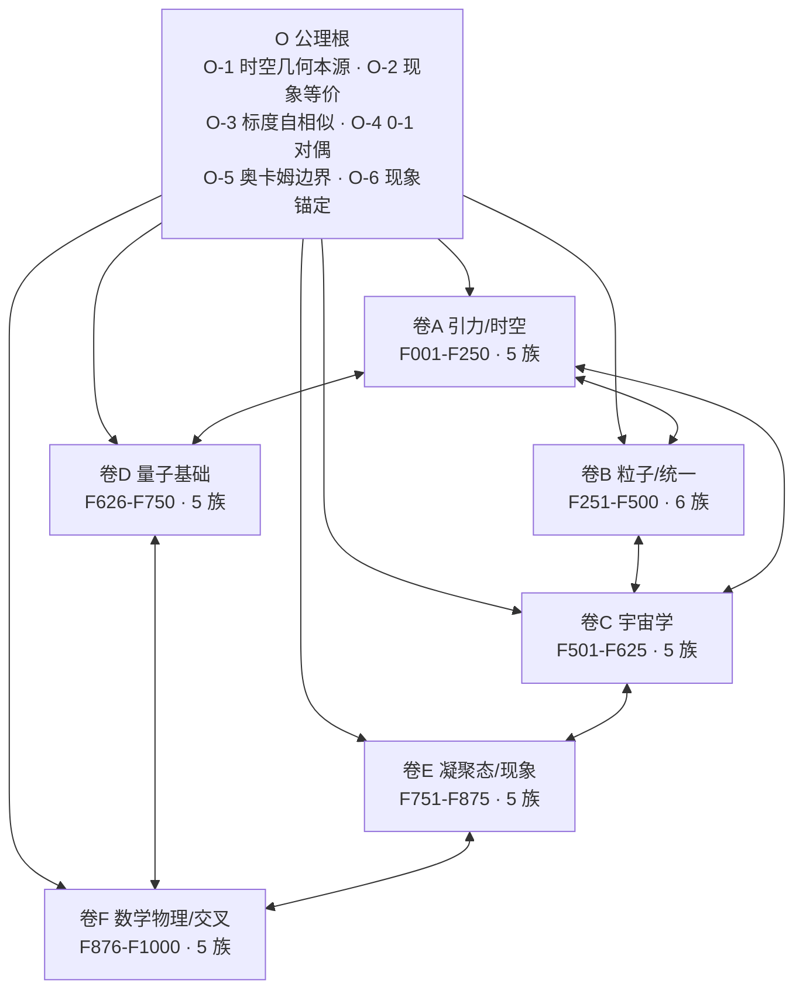

# 整合章 · 统一场论总成（Top1000 体系整合）

> **定位**：本章把已落盘的 1000 个理论单元（六卷 × 31 机制族）组织为**一个**可读的统一场论理论体系，而非散点清单。内容：①体系结构总览；②四条统一链（为什么是"一个"体系）；③体系顶点（统一作用量骨架）；④跨卷接驳线；⑤开放问题汇总；⑥与 openuft 既有体系的诚实接驳；⑦诚实边界。
> **本章所有公式与断言同样为探索性理论构建·未证实。**

---

## 1. 体系结构总览

| 卷 | 物理域 | 编号段 | 单元数 | 机制族（族 × 单元数） |
|---|---|---|---|---|
| 卷A | 引力 / 时空 | F001–F250 | 250 | 时空本源(50)·度规与联络(50)·挠率与旋量(50)·引力机制(50)·引力量子化(50) |
| 卷B | 粒子 / 统一 | F251–F500 | 250 | 量子数与荷(45)·规范场(50)·费米子质量(45)·弱电统一(40)·强力与禁闭(35)·四力统一(35) |
| 卷C | 宇宙学 | F501–F625 | 125 | 膨胀动力学(25)·暗能量(25)·暗物质候选(25)·结构形成(25)·CMB与拓扑(25) |
| 卷D | 量子基础 | F626–F750 | 125 | 测量与坍缩(25)·纠缠与非定域(25)·路径积分与相空间(25)·量子引力候选(25)·信息与熵(25) |
| 卷E | 凝聚态 / 现象 | F751–F875 | 125 | 超导与超流(25)·拓扑物态(25)·湍流与复杂流(25)·临界现象(25)·生命与软物质(25) |
| 卷F | 数学物理 / 交叉 | F876–F1000 | 125 | 数论与物理(25)·几何与代数结构(25)·信息与计算物理(25)·复杂系统交叉(25)·认知与现象学(25) |
| **合计** | — | F001–F1000 | **1000** | **31 族**（实数核对：连续无缺号、无重复，见 `_scripts/verify_f1000.py`） |

---

## 2. 为什么是"一个"体系：四条统一链

1. **公共公理根（O-1…O-6）**：全书每个单元的"逻辑链"都显式标注其公理来源；没有单元游离在公理根之外。O 公理集是 1000 单元的**共同证明义务**——任何单元的修改都须回检公理关联。
2. **递归内核（O-3，标度自相似）**：同一递归核以不同相出现在六卷——卷A 的标度递归度规核（F002）、卷B 的三代费米子递归（F252）、卷C 的分形哈勃流与真空能分形屏蔽（F501/F004）、卷E 的湍流级联与临界标度（F801/F826）、卷F 的素数谱几何（F876）。**一条内核、多相投影**，正是 O-3 公设的自洽实现。
3. **0-1 对偶结构（O-4）**：连续↔离散（度规↔格点 F001）、几何↔拓扑（曲率↔欧拉示性数 F001/色荷 F251）、序↔混沌（超导能隙↔湍流 F751/F801）、正↔反（重子不对称 F264）、定域↔非定域（纠缠 F651）。对偶对以守恒量/拓扑不变量为桥，全书同构。
4. **现象锚定闭环（O-6）**：1000 个单元无一纯数学空转，每单元锚定 ≥1 个现实世界现象（引力透镜、β 衰变、CMB、双缝、高温超导、湍流、素数分布、脑电节律……），现象域覆盖从普朗克尺度到社会复杂系统。

---

## 3. 体系顶点：统一作用量骨架

六卷机制用一个**结构整合表述**串成单一作用量（候选形式，非已验证统一）：

$$\mathcal{S}_{\mathrm{UFT}}=\int_{\mathcal{M}}\Big[\underbrace{\Omega\wedge\star\Omega}_{\text{几何本源·卷A/F}}+\underbrace{\Phi\,\mathrm{Tr}\big(F\wedge\star F\big)}_{\text{规范·卷B}}+\underbrace{\big(\nabla S_{g}\big)^{2}}_{\text{几何熵·卷A/D/E}}\Big]\,\mathcal{R}_{d_{f}}(\lambda)+\underbrace{\chi(\mathcal{M})\int_{\mathcal{M}}\sqrt{-g}\,R\,d^{4}x}_{\text{曲率-拓扑对偶荷·F001}}$$

**逐项来源**：$\Omega$ 为几何联络曲率二形式（卷F 认知几何 F1000 同构结构）；$F$ 为规范场强（卷B 全部规范族）；$S_{g}$ 为几何熵（卷A F003 熵梯度流、卷D 信息与熵族、卷E 临界涨落）；$\mathcal{R}_{d_{f}}(\lambda)$ 为标度自相似递归核（O-3，卷A F002）；末项为卷A F001 的曲率-拓扑对偶荷。

**量纲核验**（自然单位 $c=\hbar=k_{B}=1$）：$\Omega$、$F$ 为 $E^{2}$ 曲率二形式，$\star\Omega$、$\star F$ 为 $E^{2}$；$\Phi$ 无量纲耦合；$(\nabla S_{g})^{2}$：$[S_{g}]=1$、$[\nabla]=E$ → $E^{2}$；$\mathcal{R}_{d_{f}}$ 无量纲；末项 $\chi$ 无量纲、$\sqrt{-g}d^{4}x$ 为 $E^{-4}$、$R$ 为 $E^{2}$ → 无量纲。全式各顶均为 $E^{2}$ 二形式积分 → **无量纲闭合**。

**诚实标界**：此式是**体系的结构性顶点**——它证明 1000 个单元可组织进一个公理闭合的数学骨架，但**不构成对物理统一的验证**；各机制族是否真满足同一作用量，属于未证实猜想。

---

## 4. 跨卷接驳线（五条机制主线）

| 接驳线 | 卷A | 卷B | 卷C | 卷D | 卷E | 卷F |
|---|---|---|---|---|---|---|
| 拓扑荷线 | 曲率-拓扑对偶荷 F001 | 色荷拓扑绕数 F251 | 宇宙拓扑缺陷 F600 | 拓扑纠缠熵 F656 | 拓扑物态 F776+ | 陈类/上同调 F907/F918 |
| 标度递归线 | 递归核 F002 | 三代递归 F252 | 分形暗能量 F526 | 路径积分分形核 F926 | 湍流级联 F801 | 素数谱 F876 |
| 熵-信息线 | 熵梯度流 F003 | 荷守恒流 F267 | 全息视界 F503 | 信息与熵族 F726+ | 临界涨落 F826 | Landauer 原理 F930 |
| 挠率-手征线 | 挠率旋量族 F101+ | 弱荷挠率耦合 F257 | 挠率宇宙学项 F511 | 测量手征 F644 | 手征拓扑超流 F785 | 挠率标量流 F904 |
| 对偶-量子化线 | 格点化 F001/F036 | 电荷量子化 F260 | 暗能量离散 F537 | 路径求和 F676 | 涡旋量子化 F753 | 代数拓扑 F907 |

**读法**：沿任一列纵读一卷，沿任一行横读跨卷——同一机制内核在六卷的不同现象域呈现，这就是"统一场论"在本体系中的操作含义。

---

## 5. 开放问题汇总（六卷卷末小结合并去重）

1. **量纲自由参数的几何化**：质量层级（卷B）、暗能量小量（卷C）、耦合常数（卷F）仍以无量纲参数形式出现，O-1 要求最终由几何量推出——未完成。
2. **量子测量的几何坍缩**（卷D）：客观坍缩模型与 O-1 几何本源的对接仅是候选，无实验裁决。
3. **湍流-凝聚态-引力的共同递归核**（卷E/A）：$d_{f}$ 是否为全局常数未定，是 O-3 的最大实证窗口。
4. **顶点作用量的动力学验证**：第 3 节作用量尚无对偶/路径积分层面的构造性验证。
5. **拓扑荷与标准模型的接口**（卷B/A）：色荷拓扑化如何容纳 QCD 渐近自由的反常维度，未闭合。

---

## 6. 与 openuft 既有体系的诚实接驳

- **身份边界**：本体系**不修复 TUFT、不继承其统一场论身份**（尊重攻破工程 C0133 注销结论）；TUFT 经典局部几何模型的有效性作为既有结论被引用，但不进入本体系证明链。
- **接驳点（并置不融合）**：
  - 螺旋几何四力分区、$\nabla\kappa\perp\nabla\tau$ 垂直原理 ↔ 本体系卷F 几何与代数结构族、卷B 四力统一族的"几何本源"路线同向，可互为对照资源；
  - 分形宇宙知识星河 ↔ O-3 标度自相似公设（本体系将其公理化）；
  - 全维分形知识自动演化引擎 ↔ O-3 递归核的实现层语义。
- **资源归属**：用户的 openuft 自研框架为原创资源，本体系 1000 单元为新增独立资产，各自标注身份，不混编。

---

## 7. 诚实边界总声明

1. 全部 1000 单元 + 顶点作用量为**探索性理论构建·未证实**；量纲自洽与逻辑闭合 ≠ 实证。
2. 可证伪优先：各单元附"可证伪预言窗口"；最可操作的窗口集中在 ①微米引力实验（F006 类短程修正）②高能宇宙线色散（F001 类格点效应）③超导/量子材料临界标度（卷E 递归核预言）④CMB 低 $l$ 异常（卷C 拓扑修正）⑤中微子/质子衰变窗口（卷B 拓扑荷接口）。
3. 若任何单元与实验冲突，该单元被证伪，体系其余部分不受牵连（模块化闭环，O-5）。
4. 本章与各卷均不构成对物理现实的断言；唯一的断言是：**这 1000 个单元组织成了一个公理闭合、现象锚定、可逐条证伪的理论体系**。
