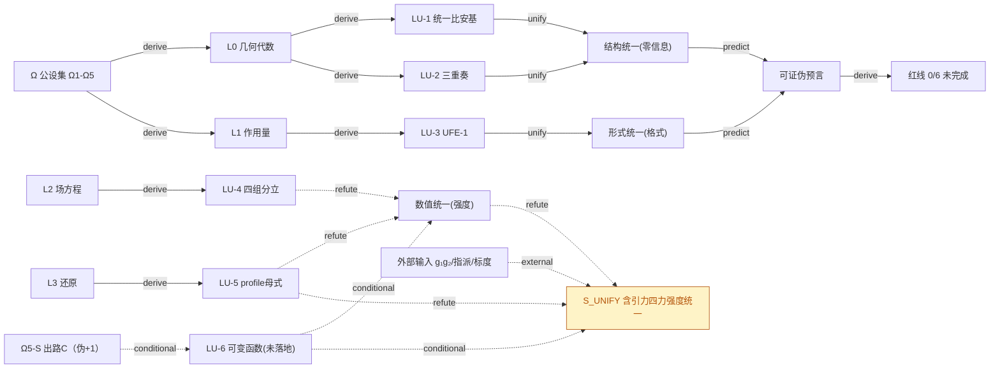

# 判定 · TUFT-r414 · 全维度 / 全链路 / 全层级 架构流程图（图论攻破版）

- **日期**：2026-11-16 ｜ **轮次**：r414 ｜ **评级**：O / L2（攻破链的图论封装与可达性判决，不是新统一结论）
- **性质**：用户「继续攻破统一场论，写进 openuft 全维度全链路全层级架构流程图」的正面回应。不是手绘图：把 r408–r413 攻破链 × L0–L5 六层 × 三判据维度构建成机器可判定有向图，做全链路可达性/缺口边分析。**不产生新物理、不落地 LU-6、不代选出路、不改任何被引文件字节。**
- **引擎**：[`源码/TUFT-r414_全维度全链路全层级架构流程图_图论攻破_2026-11-16.py`](源码/TUFT-r414_全维度全链路全层级架构流程图_图论攻破_2026-11-16.py)（纯标准库 Python 3.8 ｜ `Decimal(60)` ｜ AST 自检 ｜ 事实源 md5 只读）
- **数据**：[`.json`](数据/TUFT-r414_全维度全链路全层级架构流程图_图论攻破_2026-11-16.json) · [`.md`](数据/TUFT-r414_全维度全链路全层级架构流程图_图论攻破_2026-11-16.md) · [`_report.txt`](数据/TUFT-r414_全维度全链路全层级架构流程图_图论攻破_2026-11-16_report.txt)
- **架构图（离线可打开）**：[全维度全链路全层级架构流程图_2026-11-16.html](全维度全链路全层级架构流程图_2026-11-16.html)
- **读数**：守卫 **17/17** ｜ 条目 **15**（{'PASS': 6, 'FAIL': 2, 'INFO': 6, 'OPEN': 1}）｜ 退出码 **0** ｜ 连跑两次幂等
- **总裁定**：`ARCHITECTURE-MAP-GROUNDED--AXIOM-REACHABILITY-TO-STRENGTH-UNIFY-FALSE--GAP-EDGES-EXTERNAL-ONLY--4-NUMERIC-1-ASSIGNMENT--LU6-PSEUDO-EDGE--0OF6-UNCHANGED`

---

## §0 一句话结论

**从 Ω 公设集出发，沿公设内可通行边行走，目标「含引力四力的强度统一」S_UNIFY 不可达。** 图上所有通向 S_UNIFY 的入边都是断边（被否证 refute / 条件 conditional / 外部 external，w=0）。唯一把它变可达的办法是注入外部边——4 条独立数值约束 + 4.585 bits 部门指派 + LU-6 形状公设/参数来源。**这说明"统一"在现有公设集下是外部购入的，不是公设派生的。**

## §1 三轴架构（全维度 / 全链路 / 全层级）

- **全层级 LAYER**：L0 几何代数 · L1 作用量 · L2 场方程 · L3 还原 · L4 验证 · L5 判据
- **全维度 DIM**：D1 结构统一 · D2 形式统一 · D3 数值统一
- **全链路 CHAIN**：公理 → 层 → 方程族 → 判据 → 预言/红线
- **图规模**：节点 19 / 有向边 21 / 断边(w=0) 8。

## §2 全链路可达性（攻破核心）

从 Ω 公设集出发（根节点 AX、AXC），把 weight=0 的边视为断边，BFS 可达集为：

> AX、AXC、D1、D2、L0、L1、PRED、RED、U1、U2、U3

**S_UNIFY 公设内可达 = False。** 可达集停在 D1/D2/PRED/RED；D3（数值统一）与 SUN 均不可达。这是"最终实现统一场论方程"在图论层的结构性障碍。

## §3 缺口边账（S_UNIFY 全部入边 blocked）

| 起点 | 关系 | 权 | 说明 |
|---|---|---|---|
| U6 | conditional | 0 | 唯一潜在入口，被r413封 |
| U5 | refute | 0 | 强度输入≠强度统一 |
| OBS | external | 0 | 4数值约束+4.585bits指派 外部购入 |
| D3 | refute | 0 | 数值统一6/6层FAIL |

阳性对照：把 OBS→SUN 边权改 1（注入 4 数值约束 + 4.585 bits 指派）后 SUN 变为可达；但只把 U6→SUN 边权改 1（假设 LU-6 落地）仍然不可达——因 AXC→U6 入口边被 r413 判为条件断边。**图论独立复现了 r413 的结论。**

## §4 全层级 × 全维度 交叉矩阵

| 层 | D1 结构 | D2 形式 | D3 数值 |
|---|---|---|---|
| L0 几何代数 | PASS | PASS | NA |
| L1 作用量 | PASS | PASS | FAIL |
| L2 场方程 | NA | FAIL | FAIL |
| L3 还原 | PASS | PART | FAIL |
| L4 验证 | NA | NA | FAIL |
| L5 判据 | NA | NA | FAIL |

D3 数值统一列在 L1–L5 全 FAIL（L0 为 NA 零信息层），与 r412 全情况表「强度×数值统一 6/6 层 FAIL」逐格互印。

## §5 架构流程图（Mermaid 源码）

> 图例：实线 `-->` = 公设内可通行（w=1）；虚线 `-.->` = 断边（refute/conditional/external，w=0）。红框 S_UNIFY 为不可达目标。离线可视化见 [HTML 架构图](全维度全链路全层级架构流程图_2026-11-16.html)。

## §6 阳性对照（判据有牙）

- **axiom_unreachable_target**：expect=False got=False → OK
- **inject_external_constraints_becomes_reachable**：expect=True got=True → OK
- **inject_lu6_edge_still_unreachable**：expect=False got=False → OK
- **numeric_dim_not_axiom_reachable**：expect=False got=False → OK

## §7 自纠与红线

起草期自抓 2 条（见引擎 `SELF_CORRECTIONS`）：① 可达性必须先把 weight=0 边视为断边，否则"图上连了线"会被误当"公设内可达"（伪可达）；② 缺口边必须区分 refute/conditional/external 三类，否则"LU-6 单边注入可达"会掩盖入口 AXC→U6 仍是断边。

> 红线：本册是**攻破链的图论封装与可达性判决**，不产生新物理、不落地 LU-6、不否证任何既有册、不代选出路。唯一对外读数仍为 **0/6，未完成**；0/22、UFT-3=0、L3=0、validated=0、含引力四力正确方程 0 条、L3↛L4 全部保持（D01 全 TRUE）。「不可达」是对现有公设集的图论判决，不是对统一场论研究方向的否定。未跑 `refresh_catalog.py`、未改 `verify.py`、未做 git、未触碰他人文件。

**交叉回链**：[引擎](源码/TUFT-r414_全维度全链路全层级架构流程图_图论攻破_2026-11-16.py) · [数据 JSON](数据/TUFT-r414_全维度全链路全层级架构流程图_图论攻破_2026-11-16.json) · [运行报告](数据/TUFT-r414_全维度全链路全层级架构流程图_图论攻破_2026-11-16_report.txt) · [HTML 架构图](全维度全链路全层级架构流程图_2026-11-16.html) · [r412](判定_TUFT-r412-力的统一全情况全方程全方案总账与分层统一新思维_2026-11-16.md) · [r413](判定_TUFT-r413-出路C可变函数与部门选择的可识别性攻破_2026-11-16.md) · [归一正本](../../统一场论理论体系与方程_归一正本_2026-11-09.md) · [卷74](../../07_统一场方程/74_力的统一_单方程力谱完全分类_2026-10-28.md)

---

*登记：2026-11-16 · 算法联盟 r414 · 未占他人编号（r410–r413 已占）· 未跑 `refresh_catalog.py`、未改 `verify.py`、未做 git。*