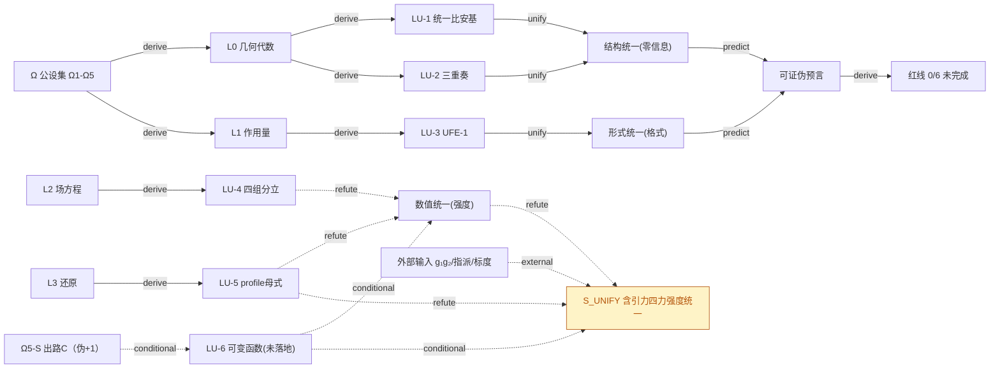

# TUFT-r414_全维度全链路全层级架构流程图_图论攻破_2026-11-16

- 日期：2026-11-16 ｜ 引擎：`源码/TUFT-r414_全维度全链路全层级架构流程图_图论攻破_2026-11-16.py`
- 守卫 **17/17** ｜ 条目 **15**（{'PASS': 6, 'FAIL': 2, 'INFO': 6, 'OPEN': 1}）｜ 退出码 **0**
- 总裁定：`ARCHITECTURE-MAP-GROUNDED--AXIOM-REACHABILITY-TO-STRENGTH-UNIFY-FALSE--GAP-EDGES-EXTERNAL-ONLY--4-NUMERIC-1-ASSIGNMENT--LU6-PSEUDO-EDGE--0OF6-UNCHANGED`

## 三轴与图规模

- 层 6 × 维 3 × 链 5 ｜ 节点 19 / 边 21 / 断边 8

## 全链路可达性

S_UNIFY 公设内可达 = **False**

## 缺口边账

- U6 → S_UNIFY [conditional,w=0] 唯一潜在入口，被r413封
- U5 → S_UNIFY [refute,w=0] 强度输入≠强度统一
- OBS → S_UNIFY [external,w=0] 4数值约束+4.585bits指派 外部购入
- D3 → S_UNIFY [refute,w=0] 数值统一6/6层FAIL

## 架构流程图（Mermaid）

