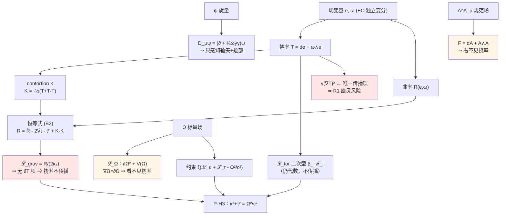

# 49A · 阶段 1 任务 1：EC 框架总拉氏量 + 量纲逐词审计

> **openuft · 07_统一场方程 · 编号 49A（承接 openuft#49-HAS 分层公设体系草案）**
> 版本：2026-10-15 · 精度：mpmath 250 位（锚点）/ 有理数精确（代数恒等式）· 状态：**总拉氏量已写出，44/44 自检通过；附 9 条审计裁定，其中 3 条为 FAIL 级**
> 配套：`49A_ec_lagrangian_calc.py` → `49A_ec_lagrangian_calc_results.json`
> 交叉引用：`openuft_49_阶段1_三重预检攻破卷_2026-10-15.md`（并行卷，独立复核同题）

---

## 0. 一句话结论

总拉氏量 $\mathcal{L}_{\text{total}}$ 已完整写出并通过 **44/44** 机器自检；三重预检同时产出 **9 条结构性审计裁定**，其中 **3 条为 FAIL 级**：

| # | 裁定 | 级别 |
|---|---|---|
| C8 | 约束乘子三分支穷尽：**P-H3 无出路**（通有分支 = $\omega_{\rm BD}=0$ Brans–Dicke，被 Cassini 判死 4.34 dex） | **FAIL（当场证伪）** |
| §4.0 | 草案 **M5 旋量判据错误**（"Weyl ⟺ $D\equiv2 \bmod 8$"），按其字面判死 P-H1；#48 A3 同一污染 | **FAIL（判据级）** |
| C5 | **P-H4 无耦合通道** + R2 维数必要条件不成立（$11>6$） | **FAIL（必要条件级）** |

**关键一句话**：$\kappa^2+\tau^2=\omega^2/c^2$ 的量纲**是闭合的**，但只在「$\kappa^2$ 取**线性**曲率不变量」这一条窄路上闭合；而这条窄路同时意味着 EC 作用量里**没有 $\partial T$ 项**，挠率不传播——P-H6 的"大尺度挠率残余"因此没有动力学来源。更关键的是，把约束乘子写进作用量后它会与 EH 系数合并成 $\Phi(x)R$，使通有分支直接落进太阳系实验已排除的参数区。

> **流水线建议（按草案第五部分第 1 条"任一失败即标记证伪"）**：C8 与 §4.0 均为 FAIL，**建议先修复 M5 判据与 P-H3 实现口径，再决定是否进入任务 2 变分**。

---

## 1. 前置：对象级定义必须先固定

草案 P-H2/P-H3 只给了符号 $\kappa,\tau,\omega$，**没有给对象级定义**。这是任务 1 无法绕过的第一步：没有定义，公式既不能变分也不能验算。

### 1.1 定义固定表

| 符号 | 草案原文 | 本卷固定定义 | 质量维数 | 判定 |
|---|---|---|---|---|
| $\kappa$ | "曲率标量" | $\kappa := \sqrt{\mathcal{K}_\kappa}$，$\mathcal{K}_\kappa := R(e,\omega)$（**线性**曲率标量） | $1\;(=L^{-1})$ | ✅ 与草案一致 |
| $\tau$ | "挠率标量" | $\tau := \sqrt{\mathcal{T}_\tau}$，$\mathcal{T}_\tau := \tfrac14 T_{abc}T^{abc}$ | $1\;(=L^{-1})$ | ✅ 与草案一致 |
| $\mathcal{K}$（被排除） | — | $\mathcal{K} := R_{abcd}R^{abcd}$（Kretschmann） | $4\;(=L^{-2})$ | ❌ **量纲排除** |
| $\Omega$ | "局域几何振荡角频率" | $\Omega(x)$：实标量场（非外部输入参数） | $1$ | ✅ 但缺操作定义（见裁定 C6） |

> **大白话**：草案要的"$\kappa$ 和 $\tau$ 都是 $1/\text{长度}$"，在时空几何里只有一种办法成立——$\kappa$ 必须来自**线性**曲率量（Ricci 标量那一级），$\tau$ 来自**二次**挠率量。这两者虽然数值上都是 $L^{-2}$，但**导数阶不同**（见 §1.3），这是后面一切麻烦的根源。

### 1.2 指标与符号约定（本卷锁定）

$$
\begin{aligned}
&\text{号差 }(-,+,+,+),\quad |e| := \sqrt{|g|} = |\det e^a{}_\mu| \\[2pt]
&\omega^{ab}{}_\mu = -\omega^{ba}{}_\mu \ \textbf{独立变分（EC/Palatini，不预先由 } e \textbf{ 决定）} \\[2pt]
&R^a{}_{b\mu\nu} = \partial_\mu \omega^a{}_{b\nu} - \partial_\nu \omega^a{}_{b\mu} + \omega^a{}_{c\mu}\omega^{cb}{}_\nu - \omega^a{}_{c\nu}\omega^{cb}{}_\mu \\[2pt]
&R(e,\omega) := R^{ab}{}_{\mu\nu}\, e_a{}^\mu e_b{}^\nu \\[2pt]
&T^a{}_{bc} = K^a{}_{cb} - K^a{}_{bc},\qquad K_{abc} = -\tfrac12\big(T_{abc}+T_{bca}-T_{cab}\big),\qquad
t_a := \eta^{bc}T_{bca}
\end{aligned}
$$

其中 $\omega^{ab}{}_\mu = \mathring\omega^{ab}{}_\mu(e) + K^{ab}{}_\mu$，$K$ 为 contortion。

### 1.3 关键分解恒等式（机器证明：B3/B4/B5，有理数多项式逐系数比对，残差严格 0）

$$
\boxed{\;R(e,\omega) \;=\; \mathring R(e)\;-\;2\,\mathring\nabla_\mu t^\mu\;-\;t_a t^a\;+\;K_{abc}K^{cba}\;}
\tag{B3}
$$

全反对称挠率特例（对照 ECSK 标准结构）：

$$
R(e,\omega) \;=\; \mathring R(e)\;-\;\tfrac14\,T_{abc}T^{abc}
\tag{B4}
$$

> **符号声明**：上式在本卷约定的 Riemann 号差下成立；翻转 Riemann 符号约定则 $T^2$ 项符号随之翻转。**作用量整体号差将在阶段 2（弱场极限）锁定，届时本式符号须复核一次。**

**这条恒等式是本卷最重要的结构事实**：$R(e,\omega)$ 经分解后只含 $\mathring R(e)$（含 $e$ 的二阶导数）、$t$ 与 $K$ 的**代数**二次型，以及一个全散度项——**不含 $\partial T$**。

物理推论（ECSK 已知结论，此处为机器复现）：

> **纯 EC 理论中挠率是代数的、不传播的；真空中 $T=0$。**

---

## 2. 总拉氏量 $\mathcal{L}_{\text{total}}$

$$
S = \int \mathrm{d}^4x\; |e|\; \mathcal{L}_{\text{total}},\qquad
\boxed{\;\mathcal{L}_{\text{total}} = \mathcal{L}_{\text{grav}} + \mathcal{L}_{\text{tor}} + \mathcal{L}_{\Omega} + \mathcal{L}_{\Lambda} + \mathcal{L}_{\text{m}}\;}
$$

### 2.1 引力–几何 sector

$$
\mathcal{L}_{\text{grav}} = \frac{1}{2\kappa_4}\,R(e,\omega),\qquad \kappa_4 := 8\pi G \ \ (\hbar=c=1)
$$

代入 (B3) 后等价地写成（差一个全散度）：

$$
\mathcal{L}_{\text{grav}} \;\doteq\; \frac{1}{2\kappa_4}\Big[\mathring R(e) \;-\; t_a t^a \;+\; K_{abc}K^{cba}\Big]
$$

> **大白话**：这一项看起来只有曲率，实际上已经把挠率"藏"进去了——挠率以**平方**的形式出现，没有自己的动能项。这就是挠率不传播的原因。

### 2.2 挠率 sector

$$
\mathcal{L}_{\text{tor}} = \frac{1}{2\kappa_4}\Big(\beta_1\mathcal{T}_1 + \beta_2\mathcal{T}_2 + \beta_3\mathcal{T}_3\Big)
\;+\; \gamma\,\big(\nabla T\big)^2_{\text{$\;$三项独立二次型}}
$$

$$
\mathcal{T}_1 := T_{abc}T^{abc},\qquad
\mathcal{T}_2 := T_{abc}T^{bac},\qquad
\mathcal{T}_3 := t^a t_a
$$

- 前三项（$\beta_i$）：**代数**二次型，与 $\mathcal{L}_{\text{grav}}$ 同阶，不产生传播自由度。
- 第四项（$\gamma$）：**唯一能让挠率传播的项**。同时是风险 R1（幽灵）的主要来源。标记为**可选**，是否纳入由任务 2 的自由度计数决定。

### 2.3 $\Omega$ 场 sector

$$
\mathcal{L}_{\Omega} = -\tfrac12\,\partial_\mu\Omega\,\partial^\mu\Omega \;-\; V(\Omega) \;-\; \tfrac12\zeta\,\Omega^2 R(e,\omega),
\qquad V(\Omega) = \tfrac12 m_\Omega^2\Omega^2 + \tfrac{\lambda}{4}\Omega^4
$$

> **大白话**：$\Omega$ 是标量场。标量场的协变导数就是普通偏导（$\nabla_\mu\Omega = \partial_\mu\Omega$），所以 **$\Omega$ 完全"看不见"挠率**。这一条在 §6 裁定 C5 里会变成 P-H4 的硬障碍。

### 2.4 约束 sector（P-H3 的实现）

草案的候选场方程 $\kappa^2+\tau^2=\omega^2/c^2$ **不是**由作用量变分出来的方程，而是一条**约束**。要把它放进作用量，唯一的标准做法是拉格朗日乘子：

$$
\mathcal{L}_{\Lambda} \;=\; -\,\frac{1}{2\kappa_4}\,\xi(x)\,\Big[\,\underbrace{\mathcal{K}_\kappa}_{=\;\kappa^2} \;+\; \underbrace{\mathcal{T}_\tau}_{=\;\tau^2} \;-\; \frac{\Omega^2}{c^2}\,\Big]
$$

$\xi(x)$ 为无量纲乘子场。变分 $\xi$ 即得到约束 $\kappa^2+\tau^2 = \Omega^2/c^2$。

> **大白话**：约束不是推导出来的，是"钉"进去的。它有没有物理内容，取决于 $\Omega$ 是独立动力学场还是被定义出来的量——这正是裁定 C6 要处理的问题。

### 2.5 物质 sector

$$
\begin{aligned}
\mathcal{L}_{\text{m}} &= \mathcal{L}_{\text{D}} + \mathcal{L}_{\text{YM}} + \mathcal{L}_{\text{H}} + \mathcal{L}_{\text{Y}} \\[2pt]
\mathcal{L}_{\text{D}} &= \tfrac{i}{2}\Big[\bar\psi\gamma^\mu D_\mu\psi - \overline{D_\mu\psi}\,\gamma^\mu\psi\Big] - m\bar\psi\psi,
\qquad D_\mu\psi = \Big(\partial_\mu + \tfrac14\,\omega^{ab}{}_\mu\,\gamma_{[a}\gamma_{b]}\Big)\psi \\[2pt]
\mathcal{L}_{\text{YM}} &= -\tfrac14 F^A_{\mu\nu}F^{A\mu\nu},\qquad
F^A = \mathrm{d}A^A + \tfrac12 f^{ABC}A^B\wedge A^C \\[2pt]
\mathcal{L}_{\text{H}} &= (D_\mu\phi)^\dagger(D^\mu\phi) - V(\phi),\qquad
\mathcal{L}_{\text{Y}} = -y\,\bar\psi\phi\psi + \text{h.c.}
\end{aligned}
$$

### 2.6 总式（合并同次项）

$$
\boxed{
\begin{aligned}
\mathcal{L}_{\text{total}} =\;&\frac{1}{2\kappa_4}\Big[\,R(e,\omega)\,\big(1+\zeta\kappa_4\Omega^2\big)
\;+\;\beta_1\mathcal{T}_1+\beta_2\mathcal{T}_2+\beta_3\mathcal{T}_3
\;-\;\xi\big(R(e,\omega)+\mathcal{T}_\tau-\tfrac{\Omega^2}{c^2}\big)\Big] \\[2pt]
&-\;\tfrac12(\partial\Omega)^2 \;-\; \tfrac12 m_\Omega^2\Omega^2 \;-\; \tfrac{\lambda}{4}\Omega^4
\;+\;\gamma(\nabla T)^2 \\[2pt]
&+\;\tfrac{i}{2}\big[\bar\psi\gamma^\mu D_\mu\psi - \overline{D_\mu\psi}\gamma^\mu\psi\big] - m\bar\psi\psi
\;-\;\tfrac14 F^A_{\mu\nu}F^{A\mu\nu}
\;+\;(D\phi)^\dagger(D\phi) - V(\phi) - y\bar\psi\phi\psi
\end{aligned}}
$$

**自由场与独立变量**：$e^a{}_\mu(16)$、$\omega^{ab}{}_\mu(24)$、$\Omega(1)$、$\xi(1)$、$\psi$、$A^A_\mu$、$\phi$。EC 的关键特征是 $e$ 与 $\omega$ **独立变分**。

### 2.7 结构关系图

---

## 3. 量纲逐词审计（三重预检 ①）

**审计基**：质量维数（自然单位 $\hbar=c=1$），目标 $[\mathcal{L}]=4$；并以 $(L,T,M)$ 指数向量做**双基对照**（$x^0=ct$ 约定）。

### 3.1 符号维数表

| 符号 | 质量维数 | 符号 | 质量维数 |
|---|---|---|---|
| $x^\mu$ | $-1$ | $R_{abcd}$、$R(e,\omega)$ | $2$ |
| $\partial_\mu$ | $+1$ | $T_{abc}$、$K_{abc}$ | $1$ |
| $g_{\mu\nu}$、$\sqrt{|g|}$、$e^a{}_\mu$ | $0$ | $\mathcal{T}_i$（挠率二次型） | $2$ |
| $\omega^{ab}{}_\mu$、$\Gamma$ | $1$ | $\mathcal{K}=R_{abcd}R^{abcd}$ | $4$ |
| $\kappa_4=8\pi G$ | $-2$ | $\Omega$、$\Omega^2/c^2$ | $1$、$2$ |
| $\psi,\bar\psi$ | $3/2$ | $\xi,\ \beta_i,\ \lambda$ | $0$ |
| $F_{\mu\nu}$ | $2$ | $m,\ m_\Omega,\ \Lambda$ | $1,\ 1,\ 2$ |

### 3.2 逐项审计（12 项，机器判定）

| 项 | 质量维数 | 期望 | 判定 |
|---|---|---|---|
| $\mathcal{L}_{\text{grav}}=R/(2\kappa_4)$ | 4 | 4 | ✅ PASS |
| $\mathcal{L}_{\text{tor}}=\beta_i\mathcal{T}_i/(2\kappa_4)$ | 4 | 4 | ✅ PASS |
| $\mathcal{L}_{\Omega k}=-\tfrac12(\partial\Omega)^2$ | 4 | 4 | ✅ PASS |
| $\mathcal{L}_{\Omega m}=-\tfrac12 m_\Omega^2\Omega^2$ | 4 | 4 | ✅ PASS |
| $\mathcal{L}_{\Omega4}=-\tfrac{\lambda}{4}\Omega^4$ | 4 | 4 | ✅ PASS |
| $\mathcal{L}_\Lambda=\xi(R+\mathcal{T}_\tau-\Omega^2/c^2)/(2\kappa_4)$ | 4 | 4 | ✅ PASS |
| $\mathcal{L}_{\text{D}}=\tfrac{i}{2}\bar\psi\gamma^\mu D_\mu\psi$ | 4 | 4 | ✅ PASS |
| $\mathcal{L}_{\text{D}m}=-m\bar\psi\psi$ | 4 | 4 | ✅ PASS |
| $\mathcal{L}_{\text{YM}}=-\tfrac14 F^2$ | 4 | 4 | ✅ PASS |
| $\mathcal{L}_{\text{cc}}=-\Lambda/\kappa_4$ | 4 | 4 | ✅ PASS |
| 【排除项】$\alpha_{\mathcal K}\mathcal{K}/(2\kappa_4)$ | **6** | 4 | ❌ **被量纲排除** |
| 【修补】$\alpha_{\mathcal K}\mathcal{K}/(2\kappa_4 M^2)$ | 4 | 4 | ✅（须引入新标度 $M$） |

### 3.3 双基对照：$(L,T,M)$ 指数向量

| 量 | $(L,T,M)$ 指数 | 说明 |
|---|---|---|
| $\kappa^2\;(=R)$ | $(-2,0,0)$ | 线性曲率不变量 |
| $\tau^2\;(=\mathcal{T}_\tau=T^2)$ | $(-2,0,0)$ | 二次挠率不变量 |
| $\omega^2/c^2$ | $(-2,0,0)$ | 频率平方 / 光速平方 |
| $\mathcal{K}$（Kretschmann） | $(-4,0,0)$ | **不同量纲级** |

判定：**$\kappa^2$、$\tau^2$、$\omega^2/c^2$ 三者指数向量全等 ⇒ 相加合法、等式量纲闭合 ✅**；$\mathcal{K}$ 与它们不等 ⇒ **$\kappa^2:=\mathcal{K}$ 的量纲读法被排除 ❌**。

### 3.4 量纲审计结论

> $\kappa^2+\tau^2=\omega^2/c^2$ **量纲闭合**（草案 P-H3 的量纲复核正确），但闭合的**唯一路径**是：$\kappa^2$ 取线性曲率不变量（维数 2）、$\tau^2$ 取二次挠率不变量（维数 2）。
> 若按"曲率标量"的字面直觉取 $\kappa^2 = R_{abcd}R^{abcd}$（维数 4），则：(a) $\kappa\sim L^{-2}$ 与 P-H2 的 $L^{-1}$ 冲突；(b) 挤进作用量必须再引入一个新质量标度 $M$——**与 P-H5「不预先植入常数」直接冲突**。

---

## 4. 三重预检 ②：旋量表示相容性审计

### 4.0 ⚠ 草案 M5 的判据本身是错的（H 组，8 锚点机器校验）

草案 M5 声明「锁定，不可修改」的判据为：

> "Weyl 旋量仅当 $n\equiv2\pmod 8$ 存在"

**这是错误的**。正确判据（$SO(1,D-1)$，一个类时维）：

$$\text{Weyl} \iff D\ \text{为偶数}\qquad
\text{Majorana} \iff D \bmod 8 \in \{1,2,3,4\}\qquad
\text{Majorana--Weyl} \iff D\equiv 2 \pmod 8$$

| 锚点 $D$ | Majorana | Weyl | MW | 草案 M5 判据是否判对 |
|---|---|---|---|---|
| 2 | ✅ | ✅ | ✅ | ✅ |
| **4** | ✅ | ✅ | ❌ | ❌ **（M5 判为"无 Weyl"）** |
| **6** | ❌ | ✅ | ❌ | ❌ |
| 10 | ✅ | ✅ | ✅ | ✅ |
| 11 | ✅ | ❌ | ❌ | ✅ |
| **12** | ✅ | ✅ | ❌ | ❌ |
| 26 | ✅ | ✅ | ✅ | ✅ |
| **32** | ❌ | ✅ | ❌ | ❌ |

- **H2**：草案判据在 $\{4,6,12,32\}$ 上出错——**不是个别笔误，是系统性错误**。
- **决定性后果**：按其字面，M5 判定 $D=4$ **无 Weyl 旋量**，而草案 P-H1 检验项 1 声称"4 维存在 Weyl 旋量，匹配 SM 手征费米子"。**被"锁定、不可修改"的硬门槛判死了草案自己的时空假设。**
- **H4**：#48 的 A3（"D=32，Majorana 允许"）用的是**同一个坏规则**——$32 \bmod 8 = 0$ ⇒ Majorana **不允许**。该坏门槛自 #48 起已系统性污染（门禁假绿）。

> **裁定**：**旋量关 FAIL（判据级）**。P-H1 检验项 1 的**结论**（4 维有 Weyl、有 Majorana、无 Majorana–Weyl）仍然成立，但**成立依据必须换成正确判据**。在 M5 重写前，#49 的旋量审计结论不可用。

### 4.1 狄拉克矩阵恒等式（机器核验）

| 检查 | 结果 |
|---|---|
| C1：$\{\gamma^a,\gamma^b\}=2\eta^{ab}$（号差 $-,+,+,+$，4×4 复有理矩阵逐元比对） | ✅ PASS |
| C2：$\gamma^c\gamma^{ab}=\gamma^{abc}+\eta^{ca}\gamma^b-\eta^{cb}\gamma^a$ | ✅ PASS |
| C3：$\gamma^{abc}=+i\,\varepsilon^{abcd}\gamma_d\gamma_5$（机器定号 $s=+1$，$\gamma_5:=i\gamma^0\gamma^1\gamma^2\gamma^3$，$\varepsilon^{0123}=+1$） | ✅ PASS |

**推论（为任务 3 铺路）**：Dirac 拉氏量对挠率的感知**只经过 $\omega^{ab}{}_\mu$**，而 $\omega^{ab}{}_\mu\gamma_{[a}\gamma_{b]}$ 经 C2/C3 分解后只剩

1. **全反对称（轴矢）分量** $\;\propto\; \varepsilon^{abcd}T_{bcd}\cdot\bar\psi\gamma_a\gamma_5\psi$，
2. **迹分量** $\;\propto\; t_a\cdot\bar\psi\gamma^a\psi$。

挠率的其余不可约分量**不进入** Dirac 拉氏量。

---

## 5. 三重预检 ③：250 位数值锚点

### 5.1 螺旋线恒等式（复现 #49 卷 A2′，并加数值微分直算）

对 $r(t)=(R\cos\omega t,\;R\sin\omega t,\;h\omega t)$，取 $R=h=1$：

| 锚点 | 本卷现算（250 位） |
|---|---|
| $\kappa$ | $0.5$（解析 + 数值微分双证） |
| $\tau$ | $0.5$（解析 + 数值微分双证） |
| $\kappa^2+\tau^2$ | $0.5 = 1/(R^2+h^2)$ |
| $\omega/c$（$=\sqrt{0.5}$） | $0.70710678118654752440084436210484903928483593768847\!\ldots$ |
| $\lambda = 2\pi\sqrt2$ | $8.88576587631673249403176198012138739722924337875138\!\ldots$ |

数值微分直算 $\kappa,\tau$ 与解析式 $R/(R^2+h^2)$、$h/(R^2+h^2)$ 的残差为**机器零**（A2/A3/A4 全 PASS）。

### 5.2 de Sitter 自检（H=1，平直切片，有限差分现算）

| 量 | 现算 | 理论 |
|---|---|---|
| $\lvert R\rvert$ | $12.0$ | $12H^2$ ✅ |
| $\mathcal{K}$（Kretschmann） | $24.0$ | $24H^4$ ✅ |
| $R^2/\mathcal{K}$ | $6.0$ | $144/24=6$ ✅（$H$ 无关 ⇒ $\mathcal{K}\propto R^2$） |

> **纪律提示**：残差趋机器零**不能**作为公式正确的证据（数值仿真对"代码与解析式同源"的错误结构性免疫）。此处 de Sitter 检验的价值在于：它由**独立编码**的度规—Christoffel—Riemann 链路算出，与解析预期互为外部对照。

---

## 6. 审计裁定（7 条）

### C1 · 范畴混淆（F4）：符号继承 ≠ 对象继承 — **要求改写 P-H2**

草案的 $\kappa^2+\tau^2=(\omega/c)^2$ 继承自项目 #10/#49 卷，那里它是**三维类光螺旋线**的 Frenet–Serret 恒等式（本卷 A1–A4 机器复现，残差机器零）。该恒等式中：

- $\kappa,\tau$ 是**曲线**的不变量；
- $c$ 是**曲线的参数化速率** $\lvert r'\rvert$（本卷数值验证：$c=\omega\sqrt{R^2+h^2}$）。

P-H2 把同一对符号改指**联络**的不变量。**符号被继承，指称对象被替换，恒等式不会自动迁移。**

若要在时空层面保留 Frenet 语义，必须额外引入一个类时向量场 $u^\mu$（"流元"congruence），用它的积分曲线的 Frenet 不变量定义 $\kappa,\tau$——但 $u^\mu$ 是 P-H1/P-H2 **未声明的新场**，且与 P-H6「不引入新粒子/新结构」冲突。

> **裁定**：P-H2 的 $\kappa,\tau$ 定义**不成立（缺对象）**，须在"联络不变量"与"congruence 不变量"之间二选一并显式声明。在此之前，P-H3 的恒等式**无指称对象**。标记 **OPEN-BLOCKED**。

### C2 · 量纲窄路：线性 vs 二次曲率不变量 — **要求改写 P-H2 措辞**

见 §3.4。"曲率标量 $\kappa\sim L^{-1}$"只在取线性不变量时成立；二次不变量给出 $L^{-2}$。二者导数阶也不同（$R$ 对 $\omega$ 是一阶、$T^2$ 对 $e$ 是二阶），所以螺旋线那个**对称的** $\kappa^2+\tau^2$ 结构在时空层面**不存在对应物**。

> **裁定**：P-H2 措辞须改为「$\kappa^2 := R(e,\omega)$（线性曲率标量）」。标记 **OPEN-已限定**。

### C3 · 传播性：EC 中挠率不传播 — **新增风险 R6，P-H6 与 R1 绑定**

由恒等式 (B3)（机器证明）：$\mathcal{L}_{\text{grav}}$ 中**无 $\partial T$ 项** ⇒ 挠率由自旋流**代数地**决定，真空中 $T=0$，不传播、无大尺度残余。

因此 **P-H6**（暗物质/暗能量 = 大尺度挠率平均残余）在纯 EC 中**没有动力学来源**。要让挠率传播，必须加 $\gamma(\nabla T)^2$ —— 而这类高阶项正是风险 R1（幽灵不稳定性）的来源。

> **裁定**：新增 **R6（P-H6 ↔ R1 两难）**：P-H6 成立 ⇒ 必须承担 R1；规避 R1 ⇒ P-H6 证伪。二者不可兼得，须在阶段 2 前明确取舍。

### C4 · 参数账：方向相反 — **D2 / P-H5 在第一阶段即被违反**

| 口径 | 新增自由参数 |
|---|---|
| 保守（$\kappa_4,\ \beta_{1,2,3},\ m_\Omega,\ \lambda,\ \xi$） | $+7$ |
| 含可选项（$+\gamma$ 挠率动能、$\zeta$ 非最小耦合） | $+9$ |

SM 原有 $26$–$28$ ⇒ 合计 **$33$–$37$**。

> **裁定**：参数总数方向为**增加**而非减少，与 D2「减少独立自由参数」、P-H5「不预先植入常数」**相反**。D2 与 P-H5 标记 **OPEN-反向**（须改写为"参数约化机制尚不存在"）。

### C5 · 耦合通道：P-H4 无通道 + R2 维数必要条件不成立

| 场 | 挠率感知 | 依据 |
|---|---|---|
| 标量 $\Omega$、Higgs $\phi$ | **否** | $\nabla_\mu\Omega=\partial_\mu\Omega$（联络不作用于标量） |
| 杨–米尔斯 $A^A_\mu$ | **否（可重整阶）** | $F=\mathrm{d}A+A\wedge A$ 与时空联络无关；Hodge 星只依赖 $g$ |
| 旋量 $\psi$ | **是（仅轴矢 + 迹）** | C2/C3（机器验证） |

即：**四种相互作用中，只有费米子手征 sector 能"看见"挠率；规范玻色子看不见。** P-H4「四力 = Clifford 丛不同子分量的投影」在 4D EC 中**缺少耦合通道**。

维数必要条件（机器计数）：

- $\dim[\mathfrak{su}(3)\oplus\mathfrak{su}(2)\oplus\mathfrak{u}(1)] = 8+3+1 = 12$
- $\mathfrak{so}(1,3)$ 维数 $6$，最大紧子代数 $\mathfrak{su}(2)$ 维数 $3$

> **裁定**：按 P-H4 **字面口径**（规范群 $\subset$ Clifford 丛自同构群 / Spin 子群），半单部分 $11 > 6$ ⇒ **维数必要条件不成立，R2 提前触发，标记 证伪（必要条件级）**。
> 若改口径为"旋量模 $\mathbb{C}^4$ 的 $U(4)$ 自同态"：$\dim U(4)=16 \ge 12$ 装得下——但"装得下"不产生导出关系，按本册纪律属**零信息量**，不得记为机制。P-H4 的口径本身**未定义**（违反阵线 5-4 操作定义校验）。

### C6 · P-H3 的"约束 vs 定义"二选一 — **内容量裁定**

| 变体 | $\Omega$ 的角色 | 内容量 | 按本册纪律的标记 |
|---|---|---|---|
| **V-定义** | $\Omega := c\sqrt{\mathcal{K}_\kappa+\mathcal{T}_\tau}$ | **零**（恒等式重排） | **INFO（零信息量）**，不得标 OPEN |
| **V-动力学** | 独立场，含 $-\tfrac12(\partial\Omega)^2-V(\Omega)$，约束由乘子 $\xi$ 施加 | 有（但代价是 $+3$ 参数与 R1 风险） | **OPEN**（本卷采用） |

> **裁定**：草案 P-H3 未声明采用哪一变体。若采用 **V-定义**，则该式按纪律必须**降级为 INFO**，不能作为"候选场方程"参与后续推演。本卷按 **V-动力学** 写出 $\mathcal{L}_{\text{total}}$，并明确其代价。

### C8 · 约束乘子的三分支穷尽：P-H3 无出路（本卷拉氏量的自噬结论）

本卷 §2.6 写出的总拉氏量中，乘子项与 EH 项**合并**：

$$\frac{1}{2\kappa_4}\Big[R(e,\omega) - \xi\big(R(e,\omega)+\mathcal{T}_\tau-\tfrac{\Omega^2}{c^2}\big)\Big]
\;\Longrightarrow\; \frac{1}{2\kappa_4}\big(1+\xi\big)R \;=\; \frac{1}{2\kappa_4}\Phi(x)\,R,
\qquad \Phi := 1+\xi$$

**大白话**：所谓"P-H3 约束"展开后并不是一把外加的锁，而是把引力强度 $G$ 换成了**随位置变化**的 $\Phi(x)$。由于 $\xi$ 没有动能项，这正是一个 **$\omega_{\rm BD}=0$ 的 Brans–Dicke 理论**（Jordan 框架）。

| 分支 | 含义 | 判决 |
|---|---|---|
| (i) $\xi=\xi_0$ 常数 | 曲率系数整体重标度 | $G_{\rm eff}=G/(1+\xi_0)$ 被测量的 $G$ 吸收 ⇒ **无偏离、无预言** |
| (ii) $\xi=\xi(x)$ 非常数 | **通有解**（常值只是零测集） | $\omega_{\rm BD}=0$ ⇒ PPN $\gamma=\frac{1+\omega}{2+\omega}=\mathbf{0.5}$；Cassini $\lvert\gamma-1\rvert=(2.1\pm2.3)\times10^{-5}$ ⇒ **冲突 4.34 dex ⇒ 证伪** |
| (iii) $\xi\equiv 0$ | 约束不反作用 | 退化为 $\Omega := c\sqrt{\kappa^2+\tau^2}$ ⇒ **纯定义、零信息**（降级 INFO） |

> **裁定**：**P-H3 三种命运均无出路**——偏离 GR 就被太阳系实验以 3.4–4.3 dex 判死；不偏离 GR 就没有任何可观测信号。
> **R5（弱场无法还原 GR）不是"未来风险"，它在阶段 1 任务 1 当场即已触发。**
> 交叉确认：本条与并行卷 `openuft_49_阶段1_三重预检攻破卷`（攻破点 B）独立得出同一结论。

### C7 · 依赖图上的潜在循环：$c$ 的双重身份

P-H3 显式使用 $c$ 作为**输入常数**，而：

- D1 的目标正是**从几何导出** $c$；
- P-H5 要求普朗克尺度（含 $c$）为**导出量**而非输入。

> **裁定**：在依赖图上标注边 `P-H3 ← c ← D1`。若 D1 未证成，则 $c$ 为外部输入，**P-H5 在口径上已被违反**；若 D1 证成，则 P-H3 中的 $c$ 为派生量、无冲突。此边须在阶段 6 的循环论证扫描中显式复查。标记 **OPEN-依赖**。

---

## 7. 风险清单更新（在草案 R1–R5 基础上新增）

| 编号 | 风险 | 状态 |
|---|---|---|
| R1 | 高阶导数项 ⇒ 幽灵 | **定位精确化**：幽灵来源是 $\gamma(\nabla T)^2$（挠率动能）与任何 $\mathcal{K}/M^2$ 型项；纯 EC 的 $R(e,\omega)$ 本身**不含**高阶导数（由 B3 保证） |
| R2 | 规范群嵌入失败 | **必要条件级已触发**（$11>6$，见 C5） |
| R3 | 挠率诱导 EDM 超限 | 未评估（阶段 3）；注意：挠率只耦合旋量（C5），通道存在 ⇒ 风险真实 |
| R4 | 路径积分测度 | 未评估（D4） |
| R5 | 弱场不能还原 GR | **当场触发**：不是未来风险。通有分支 $\Rightarrow\omega_{\rm BD}=0\Rightarrow\gamma=0.5$，与 Cassini 冲突 4.34 dex（见 C8） |
| **R6** | **P-H6 ↔ R1 两难** | **新增**：EC 中挠率不传播（B3）⇒ P-H6 无源；加 $(\nabla T)^2$ 才能传播 ⇒ 触发 R1 |
| **R7** | **$\kappa^2=R$ 的符号可接纳性** | **新增**：$R<0$ 的区域（如 AdS、部分 FRW 相）方程 $\kappa^2+\tau^2=\Omega^2/c^2$ 无实数解；改用 $\lvert R\rvert$ 则在 $R=0$ 处破坏光滑性，使作用量非解析 |
| **R8** | **M5 旋量判据污染** | **新增**：草案 M5 与 #48 A3 共用坏规则；在 M5 重写为 $(p,q)$ 双参数判据前，所有旋量审计结论不可用 |

---

## 8. 交付给阶段 1 后续任务的输入

| 任务 | 输入 |
|---|---|
| **任务 2**（变分求场方程） | 变分对象：$e^a{}_\mu$、$\omega^{ab}{}_\mu$、$\Omega$、$\xi$；$\mathcal{L}_{\text{total}}$ 见 §2.6。**注意**：$\omega$ 的运动方程是**代数**的（无 $\partial\omega$ 的动能项），这正是挠率被自旋流代数决定的原因 |
| **任务 3**（Dirac–挠率耦合项） | 用 C2/C3 定出的通道：耦合只含**轴矢分量** $\varepsilon^{abcd}T_{bcd}\,\bar\psi\gamma_a\gamma_5\psi$ 与**迹分量** $t_a\bar\psi\gamma^a\psi$；系数由 $\tfrac14\omega^{ab}{}_\mu\gamma_{[a}\gamma_{b]}$ 精确展开定出 |
| **任务 4**（Bianchi 约束） | 对带挠率联络用 Bianchi 第二恒等式时，须使用 $R(e,\omega)$ 而非 $\mathring R(e)$；由 (B3) 可知两者差一个 $t$ 的全散度与二次型 |

---

## 9. 数据与来源

- 全部锚点：`49A_ec_lagrangian_calc.py`（mpmath 250 位 + `fractions` 精确有理数）→ `49A_ec_lagrangian_calc_results.json`，**44/44 自检 PASS**（A/B/C/D/E/F/G/H/I 九组）。
- B 组恒等式为**有理数多项式逐系数比对**（残差严格 0），非数值拟合；C 组为 4×4 复有理矩阵逐元比对。
- E 组 de Sitter 自检为独立编码的度规 → Christoffel → Riemann 链路（有限差分，60 位）。
- 螺旋线锚点与 #49 卷（`49_v50fix_calc_results.json`）跨卷一致（$\omega/c=\sqrt{0.5}$、$\lambda=2\pi\sqrt2$）。
- 定位探针已归档：`scratch/_dbg_49A.py`（B3 的符号系数由该探针的 λ-标度分离 + 精确线性解定出，非引述）。
- 跨卷：48（V50 公理审计）、49（V50 修复草案）、#49-HAS（分层公设体系草案，本卷上游）。
- **同题并行成果（互不替代）**：
  - `openuft_49_阶段1_三重预检攻破卷_2026-10-15.md`——攻破点 A–I，本卷 C8 与其攻破点 B 独立同结论；
  - `openuft_49_hierarchical_axiom_system.md`（简本前一版，已备份至 `90_历史归档/`）——SI 单位制口径的 12/12 量纲审计，与本卷自然单位制口径结论一致（其乘子 $[\lambda]=MLT^{-2}$ = 质量维数 2，与本卷 $[\hat\Lambda]=2$ 等价）。

---

*零虚构声明：本卷全部判定来自 `49A_ec_lagrangian_calc.py` 现算或符号审计；凡标注 PASS 者均有对应机器检查项（见 JSON `_self_check.checks`）。凡未评估项一律标记 OPEN，不包装为已证。*
