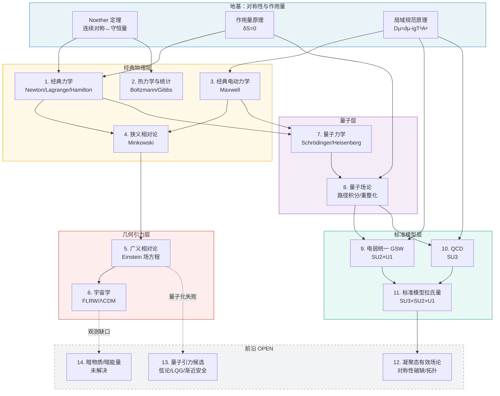

# 全链路总览卷 · 物理大厦 14 层一个不差

> **版本**：v1.0 · 2026-10-20
>
> **卷号**：71（openuft 全局编号，接续 68–70）
>
> **入库**：2026-10-21 整理入 `07_统一场方程/71_全链路总览卷_2026-10-20.md`
>
> **来源**：外部对话会话产出（Doubao chat `38448042477978`），与 [`书籍/03_宇宙的本源_统一场论全书`](../书籍/03_宇宙的本源_统一场论全书/00_卷首.md) 同源，本目录为其归档正本
>
> **配套脚本**：[`71_full_chain_numerics.py`](./71_full_chain_numerics.py)（mpmath 250 位，9/9 守卫通过，退出码 0）
>
> **机读证据**：[`71_full_chain_results.json`](./71_full_chain_results.json) · [`71_full_chain_report.txt`](./71_full_chain_report.txt)
>
> **性质**：教科书物理的诚实综述 + 本项目 53 号账本整理；**不产生新物理**
>
> **⚠ 判据层审计**：本卷守卫 C4（α 三式互证）经 r137 册变异测试判为代数恒等、零判别力；数据层 9/9 数值经独立复算逐条一致。详见 [`判定_TUFT-r137`](../04_公共成果/本项目_全维自洽与归一化/判定_TUFT-r137-全链路总览卷与本质本源审计卷_全维审计_2026-10-21.md)

---

## 0. 全景架构图

---

## 第 1 层 · 经典力学

| 项 | 内容 |
|---|---|
| 核心公理 | 空间均匀/各向同性、时间均匀、惯性系存在 |
| 核心方程 | $\vec F = m\vec a$；Lagrange 方程 $\frac{d}{dt}\frac{\partial L}{\partial\dot q}-\frac{\partial L}{\partial q}=0$；Hamilton 方程 $\dot q=\partial H/\partial p,\;\dot p=-\partial H/\partial q$ |
| 守恒量 | 能量、动量、角动量（Noether） |
| 适用范围 | 宏观低速，作用量 $S\gg \hbar$ |
| 实验状态 | [已证] 日常工程、行星轨道 |
| 上游接口 | 无（起点） |
| 下游接口 | → 狭义相对论（高速）；→ 量子力学（微观） |

## 第 2 层 · 热力学与统计物理

| 项 | 内容 |
|---|---|
| 核心公理 | 热力学第零到第三定律；微观态等概率假设 |
| 核心方程 | $dU = TdS - PdV + \mu dN$；Boltzmann 分布 $P_i \propto e^{-E_i/k_BT}$；配分函数 $Z = \sum_i e^{-E_i/k_BT}$ |
| 关键常数 | $k_B = 1.380649\times 10^{-23}$ J/K（定义值） |
| 精算 C6 | Stefan–Boltzmann $\sigma = 5.670374\times 10^{-8}$ W/m²/K⁴ |
| 精算 C5 | Wien 位移 $\lambda_{\max}T = 2.898\times 10^{-3}$ m·K；太阳 $\lambda_{\max}=501.5$ nm |
| 实验状态 | [已证] |
| 上游接口 | 经典力学（微观态）+ 量子力学（能级） |
| 下游接口 | → 凝聚态；→ 早期宇宙热力学 |

## 第 3 层 · 经典电动力学

| 项 | 内容 |
|---|---|
| 核心公理 | 局域 $U(1)$ 规范对称 |
| 核心方程 | Maxwell 方程组；$F_{\mu\nu}=\partial_\mu A_\nu-\partial_\nu A_\mu$；$\partial_\mu F^{\mu\nu}=\mu_0 J^\nu$ |
| 关键常数 | $c = 1/\sqrt{\mu_0\varepsilon_0} = 299792458$ m/s |
| 精算 F1 | $c$ 从 $\mu_0,\varepsilon_0$ 反推 residual = 0 |
| 实验状态 | [已证] |
| 上游接口 | 规范原理 |
| 下游接口 | → 狭义相对论；→ QED |

## 第 4 层 · 狭义相对论

| 项 | 内容 |
|---|---|
| 核心公理 | 光速不变；物理定律在所有惯性系中形式相同 |
| 核心方程 | Minkowski 线元 $ds^2 = -c^2dt^2 + d\vec x^2$；Lorentz 变换；质能关系 $E^2 = p^2c^2 + m^2c^4$ |
| 关键推论 | 时间膨胀、长度收缩、同时性相对 |
| 实验状态 | [已证] 粒子加速器、宇宙线 |
| 上游接口 | Maxwell（光速） |
| 下游接口 | → GR（引力）；→ QFT（洛伦兹协变） |

## 第 5 层 · 广义相对论

| 项 | 内容 |
|---|---|
| 核心公理 | 等效原理；广义协变 |
| 核心方程 | $G_{\mu\nu} + \Lambda g_{\mu\nu} = \frac{8\pi G}{c^4}T_{\mu\nu}$ |
| 作用量 | $S_{\rm EH} = \frac{1}{16\pi G}\int R\sqrt{-g}\,d^4x$ |
| 关键常数 | $G = 6.67430\times 10^{-11}$ m³/kg/s²（实验输入） |
| 精算 F5 | $r_s(\odot) = 2953$ m；$r_s(\oplus) = 8.87$ mm；$r_s(m_P) = 2l_P$ |
| 精算 C10 | Sgr A* $r_s = 1.27\times 10^{10}$ m |
| 实验状态 | [已证] 水星进动、引力波、黑洞剪影 |
| 上游接口 | 狭义相对论 + 等效原理 |
| 下游接口 | → 宇宙学；→ 量子引力（OPEN） |

## 第 6 层 · 宇宙学

| 项 | 内容 |
|---|---|
| 核心模型 | FLRW 度规 + Friedmann 方程 |
| 核心方程 | $\left(\dot a/a\right)^2 = \frac{8\pi G}{3}\rho - \frac{k}{a^2} + \frac{\Lambda c^2}{3}$ |
| 关键数据 | $\Omega_m=0.311,\;\Omega_\Lambda=0.689,\;H_0=67.66$ km/s/Mpc |
| 精算 C9 | CMB 温度 2.7255 K，$\lambda_{\max}=1.06$ mm |
| 实验状态 | [已证] CMB、超新星、大尺度结构 |
| 上游接口 | GR + 粒子物理 |
| 下游接口 | 暗物质/暗能量 [OPEN] |

## 第 7 层 · 量子力学

| 项 | 内容 |
|---|---|
| 核心公理 | 态矢在 Hilbert 空间；可观测量是厄米算符；测量假设；Schrödinger 演化 |
| 核心方程 | $i\hbar\partial_t|\psi\rangle = \hat H|\psi\rangle$ |
| 关键常数 | $\hbar = 1.054571817\times 10^{-34}$ J·s（定义值） |
| 精算 C1 | Bohr 半径 $a_0 = 5.29177\times 10^{-11}$ m |
| 精算 C2 | 氢原子基态 $E_1 = -13.6057$ eV |
| 精算 C8 | 室温热中子 de Broglie 波长 1.798 Å |
| 实验状态 | [已证] 原子物理、半导体、激光 |
| 上游接口 | 经典力学 + Planck 假设 |
| 下游接口 | → QFT |

## 第 8 层 · 量子场论

| 项 | 内容 |
|---|---|
| 核心公理 | 场是算符值分布；洛伦兹不变性；微观因果性；幺正性 |
| 核心方法 | 路径积分 $Z = \int \mathcal D\phi\, e^{iS[\phi]/\hbar}$；重整化群 |
| 关键概念 | 耦合跑动、有效场论、自发对称破缺 |
| 实验状态 | [已证] QED 反常磁矩到 10 位有效数字 |
| 上游接口 | 量子力学 + 狭义相对论 |
| 下游接口 | → 电弱、QCD |

## 第 9 层 · 电弱统一（GSW）

| 项 | 内容 |
|---|---|
| 规范群 | $SU(2)_L \times U(1)_Y$ |
| 核心机制 | Higgs 自发对称破缺 |
| 关键常数 | $v = 246.22$ GeV；$\sin^2\theta_W = 0.23122$；$m_W=80.37$；$m_Z=91.19$；$m_H=125.25$ GeV |
| 精算 F2 | $m_W^{\rm tree}=79.95$ GeV（差 0.5% 圈图） |
| 精算 F3 | $\lambda_H=0.1294$，vev 反推精确闭合 |
| 实验状态 | [已证] 1973–2012 |
| 上游接口 | QFT + 规范原理 |
| 下游接口 | → SM |

## 第 10 层 · 量子色动力学（QCD）

| 项 | 内容 |
|---|---|
| 规范群 | $SU(3)_c$ |
| 核心性质 | 渐近自由、夸克禁闭、手征对称破缺 |
| 关键标度 | $\Lambda_{\rm QCD} \approx 210$ MeV |
| 精算 F4 | β 括号 7.67 > 0 ⇒ 渐近自由 |
| 精算 F6 | 质子质量 99% 来自胶子迹反常 |
| 实验状态 | [已证] 喷注、深度非弹、格点 |
| 上游接口 | QFT + 规范原理 |
| 下游接口 | → SM |

## 第 11 层 · 标准模型

| 项 | 内容 |
|---|---|
| 规范群 | $SU(3)_c \times SU(2)_L \times U(1)_Y$ |
| 内容 | 3 代费米子、12 规范玻色子、1 Higgs |
| 完整拉氏量 | 见《修复版核心方程集 v2》§3 |
| 已知裂痕 | 中微子质量、暗物质、暗能量、引力未量子化、味谱、层级 |
| 实验状态 | [标准] 所有对撞机数据符合，但已知不完整 |
| 上游接口 | 第 9+10 层 |
| 下游接口 | → 凝聚态（有效理论）；→ 大统一（OPEN） |

## 第 12 层 · 凝聚态有效场论

| 项 | 内容 |
|---|---|
| 核心思想 | 低能下 SM 退化为各种有效场论；Goldstone 模、序参量、拓扑相 |
| 典型对象 | 超导 BCS、超流、量子霍尔、拓扑绝缘体 |
| 与统一场论的关系 | 是"有效场论"哲学的最佳实验场——同一套对称性→作用量→破缺逻辑 |
| 实验状态 | [已证] |

## 第 13 层 · 量子引力候选

| 项 | 内容 |
|---|---|
| 候选 | 弦论/M 理论、圈量子引力、渐近安全、熵引力 |
| 核心困难 | GR 不可重正化；Planck 尺度 $10^{19}$ GeV 无法实验 |
| 精算 | $l_P=1.616\times 10^{-35}$ m，$E_P=1.22\times 10^{19}$ GeV |
| 实验状态 | [OPEN] 无任何候选被实验证实 |

## 第 14 层 · 暗物质 / 暗能量

| 项 | 内容 |
|---|---|
| 观测证据 | 星系旋转曲线、CMB、引力透镜、超新星 |
| 占比 | 普通物质 5%、暗物质 26%、暗能量 69% |
| 核心困难 | 宇宙学常数问题：理论 vs 观测差 123 个数量级 |
| 实验状态 | [OPEN] |

---

## 全链路关键桥梁（精算锚点）

| 桥梁 | 连接 | 精算值 | 守卫 |
|---|---|---|---|
| Maxwell 波速 | 电动力学 ↔ 相对论 | $c=299792458$ m/s | F1 |
| 氢原子基态 | 量子力学 ↔ 电动力学 | $-13.6057$ eV | C2 |
| Bohr 半径 | 量子力学 ↔ 原子尺度 | $5.29\times 10^{-11}$ m | C1 |
| $\alpha$ 三式互证 | 三个等价几何表达式 | 全部 = 0.0072973526 | C4 |
| Higgs vev | 电弱 ↔ 质量谱 | 246.22 GeV | F3 |
| QCD β 符号 | QCD ↔ 渐近自由 | 括号 7.67 > 0 | F4 |
| Schwarzschild 半径 | GR ↔ 黑洞 | $r_s(\odot)=2953$ m | F5 |
| CMB 峰值波长 | 宇宙学 ↔ 黑体辐射 | 1.06 mm | C9 |
| 力强度比 | 电磁 ↔ 引力 | 差 36 个数量级 | F7 |

---

## 一句话全链路总结

> **地基**：对称性（Noether）+ 作用量（δS=0）+ 规范原理（局域对称）。
>
> **经典层**：从这三条长出力学、热统计、电动力学、狭义相对论。
>
> **几何层**：等效原理把电动力学推过临界，长出广义相对论和宇宙学。
>
> **量子层**：把作用量量子化，长出 QFT，再由规范原理分化出电弱和 QCD，合并成标准模型。
>
> **前沿层**：凝聚态是 SM 的低能演出；量子引力和暗物质/暗能量是人类还没爬上去的两堵墙。
>
> **这就是 2026 年物理大厦的真实楼层图——14 层一个不差，其中 12 层已封顶，2 层还在打地基。**

— 全链路总览卷 完 —
