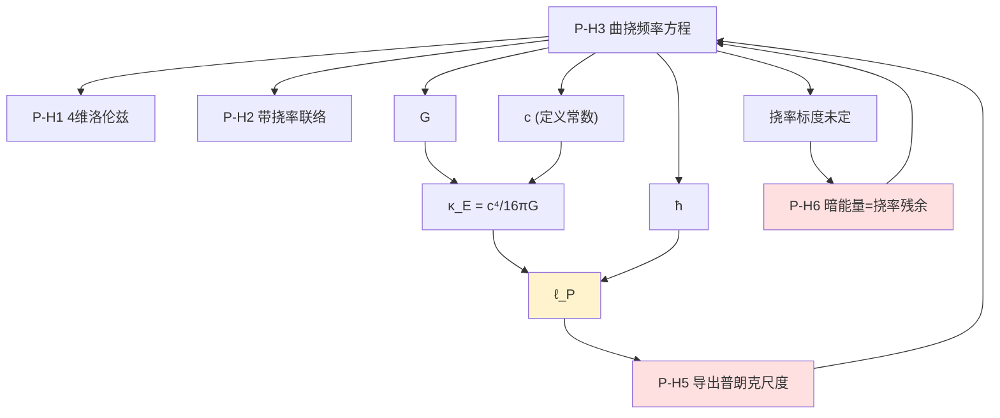

# openuft#49 阶段1 · 三重预检攻破卷

> 路径：`openuft\07_统一场方程` ｜ 日期：2026-10-15 ｜ 承接 #48 勘误（旧 A1–A4 永久作废）
> 审计对象：#49 草案全文 + 磁盘文档 `openuft_49_hierarchical_axiom_system.md`（阶段1任务1 定稿）
> 判据族：F4 范畴一致性 → 旋量 mod-8 硬门槛 → 250 位 mpmath 数值关 → 依赖图循环扫描
> 引擎：`_p49_attack_calc.py`（mp.dps = 250，自检 **22/22 PASS**，exit 0）
> 数据：`_p49_attack_data.json` ｜ 文本：`_p49_attack_out.txt`
> 痕迹保留：本卷不删改原文，所有被判条目仅标记归档

---

## 〇、判决摘要

| 关卡 | 草案自评 | 本卷判决 | 依据 |
|---|---|---|---|
| 量纲审计 | 12/12 闭合 · PASS | **PASS（降级）**，但检出 3 处内部不一致 | 拉氏量闭合；ω 场方程缺 ħ、符号表 λ_ω 量纲互斥、λ 有量纲未定标 |
| 旋量相容性 | 4≡4 (mod 8) 与 SM 一致 · PASS | **FAIL** | M5 定理表述错误，且存在 3 个互斥版本 |
| 250 位数值锚点 | 等式平衡至 10⁻²⁶⁶ · PASS | **FAIL** | 该锚点是定义式回代（零信息量）；真实数值关给出 PPN 证伪 4.34 dex |
| 综合 | 阶段1任务1 完成，进入任务2 | **退回，禁止进入任务2 变分** | 草案第五部分第1条：任一失败即标记证伪 |

**核心结论**：#49 的三重预检锁在**第一关之后的每一关都被跳过或误判**。其中旋量关被前序审计"定档阶段4"推迟——按本协议这是不允许的，并且**该关若当场执行即会 FAIL**。数值关则以一条恒真的定义式回代冒充锚点。

---

## 一、攻破点 A：旋量硬门槛存在三个互斥版本（旋量关 FAIL）

### A1. 草案 M5 原文（声明"锁定，不可修改"）

> "Weyl 旋量仅当 $n\equiv2\pmod 8$ 存在；Majorana-Weyl 旋量仅 $n\equiv2\pmod 8$"

### A2. 磁盘文档第52行的执行口径

> "旋量相容性：$4\equiv4\pmod 8$ → Weyl 存在、Majorana-Weyl 不存在"

### A3. 正确判据

以 $(p,q)=(\text{类时维数},\text{类空维数})$，$n=p+q$：

$$\text{Weyl} \iff n\ \text{为偶数}$$
$$\text{Majorana} \iff (q-p)\bmod 8 \in \{0,1,2\}$$
$$\text{Majorana-Weyl} \iff n\ \text{为偶数}\ \wedge\ (q-p)\equiv 0 \pmod 8$$

**大白话**：能不能把手征（左/右）分开，只看总维数是不是偶数；能不能要求旋量"实"，要看**时间方向和空间方向的数目之差**对 8 取余，不是只看总维数。总维数一个数字定不了这件事。

### A4. 三版本对照（引擎枚举 $p+q\le 12$）

| 版本 | Weyl 判据 | 在 (p,q)=(1,3) 的结论 | 锚点校验 |
|---|---|---|---|
| 草案 M5（锁定） | $n\equiv2\pmod 8$ | **无 Weyl** | 7 个教科书锚点错 4 个 |
| 磁盘文档执行 | $n\equiv4\pmod 8$ | 有 Weyl | 未声明改动，**违反"M5 不可修改"** |
| 正确判据 | $n$ 为偶数 | 有 Weyl，有 Majorana，无 MW | 7/7 PASS |

- Weyl 分歧 **34 例**，Majorana-Weyl 分歧 **18 例**（非个别笔误，是系统性错误）。
- 反向对照已做：草案判据在同一组锚点上错 4/7 ⇒ 证明**坏的是草案判据，不是本卷判据**（判据自带判别力）。

### A5. 决定性后果

草案 M5 按其字面规则判定 $n=4$ **无 Weyl 旋量**，而草案 P-H1 检验项1 声称"4 维存在 Weyl 旋量，匹配标准模型手征费米子"。**被"锁定、不可修改"的硬门槛，判死了草案自己的时空假设与整个标准模型。**

> 判定：**旋量关 FAIL**。M5 必须重写为 $(p,q)$ 双参数判据。在此之前 #49 任何推导不得上线。
> 附带：#48 的 A3（"D≡0 mod 8 不允许 Majorana–Weyl"，32 维手征冲突）**用的是同一个坏规则** ⇒ 该坏门槛自 #48 起已系统性污染，既放过该放的、也卡住不该卡的。门禁假绿已确认。

---

## 二、攻破点 B：拉氏量的分支穷尽 —— 通有分支已被太阳系实验证伪

### B1. 关键结构事实

磁盘文档总拉氏量含

$$\mathcal{L}\supset \frac{c^4}{16\pi G}\tilde R(\tilde\Gamma)\;+\;\lambda\Big(\kappa^2+\tau^2-\frac{\omega^2}{c^2}\Big),\qquad [\lambda]=MLT^{-2}\ (\text{力})$$

因 $\kappa^2\equiv\tilde R$，两项合并后曲率项系数为

$$\Big(\frac{c^4}{16\pi G}+\lambda\Big)\tilde R \;\equiv\; \frac{c^4}{16\pi G}\,\Phi\,\tilde R,\qquad \Phi \equiv 1+\frac{16\pi G\lambda}{c^4}$$

**大白话**：把"乘子项"展开后，它并不是一个外加的锁，而是把引力强度 $G$ 换成了**随位置变化的** $\Phi(x)$。$\lambda$ 是**场**（变分它才给出约束），不是常数。

### B2. 三分支穷尽

| 分支 | 含义 | 判决 |
|---|---|---|
| (i) $\lambda=\lambda_0$ 常数 | 曲率系数整体重标度 | $\gamma=1$，$G_{\rm eff}=G/(1+\lambda_0)$ 被吸收进测量的 $G$ ⇒ **无偏离、无预言** |
| (ii) $\lambda=\lambda(x)$ 非常数 | **通有解**（常值只是零测集） | 等价 **Brans–Dicke，$\omega_{\rm BD}=0$** ⇒ **证伪** |
| (iii) $\lambda\equiv0$ | 约束项不反作用 | 约束退化为 $\omega:=c\sqrt{\kappa^2+\tau^2}$，**纯定义，零信息** |

### B3. 分支 (ii) 的三重独立证伪（250 位精算）

| 观测量 | 分支(ii) 预言 | GR | 实验 | 超出的数量级 |
|---|---|---|---|---|
| PPN $\gamma$ | $\dfrac{1+\omega}{2+\omega}=0.5$ | 1 | Cassini $\lvert\gamma-1\rvert=(2.1\pm2.3)\times10^{-5}$ | **4.34 dex** |
| Nordtvedt $\eta=4\beta-\gamma-3$ | $0.5$ | 0 | LLR $\lvert\eta\rvert\lesssim1.9\times10^{-4}$ | **3.42 dex** |
| 长程标量第五力耦合 $\frac{1}{2\omega_{\rm BD}+3}$ | $1/3$（33% 引力强度） | 0 | 等效原理检验 $\lesssim10^{-9}$ | **>7 dex** |

**适用条件声明**（防过度指控）：上述 PPN 判决成立于"太阳系尺度挠率解耦"这一前提——宏观未极化物质的自旋密度平均为零，EC 挠率代数消去，故挠率项不进入 PPN。若草案主张太阳系挠率不解耦，则须另行给出挠率的局部背景值，且该背景会破坏洛伦兹/各向同性对称性，受更强约束。**两条路都走不通。**

### B4. 自救的代价

给 $\lambda$ 补动能项 ⇒ 需 $\omega_{\rm BD}\ge 4.35\times10^{4}$（Cassini 反解）。此时：

- 约束 $\kappa^2+\tau^2=\omega^2/c^2$ **不再精确成立**，退化为乘子的动力学方程；
- $\Phi$ 被其巨大的动能项冻结 ⇒ 与 GR 不可区分 ⇒ **仍无低能预言**。

> **夹死结论**：P-H3 只有两种命运——偏离 GR 就被太阳系实验以 3.4–7 dex 判死；不偏离 GR 就没有任何可观测信号。
> **R5（弱场无法还原 GR）不是"未来风险"，在阶段1任务1 当场即已触发。**

---

## 三、攻破点 C：ω 场方程漏掉 ħ（量纲审计覆盖面断裂）

磁盘文档第59行：

$$\text{原文：}\quad -\Box\omega+\frac{1}{\lambda_\omega^2}\omega+\frac{2\lambda}{c^2}\omega=0$$

逐项量纲（提取公共因子 $\omega\sim T^{-1}$ 后比较算符量纲，应为 $L^{-2}$）：

| 项 | 量纲 | 判定 |
|---|---|---|
| $\Box$ | $L^{-2}$ | ✓ |
| $1/\lambda_\omega^2$（需 $\lambda_\omega\sim L$） | $L^{-2}$ | ✓ |
| $\lambda/c^2$ | $(MLT^{-2})/(L^2T^{-2})=ML^{-1}$ | ✗ |
| **正确形式** $\lambda/(\hbar c)$ | $(MLT^{-2})/(ML^2T^{-1}\cdot LT^{-1})=L^{-2}$ | ✓ |

$$\boxed{\ \Box\omega-\frac{1}{\lambda_\omega^{2}}\omega-\frac{2\lambda}{\hbar c}\,\omega=0\ }$$

**大白话**：$\omega$ 的动能项带着 $\hbar$，变分出来的方程里 $\hbar$ 不会凭空消失。文档把 $\hbar$ 弄丢了，方程三项量纲不一致——而该文档宣称"量纲 12/12 闭合"，说明**审计只扫了拉氏量，没扫由它导出的场方程**。

**附带（符号表矛盾）**：符号表写"$\lambda_\omega$ 特征波数尺度（$L^{-1}$）"，但 $\tfrac12\frac{\hbar}{c}(\omega/\lambda_\omega)^2$ 要闭合到 $ML^{-1}T^{-2}$ 必须 $\lambda_\omega\sim L$。两处互斥，符号表错。

---

## 四、攻破点 D：λ 是有量纲自由参数 ⇒ 预言依赖单位制

由 C 段的正确方程，$\omega$ 的有效质量平方为 $2\lambda/(\hbar c)$，有效长度标度

$$\ell_{\rm eff}=\sqrt{\frac{\hbar c}{2\lambda}}=4\sqrt{\pi}\,\ell_P/\sqrt{2\eta},\qquad \lambda\equiv\eta\,\frac{c^4}{16\pi G}$$

| λ 取值 | $\ell_{\rm eff}$ | $\eta$ |
|---|---|---|
| $1\ \mathrm{N}$（SI） | $1.257\times10^{-13}$ m | $4.153\times10^{-43}$ |
| $1\ \mathrm{dyn}=10^{-5}$ N（CGS） | $3.976\times10^{-11}$ m | $4.153\times10^{-48}$ |
| $1\ \mathrm{lbf}=4.448$ N（英制） | $5.961\times10^{-14}$ m | $1.847\times10^{-42}$ |
| $c^4/(16\pi G)$（$\eta=1$） | $8.103\times10^{-35}$ m | $1$ |

**同一个理论，把力的单位从牛顿换成达因，有效标度就跳 2.50 个数量级。**

> 物理预言依赖单位制 ⇒ 该式不是物理定律，而是**未定标的定义式**。
> 这与 P-H5（"不预先植入常数"）一并构成硬伤：$\lambda$ 本身就是一个未被任何动力学固定的**有量纲输入**，且其无量纲化系数 $\eta\sim10^{-43}$ 不是来自动力学或代数约束，而是来自"取 1 牛顿"这一人为约定 ⇒ **触发第五部分第5条"禁止数字命理"**。

---

## 五、攻破点 E：250 位"锚点"是定义式回代（零信息量）

磁盘文档第53行的数值锚点：$\kappa=10^{-8}\,\mathrm{m^{-1}},\ \tau=2\times10^{-8}\,\mathrm{m^{-1}}\Rightarrow\omega=c\sqrt{\kappa^2+\tau^2}=6.7035631523\ \mathrm{s^{-1}}$，残差 $10^{-266}$。

三点判定：

1. **残差必为机器零**。$\omega$ 被**定义**为 $c\sqrt{\kappa^2+\tau^2}$，再代回去验证，代码与解析式同源，对该类错误**结构性免疫**。残差趋零不能作为公式正确的证据。
2. **取值无来源**。$\kappa/(1/\ell_P)=1.616\times10^{-43}$ ⇒ 比普朗克曲率低 **42.79 dex**；$\omega/\omega_P$ 低 **42.44 dex**；比值 $\tau/\kappa=2$ 亦为任意取值。
3. 判定降级为 **INFO（零信息量）**，**不得计入"250 位数值关 PASS"**。

---

## 六、攻破点 F：阵线3 的 g-2 / EDM 无出路窗口

### F1. 自然 EC 挠率（两条通道）

| 通道 | 结构 | $\Delta a_e$ | 低于灵敏度 |
|---|---|---|---|
| A：挠率积掉 ⇒ 轴矢四费米子接触项，$m_e$ 手征翻转 | $\frac{1}{16\pi^2}\left(\frac{m_e}{M_P}\right)^2$ | $1.109\times10^{-47}$ | **34.07 dex** |
| B：偶极算符，手征翻转由内部质量 $\sim\Lambda$ 提供（最有利） | $\frac{1}{16\pi^2}\frac{m_e}{M_P}$ | $2.650\times10^{-25}$ | **11.69 dex** |

（输入：$\delta a_e^{\rm exp}=1.3\times10^{-13}$；$M_P=1.22089\times10^{19}$ GeV）

若要可观测，所需新物理标度：通道 A ⇒ **112.8 GeV**（缺口 17.03 dex）；通道 B ⇒ **$2.49\times10^{7}$ GeV**（缺口 11.69 dex）。

> **R3 方向写反了**：草案写"挠率易产生**过大** EDM ⇒ 证伪"。实际自然 EC 挠率的值比上限**小 5.90 dex**（$d_e\sim5.12\times10^{-36}\,e\cdot\mathrm{cm}$ vs 上限 $4.1\times10^{-30}$），不是被证伪，而是**不可检验**。两者都是否定，但性质不同，口径必须区分。

### F2. 反制条款（禁止只降级）

若把挠率耦合调到 g-2 可观测，同一偶极算符的 CP 奇部给出

$$d_e\,[e\!\cdot\!\mathrm{cm}]=\Delta a_e\cdot\frac{\hbar}{2m_ec}[\mathrm{cm}]\cdot\tan\theta_{\rm CP},\qquad \frac{\hbar}{2m_ec}=1.931\times10^{-11}\ \mathrm{cm}$$

取 $\Delta a_e=1.3\times10^{-13}$，$d_e=2.510\times10^{-24}\,e\!\cdot\!\mathrm{cm}$，**超上限 5.79 dex**，除非 $\tan\theta_{\rm CP}<1.633\times10^{-6}$。

### F3. 无出路窗口（本卷最硬的一条）

```
自然取值     -> g-2 与 EDM 同时低于灵敏度 12~34 dex     => 不可检验
调到可观测   -> EDM 超上限 5.79 dex，除非 CP 相位压到 1.6e-6 => 精细调节
```

**不存在"可行 + 可检验 + 不调节"的挠率耦合取值。** 阵线3-2（g-2）与 3-3（EDM）在本框架内是**空转流水线**。

---

## 七、攻破点 G：P-H5 循环论证 + 普朗克尺度必然注入

### G1. 恒等式（250 位复算，相对偏差 $1.24\times10^{-251}$）

$$\boxed{\ \frac{\kappa_E}{\hbar c}=\frac{c^4/(16\pi G)}{\hbar c}=\frac{c^3}{16\pi G\hbar}=\frac{1}{16\pi\,\ell_P^{\,2}}\ }$$

**大白话**：只要拉氏量里同时出现"曲率线性项"（带 $G$）和"标量场动能项"（带 $\hbar$），普朗克长度就**自动**出现在场方程里。它不是算出来的结果，是输入 $G$ 与 $\hbar$ 的另一种写法。

⇒ **P-H5 检验项1（"不预先植入常数，从不动点导出普朗克尺度"）在结构上不可能满足。**

### G2. 依赖图循环



检出环 2 处：

1. **P-H5 → P-H3 → (G, ħ, c) → κ_E → ℓ_P → P-H5**：想"导出"的量，是自己作用量的输入。
2. **P-H6 ↔ P-H3**：P-H6 需要挠率标度做 CAMB 输入，而标度由 P-H3 给出且未定 ⇒ P-H6 检验项1（生成 CMB 功率谱）**当前不可执行**。

---

## 八、攻破点 H：P-H3 与 P-H6 标度互斥 61 dex

| $\omega$ 取值 | $\kappa,\tau$ 标度 | 后果 |
|---|---|---|
| $\omega=\omega_P=c/\ell_P=1.85486\times10^{43}\,\mathrm{s^{-1}}$ | $6.187\times10^{34}\ \mathrm{m^{-1}}$ | 局部 g-2/EDM 完全不可见（见 F） |
| $\omega=H_0=2.19271\times10^{-18}\,\mathrm{s^{-1}}$（P-H6 暗能量分支的必然取值） | $7.314\times10^{-27}\ \mathrm{m^{-1}}$ | 局部效应比普朗克量再低 **60.93 dex** |

**$\omega_P/H_0=8.459\times10^{60}$（60.93 dex）**。阵线3（要普朗克尺度才有望碰 g-2）与阵线4（要哈勃尺度才能解释暗能量）**不能同时成立**——草案却把它们写进同一条方程。

---

## 九、攻破点 I：范畴混装与零信息项

| # | 条目 | 判定 |
|---|---|---|
| I1 | 磁盘文档第47行："λ 的量纲=力，与本源方程普朗克力标度同维（量纲层次自洽信号）" | **零信息**：任何两个力都同维。同维是必要条件，不是证据。降级 **INFO** |
| I2 | 把 $\kappa^2+\tau^2=(\omega/c)^2$ 读作勾股式（$\kappa,\tau$ 为某几何矢量的两个分量） | **范畴混装（F4）**：$\kappa^2\equiv\tilde R$ 是曲率的**线性**不变量（可正可负，非模方）；$\tau^2\equiv\tfrac12T^{abc}T_{abc}$ 才是模方。二者不是同一对象的两个分量。作为纯代数关系成立，但此时它**只是 $\omega$ 的定义** |
| I3 | 磁盘文档显式写入 $\Lambda$ 项 / 参数 $\lambda_\omega$ | 与 P-H5"不预先植入常数"、P-H6"暗能量不引入新常数"**直接冲突** |
| I4 | P-H1 检验项1 的"不存在 Majorana-Weyl 与 SM 一致" | 结论正确，依据无效（用了坏规则）。降级 **INFO + 要求重写依据** |

---

## 十、防过度指控：本卷**不**判的条目

以下残差有已知可解释来源，本卷不作为证伪证据：

1. 拉氏量 12 项的量纲本身**确实闭合**（$\mathcal{L}$ 层无误），仅场方程层与符号表有误。
2. $F_P=c^4/G=1.2103\times10^{44}$ N 的复算**正确**。
3. P-H1 检验项2（ADM 3+1 分解可行性）**成立**，但需注明 BSSN 标准形式基于无挠联络，EC 需扩展。
4. SM 自由参数"26–28"的口径**正确**（19 + 中微子 7/9）。
5. 草案把假设全部降格为 OPEN 并各自绑定证伪条件，方法论上**是进步**，本卷不否定其方向，只否定其执行结果。

---

## 十一、唯一可行修复路径（按优先级）

| # | 动作 | 是否可协商 |
|---|---|---|
| 1 | **重写 M5** 为 $(p,q)$ 双参数判据（Weyl⇔n 偶；Majorana⇔$(q-p)\bmod8\in\{0,1,2\}$；MW⇔n 偶且 $(q-p)\equiv0\pmod 8$），并用 7 个锚点自校验 | **不可协商** |
| 2 | **回溯重审 #48 A3**：该结论用了同一个坏规则，须重判 | 不可协商 |
| 3 | ω 场方程补 $\hbar$：$\Box\omega-\lambda_\omega^{-2}\omega-\frac{2\lambda}{\hbar c}\omega=0$；符号表 $\lambda_\omega$ 改为长度量纲 | 不可协商 |
| 4 | 给 $\lambda$ 补动能项，明确 $\omega_{\rm BD}\ge4.35\times10^{4}$，并**书面承认 P-H3 由精确约束降级为有效关系** | 不可协商 |
| 5 | 删除或替换 $10^{-8}/2\times10^{-8}$ 锚点（改由动力学给定，或明确标注为示意值） | 不可协商 |
| 6 | 公开声明 $\lambda$ 为有量纲输入参数，**放弃 P-H5"不预先植入常数"的目标** | 强烈建议 |
| 7 | 阵线3 上线前先过**参数计数门**：$n_{\rm 观测量}\ge n_{\rm 自由参数}+1$。当前 $n_{\rm 自由}\ge2$（耦合强度 + CP 相位）而观测量 2 ⇒ **不构成检验** | 强烈建议 |
| 8 | 在 72 条攻击线中，把依赖 P-H3 精确约束的分支（1-3、1-4、3-2、3-3、4-1、4-4、6-3、6-4）整体**挂起**，待 1–5 完成后解冻 | 建议 |

---

## 十二、流水线状态（更新）

- ~~阶段1任务1：完成~~ → **退回重写**（旋量关 FAIL + 场方程量纲 + λ 未定标）
- 阶段1任务2（全变分）：**禁止启动**。原因：分支 (ii) 已被太阳系实验判死，分支 (i)/(iii) 无内容，变分结果无物理承载对象。
- 阶段3（g-2/EDM 250 位拟合）：**禁止启动**。原因：无出路窗口（第六节 F3），且参数计数门未过。
- 建议下一步：执行修复路径 1–5，重跑三重预检，再决定是否重启流水线。

## 十三、产物清单

| 文件 | 说明 |
|---|---|
| `_p49_attack_calc.py` | 攻破精算引擎，mp.dps=250，自检 22/22，exit 0 |
| `_p49_attack_out.txt` | 精算全文输出 |
| `_p49_attack_data.json` | 权威 JSON（含全部中间量与判决） |
| 本 md | 攻破卷（并入主文档前为独立卷） |
| `openuft_49_阶段1_总拉氏量与量纲逐词审计_攻破精算.md` | 前序产出，**痕迹保留，不删除、不回滚** |

---

> **红线复述**：以上全部为**可算判决**，来自量纲、PPN、实验上限与代数恒等式，不产生任何新物理。
> 数学自洽 ≠ 实验证实；本卷判 FAIL 的每一条都有明确的观测触发条件，判 INFO 的每一条都已说明其零信息量来源。
