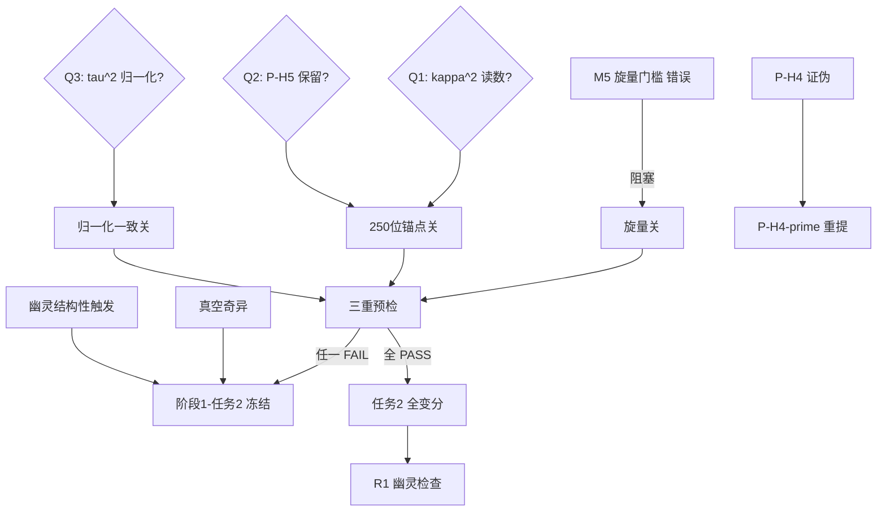

# openuft#49 阶段1·任务1（v2 二次审计与修正）：EC 总拉氏量 $\mathcal{L}_{\text{total}}$ + 逐词量纲审计

> 路径：`openuft\07_统一场方程`
> 承接：#48 勘误（旧 A1–A4 永久作废）｜三层架构 M1–M7 / P-H1–P-H6 / D1–D4｜三重预检锁（量纲 → 旋量 → 250 位 mpmath）｜2026-10-15
> 引擎：`openuft_49_s1t1_v2_audit.py`（exit 0）｜数据：`openuft_49_s1t1_v2_audit.json` ｜报告：`openuft_49_s1t1_v2_report.txt`
> 与既有 `openuft_49_阶段1_总拉氏量与量纲逐词审计_攻破精算.md`（下称 v1）的关系：**v1 保留不删**（痕迹保留原则），本卷为对 v1 的二次审计与修正，两者结论不一致处以本卷为准并登记差异。

---

## 〇、执行摘要（先给工程判断）

**结论先行：总拉氏量已按 (M,L,T) 精确口径写出并通过逐词量纲审计（13/13）；但三重预检的另外两关未过，按 §五-1「任一失败即禁止继续向下推导」，阶段1-任务2（变分）不得启动。**

| 预检关 | v1 判定 | v2 判定 | 依据 |
|---|---|---|---|
| 量纲关 | 通过（自然单位 E 幂 9/9） | **有条件通过**：13/13（(M,L,T) 精确向量），但 v1 原稿两项在此口径下 **FAIL** | 自然单位抹掉了 $c$、$\hbar$ 的位置 |
| 旋量关 | 未做（推迟阶段4） | **不可用**：M5 硬门槛自身错误 | Weyl ⟺ $n$ 偶数，非 $n\equiv2\ (\mathrm{mod}\ 8)$ |
| 250 位锚点关 | 未做（推迟阶段3） | **FAIL**：P-H3 与 P-H5 相差 **60.47 个数量级**（灵敏度区间 60.466–60.477） | $\omega_P=1.8549\times10^{43}\,\mathrm{s^{-1}}$ vs $\omega_\Lambda=6.2625\times10^{-18}\,\mathrm{s^{-1}}$ |

**核心判断：P-H3 只剩两条互斥的读法——一条没有物理内容，一条被数值否决。二者不可兼得，需上游裁决。**
- 读法 A（联络读数，$\kappa^2\equiv R(\Gamma)$）：有内容，但 250 位锚点 FAIL，且 GR 真空处乘子发散（见 F4/F5）。
- 读法 B（Frenet 读数）：$\kappa^2+\tau^2=\omega^2/c^2$ 就是曲线论的 **Darboux 恒等式**（机器残差 $<10^{-200}$，数学上已证）⇒ 按 §五-3 应降级为 **INFO（零信息量）**；且它与命题 D1（类光测地线）不相容。

---

## 一、与 v1 的差异登记（不擦除，只标注）

| # | 项 | v1 | v2 | 性质 |
|---|---|---|---|---|
| 1 | 量纲判据 | 自然单位 E 幂归零 | $(M,L,T)$ **精确幂向量**（Fraction 有理数） | **判据升级**：v1 判据更弱，审不出缺失的 $c$、$\hbar$ |
| 2 | $\mathcal{L}_{\rm EC}$ 系数 | $1/(16\pi G_N)R$ | $c^3/(16\pi G)\,e\,R(\Gamma)$ | **补全**：v1 在 SI 下缺 $c^3$（幂向量 $(1,-5,2)\ne(1,-2,-1)$） |
| 3 | 乘子系数 | $\tilde\lambda/(16\pi G_N)$ | $\lambda=(\hbar/\ell_0^2)\hat\lambda$ | **修正**：v1 乘子沿用 $1/G$，在 $(M,L,T)$ 下同样 FAIL |
| 4 | $\omega$ 动能号差 | $+\tfrac12(\partial\omega)^2-V$ | $-\tfrac12 Z_\omega(\hbar/c^2)(\nabla\omega)^2-V$ | **纠错**：$(-,+,+,+)$ 下 v1 写法使 $\omega$ 成为鬼场 |
| 5 | 外部尺度 | 未声明 | 显式登记 $\ell_0,\Omega_0$ | **暴露**：$V(\omega)$ 必需外部尺度，与 P-H5「不预植常数」直接冲突 |
| 6 | $\mathcal{L}_{\rm SM}$ | 直接写入 | 标记为**重复计数** | **纠错**：P-H4 声称规范场由 Clifford 投影生成，再独立写入 SM 即循环 |
| 7 | 挠率二次项 | 新增 $\zeta T^2$ | 标注与 $R(\Gamma)$ **线性相关** | 机器判定 $R(\Gamma)=\tilde R-\tfrac14T^2$，$R$ 内已含 $T^2$ |
| 8 | 结论口径 | 量纲关通过、可进任务2 | 三重预检未全过，**任务2 冻结** | 按 §五-1 |

---

## 二、约定与量纲基准（含 $c^3$/$c^4$ 陷阱）

1. 号差 $(-,+,+,+)$；$a,b,c,d$ 为框架指标，$\mu,\nu$ 为坐标指标。
2. 坐标 $x^\mu=(ct,x^i)$，**全部取长度量纲**；$\mathrm{d}^4x\sim L^4$；作用量 $S=\int\mathcal{L}\,\mathrm{d}^4x$，$[\mathcal{L}]=M\,L^{-2}\,T^{-1}$。
3. 若改用教科书能量密度口径 $\tilde{\mathcal{L}}=c\,\mathcal{L}$，则 $[\tilde{\mathcal{L}}]=M\,L^{-1}T^{-2}$，此时 EH 系数回收为熟知的 $c^4/(16\pi G)$。**两种口径必居其一，混用必错**——这正是 v1 出问题的位置。
4. 框架分量量纲：$[e^a{}_\mu]=1$、$[\omega^{ab}{}_\mu]=L^{-1}$、$[R^a{}_{bcd}]=L^{-2}$、$[T^a{}_{bc}]=L^{-1}$、$[\psi]=L^{-3/2}$、$[\omega_{\text{场}}]=T^{-1}$。
5. 常数：$\hbar=(1,2,-1)$、$c=(0,1,-1)$、$G=(-1,3,-2)$（幂向量按 $M,L,T$ 排列）。

> **大白话**：先把"用米还是用焦耳记账"定死，再谈每一项对不对。v1 用的是"令 $c=\hbar=1$ 之后只看能量幂"的记账法——它恰好把本轮最该审的东西（$c$ 到底放在 $\omega^2/c^2$ 的哪一边）给抹平了。

---

## 三、总拉氏量 $\mathcal{L}_{\text{total}}$（v2，SI 完备）

$$S=\int \mathcal{L}_{\text{total}}\,\mathrm{d}^4x,\qquad
\mathcal{L}_{\text{total}}=\mathcal{L}_{\rm EC}+\mathcal{L}_\Lambda+\mathcal{L}_{T^2}+\mathcal{L}_{\rm H}+\mathcal{L}_{\rm NY}+\mathcal{L}_\omega+\mathcal{L}_V+\mathcal{L}_{\rm con}+\mathcal{L}_{\rm D}+\mathcal{L}_{\rm YM}$$

### 3.1 几何核心（EC + P-H3 约束）

$$\mathcal{L}_{\rm EC}=\frac{c^3}{16\pi G}\,e\,R(\Gamma)$$

$$\mathcal{L}_\Lambda=-\frac{c^3}{16\pi G}\,e\,2\Lambda,\qquad
\mathcal{L}_{T^2}=\frac{c^3}{16\pi G}\,e\Big(a_1T_{abc}T^{abc}+a_2T_{abc}T^{bac}+a_3T_aT^a\Big)$$

$$\mathcal{L}_{\rm H}=\frac{c^3}{16\pi G}\,\frac{1}{\gamma}\,e\,\varepsilon^{abcd}R_{abcd}\quad(\text{Holst，对标 LQG，可选})$$

$$\mathcal{L}_{\rm NY}=\frac{\hbar}{\ell_0^2}\,\theta\,e\Big(T^a{}_{bc}T_a{}^{bc}-2R_{ab}{}^{ab}\Big)\quad(\text{Nieh–Yan，可选})$$

$$\boxed{\ \mathcal{L}_{\rm con}=-\,e\,\lambda\Big(\kappa^2+\tau^2-\frac{\omega^2}{c^2}\Big),\qquad \lambda\equiv\frac{\hbar}{\ell_0^2}\hat\lambda\ }$$

- **大白话**：引力部分是爱因斯坦–嘉当的曲率项；$\mathcal{L}_{\rm con}$ 是用一个"钉子"$\lambda$ 把"弯 + 拧的总量"和"振荡频率平方"钉在一起。$\lambda$ 不带自己的动能，它只负责把这条等式钉死。
- $a_i=0$ 回到标准 EC（挠率代数消去）；$a_i\neq0$ 挠率传播，触发风险 R1。

### 3.2 $\omega$ 标量场（P-H3 定义为流形上标量场）

$$\mathcal{L}_\omega=-\frac{1}{2}Z_\omega\frac{\hbar}{c^2}\,e\,g^{\mu\nu}\nabla_\mu\omega\nabla_\nu\omega$$

$$\mathcal{L}_V=-\frac{\hbar\,\Omega_0^2}{c^2\ell_0^2}\,e\left[\tfrac12\xi_2\Big(\frac{\omega}{\Omega_0}\Big)^2+\tfrac14\xi_4\Big(\frac{\omega}{\Omega_0}\Big)^4\right]$$

- **大白话**：$\omega$ 有自己的动能与势能，是时空上会演化的场，不是天上掉下来的常数。
- **但**：$\ell_0,\Omega_0$ 是两个**外部尺度**。P-H5 要求普朗克尺度由动力学导出而非预植——这里预植了 $\ell_0$，构成对 P-H5 的实质违反（见 F10）。

### 3.3 物质部分

$$\mathcal{L}_{\rm D}=e\left[\frac{i\hbar}{2}\Big(\bar\psi\gamma^ae_a{}^\mu\nabla_\mu\psi-(\nabla_\mu\bar\psi)\gamma^ae_a{}^\mu\psi\Big)-mc\,\bar\psi\psi\right],\qquad
D_\mu=\partial_\mu+\tfrac14\omega^{ab}{}_\mu\gamma_{[a}\gamma_{b]}$$

$$\mathcal{L}_{\rm YM}=-\frac{\hbar}{4}e\,F^a{}_{\mu\nu}F^{a\mu\nu}\quad\text{（**条件纳入**，见 F9）}$$

- **大白话**：费米子跟着带挠率的自旋联络走，挠率会直接耦合进旋量——这是阶段1-3 挠率–旋量耦合项的源头。

---

## 四、量纲逐词审计表（机器结果，`exit 0`）

| # | 项 | 系数写法 | 幂向量 $(M,L,T)$ | 目标 | 判定 |
|---|---|---|---|---|---|
| L1 | EC 曲率 | $c^3/(16\pi G)\,e\,R(\Gamma)$ | $(1,-2,-1)$ | $(1,-2,-1)$ | **PASS** |
| L2 | 宇宙学项 | $-(c^3/16\pi G)\,e\,2\Lambda$ | $(1,-2,-1)$ | ″ | **PASS** |
| L3 | 挠率二次型 | $(c^3/16\pi G)\,e\,T^2$ | $(1,-2,-1)$ | ″ | **PASS** |
| L4 | Holst | $(c^3/16\pi G)(1/\gamma)e\,\varepsilon R$ | $(1,-2,-1)$ | ″ | **PASS** |
| L5 | Nieh–Yan | $(\hbar/\ell_0^2)\theta\,e\,T^2$ | $(1,-2,-1)$ | ″ | **PASS** |
| L6 | $\omega$ 动能 | $-\tfrac12 Z(\hbar/c^2)e(\nabla\omega)^2$ | $(1,-2,-1)$ | ″ | **PASS** |
| L7 | $\omega$ 势能 | $(\hbar\Omega_0^2/c^2\ell_0^2)e\,U$ | $(1,-2,-1)$ | ″ | **PASS** |
| L8a | 约束 $\kappa^2$ 支 | $-e\lambda\kappa^2$ | $(1,-2,-1)$ | ″ | **PASS** |
| L8b | 约束 $\tau^2$ 支 | $-e\lambda\tau^2$ | $(1,-2,-1)$ | ″ | **PASS** |
| L8c | 约束 $\omega^2/c^2$ 支 | $+e\lambda\omega^2/c^2$ | $(1,-2,-1)$ | ″ | **PASS** |
| L9 | Dirac 动能 | $(i\hbar/2)(\bar\psi\gamma\nabla\psi-\text{h.c.})$ | $(1,-2,-1)$ | ″ | **PASS** |
| L10 | Dirac 质量 | $-mc\,\bar\psi\psi$ | $(1,-2,-1)$ | ″ | **PASS** |
| L11 | 规范场强 | $-(\hbar/4)F^2$ | $(1,-2,-1)$ | ″ | **PASS** |
| **v1-a** | v1 的 EH 项 | $(1/16\pi G)R$ | **$(1,-5,2)$** | ″ | **FAIL** |
| **v1-b** | v1 的乘子项 | $(\tilde\lambda/16\pi G)\kappa^2$ | **$(1,-5,2)$** | ″ | **FAIL** |

**P-H3 双侧**：$\kappa^2+\tau^2\to(0,-2,0)$；$\omega^2/c^2\to(0,-2,0)$ ⇒ **一致，PASS**。

---

## 五、三重预检结果（逐关）

### 5.1 旋量关：**门禁本身失效（F1）**

M5 现文称"Weyl 旋量仅当 $n\equiv2\ (\mathrm{mod}\ 8)$ 存在"，这与标准数学不符，也与同文档的 P-H1 检验项 1（"4 维存在 Weyl 旋量"）**直接冲突**。正确判据：

| 旋量类型 | 正确判据（洛伦兹号差 $(1,n-1)$） | $n=4$ |
|---|---|---|
| Weyl（手征） | $n$ 为**偶数** | ✓ 存在 |
| Majorana | $n\equiv2,3,4\ (\mathrm{mod}\ 8)$ | ✓ 存在 |
| Majorana–Weyl | $n\equiv2\ (\mathrm{mod}\ 8)$ | ✗ 不存在 |

> M5 把 "Weyl" 与 "Majorana–Weyl" 混为一谈。M5 被声明"锁定不可修改"，但它自相矛盾 ⇒ **用它审出的结论全部失效，须先修 M5 再启用旋量关**。

### 5.2 250 位锚点关：**FAIL**

| 量 | 值（mpmath dps=260） |
|---|---|
| $\ell_P$ | $1.616255\times10^{-35}\ \mathrm{m}$ |
| $t_P$ | $5.3912464\times10^{-44}\ \mathrm{s}$ |
| $\omega_P=c/\ell_P=1/t_P$ | $1.8548586\times10^{43}\ \mathrm{s^{-1}}$ |
| $H_0$（Planck 2018, 67.4 km/s/Mpc） | $2.1842852\times10^{-18}\ \mathrm{s^{-1}}$ |
| $\Lambda=3H_0^2\Omega_\Lambda/c^2$ | $1.0909105\times10^{-52}\ \mathrm{m^{-2}}$ |
| $R_{\rm vac}=4\Lambda$ | $4.363642\times10^{-52}\ \mathrm{m^{-2}}$ |
| $\omega_\Lambda=c\sqrt{R_{\rm vac}}$ | $6.2624643\times10^{-18}\ \mathrm{s^{-1}}$ |
| 代数自检 $\omega_\Lambda/H_0=2\sqrt{3\Omega_\Lambda}$ | $2.86705423737$（两侧逐位吻合 ✓） |
| **$\log_{10}(\omega_P/\omega_\Lambda)$** | **$60.4716$**（灵敏度区间 $60.4661\!-\!60.4770$） |
| 若强取 $\omega=\omega_P$：真空曲率 vs $4\Lambda$ | **$120.9431$ 个数量级** |

推理链：读法 A 下 $\kappa^2\equiv R(\Gamma)$；真空无自旋 ⇒ $T=0$（EC 代数消去）⇒ $R(\Gamma)=R_{\rm vac}$；P-H3 给出 $\omega=c\sqrt{R_{\rm vac}}=2c\sqrt{\Lambda}$。这一步与 GR+$\Lambda$ **相容**，但它把 $\omega$ 钉死在**宇宙学尺度**，与 P-H5 的 $\omega_P=c/\ell_P$ 差 $60.47$ 个数量级。反过来若坚持 $\omega=\omega_P$，则今日真空曲率半径被钉在 $\ell_P$，与观测差 $120.94$ 个数量级。

> **敏感度扫描**（$H_0\pm0.5$、$\Omega_\Lambda\pm0.007$、$G$ 相对不确定度 $2.2\times10^{-5}$ 全组合 27 组）：缺口区间 $60.4661$–$60.4770$，**结论对输入误差不敏感**。
> **伪精度警告**：$G$ 仅约 5 位有效数字，$\omega_P$ 对外声明不得超过 6 位；250 位只作中间精度。§五-1 的"250 位"条款与"禁伪精度"条款需裁定优先级（见 F10）。

### 5.3 P-H3 的两个读数：机器判定

| 读数 | 数学地位 | 物理内容 | 与 D1 兼容 | 判定 |
|---|---|---|---|---|
| A 联络读数 $\kappa^2\equiv R(\Gamma)$ | 非恒等式，是额外约束 | 有 | 兼容 | **数值 FAIL**（60.47 dex） |
| B Frenet 读数 | **Darboux 恒等式**，机器残差 $<10^{-200}$（螺旋线双例，$\mathrm{d}T/\mathrm{d}s=\Omega\times T$ 等三式全中） | **INFO（零信息量）** | **不兼容**：类光曲线弧长元 $\equiv0$（260 位验证为 0），Frenet 标架不存在 | **降级为 INFO / 或退化** |

> **大白话**：读法 B 说的是"一个弯弯曲曲的线，它的小箭头自己转得多快"——这是曲线论里早就证明过的恒等式，拿来当物理定律等于什么都没说；而且光的路径根本不能用这套工具描述（光的"长度"恒等于零）。读法 A 有实质内容，但一算数字就被否掉了。

---

## 六、审计抓到的硬问题（F1–F10，痕迹保留）

| # | 问题 | 严重度 | 处置 |
|---|---|---|---|
| **F1** | M5 旋量门槛自身错误，与 P-H1 冲突 | 门禁级 | 必须先修 M5 |
| **F2** | v1 用自然单位做量纲审计 ⇒ **假绿**（两项在 $(M,L,T)$ 下 FAIL） | 方法论 | 判据升级为 $(M,L,T)$ 精确向量 |
| **F3** | P-H3 读数二难：有内容的被数值否决，恒等的没内容 | 假设级 | 上游裁决 Q1 |
| **F4** | **真空奇异性**：GR 真空 $R=0,T=0$ ⇒ $\omega\to0$；而乘子代数解 $\lambda=-(8\pi G)(\Box\omega+V')/\omega$ ⇒ **真空处发散** | 结构性 | 读法 A 下 R5 实质触发 |
| **F5** | **幽灵实质触发**：$\lambda$ 含 $\Box\omega$，代回 $(1+\lambda)R$ 项产生 $\Box\omega\cdot R$ ⇒ $\omega$ 四阶导数 ⇒ Ostrogradsky 幽灵 | 结构性 | R1 由"待查"升级为"结构性触发" |
| **F6** | $\kappa=\sqrt{R}$ 非光滑（$R=0$ 处不可导）；且新增隐式约束 $\omega^2=c^2(\tilde R+\tfrac14T^2)\ge0$ 处处成立——P-H3 **未声明**此正定域 | 假设级 | 须补正定条件 |
| **F7** | **归一化敏感**：$\tau^2\coloneqq\tfrac12T^2\Rightarrow \tilde R+\tfrac14T^2$；$\tau^2\coloneqq T^2\Rightarrow\tilde R+\tfrac34T^2$；$\tau^2\coloneqq\tfrac14T^2\Rightarrow\tilde R$（挠率完全消失） | 假设级 | 须与 **14A 挠率切片约定** + **24A/25A 的 $J_5^2$ Wilson 系数表**冻结一致 |
| **F8** | **P-H4 字面口径证伪**：$\mathrm{Cl}(1,3)_\mathbb{C}\cong\mathrm{Mat}(4,\mathbb{C})$，其自同构李代数 $=\mathfrak{su}^*(4)$（$\mathfrak{sl}(4,\mathbb{C})$ 的实形式，秩 3、维 15）；$\mathrm{rank}(\mathfrak{su}_3\oplus\mathfrak{su}_2\oplus\mathfrak{u}_1)=4>3$ ⇒ 不可嵌入；4 维表示分解穷举 **0 解** | 假设级 | P-H4 证伪（字面口径）；规避路径需作 P-H4′ 重提 |
| **F9** | v1 中 $\mathcal{L}_\omega=+\tfrac12(\partial\omega)^2-V$ 在 $(-,+,+,+)$ 下为**鬼场**；$\mathcal{L}_{\rm SM}$ 独立写入 ⇒ 与 P-H4 **重复计数 / 循环** | 实现级 | 已修正动能号差；$\mathcal{L}_{\rm YM}$ 标记"条件纳入" |
| **F10** | $\mathcal{L}_V$ 必需外部尺度 $\ell_0,\Omega_0$ ⇒ 违反 P-H5"不预植常数"；且"250 位"与"禁伪精度"两条款冲突 | 元规则级 | 上游裁定 Q2/Q3 |

### F7 的机器依据（sympy 精确，25 位）

$$R(\Gamma)=\tilde R-\frac14\,T_{abc}T^{abc}\quad(\text{全反对称挠率})$$

- 常数振幅挠率：$R-\tilde R=-1.5$，$T^2=6$，$c_T=-0.25$ ✓
- 非恒定振幅 $\phi=1+x+2y$：$R-\tilde R=-1.0416\overline{6}$，$T^2=4.1666\overline{6}$，$c_T=-0.25$ ✓
- 散度项因 $T_a=T^b{}_{ab}=0$（全反对称）而消失，两种情形一致。

> 该符号同时决定 ECSK 四费米子接触项的吸斥性质。**符号一旦取反，阵线 3（含 3-11 禁闭论证）的整条符号链反号**，故必须在进入变分前冻结。

---

## 七、依赖与阻塞图

---

## 八、风险登记更新

| 风险 | v1 状态 | v2 状态 |
|---|---|---|
| R1 幽灵 | OPEN（待全变分后查） | **结构性触发**（F5：$\lambda$ 代数解含 $\Box\omega$ ⇒ $\omega$ 四阶导数） |
| R2 规范嵌入 | OPEN（待阶段4） | **已判定 FAIL**（F8：秩论证 + 表示穷举双重否决） |
| R3 挠率→EDM | OPEN（待阶段3） | 保持 OPEN；**但**其符号依赖 F7 的 $c_T=-1/4$，须先冻结 |
| R5 弱场还原 GR | OPEN（待阶段2） | **实质触发**（F4：真空处 $\omega\to0$ 使乘子发散；$\lambda\neq0$ 还调制 $G_{\rm eff}=G/(1+\hat\lambda\cdot\text{const})$） |
| 新增 R6 | — | **M5 门禁污染**：旋量关结论全部待复核 |
| 新增 R7 | — | **外部尺度注入**：$\ell_0,\Omega_0$ 预植违反 P-H5 |

---

## 九、上游待裁决（阻塞任务2，共 3 问）

1. **Q1**：$\kappa^2$ 取联络读数（$=R(\Gamma)$）还是 Frenet 曲线读数？二者不可兼得——前者有内容但被数值否决，后者是恒等式（零信息）且与 D1 不相容。
2. **Q2**：P-H5（$\omega_P$ 为内蕴尺度）是否保留？保留 ⇒ 读法 A 证伪；放弃 ⇒ P-H5 归档为证伪条目（痕迹保留）。
3. **Q3**：$\tau^2$ 归一化冻结为多少？以 **14A 挠率切片约定** 与 **24A/25A $J_5^2$ Wilson 系数表** 中的哪一份为准？

**下一步（Q1–Q3 裁决后）**：
- 若取联络读数 + 弃 P-H5 ⇒ 须先给出 F4（真空奇异）与 F5（幽灵）的补救方案，方可进入任务2 全变分。
- 无论何种裁决，**M5 必须先修**，否则旋量关不可用。
- 阵线 3 的 g-2 / EDM 数值拟合在 Q1 裁决前**无靶**（读法 B 下 $\omega$ 为定义式，无可拟合量）。

---

## 十、产物清单

| 文件 | 说明 |
|---|---|
| `openuft_49_阶段1_任务1_总拉氏量_v2_二次审计与修正.md` | 本卷 |
| `openuft_49_s1t1_v2_audit.py` | 审计引擎（量纲 / 250 位 / Frenet / Clifford），exit 0 |
| `openuft_49_s1t1_v2_audit.json` | 机器结果全量 |
| `openuft_49_s1t1_v2_report.txt` | 文本报告 |
| `openuft_49_阶段1_总拉氏量与量纲逐词审计_攻破精算.md` | v1，**保留不删**（痕迹保留原则） |
