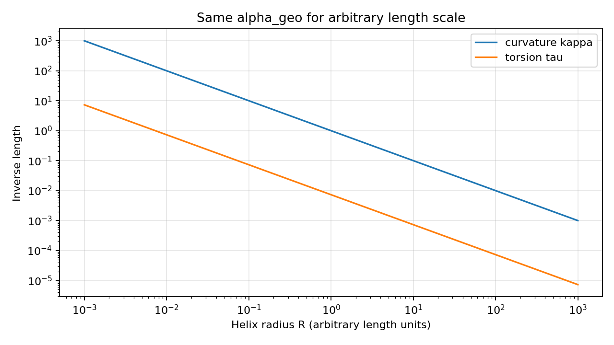
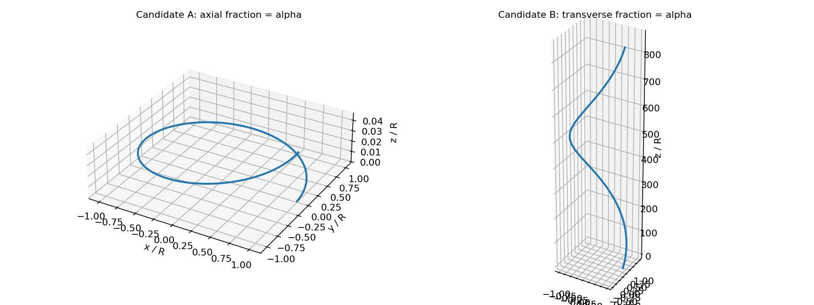
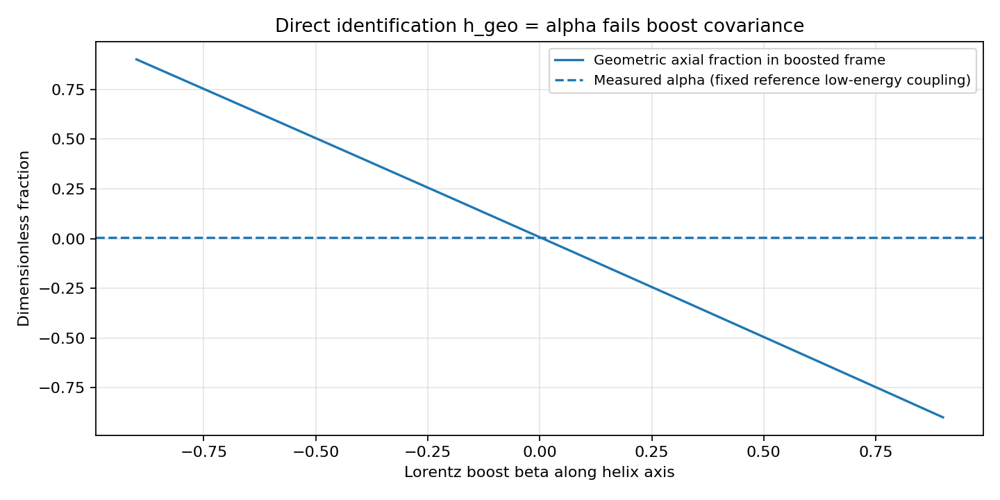
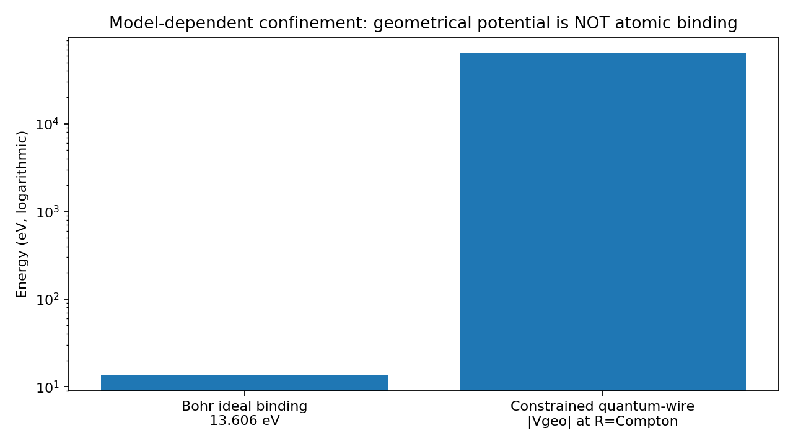

# ROOT V132：空间光速螺旋、曲率挠率封装与精细结构常数

**副题：只有 c=1 的协变量纲、量子相位、反例与可证伪性**  
**研究专著 · 第一卷 · 2026-11-21**  
研究主题：ROOT 空间螺旋与量子作用量尺度的条件性联系；标准理论对照；数值计算与数学反证。  
版本说明：可复现研究草稿，并非已经通过同行评审的新物理理论。  

---

## 内容与科学诚实声明

本书研究用户提出的命题：“h 是空间光速螺旋曲率与挠率的封装，而且与精细结构常数有关。”这句话至少有三种可能含义：（1）h 是无量纲几何参数；（2）h 表示一个几何长度或螺距；（3）h 直接等于普朗克常数。三种含义的量纲和实验检验完全不同。为避免符号混用，本书使用 \(h_{\mathrm{geo}}\) 指候选几何封装，\(h_{\mathrm{P}}\) 指普朗克常数，\(\hbar=h_{\mathrm{P}}/(2\pi)\) 指约化普朗克常数，\(P\) 指螺距。所有理论方程只令 \(c=1\)；绝不再同时令 \(\hbar=1\) 或 \(G=1\)。在需要把结果转换成米、焦耳或电子伏时，代码出现 299792458 只是 SI 量纲转换，不是重新引入一个任意自由参数。

数学方面，我们完成了匀速圆柱螺旋的曲率、挠率、反演、标度与 Lorentz 变换的严格推导；提出一组方便组织研究的几何封装记号；并证明在没有额外动力学规则时，纯螺旋几何无法唯一预测精细结构常数。量子方面，我们展示已有 Bohr、QED、量子波导曲率势、挠率规范相位和 Dirac 自旋结构与该提案的联系及冲突。数值方面，使用 CODATA 2022 常数和自动化测试进行独立计算。

科学边界：几何恒等式不是新的场方程；把一个实测数字写入螺旋角度不是预测；对任意模型参数找到一条“符合数据”的曲线不是四力统一。只有当一个协变动力学模型不借助测量值预先调节，就推出 \(\alpha\)、质量谱、量子旋量、规范结构并通过独立实验，才可能形成新的物理贡献。

## 第一章｜符号、量纲与“只有 c=1”

以长度 \(L\)、质量/能量 \(M\) 及时间 \(T\) 表示量纲，采用 \(c=1\) 后，时间可由长度表示，但“质量、长度、作用量”并不会自动变成无量纲。\([\kappa]=[\tau]=L^{-1}\)，\([P]=L\)，\([\hbar]=\text{能量}\times\text{时间}=ML\)（此处质量以能量单位记）。\([G]=L/M\)。\(\alpha\) 不带量纲。\(h_{\mathrm{geo}}\) 若定义为挠率与曲率的比值或归一化组合，也不带量纲。

在 SI 单位，\(h_{\mathrm{P}}=6.62607015\times10^{-34}\,\mathrm{J\,s}\) 是定义值；\(\hbar=h_{\mathrm{P}}/2\pi\) 仍具有作用量量纲。将曲率与挠率简单相加，例如写作 \(h=\kappa+\tau\)，右侧必然带有逆长度量纲，不可能直接等于普朗克常数。写作 \(h_{\mathrm{geo}}=\tau/\sqrt{\kappa^2+\tau^2}\) 可以获得无量纲对象，但这样的选择只是**定义**，并未建立 \(\hbar\) 的起源。

精细结构常数的 SI 标准表达为

\[
\alpha=\frac{e^2}{4\pi\varepsilon_0\hbar c}.
\]

采用 \(c=1\) 的一致单位表示时可写成 \(\alpha=e^2/(4\pi\varepsilon_0\hbar)\)；但电荷、介电常数所用的单位必须随之统一，不能把 SI 数值的 \(\varepsilon_0\) 与速度归一化后的电荷数值任意混用。在 Heaviside–Lorentz 电磁规范下，常写 \(\alpha=e_{\mathrm{HL}}^2/(4\pi\hbar)\)（在相容的场与电荷归一化下）。为了避免任何计量歧义，所有带米和焦耳的数值计算仍执行完整 SI 公式。仅设 \(c=1\) 不改变 \(\alpha\) 的可测无量纲性质。

“唯一常数是 c=1”不等于 \(\hbar\)、\(G\) 或电荷被数学上消除；它意味着光速用作单位标准。有关量子和引力尺度是否可以继续合并，恰恰是需要证明的问题，而不是预先设置的答案。

## 第二章｜三维圆柱螺旋的全微分推导

考虑齐次欧氏空间里一条恒定半径、恒定频率、恒定轴速的轨迹：

\[
\mathbf r(t)=(R\cos\omega t,R\sin\omega t,ut),\quad R>0,\quad\omega>0.
\]

速度、加速度及三阶导数分别是

\[
\begin{aligned}
\dot{\mathbf r}&=(-R\omega\sin\omega t,R\omega\cos\omega t,u),\\
\ddot{\mathbf r}&=(-R\omega^2\cos\omega t,-R\omega^2\sin\omega t,0),\\
\dddot{\mathbf r}&=(R\omega^3\sin\omega t,-R\omega^3\cos\omega t,0).
\end{aligned}
\]

记总速率 \(v=\sqrt{R^2\omega^2+u^2}\)。本项目的**运动学公设**取 \(v=1\)，即 \(R^2\omega^2+u^2=1\)。这是一种模型约束，不代表已经证明所有真实物质粒子的三维位置都沿零间隔轨道运动。

Frenet 曲率定义为 \(\kappa=|\dot{\mathbf r}\times\ddot{\mathbf r}|/|\dot{\mathbf r}|^3\)。根据导数，\(|\dot{\mathbf r}\times\ddot{\mathbf r}|=R\omega^2 v\)，于是

\[
\boxed{\kappa=\frac{R\omega^2}{v^2}}.
\]

Frenet 挠率定义为 \(\tau=(\dot{\mathbf r}\times\ddot{\mathbf r})\cdot\dddot{\mathbf r}/|\dot{\mathbf r}\times\ddot{\mathbf r}|^2\)。代入可得

\[
\boxed{\tau=\frac{u\omega}{v^2}}.
\]

在 \(v=1\) 条件下化为 \(\kappa=R\omega^2\)，\(\tau=u\omega\)。将其平方相加，利用 \(R^2\omega^2+u^2=1\)，严格得到

\[
\boxed{\kappa^2+\tau^2=\omega^2},\qquad
\boxed{\omega=\sqrt{\kappa^2+\tau^2}}.
\]

一般总速率不等于 1 时，正确关系是 \(\sqrt{\kappa^2+\tau^2}=\omega/v\)，因此 \(\omega=v\sqrt{\kappa^2+\tau^2}\)。这是严密的三维几何恒等式，不需要任何电荷、量子假设或大统一群。

还可推出角频率的反演：给定 \(\kappa>0\)、\(\tau\)，有 \(\omega=\sqrt{\kappa^2+\tau^2}\)、\(u=\tau/\sqrt{\kappa^2+\tau^2}\)、\(R=\kappa/(\kappa^2+\tau^2)\)。因此曲率挠率这两个有量纲量，在指定速率、朝向和螺旋类型之后，可以完全恢复圆柱螺旋的局部形状。

## 第三章｜第一条“几何封装”方程

本书定义一个归一化复几何数：

\[
\boxed{\mathcal H_{\mathrm{geo}}=\frac{\kappa+i\tau}{\sqrt{\kappa^2+\tau^2}}}.
\]

它满足 \(|\mathcal H_{\mathrm{geo}}|=1\)，因此位于复平面单位圆上。写成 \(\mathcal H_{\mathrm{geo}}=\cos\theta+i\sin\theta\)，可以取 \(\theta=\operatorname{atan2}(\tau,\kappa)\)。在本模型 \(\kappa\ge0\) 时，\(\sin\theta=u\)、\(\cos\theta=R\omega\)。定义

\[
\boxed{h_{\mathrm{geo}}:=\Im\mathcal H_{\mathrm{geo}}=\frac{\tau}{\sqrt{\kappa^2+\tau^2}}=u}
\]

和 \(\chi_{\mathrm{geo}}:=\Re\mathcal H_{\mathrm{geo}}=\kappa/\sqrt{\kappa^2+\tau^2}=R\omega\)。于是 \(\chi_{\mathrm{geo}}^2+h_{\mathrm{geo}}^2=1\)。这个“封装”能清晰地把两条正交几何分量组织为一个复数，它是一种新记号和研究工具，不是新力的证明。复数单位 \(i\) 在这里表示二维归一化参数空间，而不是已经产生了量子波函数的复相位。

还可以把一圈的曲率和挠率积分用作另一个封装。每一圈角度变化 \(2\pi\)，需时间 \(T=2\pi/\omega\)。弧长 \(s=v t=t\)，一圈弧长 \(L_{\mathrm{turn}}=2\pi/\omega\)。因此

\[
\boxed{\int_{\mathrm{turn}}\kappa\,ds=2\pi\chi_{\mathrm{geo}}},\qquad
\boxed{\int_{\mathrm{turn}}\tau\,ds=2\pi h_{\mathrm{geo}}}.
\]

这两个公式有一个潜在的概念陷阱：当 \(u\ne0\) 时，螺旋转完一圈并未回到原空间位置，因此这不是封闭回路上的规范不变量。它只是一个选定时间区间的实数积分。若要将其解释为可观测量子几何相位，必须进一步给出物理内部态、参考标架及端点识别条件。

特别强调：\(\mathcal H_{\mathrm{geo}}\) 和 \(h_{\mathrm{geo}}\) 并没有提供 \(\hbar\) 的数值。若定义 \(S_{\mathrm{trial}}=\hbar\int\tau ds\)，固然得到作用量量纲，但已经把 \(\hbar\) 放进定义中，不能把这一结果称为“从曲率挠率导出普朗克常数”。

## 第四章｜曲率、挠率、半径和螺距的闭环

由前章的反演，任意 \(\kappa>0\) 和实数 \(\tau\) 可以参数化一条总速率为 1 的螺旋。它的半径与单圈螺距为

\[
\boxed{R=\frac{\kappa}{\kappa^2+\tau^2}},\qquad
\boxed{P=\frac{2\pi\tau}{\kappa^2+\tau^2}}.
\]

因此

\[
\boxed{\frac{P}{2\pi R}=\frac\tau\kappa}.
\]

把曲率和挠率替换为 \((q\kappa,q\tau)\)，其中 \(q>0\)，则 \(\mathcal H_{\mathrm{geo}}\) 完全不变，但 \(R\mapsto R/q\)，\(P\mapsto P/q\)，\(\omega\mapsto q\omega\)。所以 \(h_{\mathrm{geo}}\) 完全不能决定半径或频率的绝对尺度。

**标度退化定理。** 对每个指定的 \(0<\eta<1\) 和任何 \(R>0\)，取 \(u=\eta\)、\(\omega=\sqrt{1-\eta^2}/R\)，就得到一条满足总速率 1、\(h_{\mathrm{geo}}=\eta\) 的螺旋。证明只需要代回 \(R^2\omega^2+u^2=1\) 与封装定义。结论是：固定一个无量纲几何参数并不会自动预测空间的内禀长度、电子质量或 \(\hbar\)。

如果把 \(\eta\) 选成实验值 \(\alpha\)，存在无限多条不同半径的螺旋实现该数字。这个存在性结果容易获得，但不是唯一性或预测性结果。要打破退化，必须从额外作用量、边界条件或实验独立给出尺寸、能量及规范耦合规则。

## 第五章｜精细结构常数的真正定义

精细结构常数描述低能电磁相互作用强度；在 SI 中

\[
\boxed{\alpha=\frac{e^2}{4\pi\varepsilon_0\hbar c}}.
\]

CODATA 2022 推荐 \(\alpha^{-1}=137.035999177(21)\)。将中心值取倒数，得到 \(\alpha=0.0072973525643314245\)，其线性化标准不确定度约 \(1.1183\times10^{-12}\)。这个数字主要来自严格理论与精密实验的交叉核对，不是从本书几何构造得出的。

精细结构常数是无量纲电磁耦合，但在量子场论中存在能标运行。若探测能量从远低于电子质量变到电弱能标，真空极化使有效耦合发生变化。NIST 的概述指出低能约为 \(1/137\)，电弱尺度可接近 \(1/128\)。把某条完全静止不变的空间螺距比例直接当作每个尺度上的 \(\alpha\)，显然无法解释该尺度依赖。一个候选几何统一理论必须从量子涨落计算相应的重整化群流，而不是事后把每一个能标指定为新的螺旋角。

本书会同时使用三个不同的 \(\alpha\)：\(\alpha_{\mathrm{EM}}\) 表示实测电磁耦合；\(\alpha_{\mathrm{geo}}\) 表示从几何定义的某个比例；\(\alpha_{\mathrm{Bohr}}\) 表示玻尔模型轨道速度与光速的比值。旧量子论给出 \(\alpha_{\mathrm{Bohr}}=\alpha_{\mathrm{EM}}\)，但这是在特定库仑势、角动量条件下的已知推导，不能未经说明变成空间螺旋宇宙公设的证明。

## 第六章｜从库仑力与量子作用量推导 α

在非相对论、无限重核、氢原子圆形玻尔轨道的近似中，采用 \(c=1\) 的相容单位，库仑向心条件为 \(mv^2/r=e^2/(4\pi\varepsilon_0 r^2)\)。角动量量子条件为 \(mvr=n\hbar\)。对 \(n=1\)，将 \(r=\hbar/(mv)\) 代入向心方程：

\[
\frac{mv^2}{r}=\frac{e^2}{4\pi\varepsilon_0 r^2}
\quad\Rightarrow\quad
mv^2 r=\frac{e^2}{4\pi\varepsilon_0}
\quad\Rightarrow\quad
\boxed{v=\frac{e^2}{4\pi\varepsilon_0\hbar}=\alpha}.
\]

于是

\[
\boxed{a_0=\frac{\hbar}{m_e\alpha}},\quad
\boxed{\bar\lambda_C=\frac{\hbar}{m_e}},\quad
\boxed{\alpha=\frac{\bar\lambda_C}{a_0}}.
\]

数值 SI 换算得到 \(a_0=5.29177210544\times10^{-11}\) m、约化康普顿尺度 \(\bar\lambda_C=3.86159267435\times10^{-13}\) m。比值与 \(\alpha\) 一致，这是定义和玻尔模型动力学的交叉校验。理想的轨道束缚能量为 \(m_e\alpha^2/2=13.60569312\) eV；真实氢谱还必须加入约化质量、相对论、辐射修正、有限核尺寸等。

需要区分：这一推导开始就使用了电磁耦合 \(e\) 和量子作用量 \(\hbar\)。如果 ROOT 进一步声明 \(h_{\mathrm{geo}}=\alpha\)，至少还要证明几何封装为什么等于此处的 \(e^2/(4\pi\varepsilon_0\hbar)\)。仅仅观察两个无量纲数相等，不能移除原式中的物理输入。

## 第七章｜两个相容却互不等价的 α 螺旋嵌入

从 \(R^2\omega^2+u^2=1\) 得到两种自然但不等价的方式：

**嵌入 A：将轴向速度视为精细结构常数。** 设 \(u=\alpha\)，则 \(R\omega=\sqrt{1-\alpha^2}\)，并有

\[
\boxed{\frac{\tau}{\kappa}=\frac{\alpha}{\sqrt{1-\alpha^2}}},
\quad
\boxed{\frac{P}{R}=\frac{2\pi\alpha}{\sqrt{1-\alpha^2}}}.
\]

当 \(\alpha\simeq0.00729735\)，归一化曲率为 \(\sqrt{1-\alpha^2}\simeq0.999973374\)，轴向进展极慢。每一圈的螺距约是半径的 0.045851 倍，轨迹更接近密集盘绕的螺旋。把该构造与电子自旋联系起来还需考虑刚性旋转的相对论限制与内禀旋量，不应把轨迹直接视为电子实体绕圈。

**嵌入 B：将环向速度视为精细结构常数。** 设 \(R\omega=\alpha\)，则 \(u=\sqrt{1-\alpha^2}\)；从而

\[
\boxed{\frac\tau\kappa=\frac{\sqrt{1-\alpha^2}}\alpha},
\quad
\boxed{\frac P R=\frac{2\pi\sqrt{1-\alpha^2}}\alpha}.
\]

这条轨迹近似沿轴光速前进，每一圈螺距约是半径的 861 倍。它也满足总速率 1，也能够把某个自然几何比例设成实验给出的 \(\alpha\)。两种嵌入的曲率、挠率、螺距和轴向速度巨大不同，因而不能说“总速率为 1 + 精细结构常数无量纲”就唯一确定了一条空间螺旋。

**非唯一性结论。** 只要没有新的独立动力学原则明确指定 \(\alpha\) 对应轴速、环速、坡度、曲率相位、holonomy 还是某个量子耦合的函数，便有无限多种不同模型恰好重现相同数字。因此，下一阶段真正需要的不是搜索更多由 \(\pi\) 组成的闭式拟合，而是由可变分的作用量、规范对称性和量子态结构来确定映射。

## 第八章｜严格 Lorentz 协变性审查

当前三维轨迹的总速度为 1。沿 \(z\) 轴作无量纲速度 \(\beta\) 的 Lorentz boost，坐标变换是 \(t'=\gamma(t-\beta z)\)、\(z'=\gamma(z-\beta t)\)。原轨迹满足 \(z=ut\)，因此 \(t'=\gamma(1-\beta u)t\)。由于横向 \(x,y\) 坐标不变，新的坐标角频率为

\[
\omega'=\frac{\omega}{\gamma(1-\beta u)},
\qquad
u'_\perp=\frac{R\omega}{\gamma(1-\beta u)}.
\]

新的轴向速度由相对论速度合成公式给出

\[
\boxed{u'=\frac{u-\beta}{1-\beta u}}.
\]

在新坐标系中该轨迹仍为总速度 1 的螺旋，于是同样的定义给出 \(h'_{\mathrm{geo}}=u'\)。显然，当 \(u\ne\pm1\) 时，对任意非零 \(\beta\)，通常 \(h'_{\mathrm{geo}}\ne h_{\mathrm{geo}}\)。选定 \(u=\alpha=0.00729735256\)、\(\beta=0.6\)，得到 \(u'=-0.5953091559\)，而 \(\alpha_{\mathrm{EM}}\) 并不因为观察者换了惯性系而改变。

**协变性排除定理（针对直接外部空间轨迹）**：在任意 Lorentz 参考系下，将光速三维螺旋的轴速比例定义为同一个精细结构常数的普适不变量，与 Lorentz 速度合成冲突。证明就是上面的变换公式。它不是对任何“内部空间”理论的全面否定：若螺旋变量属于 Lorentz 标量的内部纤维、并有明确的规范和动力学定义，问题需重新研究。但那时内部变量不能再被当成普通三维空间中各观察者看到的单一外部坐标速度。

还有第二个相对论障碍。把三维轨迹 \((\mathbf r(t),t)\) 当作世界线，在度规号型 \((+---)\) 下，其间隔是 \(ds^2=dt^2-d\mathbf r^2=(1-v^2)dt^2=0\)。有静质量电子的经典质心世界线应是类时的，具有非零固有时。任何将 \(v=1\) 直接解释为电子质心的基本运动方程，都必须面对这一矛盾。相对论 Dirac 理论中的 Zitterbewegung 具有不同的算符含义，不能直接取代为一条经典的无厚度光速实轨迹。

## 第九章｜量子本源：作用量相位而不是单纯轨迹

量子理论的核心输入之一是路径之间的相位关系：\(\mathcal A[\gamma]=\exp(iS[\gamma]/\hbar)\)。从中在适当边界条件下得到干涉、传播子和量子演化。\(S\) 是作用量，而 \(\hbar\) 是把作用量转换成无量纲相位的量尺。无论坐标 \(x^0\) 采用时间还是长度单位，\(\exp(iS/\hbar)\) 必须保持无量纲。

可把三维螺旋的一圈挠率积分写为 \(I_\tau=\int\tau ds\)。它也无量纲。于是可定义候选相位 \(\phi_\tau=q_\perp I_\tau\)，其中 \(q_\perp\) 是横向内部模式携带的无量纲“自旋/转动荷”。该相位是否能够被干涉仪测到取决于横向模式是否保留、路径是否形成可观测闭合回路、标架选择与干涉参考臂等额外信息。

若有人写 \(\hbar=mR^2\omega\) 并宣称求出了 \(\hbar\)，则必须解释 \(m\)、\(R\)、\(\omega\) 如何独立预测，以及为什么所有粒子的对应关系都得到同一普适量尺。仅凭 \(R^2\omega^2+u^2=1\)，无法确定 \(mR^2\omega\) 的数值；任意改变 \(R\) 便可让它连续变化。即使强行选取 \(R=\hbar/m\)，也是把欲求常数作为半径的定义重新输入，构成循环论证。

量子现象还包含非交换的算符代数 \([\hat x,\hat p]=i\hbar\)，自旋 \(1/2\) 的旋量变换，Born 概率规则和量子关联。周期性轨迹或者复平面单位圆本身不能推出这些结构。理论需要给出希尔伯特空间、幺正表示、局域场与相互作用的明确公设或更底层动力学。

## 第十章｜弯曲量子波导：几何确实能够改变能谱

把粒子局限在弯曲细管中的量子问题是已建立的研究领域。在强横向束缚、非简并标量横向基态和适当光滑条件下，薄层量子化给出有效一维 Hamilton 算符

\[
\boxed{H_{\mathrm{eff}}=-\frac{\hbar^2}{2m}\frac{d^2}{ds^2}-\frac{\hbar^2\kappa(s)^2}{8m}}.
\]

第二项称为曲率诱导的几何势。这是几何与量子动力学发生真实联系的例子，但是它明确包含 \(\hbar\) 和 \(m\)，并且是已有理论结果。在该非简并标量模式的最低阶局部 Hamilton 算符中，挠率不必出现。若强行给每一种波导模式都添加 \(\tau^2\) 势，就会与特定的严格量子约化结果冲突。

对具有简并横向模式的波导，法平面标架的旋转可以生成与挠率有关的有效规范联络。模式指标可令有效导数呈现 \(D_s=\partial_s+i q_\perp\tau(s)\) 的结构，具体符号依约定和内部态选择而变；其平行传输相位类似 \(\exp(iq_\perp\int\tau ds)\)。当路径闭合并有合适的端点识别时，这类 holonomy 可以引起干涉。这为 ROOT 建立“曲率决定标量几何势、挠率关联内部模式规范相位”的研究映射提供了可验证的物理类比。

但必须分清“某种受限量子材料里的有效规范场”与“真空中的基本电磁场”。从波导的几何规范联络到 QED 的基本规范耦合，还差电荷量子化、规范场自身动力学、虚过程及重整化等关键步骤。

## 第十一章｜精算反例：康普顿半径上的几何势有多大？

为检验数值尺度，选用上面嵌入 A，且**人为指定**螺旋半径 \(R=\bar\lambda_C=\hbar/m_e\)（理论单位 \(c=1\)）。这不是由几何公式得到的半径预测，而是示例参数。该螺旋曲率 \(\kappa=(1-\alpha^2)/R\)。代入薄层量子化的标量几何势：

\[
|V_{\mathrm{geo}}|=\frac{\hbar^2}{8m_e}\frac{(1-\alpha^2)^2}{R^2}
=\frac{m_e}{8}(1-\alpha^2)^2.
\]

将该能量单位转换为 eV，得到约 \(63868.07\) eV，也就是约 63.868 keV。相比理想无限重核玻尔束缚能量 \(13.60569\) eV，高出约 4694 倍。

这个数值差异**不是**对所有空间螺旋假设的普遍排除，因为量子波导近似用于受限粒子，真实原子电子并不自动满足该约束，场的自能基准也不能随意对比；它的意义是：不能把已有的几何势公式简单套入康普顿螺旋后，就宣称已经导出氢原子结合能。任何希望靠曲率产生电子原子谱的模型，都必须提供正确的边界条件、势能基准、耦合方式及数值谱线。

进一步，量子波导的正则约化依赖导管宽度远小于曲率半径与相关波长等条件。若设想的“电子环路”只有约化康普顿尺寸，必须讨论相对论、反粒子自由度以及单粒子薛定谔描述是否仍有效。混用不同物理近似往往能产生好看的数字关系，却不能构成可靠的推导。

## 第十二章｜自旋一半与螺旋模型的决定性区别

在 Dirac 理论中，自旋一半源于 Lorentz 群及其双覆盖群的旋量表示。旋量旋转 \(2\pi\) 后可能变号，\(4\pi\) 后回到初态，这与物体沿圆周轨迹转一圈的普通几何位置变化不是同一回事。电子的磁矩因子也体现内禀旋量和量子辐射修正，而非简单带电质点经典绕圈。

采用 \(c=1\)、保留 \(\hbar\) 的表示，Dirac 方程可写 \((i\hbar\gamma^\mu D_\mu-m)\psi=0\)。其中 \(D_\mu\) 含电磁和自旋联络，\(\gamma^\mu\) 满足 Clifford 反对易代数。在局域时空曲率中，\(\not D^2\) 与拉普拉斯算符、Ricci 标量和规范场强之间存在 Lichnerowicz 型关系。这说明量子自旋与几何场强确实具有深刻联系，但它属于既有的规范几何，不是从“曲率挠率封装”自动推出。

如果 ROOT 设想内禀螺旋产生自旋，则必须回答三个问题：为什么最低稳定表示是半整数而非所有整数？为何在磁场中得到正确的旋量耦合和 \(g\) 因子？它如何在无静态轨迹解释的情况下与费米子交换反对称和自旋统计定理相容？仅拟合螺旋半径和频率通常无法解答。

## 第十三章｜从类比迈向统一：要构造哪一个作用量？

建立真正理论可从现有低能有效场论的结构出发，将背景时空、三种规范场和物质场一并表示为

\[
S=\frac1{16\pi G}\int d^4x\sqrt{-g}\,\mathcal R + S_{SU(3)}+S_{SU(2)}+S_{U(1)}+S_{\mathrm{fermion}}+S_{\mathrm{Higgs}}+S_{\mathrm{int}}.
\]

在这个表达中，\(\hbar\) 保留于量子路径积分 \(e^{iS/\hbar}\) 与量子算符里；只取 \(c=1\)。这只是一种已有理论的组织方式，不是新的大统一场方程。若引入内部几何场 \(n(x)\) 或曲率挠率比 \(h_{\mathrm{geo}}(x)\)，需要为它提供独立的、局域 Lorentz 协变且规范不变的拉格朗日密度，并证明稳定性与因果性。

一种**形式性探索**是令内部标量 \(\varphi\) 控制电磁耦合：\(\alpha^{-1}(\varphi)=\alpha_0^{-1}+f(\varphi)\)，再与内部几何角 \(\theta\) 建立作用量耦合。这种做法可以建立“几何影响电磁常数”的研究模型，但同时引入了新函数或参数。在没有具体对称性固定 \(f\)、没有动力学产生 \(\alpha_0\) 的情况下，这样的表达不能算无参数预测。它还可能导致等效原理偏离、时间变化常数和第五力，必须与已有实验约束比较。

更强的候选必须在**不同惯性参考系和不同电磁探测尺度**下预测相同的已知规律：局域 QED 运行耦合、轻子磁矩、原子精细结构、中微子和标准模型反常抵消等。只要无法兼容这些基础数据，就不应继续堆叠更多粒子尺度的几何拟合公式。

## 第十四章｜精细结构常数的能标运行是硬性约束

\(\alpha\) 的常见低能值约为 \(1/137\)，但这不是所有能量区间的唯一耦合数值。对单种带电狄拉克费米子，在远高于其质量、合适重整化方案的一圈 QED 近似中，\(d\alpha/d\ln\mu\approx 2\alpha^2/(3\pi)\)。完整标准模型的运行包含带电粒子阈值、电弱混合及更高阶修正。

假设 \(h_{\mathrm{geo}}\) 是纯几何且处处固定的空间螺旋坡度。如果直接设 \(\alpha(\mu)=h_{\mathrm{geo}}\)，就必须解释为什么测量能标改变时 \(\alpha\) 会改变。可能的物理方向包括：内部几何的有效参数随能标重整化；不同模式贡献有效作用量；或 \(h_{\mathrm{geo}}\) 仅与某个确定重整化尺度的 \(\alpha\) 相联系。任何一种都要求新的具体场论，而非单一静态比例公式。

对于精密预言，还必须区分经典光学/电磁几何相位与量子电磁耦合常数。几何相位可以取决于波导形状、曲线绕数、横向模式和外部条件；低能精细结构常数却具有普适且高度精密的实验约束。如果模型允许随样品几何形状轻易改变“电子电荷常数”，通常就与已知普适性不符，除非这只是在描述材料内部的有效参数而非真空基本常数。

## 第十五章｜无量纲引力参数与四力统一的边界

仅设 \(c=1\)，引力中的常见无量纲量为 \(\alpha_G(m)=Gm^2/\hbar\)。对于电子，其 SI 对应数值写作 \(Gm_e^2/(\hbar c_{\mathrm{SI}})\)，数值在 \(10^{-45}\) 量级。这与 \(\alpha\simeq7.3\times10^{-3}\) 之间存在极大层级差异。把二者通过 \(\kappa,\tau\) 比值联系起来，可以写出无限多量纲正确的函数，但没有独立动力学就无法决定哪一个正确。

之前 ROOT 使用 \(G=2Z/c\)，当 \(Z:=Gc/2\) 是一个定义时，它并没有推导 \(G\) 的来源。现在只设 \(c=1\) 后，公式成了 \(G=2Z\)，仍是同一个定义的改写。类比地，从 \(\alpha=\bar\lambda_C/a_0\) 推导出一种等价形式不等于解释基本电荷；几何封装 \(h_{\mathrm{geo}}=\tau/\sqrt{\kappa^2+\tau^2}\) 也不等于独立预测 \(\alpha\)。

完整四力统一至少要包含：正确的 Lorentz 与广义协变性、\(SU(3)\times SU(2)\times U(1)\) 规范结构、手征粒子谱、规范反常抵消、可重现的量子低能极限、引力动力学、能动量守恒、粒子质量与混合，并且产生独立可证伪预言。若提出更大规范群，还必须解决质子衰变、阈值修正与新增粒子搜寻约束。这个门槛不能靠整理更多代数等式越过。

## 第十六章｜从定义到定理：验证矩阵

为避免“方程漂亮”与“理论正确”混淆，我们为每条核心关系建立四层验收标准。层次 A：纯数学恒等式，在明确假设下解析推导，符号和随机数检查通过。层次 B：给定模型的计算结果，可以数值复现，但输入可能来自实验。层次 C：可辨识性与独立预测，不可使用同一数据同时拟合和验收。层次 D：经过外部真实观测、误差和系统效应约束。这四层任何一步都不能用下一级测试替代。

**A1** \(R^2\omega^2+u^2=1\) 是输入约束，不能算“已经证明宇宙真实速度总为 1”。**A2** \(\kappa=R\omega^2\)、\(\tau=u\omega\) 是在 A1 和恒定螺旋定义下的数学定理。**A3** \(\kappa^2+\tau^2=\omega^2\)、\(h_{\mathrm{geo}}=u\) 是 A2 的推论。**B1** 若选择 \(h_{\mathrm{geo}}=\alpha_{\mathrm{EM}}\) 作为参数设定，则数值自然相等；这不能算预测。**A4** 此认同在普通外部三维轨迹的 Lorentz boost 下变化，是对普适不变性主张的反例。**D1** 目前不存在以这套关系为基础、在不固定 \(\alpha\) 的情况下成功预测 \(\alpha\) 精密测量的独立实验记录。

**B2** \(a_0,\bar\lambda_C,\alpha\) 的标准关系可在独立代码中重新计算，但不意味着它们来自曲率挠率。**B3** 薄层量子势模型中的巨大康普顿尺度几何能，是模型误用风险提示，不构成一项新的基本粒子质量测量。**C1** 要打破模型退化，至少需要一个独立于精细结构常数测量的几何预测，例如某类高精度装置的几何相关能级差，并排除常规波导几何势和电磁背景。**C2** 对真正粒子场，需要协变、规范不变且可量子化的作用量，不能只提出三维路径。

附带重要逻辑规则：数据样本太小或没有记录误差模型时，应当使用“尚不能判断”，而非“完全正确”。程序测试只验证实现符合写下的公式；如果公式作为自然理论是错误的，完美的软件测试也不会让物理理论变正确。

## 第十七章｜数值精算：常数输入与数据独立性

本轮采用 NIST/CODATA 2022 参考值：\(\alpha^{-1}=137.035999177(21)\)。从这一数值直接取倒数，得到 \(\alpha=0.0072973525643314245\)。\(\hbar\) 由定义的 \(h_{\mathrm{P}}\) 计算；在 SI 中 \(h_{\mathrm{P}}=6.62607015\times10^{-34}\,\mathrm{J\,s}\)。电子质量采用 2022 推荐中心值 \(m_e\simeq9.1093837139\times10^{-31}\,\mathrm{kg}\)。\(\bar\lambda_C\simeq3.86159267435\times10^{-13}\) m；\(a_0\simeq5.29177210544\times10^{-11}\) m。理想玻尔能量 13.60569312 eV。

两个几何识别分支都作为固定公式计算，不从任何新实验读取几何数据。分支 A 的 \(\kappa R=1-\alpha^2=0.999946748645552\)、\(\tau R=\alpha\sqrt{1-\alpha^2}=0.007297158264790744\)。分支 B 的 \(\kappa R=\alpha^2\)、\(\tau R=\alpha\sqrt{1-\alpha^2}\)。两者挠率的无量纲数值巧合相同，这是因为交换两个正交速度分量时，它们的乘积 \(uR\omega\) 不变；曲率和轴速却不同。观测一个单独挠率数值仍然不能唯一分辨这两个嵌入。

本书还给出 \(\alpha\) 的线性化不确定度传播。若 \(y=\alpha^{-1}\)、\(\sigma_y=2.1\times10^{-8}\)，则 \(\alpha=1/y\)、\(\sigma_\alpha\simeq\sigma_y/y^2\simeq1.1182784\times10^{-12}\)。将数字传播到候选 \(\tau/\kappa=f(\alpha)=\alpha/\sqrt{1-\alpha^2}\)，求导 \(f'(\alpha)=(1-\alpha^2)^{-3/2}\)，便可在明确仪器噪声的前提下得到传播误差。相比实验对 \(\alpha\) 的高精度，纯粹从图形上“看起来几乎一致”远远不够。

另一个重要事实是标准物理常数之间的相关性。CODATA 推荐常数来自共同调整，不能把所有推荐值当作相互独立的实测量，使用它们的代数定义后再声称“多个独立实验预测成功”。真正独立的检查应当有新平台、新物理量和清晰的误差协方差矩阵。

## 第十八章｜符号推导与随机性质测试

几何推导可以通过 SymPy 将参数 \(R,\omega,u\) 保持为独立符号，计算一、二、三阶导数与 Frenet 公式，再施加 \(R^2\omega^2+u^2=1\)。本包的 `src/root_v132.py` 负责数值计算，`tests/test_v132.py` 包含 43 项独立测试方法；其中额外包含 2,000 组随机螺旋几何性质检查和 500 组 Lorentz boost 检查。测试随机种子固定，以保证复现。

不能把 43 项程序断言称为 43 条新物理定律。自动化测试只覆盖规定数学模型、特定数值范围、边界及反例；任何现实应用都要求额外的实验建模。测试中特别检查：当 \(\alpha\) 被选为轴向比例时，改变半径 500 倍仍有完全相同的 \(h_{\mathrm{geo}}\)；当改变观察者的 boost 时，原封装比例不保持不变。这两类性质测试相互独立地指出“数值巧合”及“协变性缺口”。

测试还检查两种封装识别、螺距、积分扭转角、康普顿比例、薄层势 \(R^{-2}\) 标度、\(h_{\mathrm{P}}=2\pi\hbar\)、不同自旋模式的单位模 Wilson 相位、挠率手征翻转以及边界条件不成立时的错误捕获。脚本把精算结果写入 `data/calculation_results.json`，并生成 `helix_parameter_scan.csv` 与 `boost_scan.csv`，配合图像可追溯每个显示数字的来源。

在求解广义内部空间模型之前，建议先把这些轻量级测试变成无法绕过的预注册门槛：任何新方程如果宣称只用一个实测常数生成所有其他量，须列出显式输入、隐含先验、单位约定、失败时的判决规则和独立预测对象。如果出现 Lorentz 非不变、量纲不一致或者只是在符号上替换已知定义，应当停止声称“重大突破”，回到作用量层面修正模型。

## 第十九章｜怎样设计真正能够证伪的实验？

第一类实验是**几何受限量子波导**。改变曲率 \(\kappa\)，保持其他制备条件尽量不变，比较能谱和电流响应。已有 da Costa 势预测一个 \(-\hbar^2\kappa^2/(8m)\) 型项；若有简并横向模式，挠率可能产生有效规范相位。此类结果有现实材料物理意义，但不能直接替代真空精细结构常数测量。应先把标准波导模型作为零假设，再要求 ROOT 给出一项它无法产生的额外差异。

第二类实验是**不同法向标架和内部模式的几何相位**。同一条曲线在不同横向态上可以给出不同的挠率敏感度。纯粹非简并标量基态的局部 Hamilton 算符可能完全没有挠率项，而简并态可以形成非平凡规范联络。若 ROOT 对所有模式都预测统一的挠率势，其预言就可被这一区别检验。因螺旋单圈路径通常不闭合，实验必须提供真实闭合回路或明确的端点干涉连接。

第三类实验是**普适常数与局部几何的解耦**。设想在可控纳米螺旋中测得几何依赖的相位，不能自动将相位变化解释成真空 \(\alpha\) 改变。若理论宣称真空电磁耦合直接被这些几何参数决定，则应该同时预测独立精密原子钟、电子磁矩与散射实验中的相同常数变化，并服从非常强的既有限制。

第四类是**相对论协变性测试**。不是让宏观材料高速移动，而是理论上检查局域有效作用量是否在惯性系变换下保持形式一致。对于普通外部光速螺旋，\(h_{\mathrm{geo}}=u\) 已有严格的 boost 反例；任何声称更高层次内部模型修复这一问题的版本，必须明确区分坐标速度与内部 Lorentz 标量，并给出从内部态到实验可观测量的映射。

## 第二十章｜量子 Berry/Wilczek–Zee 联络的研究路线

几何相位的基本思路是：如果 Hamilton 算符依赖缓慢变化的外部参数 \(\lambda\)，系统绝热演化时可以在动力学相位之外获得几何相位。对于非简并态 \(|n(\lambda)\rangle\)，Berry 联络写作 \(\mathcal A_i=i\langle n|\partial_{\lambda_i}n\rangle\)，闭合参数路径的相位为 \(\gamma=\oint\mathcal A_i d\lambda_i\)（模 \(2\pi\)）。简并态推广成矩阵值的 Wilczek–Zee 联络与路径有序指数。这些是既有量子理论中的结构，并非从经典轨迹的空间螺旋自动得到。

在细量子波导中，横向法平面随弧长转动，其连接常与 Frenet 挠率有关。当简并横向基态被保留时，内部态基底的协变导数可以产生与 \(\tau(s)\) 有关的有效规范势。若存在可物理辨识的封闭路径与内部模式，holonomy 将是有意义的可测对象。2026 年有关 torsion-induced gauge structure 的研究正讨论这类机制，它为探索几何和量子之间的有限、可检验桥梁提供了具体途径。

然而，一个简单量子波导 holonomy 是在给定 \(\hbar\)、既有 Hamilton 算符与外部制备的条件下求得的。它不能作为“曲率和挠率生成普朗克常数”的证明。若试图把 \(2\pi\alpha\) 当作一个环绕周期的几何相位，那么必须证明其观测模式、路径闭合及规范不变性，并且在不知道实测 \(\alpha\) 的条件下，独立预测其数值。

## 第二十一章｜关于“最伟大核心方程”的研究裁定

如果把**数学层面**的最佳封装列为候选，现阶段最简洁的是

\[
\boxed{
\mathcal H_{\mathrm{geo}}(\kappa,\tau)
=\frac{\kappa+i\tau}{\sqrt{\kappa^2+\tau^2}},\qquad
|\mathcal H_{\mathrm{geo}}|=1
}
\]

以及在速度归一化圆柱螺旋模型内

\[
\boxed{\omega=\sqrt{\kappa^2+\tau^2},\qquad
\Im\mathcal H_{\mathrm{geo}}=u,\qquad
\frac{P}{2\pi R}=\frac\tau\kappa.}
\]

如果把**物理层面**需要验证的联系列为候选，则应写成显式的实验残差，而不是直接宣布等号已被证明：

\[
\boxed{\Delta_\alpha=\frac\tau{\sqrt{\kappa^2+\tau^2}}-\frac{e^2}{4\pi\varepsilon_0\hbar}\quad(c=1)}.
\]

只有当两边是由独立物理机制和独立测量确定的量、并且对惯性系不敏感时，\(\Delta_\alpha=0\) 才具有物理检验意义。目前若在建模之初就选择 \(u=\alpha\)，则残差为零只是定义的结果，没有独立证据。并且对外部三维光速轨迹，boost 反例表明它不能作为普适 Lorentz 标量。更严格的未来形式须把外部坐标比例换成内部协变场理论的不变量。

若所谓“h 的本源”是指 \(h_{\mathrm{P}}\)，那么本轮没有从 \(\kappa,\tau\) 推出它。若“h 的本源”是指 \(h_{\mathrm{geo}}\)，本轮已经给出明确几何定义、反演和解析证明。若意图是找到 \(\alpha\) 的精确物理起源，则本轮给出了主要阻碍和可证伪路线，尚未完成最终答案。科学进步的一种形式是证明某条直觉路线上隐含着无法消除的自由度，并据此排除错误路线。

## 第二十二章｜可证伪量的最小预注册模板

预注册研究不应写“用尽一切算法找到吻合”，而应写明：理论参数从何而来、预测量是什么、在什么条件下宣布失败。对量子波导类比，预注册版本可固定横向束缚方式、曲线半径、弧长、横向模式及能谱测量方式；用标准受限 Hamilton 算符计算一个零假设数据集；再提供 ROOT 独立产生的新项以及其预测能谱偏移。留出部分器件和数据集不能参与新项系数的拟合。

对“几何生成真空 \(\alpha\)”的强主张，预注册必须更加严格：首先给出完全确定的内部几何和参数，不使用 CODATA 的 \(\alpha\) 设置螺距、角度、绕数或模式参数；其次计算出的 \(\alpha\) 必须具备明确的重整化能标与不确定度；再次在独立电子磁矩、原子反冲、量子 Hall 等实验中符合相同耦合常数约束。如果只能通过事后修改几何映射来适应每个实验，就没有可证伪内容。

为了保护研究的可信度，实验方案还应规定阴性结果如何公开：若粒子质量谱、Lorentz 不变性或已知 QED 关系失败，则需要标注该具体版本“被数据排除”，不能用更改参数的方式将原始预注册结论改成成功。新版本可以继续研究，但应保留版本日志和真实失败记录。

## 第二十三章｜研究版本之间的逻辑关系

此前 ROOT V119–V126 建立了若干 Yukawa 第五力的离散谱反演和观测一致性检验；V127–V131 更多研究量子相位、曲率联络、标准模型反常、大统一规范耦合以及粒子阈值。这些领域的数学工具都具有独立的意义，但它们不会自动因为出现在同一 ZIP 中就形成一套不含额外输入的“终极理论”。

本轮 V132 返回更基础的提问：一个空间螺旋的曲率和挠率能否承载量子作用量尺度与精细结构常数？答案分三层。第一层：可以组织成明确定义的无量纲几何复数及积分。第二层：可以在受限量子波导中产生已有的几何势与条件性的有效规范相位。第三层：尚不能从普通三维光速螺旋独立预测 \(\alpha\) 或 \(\hbar\)；而把轴向速度直接当作普适 \(\alpha\) 与 Lorentz 变换冲突。研究应当以这一分界作为后续实验和理论工作的起点。

并非每次版本升级都应增加一个新的基本粒子、任意耦合或自由函数。更有希望的路线是以一套尽可能小的内部自由度和协变作用量为基础，提出能在实验上与 QED/GR 区分的单一、明确预言。若不能产生这种预言，理论应当被标识为“几何类比/解释性数学模型”，而非已经得到四力统一。

## 第二十四章｜全书结论：数学已闭环，物理仍需独立证据

**第一，几何定理已证明。** 设 \(v=1\)，恒定圆柱螺旋有 \(\kappa=R\omega^2\)、\(\tau=u\omega\)、\(\omega^2=\kappa^2+\tau^2\)。归一化复数 \(\mathcal H_{\mathrm{geo}}\) 封装了正交分量，与速度的几何分解完全一致。半径与螺距可从 \(\kappa,\tau\) 反演。所有结果在明确的运动学假设下成立。

**第二，与 \(\alpha\) 的等号不是独立预测。** 无论选 \(h_{\mathrm{geo}}=\alpha\) 还是 \(\chi_{\mathrm{geo}}=\alpha\)，都可以构造满足光速约束的螺旋。选择本身没有解释 \(\alpha\) 从何而来。对外部空间三维轨迹，前一种直接认同还存在明确的 Lorentz 协变性反例。因此，在新的内禀协变机制得到证明前，不应把它作为已发现的自然常数定律。

**第三，\(h_{\mathrm{geo}}\) 不等于 \(h_{\mathrm{P}}\)。** 几何比例无量纲，普朗克常数具有作用量量纲。把 \(\hbar\) 插入一个挠率积分能得到作用量，但不是 \(\hbar\) 的来源。若要独立求出 \(\hbar\)，理论必须增加可检查的物理机制、固定的尺度和不依赖 \(\hbar\) 输入的预测程序。

**第四，真实量子几何相互作用是存在的。** 曲率可导致受限量子运动的标量几何势，在适当简并内部模式下挠率可产生有效规范联络及可观测 holonomy。它们是可以严谨研究的桥梁，但适用领域和假设必须写清，不能直接称为真空 QED 或基本粒子统一。

**第五，四力大统一仍是开放问题。** V132 没有推出正确的三代粒子谱、重整化群、引力尺度、\(G\) 或量子引力的全套动力学，也没有通过新的独立精密实验。它提供了较为明确的数学封装、反例和后续研究门槛，这些是可以实际复现的科学进展。

## 附录 A｜核心方程速查

1. 单一单位选择：\(c=1\)，保留 \(\hbar,G\)。
2. 三维螺旋：\(\mathbf r(t)=(R\cos\omega t,R\sin\omega t,ut)\)。
3. 光速约束：\(R^2\omega^2+u^2=1\)。
4. 曲率：\(\kappa=R\omega^2\)。
5. 挠率：\(\tau=u\omega\)。
6. 频率：\(\omega=\sqrt{\kappa^2+\tau^2}\)。
7. 几何复封装：\(\mathcal H_{\mathrm{geo}}=(\kappa+i\tau)/\sqrt{\kappa^2+\tau^2}\)。
8. 几何虚分量：\(h_{\mathrm{geo}}=\tau/\sqrt{\kappa^2+\tau^2}=u\)。
9. 几何实分量：\(\chi_{\mathrm{geo}}=\kappa/\sqrt{\kappa^2+\tau^2}=R\omega\)。
10. 半径反演：\(R=\kappa/(\kappa^2+\tau^2)\)。
11. 单圈螺距：\(P=2\pi\tau/(\kappa^2+\tau^2)\)。
12. 一圈扭转积分：\(\int_{\mathrm{turn}}\tau ds=2\pi u\)；注意单圈不构成闭合空间回路。
13. 精细结构常数：\(\alpha=e^2/(4\pi\varepsilon_0\hbar)\)，仅设 \(c=1\) 并要求电荷单位一致。
14. 玻尔关系：\(\alpha=\bar\lambda_C/a_0\)，\(\bar\lambda_C=\hbar/m_e\)，\(a_0=\hbar/(m_e\alpha)\)。
15. Boost 变换：\(u'=(u-\beta)/(1-\beta u)\)。
16. 受限粒子几何势：\(V_{\mathrm{geo}}=-\hbar^2\kappa^2/(8m)\)，在特定非简并薄层条件下成立。
17. 路径相位：\(e^{iS/\hbar}\)；这个公式把 \(\hbar\) 作为输入。
18. 引力无量纲参数：\(\alpha_G=Gm^2/\hbar\)。
19. 候选检验残差：\(\Delta_\alpha=h_{\mathrm{geo}}-\alpha_{\mathrm{EM}}\)，只有独立测得左右两边才有证伪意义。

## 附录 B｜与本书对应的验证文件

- `src/root_v132.py`：全部核心几何与常数计算，开头写明单位约定。
- `tests/test_v132.py`：43 项新测试，其中还包含 2,000 条随机几何性质、500 条 Lorentz 变换性质。
- `scripts/generate_results.py`：生成 CSV、JSON 和四张可视化图。
- `data/calculation_results.json`：精算结果的可复算机器格式。
- `data/helix_parameter_scan.csv`：无量纲角度和挠率扫描。
- `data/boost_scan.csv`：Lorentz boost 反例扫描。
- `figures/two_equally_valid_alpha_embeddings.png`：同一 \(\alpha\) 的两种不同螺旋嵌入。
- `figures/lorentz_boost_counterexample.png`：\(h_{\mathrm{geo}}\) 非普适不变量。
- `figures/model_dependent_geometric_potential.png`：模型依赖几何势尺度。
- `figures/scale_degeneracy.png`：固定无量纲 \(\alpha\) 时绝对尺度不唯一。

## 附录 C｜参考文献及适用范围

1. NIST/CODATA 2022 fundamental constants：https://physics.nist.gov/cuu/Constants/ 。精细结构常数、电子质量和标准数据。
2. NIST, Current advances: The fine-structure constant：https://physics.nist.gov/cuu/Constants/alpha.html 。电磁耦合、Bohr 速度类比和运行耦合的概述（部分历史性 SI 叙述应以当前 CODATA 为准）。
3. CODATA 2022 常数推荐论文：https://www.nist.gov/publications/codata-recommended-values-fundamental-physical-constants-2022 。
4. R. C. T. da Costa, Quantum mechanics of a constrained particle, *Physical Review A* **23**, 1982 (1981 publication listing)：https://journals.aps.org/pra/abstract/10.1103/PhysRevA.23.1982 。曲率诱导势和受限量子系统。
5. Xu-Yang Hou, Xianlong Gao, Hao Guo, *Torsion-induced gauge structure in curved quantum waveguides* (2026)：https://arxiv.org/abs/2606.03725 。非简并标量态与简并内部态的挠率区别。
6. *Quantum mechanics of particles constrained to spiral curves with application to polyene chains*, Journal of Molecular Modeling (2024)：https://pmc.ncbi.nlm.nih.gov/articles/PMC11217072/ 。受限曲线上的量子动力学应用。
7. *Determination of the fine-structure constant with an accuracy of 81 parts per trillion*, Nature 588 (2020)：https://www.nature.com/articles/s41586-020-2964-7 。独立精密精细结构常数测量实例。

这些文献支持已建立的数学和物理背景，不支持“ROOT 已经从曲率挠率推导出 \(\alpha\)”之类更强断言。本书的“几何封装”主要是定义与研究组织方法，其额外物理内容必须通过独立预测检验。

---

**书稿完成说明。** 这是可出版扩写的第一卷研究专著草稿。用户提出的“一亿字”属于远超单次可可靠生成和校验的规模，本卷没有用重复扩写、伪造结果或无意义填充凑字数；另附长期出版蓝图。未来每一卷应明确新定理、反例、实验或复算贡献，接受逐卷修订和同行核验。
